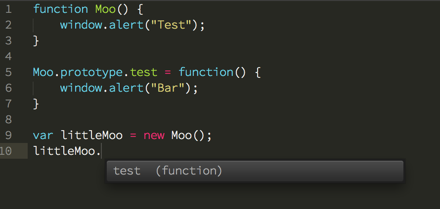

### Sent to you by Thiago Silva via Google Reader:

## 

[Mikko Ohtamaa: Javascript autocompletions and having one for Sublime Text 2](http://opensourcehacker.com/2013/03/04/javascript-autocompletions-and-having-one-for-sublime-text-2/)

via [Planet Python](http://planet.python.org/) on 3/4/13

  

[Autocompletion](https://en.wikipedia.org/wiki/Autocompletion#In_source_code_editors) is major software development productivity booster in modern programming text editors. This article discuss about Javascript autocompletion and how to make Sublime Text 2 editor to support them. If you are not familiar with Sublime Text 2 please see my earlier post [what Sublime Text 2 is all about and how to tune it to be a superior programmer’s tool](http://opensourcehacker.com/2012/05/11/sublime-text-2-tips-for-python-and-web-developers/). Please note that information here applies to Sublime Text 2, [Sublime Text 3 is underway](http://www.sublimetext.com/blog/articles/sublime-text-3-beta) (most ST2 plugins are open source and can be easily upgraded for ST3 compatibility).

## Table Of Content

[1. Why autocompletion for Javascript is so hard](http://opensourcehacker.com/category/python/feed/#Why_autocompletion_for_Javascript_is_so_hard)

[2. Introducing type information into Javascript](http://opensourcehacker.com/category/python/feed/#Introducing_type_information_into_Javascript)

[3. JsDoc directive scanning](http://opensourcehacker.com/category/python/feed/#JsDoc_directive_scanning)

[4. TypeScript definitions and language](http://opensourcehacker.com/category/python/feed/#TypeScript_definitions_and_language)

[5. SublimeCodeIntel plug-in and OpenKomodo CodeIntel](http://opensourcehacker.com/category/python/feed/#SublimeCodeIntel_plug-in_and_OpenKomodo_CodeIntel)

[6. Sublime Text 2 and CTags](http://opensourcehacker.com/category/python/feed/#Sublime_Text_2_and_CTags)

[7. Manually generating autocompletions for your favorite Javascript project](http://opensourcehacker.com/category/python/feed/#Manually_generating_autocompletions_for_your_favorite_Javascript_project)

## 1. Why autocompletion for Javascript is so hard

Javascript does not have Java-like [static typing](http://en.wikipedia.org/wiki/Type_system#Static_typing) system, meaning that it’s not possible to know what’s the type variables of like *this*, *$*, *jQuery*, etc. until the code is actually executed in the web browser. In statically typed systems like Java you declare the type of the variables when you introduce them, like *int i* or *MyClass foo*. In Javascript you have only *var* or *let*. This makes Javascript lighter to write, but it also effectively means that during writing the code the information about the variable contents is not really available. Thus, your text editor cannot know how to autocomplete your typing because it cannot know what autocompletions there are available.

What makes things even more worse and sets Javascript apart from Ruby and Python is the lack of native support of classes and modules. [Prototypial inheritance](http://en.wikipedia.org/wiki/Prototype-based_programming) gives great freedoms – leading to the sad state of the things that each Javascript framework has invented their own way to declare classes, modules and namespaces. There isn’t one right way, but many incompatible ways. Thus, there is no single solution to extract the classy type information, even run-time.

## 2. Introducing type information into Javascript

There exist several ways to annotate Javascript source code or overlay type information over it. By using these type hints your text editor can know that *$* is actually jQuery and can guess what kind of functions it could provide.

First of all, most text editors have their own type information format and files which are generated from the source code or entered as manually maintained files. Examples include [Sublime Text 2 .sublime-completions files](http://docs.sublimetext.info/en/latest/reference/completions.html) and [Aptana Studio Javascript autocompletions](http://stackoverflow.com/a/1352017/315168). To make the editor support autocompletion one needs to integrate a source code scanner plug-in which extracts the type information and turns it to the native symbol database format supported by the editor.

Please note that autocompletion is not the only reason to have static typing support or type hinting. When project size and number of developers grow, static typing becomes more and more preferable as it decreases the cognitive load needed to work with the codebase, reducing human errors.

## 3. JsDoc directive scanning

[JsDoc](http://code.google.com/p/jsdoc-toolkit/w/list) is a loosely followed convention to annotate Javascript with source code comments to contain references about packages, namespaces, singlentons, etc. Basically you write something like *@class foo.bar.Baz* in */\*\* \*/* comment blocks and it is picked up. JsDoc was originally created to generate [Javadoc](https://en.wikipedia.org/wiki/Javadoc) like API documentation for Javascript projects. If you have any self respect you document your source code with comments.  Do this by following the JsDoc best practices and you’ll be lucky and the same type information can be utilized for generating autocompletions too.

JsDoc class and namespace hints are especially needed when you are using something like [RequireJS](http://requirejs.org/) for defining your modules. This is because naive source code scanners have very hard time to determine module exports and classes from this kind of source code and as far as I know, no IDE supports RequreJS natively yet.

Note that personally I prefer superior [JsDuck](https://github.com/senchalabs/jsduck/) over JsDoc for actual HTML documentation generation.

## 4. TypeScript definitions and language

With some bad rap due to its owner, Microsoft, TypeScript is an open source project to provide type information for Javascript. TypeScript comes with two “modes” of operating.

The less invasive approach is to  provide type information in externally typed interface files ([example .ts for jQuery](http://typescript.codeplex.com/SourceControl/changeset/view/d397c54a55db#samples/jquery/jquery.d.ts)).

Move invasive, but easier to maintain approach is to write your source code in [TypeScript language itself](http://www.typescriptlang.org/Samples/) which compiles down to Javascript and .ts type information files. TypeScript language is a Javascript superset, so all Javascript is valid TypeScript. TypeScript adds optional support for classes, modules and static typing of variables. The TypeScript compiler will detect if you are trying to mix wrong types or using missing functions and gives a compiler error at the compile phase, when generating JS from TS.

[Sublime Text 2 has a plugin to support TypeScript based autocompletions](https://github.com/raph-amiard/sublime-typescript).

## 5. SublimeCodeIntel plug-in and OpenKomodo CodeIntel

[OpenKomodo](http://www.openkomodo.com/) is a software repository for the open source parts of ActiveState’s [Komodo Edit](http://www.activestate.com/komodo-edit) editor. It has a subsystem called CodeIntel for autocompletion and source code symbol scanning.

What makes CodeIntel interesting from the perspective of Sublime Text 2 is that CodeIntel is 1) open source 2) written in Python, making it easy to integrate with the Python based plug-in system of Sublime Text 2. Thus, there exist [SublimeCodeIntel](https://github.com/Kronuz/SublimeCodeIntel) plug-in.

CodeIntel has [a Javascript scanner](https://github.com/Kronuz/SublimeCodeIntel/blob/master/libs/codeintel2/lang_javascript.py). Based on its source code, [it should provide JsDoc @class decorator support](https://github.com/Kronuz/SublimeCodeIntel/blob/master/libs/codeintel2/lang_javascript.py#L88). However, I have never managed to get it working and [there is an open stackoverflow.com question how to make SublimeCodeIntel to work with JsDoc directives](http://stackoverflow.com/q/11360659/315168). All help welcome.

## 6. Sublime Text 2 and CTags

[Exuberant CTags](http://ctags.sourceforge.net/) is a generic “tag” type information extractor backend for various programming languages. As the name implies, it was originally created to autocomplete C source code. Sublime Text 2 has support for CTags with a plug-in which [is called CTags](https://github.com/SublimeText/CTags).

I have not used this plug-in myself, so I hope someone can comment how well it works with Javascript autocompletion.

## 7. Manually generating autocompletions for your favorite Javascript project

Though not so advanced approach, this gave me a wow effect and motivation to write this blog post (instead of sitting under a palm tree sipping caipirinhas). I came across [this little Python script](https://github.com/mrdoob/three.js/blob/master/utils/sublime.py) in [Three.js](https://github.com/mrdoob/three.js/), a 3D engine for WebGL and Javascript.

Three.js has invented yet another Javascript class system of their own. But instead of using JsDoc *@class*, *@module* or *@package* like annotations they have a custom Python script which scans the Javascript codebase using regular expressions. Regexes match Three.js custom class declarations and then the script generates Sublime Text 2 autocompletion file based on the results. Crude, but apparently seems to work.

I recommend check the source code and see how you could apply this for your own little project if you are a major Sublime Text 2 user. The approach is not limited to Javascript, but should work for any dynamically typed language where you have control over how you define your namespaces.

[[anexo ausente]](http://feeds.feedburner.com/mFabrikWebAndMobileDevelopment) [Subscribe to this blog in a reader](http://feeds.feedburner.com/OpenSourceHacker)  [[anexo ausente]](http://twitter.com/moo9000) [Follow me on Twitter](http://twitter.com/moo9000)
 [[anexo ausente]](https://www.facebook.com/pages/Open-Source-Hacker/181710458567630) [Follow me on Facebook](https://www.facebook.com/pages/Open-Source-Hacker/181710458567630)

  

### Things you can do from here:

- [Subscribe to Planet Python](http://www.google.com/reader/view/feed%2Fhttp%3A%2F%2Fplanet.python.org%2Frss20.xml?source=email) using **Google Reader**
- [Get started using Google Reader](http://www.google.com/reader/?source=email) to easily keep up with **all your favorite sites**
