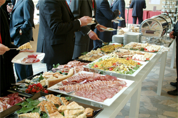

### Sent to you by Thiago Silva via Google Reader:

## 

[Comer na rua pode aumentar obesidade](http://feedproxy.google.com/~r/blogpapodegordo/~3/I_YnKo3-_Zs/)

via [Papo de Gordo](http://papodegordo.mtv.uol.com.br) by ersfilho@gmail.com (Eduardo Sales Filho) on 3/25/13

  

Você é um paulistano que trabalha sem parar e come na rua por falta de tempo pra comer em casa? Além de ser um estereótipo ambulante, você também tem um risco bem razoável de engordar! Ao menos é que o diz uma pesquisa desenvolvida na Faculdade de Saúde Pública da Universidade de São Paulo (USP), que realizou 834 entrevistas em domicílios de todos os cantos da cidade de São Paulo.

Segundo o estudo, que foi aprofundado na dissertação de Mestrado da nutricionista Bartira Mendes Gorgulho e é parte de uma parceria da USP com a Secretaria Municipal da Saúde, cerca de 60% dos paulistanos que comem fora de casa têm problemas ligados aosobrepeso. Mais da metade dos entrevistados costuma se alimentar fora de casa, sendo que 55% desse total chegou a fazer ao menos uma das principais refeições (café da manhã, almoço ou jantar) na rua.

A pesquisa também analisou os alimentos consumidos em cada refeição. No café da manhã, 80% do consumo foi de pães, torradas, manteiga, margarina, café e leite integral. No almoço, 70% do consumo foi de arroz, feijão, carne bovina, verduras, legumes, refrigerantes e aves. Por fim, no jantar, 70% do consumo se concentrou em salgados, sanduíches, arroz, verduras, legumes, carne bovina, aves, refrigerante e suco de frutas.

Quase 60% das pessoas que comem fora de casa têm sobrepeso (número acima da média nacional). Contudo, não há grandes diferenças entre o que se consome na rua ou em casa. Porém, há uma tendência a se ingerir mais gorduras totais e saturadas nas refeições fora de casa, especialmente por conta do consumo de frituras e carnes em geral nos *self-services*, o que poderia ser uma explicação (embora a pesquisa não permita ter certeza quanto a isso).

O fato é que, se você realmente precisa comer na rua por conta da pressa do dia-a-dia, tente pelo menos escolher uma comida saudável para não correr o risco de ter problemas que, no final das contas, podem acabar te impedindo de trabalhar.

—–

**Fonte:**  
[Alimentação fora do lar contribui com a obesidade](http://exame.abril.com.br/estilo-de-vida/saude/noticias/alimentacao-fora-do-lar-contribui-com-a-obesidade)

  

### Things you can do from here:

- [Subscribe to Papo de Gordo](http://www.google.com/reader/view/feed%2Fhttp%3A%2F%2Ffeeds.feedburner.com%2Fblogpapodegordo?source=email) using **Google Reader**
- [Get started using Google Reader](http://www.google.com/reader/?source=email) to easily keep up with **all your favorite sites**
