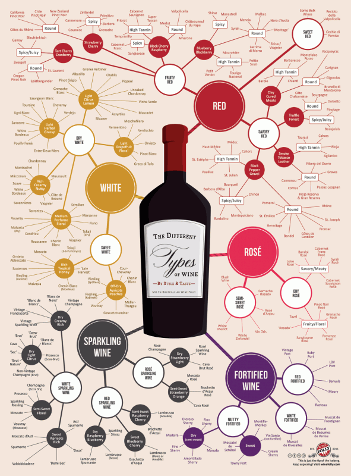
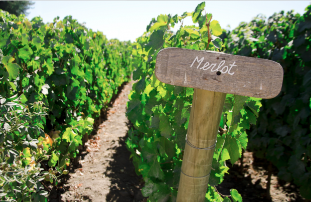
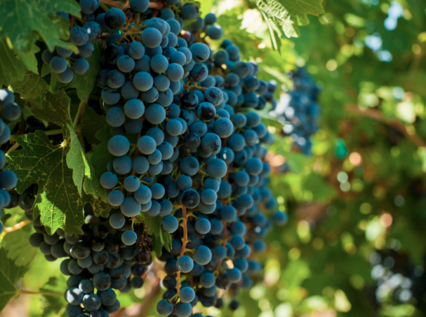

### Sent to you by Thiago Silva via Google Reader:

## 

[As 10 principais uvas tintas do mundo](http://feedproxy.google.com/~r/PapodehomemLifestyleMagazine/~3/bLE_rBcsAt4/story01.htm)

via [Papo de Homem - Lifestyle Magazine](http://papodehomem.com.br) by Daniel Perches on 3/26/13

  

Dizem por aí que se você beber um vinho diferente cada dia da sua vida, não vai chegar nem perto de ter provado todos – e esperamos que você não faça esse experimento antes dos 18 anos, por favor.

É uma infinidade de uvas que existe e para melhorar, praticamente todas podem ser mescladas na hora de fazer vinho. Até branca com tinta, como é feito em regiões da França.

Então, se você tinha a pretensão de ser um profundo conhecedor de todas as castas, esqueça meu amigo. Isso é coisa para maluco.

Mas para não travar e achar que vinho não é para você, que tal começar conhecendo as dez principais uvas tintas do mundo?

Só para ter uma noção do tamanho do enrosco

### Cabernet Sauvignon

É conhecida internacionalmente como a “Rainha das uvas tintas”. É plantada em praticamente todos os países produtores e dela sai um vinho intenso, forte, com bastante [tanino](http://pt.wikipedia.org/wiki/Tanino) e com aromas de groselha, ameixas pretas, amoras, hortelã, pimenta, eucalipto, madeira de cedro, folha de tomate, chocolate preto, mas a principal característica dela é o aroma de pimentão. Sentiu pimentão, muito provavelmente será Cabernet Sauvignon.

### Pinot Noir

Uma das mais famosas, é a uva da [Borgonha](http://pt.wikipedia.org/wiki/Borgonha). Da Pinot Noir é possível extrair grandes vinhos nessa região (e em outras também). Em geral o vinho tem uma cor um pouco mais leve, mais translúcido, mas não se engane pensando que é uma uva leve. É utilizada na produção dos melhores champanhes e vinhos espumantes também.

Tem aromas de framboesa, morango, cereja, grãos de café ou moca.

### Syrah

Também conhecida como Shiraz (principalmente na Austrália), a Syrah faz vinhos densos, ricos, fortes, com bastante álcool e com um toque apimentado que é a característica dela. Dizem por aí que é um vinho que agrada muito às mulheres.

Os principais aromas a serem encontrados num vinho Syrah são: cerejas pretas, groselhas, amoras, ameixas, damascos, pimenta preta, alcaçuz, gengibre, chocolate preto.

### Merlot

Se você assistiu ao filme [Sideways – Entre umas e outras](http://www.imdb.com/title/tt0375063/), vai se lembrar dela. O protagonista não gostava de Merlot. Mas não se deixe levar pela película, porque é só ficção. A Merlot é uma uva que produz vinhos sensacionais, inclusive um dos mais famosos do mundo, o [Petrus](http://pt.wikipedia.org/wiki/P%C3%A9trus_(vinho)) (fala-se Petrús) é feito de Merlot.

Tem aromas de ameixas, amoras, uvas passas, aspargos, chocolate, moca.

### Cabernet Franc

Não confunda com a Cabernet Sauvignon, apesar de serem primas. Essa uva tinta é responsável por fazer parte do “[corte bordalês](http://www.academiadovinho.com.br/_ela_janela_uva.php?num_uva=60)“, ou seja, a típica mistura de vinhos feita em Bordeaux, mas é possível encontrar vinhos feitos só com essa uva. A principal característica é um aroma  e sabor com um toque vegetal muito forte. É praticamente impossível não notar, mas não se preocupe porque é o que dá graça ao vinho.

### Malbec

A mais famosa uva da Argentina, a Malbec é uma uva que tem uma casca muito grossa para resistir às altas temperaturas de lugares como Mendoza, que é um deserto. Por lá se faz muito calor (com certeza mais que no Brasil) e ela precisa sobreviver. Da Malbec saem vinhos encorpados, intensos, daqueles que pintam os dentes.

Os aromas mais típicos são os de frutas vermelhas misturadas com violeta. Se passar por madeira fica ainda mais intenso e, para quem gosta de uma boa carne, é uma excelente combinação.

### Carmenere

A Carmenere é a uva do Chile. Tem uma história bem legal, pois foi esquecida pelo mundo todo e depois foi redescoberta lá no Chile, onde se deu muito bem. Praticamente todos os produtores de lá produzem essa uva e dela saem os mais variados tipos, dependendo de como o [enólogo](http://pt.wikipedia.org/wiki/Enologia) quer fazer. A principal característica dela é um aroma de goiaba intenso. Não que todas tenham, mas é fácil encontrar isso principalmente nos vinhos mais baratos.

### Tempranillo

Difundida no mundo todo, mas originária da Espanha, essa uva é fantástica. É possível provar vinhos totalmente distintos feitos com Tempranillo e se você se aventurar, vai encontrar muitos legais. Não só espanhóis mas feitos no mundo todo, inclusive no Brasil.

### Tannat

Última de nossa lista, a Tannat é famosa no Uruguai e também combina perfeitamente com uma boa carne. Bastante tânica, muitas vezes ela dá aquela sensação de gengiva seca, mas que com um bife ancho tudo se resolve. A gordura da carne é “limpada” pelo vinho e a sensação vai ser fantástica. Frutas vermelhas e um toque terroso, de terra molhada mesmo, é a principal característica.

### Carignan

Essa entrou na nossa lista não por quantidade produzida, mas sim pela qualidade e por ser uma uva muito interessante. Praticamente toda a sua produção é usada para fazer vinho de corte, ou seja, para mesclar com outras uvas, mas se você encontrar um vinho feito só com Carignan, vale a pena conhecer. Tem um toque balsâmico muito legal e muitas vezes lembra aquele Biotônico Fontoura, que você bebia quando era criança, lembra?

Em breve falaremos sobre as uvas brancas, então por enquanto vai degustando essas e a gente volta a conversar em breve.

E aí, pronto para preparar a sua lista de vinhos preferidos?

[anexo ausente]

Artigos Relacionados

- [Estamos bem vestidos e queremos dar-lhes um livro | Fevereiro foi foda](http://rss.feedsportal.com/c/32911/f/530922/s/295114fc/l/0Lpapodehomem0N0Bbr0Cestamos0Ebem0Evestidos0Ee0Equeremos0Edar0Elhes0Eum0Elivro0Efevereiro0Efoi0Efoda0C/story01.htm)
- [Basta! 6 Músicas para você esquecer “We Are The Champions” | Listas descaralhantes #11](http://rss.feedsportal.com/c/32911/f/530922/s/2966f717/l/0Lpapodehomem0N0Bbr0Cbasta0E60Emusicas0Epara0Evoce0Eesquecer0Ewe0Eare0Ethe0Echampions0Elistas0Edescaralhantes0E110C/story01.htm)
- [10 filmes cuja cor exerce um papel fundamental | Listas Descaralhantes #12](http://rss.feedsportal.com/c/32911/f/530922/s/2988df50/l/0Lpapodehomem0N0Bbr0C10A0Efilmes0Ecuja0Ecor0Eexerce0Eum0Epapel0Efundamental0Elistas0Edescaralhantes0E120C/story01.htm)
- [Os melhores brinquedos da tua época](http://rss.feedsportal.com/c/32911/f/530922/s/29cac674/l/0Lpapodehomem0N0Bbr0Cos0Emelhores0Ebrinquedos0Eda0Etua0Eepoca0C/story01.htm)

  
  
[[anexo ausente]](http://da.feedsportal.com/r/161770971367/u/49/f/530922/c/32911/s/2a0494b2/a2.htm)[anexo ausente]

[[anexo ausente]](http://feeds.feedburner.com/~ff/PapodehomemLifestyleMagazine?a=bLE_rBcsAt4:E7yyYRhF4-4:yIl2AUoC8zA)  [[anexo ausente]](http://feeds.feedburner.com/~ff/PapodehomemLifestyleMagazine?a=bLE_rBcsAt4:E7yyYRhF4-4:qj6IDK7rITs) [[anexo ausente]](http://feeds.feedburner.com/~ff/PapodehomemLifestyleMagazine?a=bLE_rBcsAt4:E7yyYRhF4-4:-BTjWOF_DHI)

[anexo ausente]

  

### Things you can do from here:

- [Subscribe to Papo de Homem - Lifestyle Magazine](http://www.google.com/reader/view/feed%2Fhttp%3A%2F%2Ffeeds.feedburner.com%2FPapodehomemLifestyleMagazine?source=email) using **Google Reader**
- [Get started using Google Reader](http://www.google.com/reader/?source=email) to easily keep up with **all your favorite sites**
