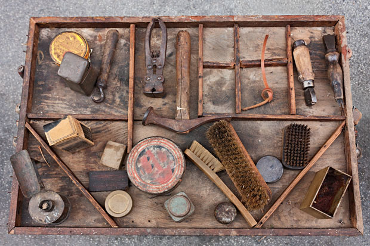
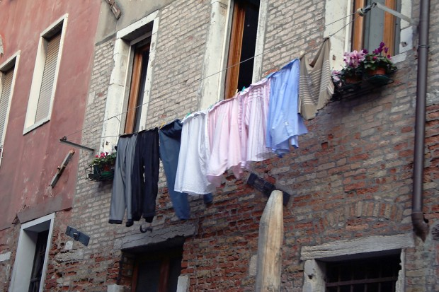

Posso estar indo um pouco contra o senso comum de que “morar sozinho é foda”, mas não é nada disso. É só ler os relatos impressionantes do Alberto Brandão para sabermos que morar sozinho – no início – é realmente complicado.

  

*Obs: o Alberto Brandão escreveu os textos “O que ninguém conta sobre morar sozinho“, “O que ninguém conta sobre morar sozinho – Parte 2” e “Fazendo miojo com água do chuveiro & outras histórias bem pessoais sobre morar sozinho“.*

  

Mas depois que você passa o período de provação, começa a entender o que significa ter total controle sobre sua vida.

  

  
  

O protagonista da própria história, o Rei Conan no próprio lar

  

Morar sozinho, começar a pagar as contas, lavar a própria roupa, saber o que está faltando na cozinha ou o que vai acabar, saber que você tem que desentupir aquela pia ou chamar um bombeiro hidráulico para cuidar daquele vazamento do banheiro que já passou da hora de consertar, faz parte do crescimento e amadurecimento. Ok, quase todo mundo. Afinal de contas, é muito mais fácil pagar uma empregada ou uma diarista que vai se virar.

  

Minha mãe reclamou a vida toda, pros quatro ventos, que os três filhos dela eram “porcos e lambazados”, *“*todos os três*“* ela gostava de enfatizar com meu pai sempre concordando de fundo. Tudo isso por causa de algumas camas desarrumadas, banheiros molhados – quando a gente é criança, banheiro é tipo um parque aquático e nós não fazemos ideia do que é se secar dentro do box – e toalhas em cima da cama.

  

Não éramos tão bagunceiros assim. Um pouco. Eu acho.

  

De qualquer forma, eu sempre a confrontei dizendo que era culpa dela, já que nós crescemos com uma empregada doméstica limpando toda a baderna que fazíamos. Eu dizia que nós havíamos sido criados daquela forma e simplesmente não tínhamos o hábito, não fazíamos de sacanagem. Ela falava que iríamos sofrer demais quando morássemos sozinhos. E que *“um dia vocês vão chorar”.*

  

E nós sofremos. E choramos.

  

Meus irmãos ainda são uns porcos e lambazados, mas eu mudei. Não assim, completamente, mas mudei bastante e aprendi muita coisa. E separei essas coisas que eu aprendi em dicas para você conviver melhor com seus domínios.

  

### Assim como Mufasa ensinou a Simba, conheça seus domínios

  

  
  

Acabou a comida, acabou a bebida, acabou a canja?

  

Durante anos meus pais vinham me visitar ou passar uns dias lá em casa e era sempre a mesma coisa:

  
> *“Pêêêêdro, não tem pó de café?**Tem água sanitária?**Tem açúcar?**Não tem limão?**Tem álcool?”*

  

*“Tem vodka mãe, serve?”*. Eu nunca, ou quase nunca tinha resposta para essas perguntas. Não sabia o que tinha ou não na minha casa, eu simplesmente habitava lá. Além disso, não sabia que dia vencia a conta de luz, o aluguel, o condomínio.

  

Nada.

  

Tudo isso ficava pro meu irmão. Até ele se mudar pra Brasília e eu ter que pedir pelo amor de Deus pro cara da Cemig não cortar a luz. Tinha esquecido completamente que existia conta de luz. Foi nesse dia que **eu resolvi que eu deveria saber de tudo, controlar tudo**.

  

E cara, faz uma diferença incrível. Só o fato de quase nada mais te pegar de surpresa já te deixa muito mais tranquilo. Hoje eu sei qual porta range, qual fechadura está estragada, sei que tal banheiro tem tal problema, sei de tudo que tem ou não tem lá em casa – o que ajuda e muito na hora de fazer compras, acredite em mim.

  

A dica de ouro aqui é: faça uma arrumação em tudo. Mas tudo mesmo. Abra todas as gavetas, todos os compartimentos, cada caixinha de DVD/CD, cada caixa de sapato, cada criado-mudo. **Jogue fora aquilo que você nem lembrava que tinha** e nunca mais precisou e tudo aquilo que julgar irrelevante. Isso vai fazer uma diferença real no seu bolso.

  

Conheça os seus domínios, seja o senhor dele.

  

*Ps: se tiver coisas em bom estado e puder doar, doe.*

  

### Diminua a quantidade de “coisas”

  

  
  

Todo homem deveria saber exatamente quais as ferramentas primordiais pro seu dia a dia em casa

  

De muito longe, a maior dor de cabeça comum a todos os homens solteiros é a pilha de coisas sujas na pia da cozinha. O problema – que ninguém quase nunca percebe – é que a gente normalmente têm coisas demais pra sujar. Tenho certeza que aí onde você mora, tem uma média de cinco copos, duas ou três xícaras, quatro pratos e três ou quatro pares de talheres para cada pessoa. Pensa aí, é ou não é?

  

O que acontece quando você tem uma gaveta lotada de garfos, facas, colheres e pazinhas de patê? O que acontece quando se tem duas pilhas de pratos – rasos, fundos e pequenos? O que acontece quando você tem uma cacetada de copos de requeijão, copos grandes, aqueles bonitos que sua mãe te deu, de uísque, taças, xícaras e canecas? Acontece que você não vai lavar nada(!) até que tenha gasto praticamente tudo. E isso é o que causa a pia lotada de coisas sujas.

  

No apartamento antigo que eu morava, eu fiquei tão puto um dia, que simplesmente estabeleci que teríamos apenas dois de cada um desses utensílios para cada pessoa e um para algum visitante ocasional. Peguei o que sobrou (foi muita coisa) e escondi. Ainda disse que se alguém achasse e pegasse de volta eu iria jogar tudo fora.

  

Funcionou perfeitamente. Não tivemos pilhas de louça suja até nos mudarmos. Porque o que você costuma fazer quando muda? Jogar fora coisas velhas? Nunca. Você costuma comprar mais coisas pra casa nova. E agora temos o dobro de pratos, copos e xícaras.

  

É uma decisão complicada, mas eu te garanto que dá certo. Quando você não tem mais nada, a única opção é lavar. Então nada mais de pilhas de coisas sujas.

  

### Lave sua própria roupa

  

Eu sei que essas dicas, vistas apenas pelo título do tópico, são bem óbvias. Mas cá entre nós, o quão difícil é pra enxergarmos o óbvio?

  

Duas coisas sempre me deixavam maluco em relação à lavagem e “passagem” de roupas: **o tanto de dinheiro que eu gastava com sabão, amaciante e Vanish**. E com a conta de luz, por causa do ferro de passar. Sem contar que a minha diarista quebrou a minha máquina duas vezes. Eu como não sabia de nada, só pagava e reclamava da porra da máquina. Até a diarista tirar licença para ter filho e eu começar a lavar minha própria roupa.

  

  
  

Um homem tem que fazer o que um homem tem que fazer (não, não é a minha casa)

  

Descobri – ligando para minha mãe, obviamente – que você gasta sabão demais mesmo. Aquele *slot* pro sabão em pó da máquina é gigantesco. Depois de constatar isso, ela foi me ensinando a mexer no painel da Enterprise. Duas conclusões foram tiradas.

  

**1.** Dá pra economizar no sabão – é só não fazer a tal da pré-lavagem.

  

**2.** A louca da diarista quebrava a máquina porque colocava 3 toneladas de roupa nela. Quase R$700,00 em conserto de máquina por causa disso.

  

Agora eu não deixo mais ninguém lavar minha roupa. Eu sei quando precisa ou não precisa lavar, espero juntar mais ou menos uma máquina inteira pra lavar – ou seja, não lavo roupa toda hora. E não passo mais roupa nenhuma.

  

Primeiro que eu não sei passar roupa, segundo que eu acho uma das maiores idiotices criadas pela humanidade esse negócio de passar roupa. No dia que eu vi a minha diarista passando um pijama eu fiquei tão doido que eu proibi ela de passar qualquer coisa que não fosse camisa, blusa e calça. Isso por causa dos meus irmãos. Porque, se você usar qualquer roupa por cinco ou dez minutos ela fica sem nenhum amassado.

  

Convenhamos, passar roupa é besteira e só gasta tempo e dinheiro. Eu aboli isso pra mim.

  

### Consuma aquilo que você compra

  

Essa dica e a última meio que se completam.

  

Você já foi aí no supermercado ou na padaria e comprou uma pá de coisas que, uma semana depois, teve que jogar fora? Agora lembre a quantidade de vezes que isso aconteceu. Faça as contas e uma fogueira para continuar queimando sua grana.

  

Eu e meu irmão mais velho sempre fomos assim. Comprávamos um monte de coisas, não passávamos tempo nenhum em casa e tudo fica velho e vencido, jogávamos fora e comprávamos de novo e o ciclo se repetia.

  

Depois de um tempo morando sozinho, você meio que já sabe se ficará em casa tempo o suficiente para consumir aquilo que você compra.

  

Um exemplo: eu voltei a trabalhar e não almoço mais em casa. Eu sei que raramente eu janto, então não trarei muita comida pronta quando for a [Monlevade](http://pt.wikipedia.org/wiki/Jo%C3%A3o_Monlevade). Sacou? Não?

  

Outro exemplo: toda quarta tem a noite do futebol aqui com meu amigo e ele sempre traz alguma coisa pra gente comer, então eu sei que não preciso comprar nada para quarta a noite.

  

Você economiza e diminui muito o seu desperdício de comida.

  

Essa dica é a mais difícil de seguir. As poucas vezes que eu comprei e consumi em dois ou três dias tudo que havia comprado foram de guardar na memória. Toda semana eu tenho que jogar um monte de ‘comida’ fora. Isso acontece muito quando você não costuma fazer comida e costuma comer só coisa pronta ou faz lanche.

  

A minha dica é que você preste mais atenção quando for comprar. Você já vai saber se realmente precisa daquilo tudo por causa da primeira dica lá em cima, então fica tudo mais fácil.

  

### Aprenda a fazer a sua própria comida

  

[*Link Vimeo*](http://vimeo.com/48864768)

  

Eu simplesmente detesto comer em restaurantes no famoso ‘horário de almoço’ que nós, trabalhadores, temos. Restaurante pra mim é almoço de domingo, de negócios ou jantar a dois. Só. Esses baratinhos que a gente come todo dia para economizar e tudo mais você nunca sabe de verdade o que tá comendo.

  

E eu detestava a comida da minha última diarista.

  

Então comecei a aprender a me virar com comida. Eu comecei a comprar, temperar e preparar minhas coisas. Pude ensinar a diarista a melhorar (um pouco). A comida que ela fazia era muito gordurosa.

  

Fazer a própria comida é demais! [Cozinhar é divertido e é recompensador](http://papodehomem.com.br/cozinhar-e-gozar-e-so-comecar/). Além, é claro, de você poder ser um “Cara que Cozinha”, um CqC (sem trocadilho, por favor), está num patamar diferente dos caras que não cozinham. As mulheres admiram, a família admira e até os caras que não cozinham admiram.

  

Temos incontáveis canais de culinária no Youtube – o meu preferido é o [*Sorted Food*](http://sortedfood.com/), incontáveis sites com receitas bacanas (temos dicas sensacionais [aqui mesmo no PdH](http://papodehomem.com.br/secoes/frentes/comida/)), além de livros e cursos que você pode fazer.

  

Fará diferença na auto estima, fará diferença no bolso e o mais importante, fará diferença na sua saúde. Nada mais de delivery naquela noite que você não tem “nada”.

  

\*\*\*

  

Bem, espero que essas dicas possam ajudar.

  

Mais importante que isso é você também dar a sua dica de coisas que podemos fazer para melhorar os hábitos loucos que adquirimos quando moramos sozinhos. O que eu esqueci de falar aqui? Qual seu maior problema aí? Vamos pensar em algo aqui que você possa fazer para resolver isso.

  

Estarei nos comentários, como sempre.

  

*Obs: a terceira e quarta imagens foram pescadaa lá no banco de imagens do Shutter Stock.*

  
[anexo ausente]  
  

Artigos Relacionados

  

[Cocktail de balde: Dr. Drinks mostra como beber em grandes quantidades](http://rss.feedsportal.com/c/32911/f/530922/s/286573bf/l/0Lpapodehomem0N0Bbr0Ccocktail0Ede0Ebalde0Edr0Edrinks0Emostra0Ecomo0Ebeber0Eem0Egrandes0Equantidades0C/story01.htm)

  

[Nova etiqueta para a comunicação no século XXI](http://rss.feedsportal.com/c/32911/f/530922/s/287d9ea3/l/0Lpapodehomem0N0Bbr0Cnova0Eetiqueta0Epara0Ea0Ecomunicacao0Eno0Eseculo0Exxi0C/story01.htm)

  

[A qualidade física: 40 dicas ilustradas para facilitar na hora do vestir](http://rss.feedsportal.com/c/32911/f/530922/s/288b7b26/l/0Lpapodehomem0N0Bbr0Ca0Equalidade0Efisica0E40A0Edicas0Eilustradas0Epara0Efacilitar0Ena0Ehora0Edo0Evestir0C/story01.htm)

  

[All Star Game 2013: o jogo das estrelas da NBA](http://rss.feedsportal.com/c/32911/f/530922/s/28942aee/l/0Lpapodehomem0N0Bbr0Call0Estar0Egame0Enba0E20A130C/story01.htm)

  

[10 obras pra entender melhor a geopolítica: guia prático de leitura](http://rss.feedsportal.com/c/32911/f/530922/s/28dd95a8/l/0Lpapodehomem0N0Bbr0C10A0Eobras0Epra0Eentender0Emelhor0Ea0Egeopolitica0Eguia0Epratico0Ede0Eleitura0C/story01.htm)

  
  
  
[[anexo ausente]](http://da.feedsportal.com/r/159490414363/u/49/f/530922/c/32911/s/291b3ae1/a2.htm) [anexo ausente]  
  

[[anexo ausente]](http://feeds.feedburner.com/~ff/PapodehomemLifestyleMagazine?a=V_jYBjwZPZU:KoYP1Ka2Q74:yIl2AUoC8zA)  [[anexo ausente]](http://feeds.feedburner.com/~ff/PapodehomemLifestyleMagazine?a=V_jYBjwZPZU:KoYP1Ka2Q74:qj6IDK7rITs) [[anexo ausente]](http://feeds.feedburner.com/~ff/PapodehomemLifestyleMagazine?a=V_jYBjwZPZU:KoYP1Ka2Q74:-BTjWOF_DHI)

  
[anexo ausente]  
  
  
  
from Papo de Homem - Lifestyle Magazine <http://papodehomem.com.br/morar-sozinho-e-sensacional/>
