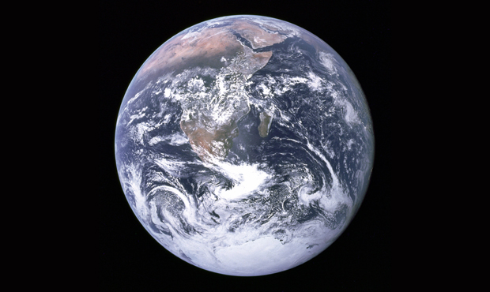

### Sent to you by Thiago Silva via Google Reader:

## 

[The Overview Effect: O planeta visto do lado de fora](http://feedproxy.google.com/~r/PapodehomemLifestyleMagazine/~3/kEaXU1b5tYA/story01.htm)

via [Papo de Homem - Lifestyle Magazine](http://papodehomem.com.br) by Luciano Ribeiro on 3/3/13

  

***Nota do Editor:** Há alguns dias, soltamos por aqui [um texto que fala sobre a expressão sawubona](http://papodehomem.com.br/eu-vejo-voce-pare-tudo-1/), que quer dizer “eu vejo você”. Nele, Orlando Bishop fala um pouco sobre o que isso realmente significa em termos de interação humana. Não deixe de assistir, antes de continuar a ler aqui.*

\* \* \*

É fácil a gente se perder em meio às milhares de ocupações e distrações com as quais entramos em contato todos os dias. É muito fácil sermos tomados por esse fluxo contínuo de atividades e seguirmos focados apenas naquilo que parece mais importante: nós mesmos. É fácil nos desconectarmos e seguirmos pensando que estamos separados, que as ações que tomamos dentro do nosso cercadinho não influenciam quem está ao redor.

Este é um lembrete precioso.

*[Link Vimeo](http://vimeo.com/55073825)*

Quando necessário, sempre tenho de fazer um esforço bem grande para trazer de volta à mente um fato que deveria estar na base dos nossos movimentos: estamos todos conectados.

Às vezes dou sorte e alguma coisa pula na minha frente trazendo de volta essa percepção. Foi o caso deste vídeo, chamado *“The Overview Effect”,* feito pela ocasião dos 40 anos da fotografia *“Blue Marble” –* Bolinha Azul, em tradução livre –, uma das primeiras e mais famosas imagens que temos do globo terrestre.

Caso você tenha chegado até aqui e não tenha dado o play no vídeo lá em cima, vários astronautas dão depoimentos sobre a sensação de estar no espaço e olhar de volta para a Terra. O que é chamado de “Overview Effect”, uma espécie de espanto, admiração, como se finalmente caísse a ficha sobre o fato de que estamos mesmo em um lugar só, na mesma casa. Uma consciência súbita a respeito da beleza e fragilidade das condições que nos mantém vivos.

Espero que consigamos nos lembrar mais vezes disso.

The Blue Marble, tirada em 7 de Dezembro de 1972 pela tripulação da missão Apollo 17, a uma distância de aproximadamente 45.000 km da Terra, a caminho da Lua

[anexo ausente]

Artigos Relacionados

- [Corinthians e Milionários: o jogo que “ninguém viu”](http://rss.feedsportal.com/c/32911/f/530922/s/291b3ae0/l/0Lpapodehomem0N0Bbr0Co0Ejogo0Eque0Eninguem0Eviu0C/story01.htm)
- [O filho eterno (Cristovão Tezza\*) | Livros pra macho #6](http://rss.feedsportal.com/c/32911/f/530922/s/291e1837/l/0Lpapodehomem0N0Bbr0Co0Efilho0Eeterno0Ecristovao0Etezza0Elivros0Epra0Emacho0E60C/story01.htm)
- [Publicidade nas coxas das meninas](http://rss.feedsportal.com/c/32911/f/530922/s/2920f79f/l/0Lpapodehomem0N0Bbr0Cpublicidade0Enas0Ecoxas0Edas0Emeninas0C/story01.htm)
- [Vacine, Bela Infanta e Fragola Sour | Música autoral alternativa #1](http://rss.feedsportal.com/c/32911/f/530922/s/292435ce/l/0Lpapodehomem0N0Bbr0Cvacine0Ebela0Einfanta0Ee0Efragola0Esour0Emusica0Eautoral0Ealternativa0E10C/story01.htm)
- [Artesão, alquimista, transformador: bicicletas feitas com sucata de carros abandonados](http://rss.feedsportal.com/c/32911/f/530922/s/2926951e/l/0Lpapodehomem0N0Bbr0Cartesao0Ealquimista0Etransformador0Ebicicletas0Efeitas0Ecom0Esucata0Ede0Ecarros0Eabandonados0C/story01.htm)

  
  
[[anexo ausente]](http://da.feedsportal.com/r/159490091477/u/49/f/530922/c/32911/s/2928625b/a2.htm)[anexo ausente]

[[anexo ausente]](http://feeds.feedburner.com/~ff/PapodehomemLifestyleMagazine?a=kEaXU1b5tYA:dYOcqdRWdFk:yIl2AUoC8zA) [[anexo ausente]](http://feeds.feedburner.com/~ff/PapodehomemLifestyleMagazine?a=kEaXU1b5tYA:dYOcqdRWdFk:D7DqB2pKExk) [[anexo ausente]](http://feeds.feedburner.com/~ff/PapodehomemLifestyleMagazine?a=kEaXU1b5tYA:dYOcqdRWdFk:qj6IDK7rITs) [[anexo ausente]](http://feeds.feedburner.com/~ff/PapodehomemLifestyleMagazine?a=kEaXU1b5tYA:dYOcqdRWdFk:-BTjWOF_DHI)

[anexo ausente]

  

### Things you can do from here:

- [Subscribe to Papo de Homem - Lifestyle Magazine](http://www.google.com/reader/view/feed%2Fhttp%3A%2F%2Ffeeds.feedburner.com%2FPapodehomemLifestyleMagazine?source=email) using **Google Reader**
- [Get started using Google Reader](http://www.google.com/reader/?source=email) to easily keep up with **all your favorite sites**
