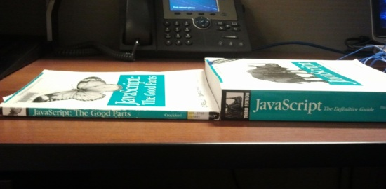

### Sent to you by Thiago Silva via Google Reader:

## 

[JavaScript: o que fazer e aprender para se tornar um desenvolvedor melhor?](http://feedproxy.google.com/~r/tableless/~3/ry-nFyAzcTA/)

via [Tableless.com.br - Web Standards com Arroz e Feijão](http://tableless.com.br) by diego@tableless.com.br (Tableless.com.br) on 3/11/13

  

Não tem como negar, JavaScript é a bola da vez. É a linguagem padrão da web, presente em todos os navegadores e dispositivos do mercado. Hoje em dia temos JavaScript até no servidor.

Neste artigo apresento alguns caminhos a serem seguidos na hora de praticar e aprender mais sobre JavaScript.

## Aprenda JavaScript

Essa é a primeira dica que dou para qualquer desenvolvedor que me pergunta por onde começar para aprender JavaScript. Esqueça jQuery, mootools ou qualquer outro framework. Eles são importantes, mas mais importante ainda é conhecer os conceitos e as particularidades da linguagem.

Como funcionam os frameworks JavaScript? O que acontece por baixo dos panos nos métodos e plugins jQuery? Como é estruturado um framework JavaScript? Responder a essas perguntas é uma excelente maneira de aprender JavaScript.

Você precisa saber que em JavaScript tudo é um objeto, até mesmo as funções. Além disso, não existe o conceito de classes, a herança é feita através de protótipos. Também é importante dominar o funcionamento do escopo em um código JavaScript e entender a importância dos eventos disparados pelo usuário ou por sua aplicação.

*Referências*

- [CodeAcademy](http://www.codecademy.com/tracks/javascript)
- [Eloquent JavaScript](http://eloquentjavascript.net/)
- [JavaScript Avançado](http://js.visie.com.br/)
- [MDN](https://developer.mozilla.org/pt-BR/docs/JavaScript)

## Parte boa vs. parte ruim

O livro *JavaScript: The Good Parts*, de Douglas Crockford, é obrigatório para qualquer desenvolvedor que queira aperfeiçoar sua técnica em JavaScript.

> Seria ótimo se produtos e linguagens de programação fossem desenvolvidos para ter apenas partes boas.  
> – Douglas Crockford

A leitura pode ser difícil em um primeiro momento, mas compensa a medida que você vai se acostumando com a didática do livro. Nele, você aprende desde a gramática da linguagem até padrões avançados de desenvolvimento JavaScript.



Outra parte importante do livro é a que cobre as funcionalidades ruins de JavaScript (as quais, infelizmente, não são poucas). Nenhuma linguagem é perfeita e JavaScript possui algumas particularidades que atrapalham mais do que ajudam – por isso é importante conhecê-las.

*Referências*

- [JavaScript: The Good Parts](http://shop.oreilly.com/product/9780596517748.do)
- [Destroy All Software Talks: WAT](https://www.destroyallsoftware.com/talks/wat)

## Escopo

Entrando na parte técnica da linguagem, é importante entender como funciona o escopo em um código JavaScript. Uma das partes ruins citadas acima (talvez a pior) é justamente o escopo global. Qualquer variável declarada fora de uma função é automaticamente associada ao escopo global da aplicação.

Toda função/bloco JavaScript também cria um escopo próprio. A esse escopo fica associada a palavra especial *this*. Entender o *this* e escopo dentro de blocos é crucial para desenvolver códigos legíveis e organizados.

Outro tópico de destaque é o escopo dentro de funções, também chamado de *closure*. Este é considerado um conceito avançado, no entanto, é essencial para o desenvolvimento JavaScript.

> Closure é um tipo especial de objeto que combina duas coisas: uma função e o ambiente [escopo] no qual essa função foi criada.  
> – Mozilla Developer Network

É ainda muito importante aprender e fixar os conceitos de funções anônimas e funções auto-executáveis. Estes tipos de função garantem uma maior integridade da aplicação, isolando trechos de códigos em escopos próprios.

*Referências*

- [What you need to know about JavaScript scope](http://coding.smashingmagazine.com/2009/08/01/what-you-need-to-know-about-javascript-scope/)
- [JavaScript pra gente grande: entendendo closures](http://rodbv.wordpress.com/2010/09/16/javascript-pra-gente-grande-entendendo-closures/)
- [MDN – Closures](https://developer.mozilla.org/pt-BR/docs/JavaScript/Guide/Closures)
- [Funções bombadas ou (function() { }) ()](http://leobalter.net/desenvolvimento/funcoes-bombadas-ou-function/)

## Eventos

Eventos constituem uma parte importante em JavaScript. O paradigma de desenvolvimento orientado a eventos, quando bem aplicado, pode reduzir a quantidade de códigos duplicados e melhorar a interação entre diferentes módulos de sua aplicação.

A grande maioria dos desenvolvedores já conhece os eventos disparados por ações do usuário (onClick, onBlur, onMouseover, onScroll etc.), no entanto, o que pouca gente sabe é que também é possível criar eventos customizados. Sua aplicação pode disparar eventos no final de uma determinada ação e qualquer código pode escutar e reagir aos eventos disparados.

Por exemplo, um carrossel de imagens poderia disparar um evento *imagechange*. Um menu de vários níveis poderia disparar o evento *submenushow* e por aí vai.

Browsers modernos possuem o objeto *CustomEvent* para a criação de eventos personalizados. Browsers antigos (IE9 e inferiores, principalmente) podem utilizar os métodos do DOM *createEvent* e *initEvent* ou algum plugin/biblioteca (jQuery e o método *trigger*, por exemplo).

*Referências*

- [MDN – CustomEvent](https://developer.mozilla.org/en-US/docs/DOM/Event/CustomEvent)
- [How to create custom events in JavaScript](http://www.sitepoint.com/javascript-custom-events/)
- [Custom events are pretty cool](http://css-tricks.com/custom-events-are-pretty-cool/)

## Prototype

Conforme dito anteriormente, JavaScript não possui classes, apenas objetos (e todo mundo possui como protótipo o objeto *Object*). Isso é um pouco confuso para desenvolvedores acostumados com linguagens onde classes são a base de tudo.

Todo objeto *contructor* (explicando de forma bem básica, uma função “instanciada” via *new*) possui o atributo *prototype*. Este atributo nada mais é do que um ponteiro para um outro objeto. Sempre que tentamos acessar uma propriedade que não existe no nosso objeto atual, é feita uma varredura em toda a cadeia de protótipos do objeto até algum valor ser encontrado ou retornar *undefined*.

Ou seja, dessa forma é possível criar um objeto base, com atributos e métodos comuns a todos os objetos criados a partir dele.

```
function Pessoa (nome) {
  this.nome = nome;
}

Pessoa.prototype.naturalidade = "paulista";

Pessoa.prototype.__unicode__= function () {
  return "Pessoa: " + this.nome + ", " + this.naturalidade;
}

var p = new Pessoa("Davi Ferreira");
p.naturalidade = "carioca";
p.__unicode__(); // "Pessoa: Davi Ferreira, carioca"
```

No exemplo acima criamos o objeto base *Pessoa* que possui o atributo naturalidade com o valor padrão “paulista” e o método ***unicode()***. Depois criamos uma pessoa, armazenando-a na variável *p*, e sobrescrevemos a naturalidade padrão.

O conceito de protótipos oferece uma flexibilidade enorme: toda alteração que você faz em um objeto base reflete automaticamente em todos os objetos criados a partir do seu protótipo.

*Referências*

- [Understanding “Prototypes” in JavaScript](http://yehudakatz.com/2011/08/12/understanding-prototypes-in-javascript/)
- [MDN – Details of the object model](https://developer.mozilla.org/en-US/docs/JavaScript/Guide/Details_of_the_Object_Model)
- [Javascript: A diferença entre Constructor Function e Object Literal](http://klauslaube.com.br/2011/10/23/javascript-constructor-function-object-literal/)

## Performance & Debug

Um lado importante do desenvolvimento front-end, mas muitas vezes esquecido, é a performance.

Vamos utilizar como exemplo os eventos citados acima. Um evento de *mouseover* ou *scroll* mal aplicado pode significar uma performance muito ruim na aplicação. É preciso ter cuidado na hora de estruturar e organizar seu código.

Outros grandes vilões são os métodos *setTimeout* e *setInterval*. Mais uma vez, mal utilizados, eles podem resultar em sites e aplicativos extremamente não performáticos.

É necessário avaliar e realizar testes de performance em diferentes navegadores e configurações para evitar qualquer tipo de gargalo na sua aplicação. Para isso, você precisa dominar ferramentas como o Developer Tools do Google Chrome e a extensão Firebug do Firefox.

*Referências*

- Performance font-end | [Parte 1](http://tableless.com.br/performance-frontend-parte1/) | [Parte 2](http://tableless.com.br/performance-frontend-parte2/)
- [jQuery: dicas de otimização e performance](http://tableless.com.br/jquery-dicas-de-otimizacao-e-performance/)
- [High Performance JavaScript](http://shop.oreilly.com/product/9780596802806.do)
- [A Re-introduction to the Chrome Developer Tools](http://paulirish.com/2011/a-re-introduction-to-the-chrome-developer-tools/)

## ECMA Script

Finalizando, a melhor maneira de se manter atualizado e ligado nas mudanças e novas funcionalidades da linguagem JavaScript é ficar de olho na sua especificação.

JavaScript é, na veradade, um dialeto baseado na linguagem ECMA Script, padrão adotado por Microsoft e Netscape nos primórdios do desenvolvimento web.

Na especificação da ECMA Script você consegue prever mudanças e identificar as novas funcionalidades que serão implementadas nos navegadores e engines web.

*Referências*

- [ECMA Script](http://www.ecmascript.org/)
- [ECMA-262](http://www.ecma-international.org/publications/files/ECMA-ST/ECMA-262.pdf)

O post [JavaScript: o que fazer e aprender para se tornar um desenvolvedor melhor?](http://tableless.com.br/javascript-o-que-fazer-e-aprender-para-se-tornar-um-desenvolvedor-melhor/) foi originalmente publicado em [Tableless](http://tableless.com.br).

[[anexo ausente]](http://feeds.feedburner.com/~ff/tableless?a=ry-nFyAzcTA:p7w5nPvAxgA:yIl2AUoC8zA) [[anexo ausente]](http://feeds.feedburner.com/~ff/tableless?a=ry-nFyAzcTA:p7w5nPvAxgA:D7DqB2pKExk) [[anexo ausente]](http://feeds.feedburner.com/~ff/tableless?a=ry-nFyAzcTA:p7w5nPvAxgA:7Q72WNTAKBA) [[anexo ausente]](http://feeds.feedburner.com/~ff/tableless?a=ry-nFyAzcTA:p7w5nPvAxgA:aKCwKftKxY0) [[anexo ausente]](http://feeds.feedburner.com/~ff/tableless?a=ry-nFyAzcTA:p7w5nPvAxgA:dnMXMwOfBR0) [](http://feeds.feedburner.com/~ff/tableless?a=ry-nFyAzcTA:p7w5nPvAxgA:YwkR-u9nhCs) [[anexo ausente]](http://feeds.feedburner.com/~ff/tableless?a=ry-nFyAzcTA:p7w5nPvAxgA:JEwB19i1-c4) [[anexo ausente]](http://feeds.feedburner.com/~ff/tableless?a=ry-nFyAzcTA:p7w5nPvAxgA:wF9xT3WuBAs) [[anexo ausente]](http://feeds.feedburner.com/~ff/tableless?a=ry-nFyAzcTA:p7w5nPvAxgA:V_sGLiPBpWU) [](http://feeds.feedburner.com/~ff/tableless?a=ry-nFyAzcTA:p7w5nPvAxgA:tYZ39nBRSfM)

[anexo ausente]

  

### Things you can do from here:

- [Subscribe to Tableless.com.br - Web Standards com Arroz e Feijão](http://www.google.com/reader/view/feed%2Fhttp%3A%2F%2Ffeeds.feedburner.com%2Ftableless?source=email) using **Google Reader**
- [Get started using Google Reader](http://www.google.com/reader/?source=email) to easily keep up with **all your favorite sites**
