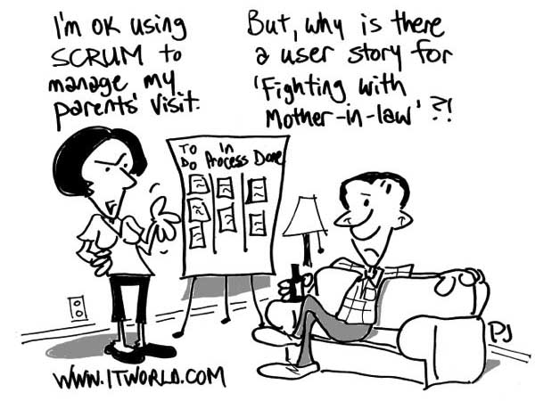

# **W**hy your users hate Agile development (and what you can do about it)

## What developers see as iterative and flexible, users see as disorganized and never-ending**.** Here’s how some experienced developers have changed that perception**.**

**June 04, 2013, 4:45 PM** —

Image credit: ITworld/[Phil Johnson](http://www.itworld.com/it-managementstrategy/289060/you-may-kiss-bride-and-update-scrum-board)

Most software developers I know really like Agile**.** There are a lot of advantages: The iterative process gives developers confidence that the application reflects the users' needs and wants; by tackling one thing at a time, you can make one thing work -- and get feedback on it -- before going on to the next; if something big comes up in one iteration, you can address it before it turns into a hairball**.** Plus, for consultants, iteration implies milestones that can be billed on completion, so you find out about a deadbeat client sooner rather than later**.** I bet you can add to this list**.**

Clients and users, however... not so much**.** Users have their own concerns -- and sometimes Agile developers don't recognize them**.**

If you truly want to build quality software that reflects users' needs (as well as their desires), it behooves you to learn from people who have gained wisdom the hard way**.** Here's their advice.

**[ [What's wrong with agile development: Culture, people top the list](http://www.itworld.com/software/344904/whats-wrong-agile-development-culture-people-top-list)  ]**

## **Users want budget predictability**

Most non-computer businesspeople are already intimidated by spending money on something they don't understand**.** They have to report to someone who wants an answer to, "When will this be ready, and what budget do we need to allocate**?** And incidentally, if it's late, it's your job on the line**.**"

Agile requires a huge leap of faith for clients used to hard budgets and fixed bids, says Dave Hecker, who owns Sagewing, an Agile development software consulting business in Colorado**.** "Clients ask, 'How much will it cost**?**'" says Hecker. An Agile-style answer is frustratingly ambiguous, he points out, along the lines of, "We think we can do it as described in about two months plus one month of bug-fixing so that's about three months unless we choose to make refinements and improve the product along the way, in which case it will be longer**.**"

"Then the client responds, 'Umm… but, how much will it cost**?**' and I begin to hear the anxiety in their voice," says Hecker**.** "They wanted a crystal clear answer to a seemingly simple question, but it's hard to supply that answer because Agile projects are always a shifting sand**.**"

Underlying that uncertainty is a trust issue**.** If the user has worked with a developer for years who reliably delivers what's promised, it's easier to agree to more flexible targeting**.** But if you don't know each other, that's not quite so easy**.**

"The less trust a customer has with you, the more they want to have a plan up front and hold you to that plan," says Joel Semeniuk, EVP at software tools provider Telerik**.** "As you gain that trust, this need goes away and you can begin being more Agile**.**"

Earn trust incrementally, Semeniuk suggests**.** For example, never under deliver on an iteration; always meet expectations**.**

One answer to the "What will it cost**?**" nervousness is to suggest fixed-cost and fixed-duration projects**.** What can be accomplished with that time-and-money might vary, but users get some predictability**.**

Hecker has another technique to help clients work through this anxiety**.** He explains that although the user won't get a hard date for a specific deliverable, the developer will provide ongoing updates about what is to come, and those updates become more accurate as the project goes on**.** Then, he says, "I give examples until they start to get it (hopefully)**.**"

For example, four weeks into a 12-week project Hecker might tell a client, "We are 99% confident we'll hit all your phase 1 requirements by week 8, so we should plan to start bug testing and polishing on week 9**.** We might be able to slip a few more features in if things go well**!**" A few weeks later, at week 9: "The bug testing is going great**.** We have some extra time to add a few more (not too complex) features**.** Which would you like to consider?" The update is transparent when things don't go quite so well, too**.** Hecker might have to say, "The integration with [some API] has turned out to be rather unstable and it's eating a lot of time**.** With only 6 weeks left, we should consider dropping a few features if we want to safely release on time**.** Or, we could extend the schedule by two weeks to accommodate everything**.**"

In both these cases, you notice, the user is in control of the software, the schedule, and the budget consequences**.**

*page 2*

## What developers see as iterative and flexible, users see as disorganized and never-ending**.** Here’s how some experienced developers have changed that perception**.**

## **Users want technology predictability**

The user wants to control far more than the budget**.** Stress levels rise if the software doesn't solve the business need**.** "Scope used to be defined at the beginning of the project, so one knew what would come out at the end of this thing**.** Now we tell them that we make it up as we go," says Thomas Kutschi, a senior manager at Infonova, an Austrian vendor of a telecom business support system platform**.**

There are reasonable technical issues that a wholly iterative approach may not address, Kutschi points out**.** "Agile methodologies leave out huge areas a CTO would be concerned about**.** How do you ensure that the architecture scales**?** How do you balance maintenance versus new features (especially in phased deployments)**?**" Drafting an extensive, detailed requirements document might reveal traps that would appear in an Agile project at a very late stage**.**

But the solutions to users' need for predictability can bring new challenges for all concerned**.**

Detailed designs and planning done prior to a project seems to provide a "safety net" to business sponsors, says Semeniuk**.** "By providing a Big Design Up Front you are pacifying this request by giving them a best guess based on what you know at that time -- which is at best partial or incorrect in the first place**.**" The danger, he cautions, is when Big Design becomes Big Commitment -- as sometimes business sponsors see this plan as something that needs to be tracked against**.** "The big concern with doing a Big Design up front is when it sets a rigid expectation that must be met, regardless of the changes and knowledge discovered along the way," says Semeniuk**.**

Or as Tomasz Smykowski, CEO of Social Media Marketing Agency [Websoul](http://websoul.pl)  in Bydgoszcz, Poland says succinctly: "Agile gives you the ability to make temporary solutions that will eventually be the final ones**.**"

## **You say iterative, they say disorganized and never-ending**

Early in Agile's history, says Semeniuk, many shops saw Agile as an excuse for development teams to avoid providing estimates, documentation, and plans**.** Things are far better, nowadays, but I'd argue that these bad reputations lurk far longer than we prefer -- even in the development community itself**.**

For example, what you see as flexible and responsive your users may see as disorganized**.** Anne Shroeder, the owner of Language Works, a web development company in Maryland, has 17 years of web development experience**.** She's been frustrated by her Agile experiences -- and so have her clients**.** "There is no process**.** Things fly all directions, and despite SVN [version control] developers overwrite each other and then have to have meetings to discuss why things were changed**.** Too many people are involved, and, again, I repeat, there is no process**.**"

"Businesses might be anxious that constant iteration = never-ending," says Josh Oakhurst, from [Skookum Digital Works](http://skookum.com) **.** Sure, to an educated client, "open-ended" is an advantage, with flexibility that can be celebrated**.** But most clients just want to know what they're buying, he says**.** "With Agile, software developers are selling a process, not a product**.**"

"For clients without a defined budget, transparency is key," Oakhurst says**.** "Two or three sprints are planned out in advance (with room to slot in features/fixes of course), and the client has control of the throttle to tell us how far to go or when to stop**.**"

The message, especially for clients with a finite budget (but big wants), is that Agile development puts them in charge of feature requests**.** "If their eyes are bigger than their mouth, they get to be the one to decide which features are must-have," Oakhurst adds**.**

Sometimes that "Agile means disorganization" mindset encourages users and clients to interpret the process as "It's okay to be capricious**.**" Yes, Agile does permit users to swap priorities even towards the end of a big project**.** But developer Sorin Costea observed the downside when things worked smoothly: "These users could not believe there are also limits to the delivery power**.** They could not really grasp velocity or timeboxing, but expected to throw in stories any moment and also get them in time**.**" With the reasoning that, "Hey, we are Agile aren't we**?**"

The "obvious" solution -- easier to say than to implement -- is that all the stakeholders need to understand one another's needs**.** Perhaps more pragmatically, Semeniuk suggests: Allow users to change their minds, he says, but also make it clear what impact this has**.**

*page 3*

## **Culture clash**

Some users are overwhelmed at how collaborative and interactive Agile projects are, Semeniuk says**.** They have jobs to do as well. Your user may be apprehensive, worrying about the increased workload from his project involvement**.** "This is a very valid scenario, and the only consolation is that investment during development will save them a lot of pain as a result," Semeniuk advises**.**

Agile requires a shift of process and relationships**.** "We are taking people from different generations, genders, races, and backgrounds and changing how they do what they do day to day**.** We are asking them, at times, to step outside their comfort zone and communicate in ways many are not accustomed to..**.** especially in IT," says Agile trainer Robert Woods**.** Users now are being asked to collaborate with a developer who can sometimes have zero communication skills**.** (Not that you know anyone who fits that description**.**) "They try to give input but it's not listened to," says Woods**.** "They are asked to review and prioritize a backlog but 'What the heck is a backlog**?**'"

Agile "failures" or "lack of understanding" may not be the user's fault, but rather a response to their business environment**.** For example, I've spoken with corporate users who kept trying to shoe-horn more and more functionality into an initial iteration**.** That sounds like they didn't grok what "iteration" means, when in reality it was a response to their own corporate culture: The users knew full well that the funding would go away after the "first phase," with excuses like, "We'll do that in phase 2, next spring," when history demonstrated that phase 2 never does get funded**.** The developers move onto some other project and the users never get that must-have requirement**.**

## **Know your stakeholders**

Another problem can arise when developers incorrectly identify stakeholders**.** They interview the department managers, who might care about things like reporting and dashboards, but the developers never have the opportunity to talk to the day-to-day users -- say, payroll clerks -- who might have reasonable requests to improve the data entry process**.** To those people, "Agile" is just another way to ignore their needs while claiming that the process is to serve them**.** The solution here for Agile developers: Make sure you talk to all the stakeholders, not just the ones who claim to represent their needs**.** Though this, too, is harder than it initially appears, since it's the managers who sign consulting agreements and paychecks, and they know what the payroll clerks need**.** Sure they do.

But beware: Some stakeholders do lose their power, Kutschi points out**.** "Very technical project managers might not like watching a daily stand-up meeting in complete quietness until being asked a question**.** Or leaving implementation decisions to the developers**.**"

## **Recognize that change isn't easy**

Don't ask for overnight success**.** It may be necessary to adopt Agile techniques gradually**.** "Organizations have to recognize Agile requires change, often a cultural one," says Mike Mikuta, VP of Technology Strategy at [Dynamics Research Corporation](http://www.drc.com/) **.** "Change makes people anxious, therefore organizations should look to implement Agile techniques incrementally, in adaptable chunks, prove success and expand**.**"

Developers have an advantage in that they understand the need to change and the benefits to be gained by it**.** "Software projects are almost impossible to predict anyways, so it's folly to think that the traditional approach doesn't leave much to fate**.** In Agile, we just accept that fact and face it head-on," says Hecker**.** "With enough examples, anxious clients will see that even though they don't know exactly how the project is going to unfold they will always be in the driver's seat and can make decisions along the way**.** At least, most anxious clients will learn that; Agile development isn't for everyone**!**"

|  |  |
| --- | --- |
| Sign me up for ITworld's FREE daily newsletter**!** | |
| Email: |  |
