# 11 Useful JavaScript Tools for Developers

[6](http://codegeekz.com/useful-javascript-tools/#comments)

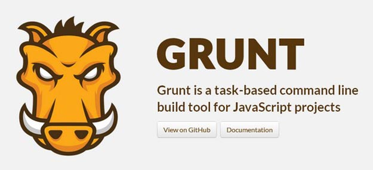

Everyone is aware of JavaScript as it is a powerful client-side scripting language used in many modern websites and Web applications**.** JavaScript is often difficult to author because of the environment it runs in: the Web browser**.** Below I have gathered **11 useful and best JavaScript tools** to help you simplify you development tasks**.** Following JavaScript tools will let you speed up your coding process and help you to achieve desired result in certain deadline**.**

## 1**.** Countable.js

[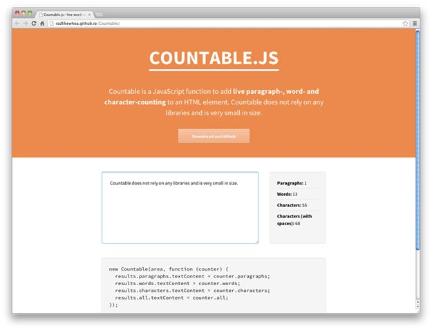](http://codegeekz.com/wp-content/uploads/countable.jpg)

  
 Countable is a tiny and standalone JavaScript function that brings the ability to count all three**.** It works very straightforward and has the option to count the inputs with stripping HTML tags**.**[Source](http://radlikewhoa.github.io/Countable/) 

## Converse. Js

[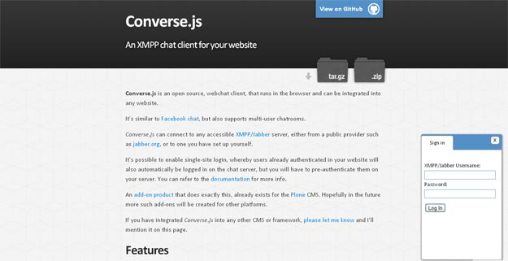](http://codegeekz.com/wp-content/uploads/Converse.jpg)

  
 Converse**.**js is an open source chat application that can connect to any XMPP/Jabber server (like Google Talk, Skype, etc**.**). It sits in the footer of web pages just like Facebook-chat and has support for one-to-one or multi-user conversations**.** Contact requests can be accepted/declined, statuses can be set (online, away..) and there are “typing” notifications to inform the “listening” users**.**[Source](http://conversejs.org/) 

## 3**.** Hitch

[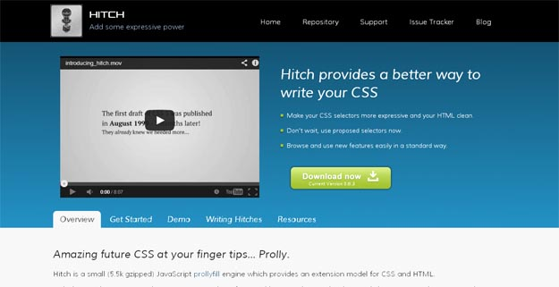](http://codegeekz.com/wp-content/uploads/hitch.jpg)

  
 Hitch is a small (5**.**5k gzipped) JavaScript prollyfill engine which provides an extension model for CSS and HTML**.** Including Hitch in your page lets you import and use features like CSS selectors that have only been proposed or HTML widgetry based on an earlier Web Components proposal (simple microformats which provide an easy uplift to real native when you decide to do so)**.** With Hitch, it is up to you (the author of the page/stylesheet) to determine which features you need, not the user’s particular browser**.**[Source](http://hitchjs.com/) 

## 4. JS Hint

[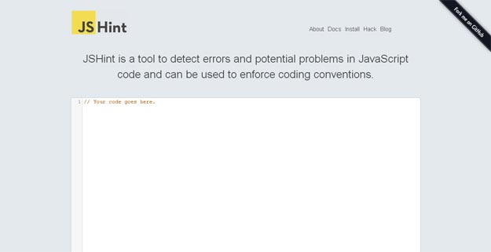](http://codegeekz.com/wp-content/uploads/jshint.jpg)

  
 JSHint is a community-driven tool to detect errors and potential problems in JavaScript code and to enforce your team’s coding conventions**.** It is very flexible so you can easily adjust it to your particular coding guidelines and the environment you expect your code to execute in**.** The goal is to help JavaScript developers write complex programs without worrying about typos and language gotchas**.**[Source](http://www.jshint.com/) 

## 5. Sequel**.**Js

[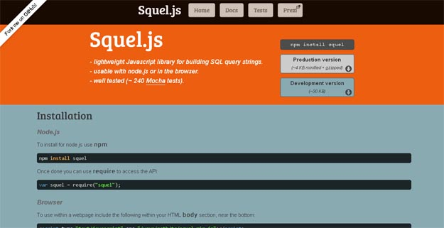](http://codegeekz.com/wp-content/uploads/sequeljs.jpg)

  
 Squel**.**js, a lightweight JavaScript library, helps building SQL query strings very easily through an object oriented API**.** It works both on the browser (not advised as the queries will be visible to all) + with  
 nodejs and supports all standard SQL queries (can be customized to support non-standard queries)**.**[Source](http://hiddentao.github.io/squel/) 

## 6**.** Responsive Nav

[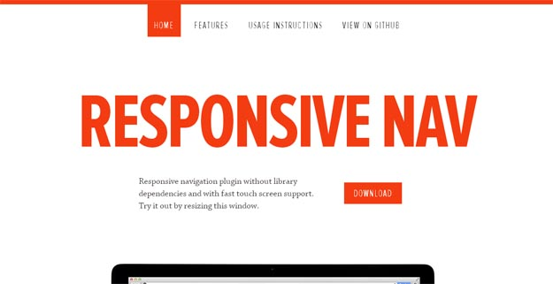](http://codegeekz.com/wp-content/uploads/responsive-nav.jpg)

  
 Responsive-Nav, a JavaScript plugin, simplifies creating such responsive menus with a lightweight footprint (1**.**6kb minified-gzipped)**.** It makes use of touch events and CSS3 transitions for a great performance and works on screen readers + with a JavaScript-disabled state**.** Also, the plugin is standalone and has callbacks for the init, open and close events**.**[Source](http://responsive-nav.com/) 

## 7. amMap

[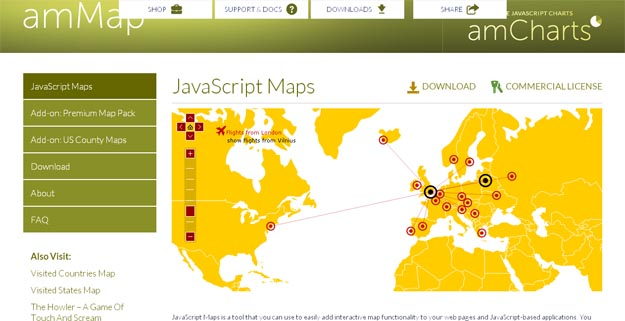](http://codegeekz.com/wp-content/uploads/ammaps.jpg)

  
 amMap is a tool that you can use to easily add interactive map functionality to your web pages and JavaScript-based applications**.** You can use this tool to show locations of your offices, routes of your journeys, create your distributor map, etc**.** Photos or illustrations can be used as layers and backgrounds of maps, so you can make different presentations, e-learning tools and more**.**[Source](http://www.ammap.com/javascript-maps/) 

## 8. Grunt : JavaScript Task Runner

  
 Grunt is a task-based command line build tool for JavaScript projects**.** It has the following predefined tasks that you can use in your project: Concatenate files, Validate files with JSHint, Minify files with UglifyJS, Run unit tests with node unit and etc**.** In addition to the built-in tasks, you can create your own tasks**.** Don’t like a built-in task’s default behavior? Override it**.**[Source](http://gruntjs.com/) 

## 9. Candy : JavaScript Powered Chat App

[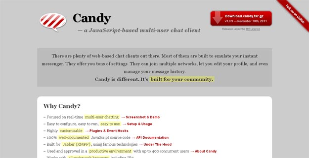](http://codegeekz.com/wp-content/uploads/candy.jpg)

  
 Candy is an open source chat application that is built with JavaScript and makes use of Jabber (XMPP) for real-time communication**.** It has support for multiple rooms, users can be active in any number of rooms, chat publicly or privately and perform all of these in a good-looking, tabbed interface**.**[Source](http://candy-chat.github.com/candy/) 

## 10**.** Roole

[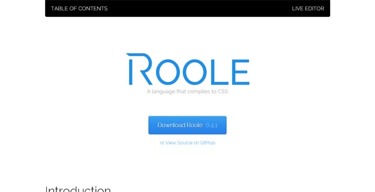](http://codegeekz.com/wp-content/uploads/Roole.jpg)

  
 Roole is another alternative that is inspired from SASS, LESS + Stylus and only requires JavaScript to work**.** It has vendor-prefixing built-in so there is no need to use them, supports variables + conditional logic and allows us to define the format we want to code CSS**.** Roole can work both on the client or server-side (nodejs) and it is documented well**.**[Source](http://roole.org/) 

## 11**.** Radi

[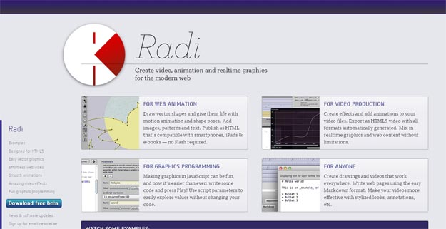](http://codegeekz.com/wp-content/uploads/radi.jpg)

  
 Radi is a complete visual design application targeting web with 100% standard and human-readable HTML + JavaScript code**.** It has built-in tools for creating/editing graphics (they can be imported too) and generating animations with canvas output that work in all modern browsers including mobile**.** There are ready-to-use filters + effects and you can always add your own code to create more customized stuff**.**[Source]( http://radiapp.com/ )
