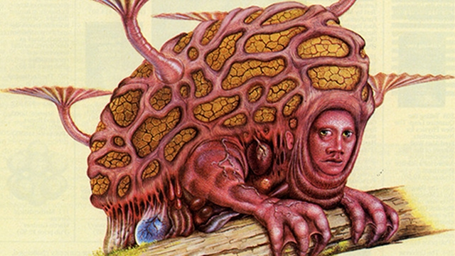
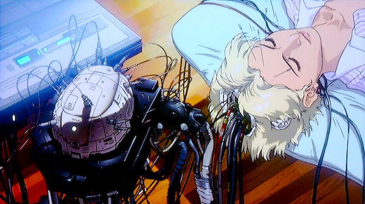

22 de Julho de 2013 

- [Gizmodo US](http://us.gizmodo.com/)

**[**futuro**](http://gizmodo.uol.com.br/futuro/ "futuro")**

# 10 dos cenários futuristas mais bizarros para a evolução da humanidade

##### Por - [George Dvorsky](http://gizmodo.uol.com.br/author/george-dvorsky/ "Posts de George Dvorsky") 12 ago, 2012 - 11:15

[Tweetar](https://twitter.com/intent/tweet?original_referer=http%3A%2F%2Fgizmodo.uol.com.br%2F10-dos-cenarios-futuristas-mais-bizarros-para-a-evolucao-da-humanidade%2F&text=10%20dos%20cen%C3%A1rios%20futuristas%20mais%20bizarros%20para%20a%20evolu%C3%A7%C3%A3o%20da%20humanidade&tw_p=tweetbutton&url=http%3A%2F%2Fgizmodo.uol.com.br%2F10-dos-cenarios-futuristas-mais-bizarros-para-a-evolucao-da-humanidade%2F&via=GizmodoBR)

[0](http://twitter.com/search?q=http%3A%2F%2Fgizmodo.uol.com.br%2F10-dos-cenarios-futuristas-mais-bizarros-para-a-evolucao-da-humanidade%2F)

[anexo ausente][anexo ausente]

|  |  |  |  |  |
| --- | --- | --- | --- | --- |
|  | |  |  |  | | --- | --- | --- | |  | 29 |  | |

|  |  |  |  |
| --- | --- | --- | --- |
| Curtir | 1 | |  | | --- | | Enviar | |

Quando futuristas e autores de ficção científica imaginam os humanos num futuro distante, eles nunca pensam que nossos descendentes serão exatamente como somos agora. Afinal, teremos acesso a ferramentas poderosas que vão nos transformar em ciborgues, ou que vão alterar nosso DNA, então não há limites para a humanidade se reinventar.

Mas quão bizarros poderiam ser nossos descendentes do futuro? Eis 10 das visões mais estranhas de um mundo pós-humano.

*Ilustração inicial por Dougal Dixon, obtida de uma edição dos anos 80 da Omni Magazine, sobre como os humanos seriam em 50 milhões de anos.*

## 1. Reversão voluntária da evolução

")Nada melhor para começar este top 10 que considerar esta possibilidade: nós daremos um enorme passo para *trás*, em vez de evoluir. A involução voluntária é a ideia de que deveríamos recriar a espécie humana, a ponto de não sermos mais avançados o bastante para sermos considerados humanos.

A premissa básica aqui é que os humanos basicamente não prestam, e que nós deveríamos regredir – de um ponto de vista evolucionário – para um estado inofensivo. Ao voltar à era pré-civilização, nós deixaríamos de ser uma ameaça para nós mesmos, para o reino animal e até para o planeta. Esta perspectiva pode ser interpretada como um [ludismo](http://pt.wikipedia.org/wiki/Ludismo) paradoxal e levado ao extremo. Nela, o progresso é medido não pelo aumento e avanço das capacidades humanas, e sim por sua regressão. O objetivo final seria acabar com a civilização e voltar para a selva.

## 2. Extinção voluntária da humanidade

Mas por que parar aí, quando você pode eliminar a própria espécie humana? E o melhor, deixando todos *convencidos* a fazer isto? Este é o objetivo do [Movimento de Extinção Humana Voluntária](http://www.vhemt.org/pindex.htm) (VHEMT), um movimento ativista que trabalha para acabar com a espécie humana, ao nos pedir (muito educadamente) para pararmos de ter filhos.

Armados com o slogan “Que possamos viver muito, e desaparecer” (May we live long and die out), o objetivo do VHEMT é devolver a Terra a seu estado natural e saudável. Com o fim da humanidade, todas as criaturas restantes no planeta poderão ter a liberdade de viver, morrer e evoluir por conta própria. Quem defende o modelo da extinção humana nega ser misantropo: eles apenas querem fornecer uma “alternativa à exploração danosa e destruição indiscriminada da ecologia da Terra”.

## 3. O surgimento do eco-humano

")Alguns futuristas preocupados com o meio ambiente não gostariam de ver a humanidade involuir ou definhar até a extinção – mas eles também não estão convencidos de que podemos lidar com a mudança climática e outros desastres ecológicos. A solução para esses problemas, dizem eles, é fazer os humanos mudarem de forma voluntária, para viver melhor e em harmonia com o planeta.

Em um estudo intitulado “[Engenharia Humana e Mudança Climática](http://www.smatthewliao.com/wp-content/uploads/2012/02/HEandClimateChange.htm)“, os filósofos S. Matthew Liao, Anders Sandberg e Rebecca Roache defendem que humanos deveriam adotar medidas como: intolerância à carne induzida por remédios (já que a produção de carne é excepcionalmente prejudicial ao meio ambiente), olhos de gato geneticamente alterados para reduzir nossa necessidade de iluminação, e redução de nosso tamanho físico para diminuir nossa pegada ecológica (eles recomendam uma redução de 21% na massa dos homens, e 25% para mulheres). Eles também esperam que os humanos terão mais força de vontade própria, o que terá o efeito periférico de aumentar nossa empatia e altruísmo.

## 4. Humanos transgênicos

")Mas por que nos limitarmos a ganhar alguns novos traços, quando podemos pegar emprestado diversas características do reino animal? Tecnologias transgênicas, que permitem a miscigenação genética de humanos e animais, permitiriam uma quantidade quase infinita de híbridos homem-animal.

E há muito a se invejar de nossos amigos não-humanos: cães têm audição e paladar mais aguçados que nós; gatos podem ver no escuro; [alguns primatas possuem melhor capacidade de memorização](http://www.baxterbulletin.com/viewart/20120625/NEWS01/306250010/Apes-monkeys-more-social-smarter-than-previously-thought) que humanos, e aves têm uma visão decididamente notável. Ansiosos pelo dia em que poderemos aplicar modificações transgênicas, muitos aspirantes a trans-humano gostariam de adquirir os olhos de uma águia, as escamas de um lagarto, ou a navegabilidade de cetáceos – imagine poder nadar ao lado de um conjunto de golfinhos.

## 5. Só cérebro, sem corpo

")Esta é a visão clássica de uma humanidade que evoluiu para ter um cérebro gigantesco, em vez de um corpo. Em seu obscuro artigo “[O Homem do Ano Um Milhão](http://davidszondy.com/future/man/man_million.htm)” (1893), H. G. Wells coloca a ideia de que a dependência da tecnologia por parte dos humanos iria resultar simplesmente em uma dependência menor do corpo, e mais do cérebro. Mesmo o garfo e faca mais simples, disse Wells, iriam tornar redundante a mandíbula humana. Conveniências modernas, como transporte motorizado, iriam resultar no desparecimento de pernas, torsos, e praticamente todos os músculos – então nossos descendentes iriam basicamente se tornar cérebros enormes que andam nas próprias mãos.

Mas até que ponto essa visão é realista? De acordo com princípios darwinianos, características físicas começam mesmo a sumir se não forem reforçadas continuamente pela seleção natural. O apêndice humano é um exemplo disso, um caso clássico de “use ou perca”. Mas crânios enormes em forma de bulbo, como os [Talosianos](http://en.memory-alpha.org/wiki/Talosian) de *Star Trek*, são improváveis: afinal, o tamanho do cérebro não é correlacionado com inteligência; além disso, estamos cada vez mais confiando nossos pensamentos a dispositivos externos. Mesmo assim, as cabeças dos americanos [estão ficando maiores com o tempo](http://io9.com/5916629/why-are-american-heads-getting-bigger).

## 6. A Mente Coletiva

")A mente coletiva é retratada pelos humanos insetoides no livro [*Hellstrom’s Hive*](http://www.amazon.com/Hellstroms-Hive-Frank-Herbert/dp/1400135648?tag=gmgamzn-20) de Frank Herbert, ou no infame [Borg](http://en.memory-alpha.org/wiki/Borg) de *Star Trek*. É um possível futuro onde a organização social toma a forma de um superorganismo, bem semelhante a formigas ou abelhas. Nesse estado, a vontade humana individual é suprimida pelas demandas da coletividade, ou por alguma forma de inteligência central mais capaz. Os experimentos totalitários do século XX foram protótipos desta ideia, felizmente limitados pela tecnologia primitiva da época.

Mas olhando para o futuro, é fácil imaginar o medonho prospecto de novos esforços do governo em controlar os pensamentos e ações da população – usando vigilância onipresente e técnicas de controle mental (como nanorrobôs ou hackeando um ciber-cérebro). Mas uma mente coletiva poderia ser vista como algo positivo, um passo à frente para a comunicação humana e organização social: alguns se referem a isto como [cérebro global](http://itc.conversationsnetwork.org/shows/detail3836.html) ou [Noosfera](http://www.december.com/cmc/mag/1997/mar/cunning.html). A grande questão a se levantar, no entanto é: quanto do indivíduo pode se manter em um mar aberto de pensamentos conscientes que concorrem entre si?

## 7. Humanos pós-gênero

")Tecnologias cibernéticas e de reprodução avançada terão um impacto profundo em nossa natureza biológica. Nós somos atualmente limitados pela reprodução sexual: somos uma espécie binária, que consiste em machos e fêmeas. Mas dado o potencial para nos tornarmos ciborgues, além de invenções como [úteros exossomáticos](http://io9.com/artificial-wombs/), talvez nós possamos parar de sermos organismos biológicos num sentido tradicional.

Os humanos do futuro – que na verdade seriam pós-humanos – [poderiam decidir ser pós-gênero](http://utas.academia.edu/PetaCook/Papers/225971/The_Modernistic_Posthuman_Prophecy_of_Donna_Haraway): eles não estariam presos a um só sexo biológico, e poderiam adquirir as melhores características que cada um tem a oferecer (uma espécie de androgenização através da tecnologia). Os humanos do futuro também poderiam descartar certos traços genéticos de vez, e se tornarem assexuados. Uma ideia mais radical ainda é a possibilidade de criar novos sexos biológicos, ou traços amorfos de gênero que poderiam ser alterados sob demanda.

## 8. Uma guerra dos corpos fora de controle

")Tecnologias de reprodução assistida, como a genômica, permitirão que casais do futuro possam selecionar e escolher traços humanos, o que é frequentemente chamado de “bebês sob medida”. Também é possível que uma avançada terapia de genes permita a você modificar e melhorar sua constituição genética, bem depois de você ter nascido.

Mas vários traços físicos poderiam ser usados para dominar certa atividade, instigando uma espécie de “guerra dos corpos”. Um exemplo: esportes. Jogadores de basquete competem por altura, enquanto nadadores competiriam por membros mais fortes e longos. Hoje, atletas obtêm suas características de forma natural; mas no futuro, quem quiser uma vantagem física adicional pedirá por alterações em seu genoma. (Este também pode ser o caso de pais que querem ver o filho se dar bem num esporte a qualquer custo.) As modificações poderiam superar algo nunca antes visto na natureza, levando a formas físicas bizarras e extremas.

## 9. Humanos modificados para o espaço

")Não é segredo que humanos, do jeito que são, não podem fazer muita coisa no espaço. Os efeitos no longo prazo da gravidade zero e radiação solar tornam o espaço um lugar inadequado para criaturas frágeis como nós. Mas isto não impede alguns de especularem como os humanos poderiam ser modificados para aguentar as dificuldades do espaço – e as soluções não são nada sutis.

O especialista em nanotecnologia Robert Freitas detalhou um plano com a eliminação de pulmões, para tornar o ar desnecessário. Ray Kurzweil especula que, no futuro, humanos não precisarão de comida: serão equipados com nanorrobôs que darão energia às nossas células. E Craig Venter deu sua opinião, pedindo o desenvolvimento de um ouvido interno avançado que permita às pessoas não terem enjoos, além de genes para regeneração de ossos, e conserto de DNA que proteja contra os efeitos da radiação. Ele também sugeriu para os humanos: estatura menor, maior utilização de energia, ausência de pelos, e menor desgaste de pele. Outros especularam sobre transformar humanos em criaturas com forma de polvo, que seriam bem mais adaptadas para se rastejar em ambientes com gravidade zero.

## 10. Uploads

")A ideia de fazer upload da consciência humana para um supercomputador é estranha por si própria, mas algumas das visões da vida com upload são ainda mais bizarras. Tome por exemplo os [Uploads Hansonianos](http://philpapers.org/rec/HANIUC): a sugestão de que mentes enviadas por upload podem assumir a tarefa de criar cópias praticamente ilimitadas de si próprias, para competirem em mercados econômicos bem concorridos. Esta sugestão é motivada pela suspeita de que copiar a si mesmo será rápido e barato, resultando em uma explosão de uploads.

Outro cenário possível: uma mente enviada por upload poderia ajustar sua velocidade relativa de processamento. Com uma velocidade extremamente lenta, por exemplo, uma mente enviada poderia literalmente ver o desdobramento de eventos em escala geológica, como a criação e destruição de montanhas.

Mentes enviadas por upload também poderiam saltar de um corpo robótico para outro, mudando completamente seu formato físico no mundo real. Outra possibilidade fascinante seria alterar parâmetros do ambiente gerado por computador que contém nossas consciências. Isto poderia nos levar muito além da compreensão humana, tanto em termos de espaço físico (como acrescentar dimensões, ou mudar a física do ambiente) como na própria percepção subjetiva e psicológica de cada um.

—

*Imagem inicial por Dougal Dixon. Imagens no texto via (1) RedIce, (2) VHEMT, (3) Ecoliteracy, (4) StarTrek.com, (5) FutureMan, (6) Vegans of Color, (7) New York Fashion, (8) andrie-basket (Bol Manute) (9) Dougal Dixon, (10) FutureTimeLine.*

[Tweetar](https://twitter.com/intent/tweet?original_referer=http%3A%2F%2Fgizmodo.uol.com.br%2F10-dos-cenarios-futuristas-mais-bizarros-para-a-evolucao-da-humanidade%2F&text=10%20dos%20cen%C3%A1rios%20futuristas%20mais%20bizarros%20para%20a%20evolu%C3%A7%C3%A3o%20da%20humanidade&tw_p=tweetbutton&url=http%3A%2F%2Fgizmodo.uol.com.br%2F10-dos-cenarios-futuristas-mais-bizarros-para-a-evolucao-da-humanidade%2F&via=GizmodoBR)

[0](http://twitter.com/search?q=http%3A%2F%2Fgizmodo.uol.com.br%2F10-dos-cenarios-futuristas-mais-bizarros-para-a-evolucao-da-humanidade%2F)

[anexo ausente][anexo ausente]

|  |  |  |  |  |
| --- | --- | --- | --- | --- |
|  | |  |  |  | | --- | --- | --- | |  | 29 |  | |

[anexo ausente]Send to Kindle

|  |  |  |  |
| --- | --- | --- | --- |
| Curtir | 1 | |  | | --- | | Enviar | |

tags:

- [ciência](http://gizmodo.uol.com.br/tag/ciencia/)
- [DE-EVOLUÇÃO](http://gizmodo.uol.com.br/tag/de-evolu%C3%87%C3%83o/)
- [evolução](http://gizmodo.uol.com.br/tag/evolucao/)
- [ficção científica](http://gizmodo.uol.com.br/tag/ficcao-cientifica/)
- [futuro](http://gizmodo.uol.com.br/tag/futuro/)
- [io9](http://gizmodo.uol.com.br/tag/io9/)
- [republicado](http://gizmodo.uol.com.br/tag/republicado/)
- [Ser humano](http://gizmodo.uol.com.br/tag/ser-humano/)
- [transhumanistas](http://gizmodo.uol.com.br/tag/transhumanistas/)

  

POSTS RELACIONADOS:

12/06/2013 - [Como organismos artificiais podem evoluir a partir de fios e plásticos](http://www.gizmodo.com.br/vida-artificial-fios-e-plasticos/)

07/04/2013 - [Você conseguiria correr mais rápido que um *Tyrannosaurus rex*?](http://www.gizmodo.com.br/voce-conseguiria-correr-mais-rapido-que-um-tyrannosaurus-rex/)

09/02/2013 - [Supercomputador Watson é escolhido para atender pacientes com câncer em mais hospitais](http://www.gizmodo.com.br/supercomputador-watson-e-escolhido-para-atender-pacientes-com-cancer-em-mais-hospitais/)

22/03/2013 - [Um programa do governo dos EUA tentou criar um coração artificial radioativo](http://www.gizmodo.com.br/um-programa-do-governo-dos-eua-tentou-criar-um-coracao-artificial-radioativo/)

[Logar](#)

[Seguir a discussão](http://intensedebate.com/postRSS/139523162 "http://intensedebate.com/postRSS/139523162")

### Comentários (155)

Classificar por: [Data](#) [Classificação](#) [Última Atividade](#)

[Logue-se](#) ou [registre-se](http://intensedebate.com/signup) agora para comentar.

 

[MauSullivan](http://intensedebate.com/people/MauSullivan) 124p  *· [49 semanas atrás](http://gizmodo.uol.com.br/10-dos-cenarios-futuristas-mais-bizarros-para-a-evolucao-da-humanidade/#IDComment420332967 "Permalink do Comentário")*

Eu li direito esse post ou eu to bêbado?! o.o

[Relatar](#)

Responder

[6 respostas](#)  *· ativo 48 semanas atrás*

 

[deleted5618831](http://intensedebate.com/people/deleted5618831) 92p  *· [49 semanas atrás](http://gizmodo.uol.com.br/10-dos-cenarios-futuristas-mais-bizarros-para-a-evolucao-da-humanidade/#IDComment420335334 "Permalink do Comentário")*

No cenário 7, falta muito pouco para que isso realmente aconteça!

[Relatar](#)

Responder

[7 respostas](#)  *· ativo 49 semanas atrás*

[solanof](http://intensedebate.com/profiles/solanof) 92p  *· [49 semanas atrás](http://gizmodo.uol.com.br/10-dos-cenarios-futuristas-mais-bizarros-para-a-evolucao-da-humanidade/#IDComment420336423 "Permalink do Comentário")*

Espero viver até poder escanear meu cérebro e mandar pra um satélite com energia nuclear e conexão com a internet.

[Relatar](#)

Responder

[1 resposta](#)  *· ativo 49 semanas atrás*

 

[Edu](http://flavors.me/edulacerda) 116p  *· [49 semanas atrás](http://gizmodo.uol.com.br/10-dos-cenarios-futuristas-mais-bizarros-para-a-evolucao-da-humanidade/#IDComment420337379 "Permalink do Comentário")*

Ainda bem que são alternativas bizarras. Do que está aí, acho que possível acontecer a separação e upload da mente para máquinas e corpos artificiais. Acho que questões éticas e morais devem frear a manipulação genética, salvo a com intuito terapêutico. Não acho também que a troca de corpo vá além do uso médico.

[Relatar](#)

Responder

[18 respostas](#)  *· ativo 48 semanas atrás*

 

[FGuilherme](http://intensedebate.com/people/FGuilherme) 74p  *· [49 semanas atrás](http://gizmodo.uol.com.br/10-dos-cenarios-futuristas-mais-bizarros-para-a-evolucao-da-humanidade/#IDComment420343149 "Permalink do Comentário")*

Imagina que beleza se camuflar igual um camaleao

[Relatar](#)

Responder

[1 resposta](#)  *· ativo 49 semanas atrás*

 

[meller](http://intensedebate.com/people/meller) 106p  *· [49 semanas atrás](http://gizmodo.uol.com.br/10-dos-cenarios-futuristas-mais-bizarros-para-a-evolucao-da-humanidade/#IDComment420344461 "Permalink do Comentário")*

Drogas?

[Relatar](#)

Responder

[1 resposta](#)  *· ativo 49 semanas atrás*

 

[VHC](http://intensedebate.com/people/VHC) 128p  *· [49 semanas atrás](http://gizmodo.uol.com.br/10-dos-cenarios-futuristas-mais-bizarros-para-a-evolucao-da-humanidade/#IDComment420347281 "Permalink do Comentário")*

post muito bom   
ta de parabens gizs

[Relatar](#)

Responder

[Ganesh](http://intensedebate.com/profiles/angina) 111p  *· [49 semanas atrás](http://gizmodo.uol.com.br/10-dos-cenarios-futuristas-mais-bizarros-para-a-evolucao-da-humanidade/#IDComment420351373 "Permalink do Comentário")*

Acho que o único motivo que me leva a querer ser imortal (se fosse possível) é justamente saber onde diabos a humanidade vai parar! Sou louco pra saber como a gente irá se extinguir! =D

[Relatar](#)

Responder

[2 respostas](#)  *· ativo 48 semanas atrás*

[rafaelguitarra](http://intensedebate.com/profiles/rafaelguitarra) 107p  *· [49 semanas atrás](http://gizmodo.uol.com.br/10-dos-cenarios-futuristas-mais-bizarros-para-a-evolucao-da-humanidade/#IDComment420354739 "Permalink do Comentário")*

dafuq just i read?

[Relatar](#)

Responder

 

[Db2ok](http:) 105p  *· [49 semanas atrás](http://gizmodo.uol.com.br/10-dos-cenarios-futuristas-mais-bizarros-para-a-evolucao-da-humanidade/#IDComment420360565 "Permalink do Comentário")*

Humano "pós-gênero"? SEM ATIVIDADE SEXUADA?!?   

[Relatar](#)

Responder

[3 respostas](#)  *· ativo 49 semanas atrás*

 

[Rosemberg](http://intensedebate.com/people/rosembergmsouza) 94p  *· [49 semanas atrás](http://gizmodo.uol.com.br/10-dos-cenarios-futuristas-mais-bizarros-para-a-evolucao-da-humanidade/#IDComment420370153 "Permalink do Comentário")*

Faltou o cyber-cérebro do Ghost in the shell:   
   

[Relatar](#)

Responder

[3 respostas](#)  *· ativo 49 semanas atrás*

 

[profeloy](http://www.eosti.com.br/) 74p  *· [49 semanas atrás](http://gizmodo.uol.com.br/10-dos-cenarios-futuristas-mais-bizarros-para-a-evolucao-da-humanidade/#IDComment420377620 "Permalink do Comentário")*

Muito bom o post!

[Relatar](#)

Responder

 

[RaphaelBastos](http://intensedebate.com/people/RaphaelBastos) 85p  *· [49 semanas atrás](http://gizmodo.uol.com.br/10-dos-cenarios-futuristas-mais-bizarros-para-a-evolucao-da-humanidade/#IDComment420381716 "Permalink do Comentário")*

Tem muita coisa ai que não faz sentido com a teoria mais a aceita.   
   
Fenótipo não modifica genótipo, ou seja fatores externos não podem influenciar para tal evolução, e sim a falta de tal coisa. a mutação ocorre randomicamente, e dai certos indivíduos por terem aquela mutação começam a se destacar e ai sim evoluem, pois como eles são "melhores" vão sobreviver mais e seus herdeiros levaram esses genes para frente, fazendo com que os não "evoluídos" fiquem para traz.   
   
Tudo na verdade é sorte, então esse é um post que contradiz a teoria Darwiniana.   
   
Para quem quiser saber mais procure no google pela borboleta de manchester(eu acho) que estava quase instinta na época da industrialização, pois era escuta, e era facilmente perseguida por seus predadores. daih quando aconteceu a industrialização a fumaça das industriais deixou as arvores cobertas de pó ou coisa do tipo(faz muito tempo que eu escutei essa historia)   
Por ela ser escura se adaptou bem aquele ambiente e as outras que eram brancas se fuderam...   
   
O ambiente não funciona como um modificador e sim um selecionador. eis a diferença.   
   
Claro que existem certas situações como as do post que o ser humano se modifica, isso não faz parte da seleção natural, entra em outra classificação.   
   
Que fique claro que eu não sou biólogo, hahha mas gostava no colégio.

[Relatar](#)

Responder

[15 respostas](#)  *· ativo 49 semanas atrás*

 

[leandro\_barc](http://intensedebate.com/people/leandro_barc) 77p  *· [49 semanas atrás](http://gizmodo.uol.com.br/10-dos-cenarios-futuristas-mais-bizarros-para-a-evolucao-da-humanidade/#IDComment420397380 "Permalink do Comentário")*

Eu fico um pouco preocupado com isso.... "vivemos" a milhões de anos sem necessidade desse tipo de alteração, acho desnecessário isso aí.

[Relatar](#)

Responder

[1 resposta](#)  *· ativo 49 semanas atrás*

[Dollytard](http://intensedebate.com/profiles/w34dsscvvff333) 111p  *· [49 semanas atrás](http://gizmodo.uol.com.br/10-dos-cenarios-futuristas-mais-bizarros-para-a-evolucao-da-humanidade/#IDComment420402318 "Permalink do Comentário")*

O 1, o 2, o 6, o 7 e o 10 foram retratados em Battlestar Galactica.

[Relatar](#)

Responder

[2 respostas](#)  *· ativo 48 semanas atrás*

 

[fkas](http://intensedebate.com/people/fkas) 100p  *· [49 semanas atrás](http://gizmodo.uol.com.br/10-dos-cenarios-futuristas-mais-bizarros-para-a-evolucao-da-humanidade/#IDComment420407222 "Permalink do Comentário")*

Ainda bem que eu não deverei estar aqui qundo qualquer destes cenários acontecer... Se acontecer.

[Relatar](#)

Responder

[2 respostas](#)  *· ativo 49 semanas atrás*

 

[jairoka](http://intensedebate.com/people/jairoka) 104p  *· [49 semanas atrás](http://gizmodo.uol.com.br/10-dos-cenarios-futuristas-mais-bizarros-para-a-evolucao-da-humanidade/#IDComment420407318 "Permalink do Comentário")*

apenas ideias conceito sem o menor fundamento cientifico......a extinçao da raça humana sera em muito breve causada por virus.....

[Relatar](#)

Responder

[4 respostas](#)  *· ativo 48 semanas atrás*

 

[jimctu](http://intensedebate.com/people/jimctu) 93p  *· [49 semanas atrás](http://gizmodo.uol.com.br/10-dos-cenarios-futuristas-mais-bizarros-para-a-evolucao-da-humanidade/#IDComment420414929 "Permalink do Comentário")*

eu acho que o mais interessante seriam humanos com características selecionadas geneticamente. Bem ao estilo do filme Gattaca [(http://www.imdb.com/title/tt0119177/)](http://%28http//www.imdb.com/title/tt0119177/)). Os pós-generos já tá em andamento no Japão e Coréia 

  

[Relatar](#)

Responder

[2 respostas](#)  *· ativo 48 semanas atrás*

 

[renato\_m1990](http://intensedebate.com/people/renato_m1990) 67p  *· [49 semanas atrás](http://gizmodo.uol.com.br/10-dos-cenarios-futuristas-mais-bizarros-para-a-evolucao-da-humanidade/#IDComment420419518 "Permalink do Comentário")*

Essa parada do 7 não da certo não em...

[Relatar](#)

Responder

 

[MacTantan](http://intensedebate.com/people/MacTantan) 81p  *· [49 semanas atrás](http://gizmodo.uol.com.br/10-dos-cenarios-futuristas-mais-bizarros-para-a-evolucao-da-humanidade/#IDComment420425069 "Permalink do Comentário")*

Vamos lá:   
   
a) insustentáveis as propostas de reversão e/ou extinção voluntária da humanidade, por ser, ela, suposta espécie daninha. Mesmo que tal coisa fosse possível (não é), nada poderia garantir que outras espécies evoluíssem de forma a serem menos danosas - ou mais benévolas - ao meio ambiente;   
   
b.1) a ingestão de proteínas de origem animal propiciou um "salto" no desenvolvimento do cérebro humano, cuja estrutura necessita de grandes quantidades de energia para funcionar bem;   
b.2) também não se pode confundir "necessidade de iluminação" com dispêndio inútil de energia. Basta comparar a eficiência energética das primeiras lâmpadas elétricas incandescentes com as atuais baseadas em LED's;   
b.3) não são necessários olhos de gato para enxergar bem com menor quantidade de iluminação. Basta circular em um shopping center para perceber que poderíamos apagar, ao menos, metade daquelas lâmpadas …   
   
c) as características de cada espécie são intimas do ambiente no qual ela vive. Nossos sensores, atuadores e sexos são otimizados para o meio em que vivemos. Se houver mudanças ambientais, dentro do possível, as acompanharemos;   
   
d) essa idéia de "cérebro sem corpo" é uma estupidez recorrente! O corpo sustenta o cérebro e ponto final;   
   
e) de certa forma, a evolução humana é uma história de multiplicação das capacidades físicas (ferramentas de construção e locomoção, por exemplo) e mentais (generalização do conhecimento, propiciada pela expansão da memória coletiva);   
   
f) upload de mente: bullshit! Não se desloca o que não é real …   
   
O ser humano tem uma necessidade quase patológica de prever o que não existe: o futuro. Bobagem, porque mal conseguimos imaginar o que ocorrerá nos próximos dez minutos … Vivamos um momento a cada vez.

[Relatar](#)

Responder

[7 respostas](#)  *· ativo 48 semanas atrás*

 

[EvertonDuarte](http://intensedebate.com/people/EvertonDuarte) 101p  *· [49 semanas atrás](http://gizmodo.uol.com.br/10-dos-cenarios-futuristas-mais-bizarros-para-a-evolucao-da-humanidade/#IDComment420426536 "Permalink do Comentário")*

Só uma palavra: especulações!

[Relatar](#)

Responder

 

[LeoContesini](http://jalopnik.com.br/) 110p  *· [49 semanas atrás](http://gizmodo.uol.com.br/10-dos-cenarios-futuristas-mais-bizarros-para-a-evolucao-da-humanidade/#IDComment420436463 "Permalink do Comentário")*

*nós daremos um enorme passo para trás, em vez de evoluir. A involução voluntária é a ideia de que deveríamos recriar a espécie humana, a ponto de não sermos mais avançados o bastante para sermos considerados humanos.*   
   
Mas já estamos nessa, não? Em vez de solucionar o problema da "insustentabilidade" inventando máquinas e sistemas mais avançados e descobrindo novas tecnologias e propriedades físico-químicas, estamos simplesmente comendo vegetais plantados com esterco puro, trocando carros por bicicletas, trocando sintéticos por plantas (aquela folhinha que cobria as vergonhas nos quadros renascentistas) etc.   
   
Acho tudo uma grande baboseira. Se precisarmos salvar o planeta, ele não será salvo pela involução, e sim pela ciência, pela evolução. Temos que ir pra frente sempre. A onde ir não falta. A menos que descubram o fim do universo.

[Relatar](#)

Responder

[1 resposta](#)  *· ativo 48 semanas atrás*

 

[quimerinha](http://intensedebate.com/people/psychedelismo) 74p  *· [49 semanas atrás](http://gizmodo.uol.com.br/10-dos-cenarios-futuristas-mais-bizarros-para-a-evolucao-da-humanidade/#IDComment420446445 "Permalink do Comentário")*

Voto por acabarmos todos juntos em um mar de LCL depois do Terceiro Impacto.

[Relatar](#)

Responder

[1 resposta](#)  *· ativo 49 semanas atrás*

 

[leo130](http://intensedebate.com/people/leo130) 88p  *· [49 semanas atrás](http://gizmodo.uol.com.br/10-dos-cenarios-futuristas-mais-bizarros-para-a-evolucao-da-humanidade/#IDComment420450854 "Permalink do Comentário")*

como vcs estao fazendo para ler os posts sem timeline?

[Relatar](#)

Responder

[Renato Oliveira](http://intensedebate.com/profiles/awayrenato) 99p  *· [49 semanas atrás](http://gizmodo.uol.com.br/10-dos-cenarios-futuristas-mais-bizarros-para-a-evolucao-da-humanidade/#IDComment420459693 "Permalink do Comentário")*

Isso me lembrou em partes Evangelion e Gunnm!

[Relatar](#)

Responder

1[2](#)[Next »](#)

|  |
| --- |
| [Gizmodo Brasil](https://www.facebook.com/gizmodobrasil) |
| |  |  | | --- | --- | | Like |  | |

.

53,838 people like [Gizmodo Brasil](https://www.facebook.com/gizmodobrasil).

- 
- 
- 
- 
- 
- 
- 
- 
- 
- 
- 
- 
- 
- 
- 
- 
- 
- 
- 
- [[anexo ausente]](https://www.facebook.com/junior.campi.3 "Junior Campi")
- 
- 

[Facebook social plugin](https://www.facebook.com/help/?page=209089222464503)

.

- [Sobre](http://gizmodo.uol.com.br/contato-editor-chefe/)
- [Expediente](http://gizmodo.uol.com.br/expediente/)
- [Mande sua dica](http://gizmodo.uol.com.br/mande-sua-dica/)
- [Sobre a F451](http://www.facebook.com/f451midia)
- [Como anunciar](http://www.f451.com.br/)
