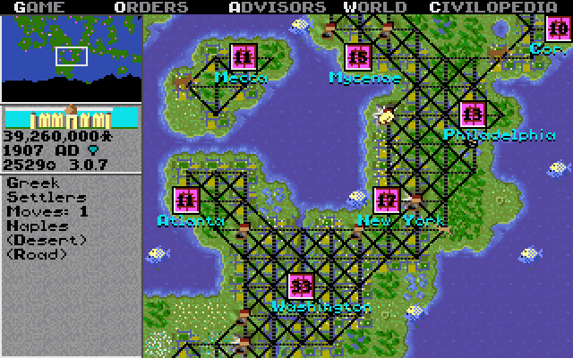
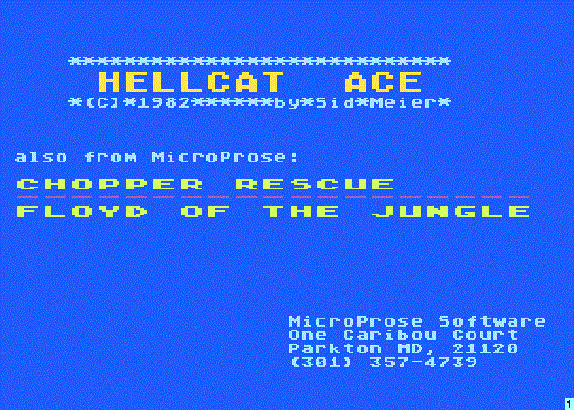
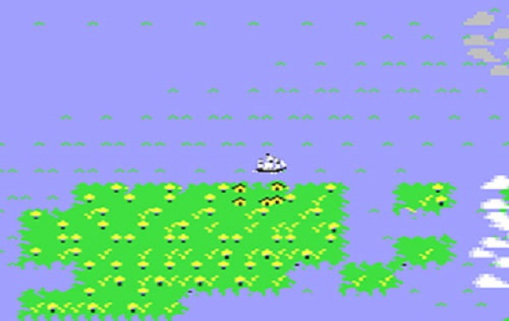
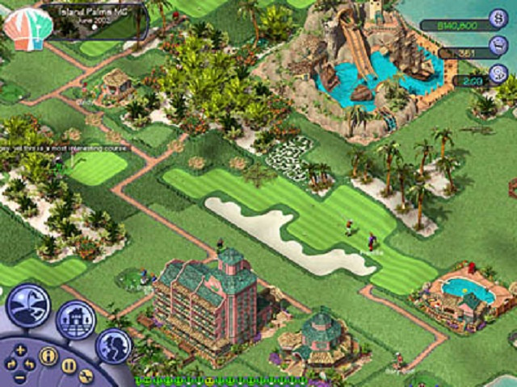

# [Sid Meier: The Father of *Civilization*](http://kotaku.com/the-father-of-civilization-584568276)

Before Sid Meier was *Sid Meier*—the iconic video game designer whose name is stamped on classic titles like *Pirates**!*** and *Civilization*—he was just another computer hacker**.**

In the early 80s, the then-20-something programmer had a job at a company called General Instruments Corporation, where he worked alongside a gruff Air Force pilot-turned-businessman named John "Wild Bill" Stealey**.** Meier, who had graduated with a degree in computer science before there was a personal computer in every home, spent his spare time reading hacker magazines, fiddling with code on his Atari, and building his own versions of arcade games like *Space Invaders* and *Pac-Man***.** At one point he made a space game and put it up on his office network; it hooked so many employees that his bosses forced him to take it down**.**

One year, as Stealey recalls, the two men went to an electronics trade conference**.** On the second night of the show, they stumbled upon a bunch of arcade games in a basement**.** One by one, Meier beat Stealey at each of them. Then they found Atari’s *Red Baron*, a squiggly flight game in which you’d steer a biplane through abstract outlines of terrain and obstacles**.** Stealey, the Air Force man, knew he could win at this one**.** He sat down at the machine and shot his way to 75,000 points, ranking number three on the arcade’s leaderboard**.** Not bad.

Then Meier went up**.** He scored 150,000 points.

“I was really torqued,” Stealey says today**.** This guy outflew an Air Force pilot? He turned to the programmer**.** “Sid, how did you do that?”

“Well,” Meier said**.** “While you were playing, I memorized the algorithms.”

---

**A great video game**, Sid Meier likes to say, is a series of interesting decisions: a set of situations in which the player is constantly confronted with meaningful choices**.** It’s an ethos that has served him well: the majority of Meier’s games are critically and commercially acclaimed**.** A 2009 *Develop* survey asked some 9,000 game makers their “ultimate development hero”—Meier came in fifth**.** (First was *Mario* creator Shigeru Miyamoto**.**)

Meier’s games are all full of interesting decisions, and they’re always totally different**.** There’s the open-world pirate adventure game; the real-time strategy game set during the Battle of Gettysburg; the simulation game about railroad management**.** Meier’s most recent release, *Ace Patrol*, is a top-down strategy game in which you maneuver fighter pilots to take down targets across the battlefields of World War I.

And then there’s *Civilization***.**

In a world full of eight-figure budgets and ambitious video game cinematics, the 20-year-old *Civilization*’s scope is impressive even today**.** Some games put players in charge of people, cities, or armies; *Civilization* put them in charge of world history**.** You’d pick a nation—Americans, Romans, English, and so forth—and guide them from 4000 BC to the modern age, year by year**.** Every turn, you could move your people across a 2D map of the world, build settlements and cities, engage in diplomacy with rival countries, research new technology, irrigate land, and wage war**.**

This formula has spawned five main games, several spinoffs (including the North America-focused *Colonization* and the sci-fi epic *Alpha Centauri*), and tons of expansion packs**.** It’s also made “Sid Meier” a gaming household name: the official title for *Civilization* is not *Civilization*; it is *Sid Meier's Civilization***.** The title implies ownership, arrogance, cockiness. It would be easy to conclude, then, that the father of PC strategy games is a man with an ego—the type of man who would put his name on every game he makes**.**

But Meier is amiable and soft-spoken, a friendly man who colleagues call brilliant, unassuming, and humble**.** "In the [13] years and all the people I've worked with at Firaxis," said fellow designer and close confidant Jake Solomon, "there has never been anyone who's had a personality issue with Sid, 'cause it's not possible**.** He's such a wonderful person."

Last month, I met the legendary designer in a chilly meeting room in Manhattan’s Union Square**.** Meier was genial and energetic, with a warm smile and a dark grey cardigan**.** He was accompanied, as always, by his wife, Susan, who occasionally chimed in to help him remember important facts, or moments he’s forgotten**.** We talked about his games, his history, his triumphs and regrets**.**

A devout Christian, Meier loves music and plays organ for his church in Baltimore, Maryland, where he and Susan live**.** His job title at Firaxis, the studio he helped found, is “Director of Creative Development,” which essentially means he can do whatever he wants**.** Sometimes that means working on his own games; other times it means offering his considerable design acumen to other people at the company and helping out on projects like *XCOM*, the sci-fi strategy game helmed by Solomon**.**

“You can always drop in—his door's always wide open,” said Solomon**.** “Anybody can stop in and talk to him about anything..**.** he's incredibly welcoming. He spends a lot of his time working. If you come in on the weekend, there's a fair chance that Sid's car's in the parking lot, and he's in the office working on his latest idea**.**”

---

### *Solomon: "If you come in on the weekend, there's a fair chance that Sid's car's in the parking lot, and he's in the office working on his latest idea**.**"*

---

I asked Meier, who is 59, if he ever thinks about retirement**.** “I kinda feel like I am retired,” he said, laughing**.** “I'm doing what I wanna do—I've been retired for a long time**.** I still love making games, so I've really never thought of that**.**”

That’s good news for video game fans: Meier has a knack for making strategy games that are fiendishly addictive and consistently delightful**.** He’s fascinated by history, and he is particularly good at turning events that would seem quaint, dull, or old-fashioned to your average game player—like the battle of Gettysburg or a [World War I air skirmish](http://kotaku.com/it-only-took-a-legendary-developer-to-make-strategic-ai-498701631) —into accessible interactive entertainment**.**

“He just is brilliant,” said Solomon**.** “He has a gift that I certainly don't have. It's very rare to find someone who is able to look at the world in such a way that you could give him a topic for a game and I guarantee you in a weekend he could come up with a prototype centered around that theme that would make you go, ‘Oh man, that’s pretty fun**.**’ Sid just has a very insightful way of looking at the world**.** He can find the fun in almost anything.”

“He just thinks differently from us,” said Brian Reynolds, a longtime collaborator who designed *Civilization II***.** “It’s an ineffable thing. His smartness doesn’t come off as, ‘I'm smarter than you, haha**.**’ You just have this really interesting conversation and it starts to dawn on you how much smarter he is**.**”

“I gave him a [Civil War] book for Christmas one year,” said Stealey**.** “And at New Years he gave it back to me. I said ‘Sid, didn't you like the book?’ He said, ‘I've memorized it already**.**’”

---

After whupping Stealey at *Red Baron*, the young Meier told his co-worker that Atari’s flight sim was okay, but he could make an even better one**.** Stealey took the bait: “if you could, I could sell it**.**”

Meier lived up to his end of the bargain, and a few months later, he brought Stealey a build for a combat flight sim called *Hellcat Ace***.** So Stealey went out and sold it**.** This was the beginning of a partnership that would last for the next decade: As Meier designed and programmed, Stealey would go out and pitch his games to local hobby stores**.** After a year of sales—$200,000 worth, Stealey claims—Stealey quit his job at General Instruments to work full-time at the company they were now calling MicroProse**.** A year and a half later, Meier did too.

Over the next few years, MicroProse made and marketed a number of flight simulators and arcade action games for Atari consoles: games like the World War II flyer *Spitfire Ace*, the rudimentary platformer *Floyd of the Jungle*, and the helicopter sidescroller *Chopper Rescue***.** Like many of the earliest video game companies, MicroProse felt like an upstart gang of rebels more than a professional operation**.**

“We put [the games] in baggies,” Meier said**.** “Bill would drive around to stores and sell them. It was very bootstrap round-up work process**.** That's the way things were.”

“I would call computer stores and ask to buy *Hellcat Ace*,” Stealey told me**.** “And when they didn't have it, I would yell and scream at them, ‘What kind of computer store are you**?**’ and hang up. I would do that three times in three weeks, each time pretending to be a different person**.** And the fourth week I'd call and say, ‘Hello, this is John Stealey**.** I'm a representative with MicroProse, with this game called *Hellcat Ace***.**’ They'd say, ‘Hey, hey, hey, everyone's been calling about that, can you help us get that game**?**’”

In 1983, a video game crash caused by market saturation crippled companies like Atari and Magnavox, but MicroProse still found success releasing a steady trickle of high-quality games designed by Meier: mostly flight sims, because that’s what the two were interested in making**.**

A few years later, as the company continued to grow—”It took three years to get to $3 million,” said Stealey—someone suggested that they make a game about pirates**.** Meier liked the idea, and he recalls one particularly important conversation with Stealey:

“Bill said, ‘When’s my next flight simulator coming out**?**’ And I said, ‘I’m not doing a flight simulator; I’m doing a pirates game**.**’ He said, ‘Well that’s crazy, ‘cause people want your next flight simulator..**.** Wait a minute. Put your name on it. Maybe if they liked your flight simulator games, they’ll recognize the name and buy this crazy pirates thing**.**’”

Stealey has a different take: “We were at dinner at a Software Publishers Association meeting, and [actor] Robin Williams was there**.** And he kept us in stitches for two hours**.** And he turns to me and says ‘Bill, you should put Sid's name on a couple of these boxes, and promote him as the star**.**’ And that's how Sid's name got on *Pirates*, and *Civilization***.**”

Wherever it came from, the idea stuck**.** In 1987, MicroProse released *Sid Meier’s Pirates**!***, an open-world exploration game in which players took on the role of glamorous swashbucklers who scour the world for treasure, stave off mutinous crews, and try to earn as much money as possible**.**

“We had created this graphic tool that allowed us to bring up pictures quickly,” Meier said**.** “Memory was limited. Everything was limited, so you had to be very efficient, but we found an efficient way to kind of pop up these pictures**.** We were able to kind of illustrate each scene in the story**.** That gave it a little bit of this adventure book story kind of quality that I think worked well**.**”

It worked extremely well: *Pirates**!*** won a number of awards from industry shows and magazines, and influenced a great deal of future games, including Will Wright’s *SimCity*, which would then go on to influence Meier’s *Civilization***.**

Meier recalls early Game Developers Conferences in San Jose, California, where he’d get together with Wright, *M**.**U.L.E**.*** designer Danielle Bunten, conference founder Chris Crawford, and about 50-100 other early game creators**.**

“We would have fun and basically tell each other how much we like each other's games,” Meier told me**.** “There wasn't really any collaboration, because we just all wanted to make our own games**.** It was too much fun to let anybody else**.**”

It was the first generation of video game designers**.** And it felt like they were at the precipice of something big**.**

“We were trying to develop an industry,” Meier said**.**

---

If you play more than one of Meier’s games, you will notice certain common characteristics: there is never any blood, for one**.** Although Meier likes to cover violent historical periods, he does not like to show violence: battles in *Civilization*, for example, are represented abstractly, with two army tiles colliding until one disappears**.**

Meier’s games are also known for giving their players all sorts of options: instead of telling a focused, linear story, Meier prefers to create situations in which the player can create his or her own narrative**.** It could be the story of America wiping out every other nation and creating a global empire, or it could be the story of the most friendly pirate in the Caribbean**.** It’s totally up to the player**.** “I prefer games where the player can lead the game in the direction that they want,” Meier said**.** “And then they kind of end up with that unique story that only they can know**.**”

---

### *Meier: “I prefer games where the player can lead the game in the direction that they want, and then they kind of end up with that unique story that only they can know**.**”*

---

No game epitomized this principle more than *Civilization*, which Meier and his team started developing after *Pirates**!*** and their next game, a business sim called *Railroad Tycoon* in which players could built and manage their own railroad companies**.**

"[*SimCity*] planted the seed in our mind about this kind of building, and that games don't have to be about blowing things up—they can be about creating," Meier said**.** "And so we kind of took some of the ideas from *Railroad Tycoon*, and some of the ideas from *SimCity*, and said you know what's a bigger topic that we can tackle**?** And we ended up with the idea of *Civilization***.**"

Today, it takes two or three years and a team of at least 100 to make your average blockbuster video game**.** *Civilization*, Meier told me, was made by a team of 8-10 people in under a year**.**

“Ultimately we had 640 kilobytes [of memory] in the computer,” Meier said**.** “When that was full, we were done**.** We couldn’t put any more code in there. So development time was a little less in those days**.**”

Today, *Civilization* is known as one of the premier turn-based strategy series, but funny enough, one of the game’s first iterations was actually set in real-time, like *StarCraft* or *Age of Empires***.** The unreleased prototype just didn't pass muster with Meier**.**

“It was more like *SimCity*, where you'd kind of say, I wanna have a village over here and a farm over here and maybe I want to have some things happening over here, and then you could kind of stand back and watch your people gradually do things,” Meier said**.** “But it was a much more passive kind of process. There was more watching than doing. It was just not happening**.**”

So they switched gears. They gave more control to the player and changed up the pacing: now, instead of waiting for the world to change, players could change the world**.** Time wouldn’t progress until players made their decisions**.**

Brian Reynolds, who at the time had just started working at MicroProse, remembers early builds of *Civilization* keeping him and his co-workers up all night**.**

“It started to kind of go ‘viral’ within the company—not that anybody knew that term back then,” Reynolds said**.** “It was one of those things that suddenly everybody was kind of playing it**.** There'd be a new version every few days. I would go in and just be this random 22-year-old guy stopping by and saying, ‘Here's some ideas**!**’ [Sid] was very tolerant, patient of all my ideas for *Civilization***.**”

“It was a very fun development,” said Meier, who was in his late 30s at the time**.** He remembers scaling down a lot—the game’s map was originally going to be twice the size, and there were two different types of tech trees—and he recalls lots and lots of play-testing alongside assistant director Bruce Shelley**.**

“Testing was a bit of a challenge because it took so long to play the game,” Meier said**.** “And we didn’t really have much in the way of testers, so I was one of the main—a lot of my time was spent playing and then fixing and changing**.**”

*Civilization* came out in late 1991**.** It took a few months for buzz to build—there was no Internet just yet—but as people started to discover the game, it spread like the Romans**.** Meier's masterpiece won various awards, ranking #1 on a list of “150 Best Games Of All Time” compiled by the magazine [*Computer Gaming World*](http://www.cdaccess.com/html/pc/150best.htm) **.** And it sold 800,000 copies, according to Reynolds.

When Meier finished the game that would make his career, he was eager to make something bigger**.** Better. More ambitious**.** But he also knew that would be ridiculously difficult—“I said if I continually get in this mode of trying to top the last game or do something bigger or more epic, I'm gonna drive myself crazy,” Meier said**.** So he decided to scale back**.** He gave Reynolds the steering wheel for the U.S.-focused *Colonization* and the *Civ* sequel, then went off to do his own thing: a music application called *CPU Bach* that allowed players to create their own music compositions**.** (It never really took off**.**)

Meanwhile, MicroProse was facing corporate restructuring as Stealey attempted to balance the company’s budget**.** In 1993, Stealey sold MicroProse to a company called Spectrum Holobyte**.** A year later, he left. “It was a great run. We should've done better. We had great people,” Stealey said**.** “I think all our people are still very proud of their MicroProse days**.** We had a family atmosphere**.** We had cash bonuses for everybody. I think it went very well for a long time**.**”

Sick of the layoffs and corporate politics, Meier—along with Reynolds and fellow designer Jeff Briggs—decided to leave MicroProse and start a new company**.** They called it Firaxis Games.

---

Sid Meier doesn’t like thinking about business, and he clammed up a bit when I asked him about MicroProse’s new ownership**.** “Sid didn't want to be involved in that at all,” Stealey told me later**.** “No business—not at all.”

“Sid is happiest in his office writing code,” Solomon said**.**

Perhaps that was what made the idea of Firaxis so exciting for Meier: there they were independent, totally free to make creative decisions without worrying about meddling corporate parents**.** By then, Meier already had a reputation in the booming video game industry, and the company was quickly able to strike a deal with Electronic Arts for their next couple of games: *Alpha Centauri,* a *Civilization* spinoff set on an alien planet, and *Gettysburg*, a real-time strategy game set during the eponymous Civil War battle**.**

“Ah, Firaxis,” Meier said. “The convicts are running the asylum**.** It was great fun.”

For a while the company stayed small and nimble, making games with a team of 10-15 people, but over the past decade and a half, it’s grown closer to 120**.** In late 2005, Firaxis was acquired by Take-Two Interactive—the publishing company behind Rockstar (*Grand Theft Auto*) and 2K (*NBA 2K*)**.**

---

### *Meier: "Ah, Firaxis**.** The convicts are running the asylum. It was great fun**.**"*

---

“Everyone here is really nice,” said Solomon, who joined Firaxis in 2000**.** “We really value nice guys and gals. We don’t really put up with personality conflicts here, and that comes from Sid**.** That is 100% because our studio grew out of Sid Meier, and his personality has a huge impact on how the studio is run, how people interact with each other**.** His vision is sort of our company vision.”

Over the past decade or so, Firaxis has gone on to make a whole bunch of *Civilization* sequels and spinoffs, including the console-driven *Civilization Revolution* and a remake of *Colonization***.** Last year’s reimagining of the sci-fi strategy game *XCOM* (directed by Solomon) earned tons of critical acclaim, winning *Kotaku*’s 2012 [Game of the Year](http://kotaku.com/5973782/xcom-enemy-unknown-is-kotakus-2012-game-of-the-year) **.** And now, with *Ace Patrol*, the ghoulish [*Haunted Hollow*](http://kotaku.com/x-com-makers-mobile-monster-mash-conquers-hearts-and-w-487651427)  and an iOS port of [*XCOM*](http://kotaku.com/its-xcom-on-ios-isnt-that-all-you-need-to-know-518608224) , the studio seems to be diversifying a bit more**.**

Related

[4](#)

---

Ahab had Moby Dick**.** Sid Meier has dinosaurs**.**

For the past decade-and-a-half, Meier has unsuccessfully tried to spear a tyrannosaurus rex**.** He’s always wanted to make a game about the Jurassic and Cretaceous periods—”Sid Meier’s Dinosaurs” does have a nice ring to it—but he just couldn’t figure out how to make it fun**.** The theme worked, but he never found the right gameplay foundation: what would the dinosaurs do**?** Just fight one another**?** What’s the progression?

“I did three different prototypes,” Meier said**.** “One was real-time, one was turn-based, and one was a card game**.** And they were all kind of fun but just not *fun* fun**.**”

“How can you tell?” I asked**.**

Related

“I play the game,” he said, sounding very much like one of his legendary counterparts, Mario creator [Shigeru Miyamoto](http://kotaku.com/shigeru-miyamotos-next-great-game-as-far-as-hes-conc-513862764) **.** “That's how I develop it, by playing the game, tweaking it and changing it**.** If other people play it, and they’re like ‘Oh, that’s okay,’ I ask, ‘But you’re still not playing it**?**’ If they say, ‘No, I put it away’ then I know it’s a problem**.** If they’re still not playing it, then it’s not as fun as it needs to be**.**”

Meier’s wife, Susan, chimed in**.** Susan has been with Firaxis since the beginning, first as the head of human resources, and now as "Master of Miscellaneous," as she likes to call herself**.** “One of the reasons you knew you had something was that people at work were playing it long and often,” she said**.**

“Even when they didn’t have to,” Meier said, laughing**.** “That’s a good sign**.**”

---

### *Meier: "If other people play it, and they’re like ‘Oh, that’s okay,’ I ask, ‘But you’re still not playing it**?**’ If they say, ‘No, I put it away’ then I know it’s a problem**.** If they’re still not playing it, then it’s not as fun as it needs to be**.**"*

---

But he just couldn’t nail down the dinosaurs**.** Solomon, meeting with Meier for the first time while interviewing for a job at Firaxis, recalls sitting down with the designer and playing one of his dinosaur prototypes**.**

“He fired it up and he let me play,” Solomon said**.** “I think he basically just looked at this as an opportunity to get feedback from somebody**.** I played the game and we talked about the game..**.** and all he was interested in was, what do I think of the game**?** Did I have fun**?** What would I change? And it wasn’t an interview in the sense of—well, I suppose he might have been using it to gauge my personality—but really, it was an interview in the sense of, I played an awesome little prototype of Sid Meier**.**”

Solomon couldn't make the game great, though**.** Meier likes to talk about the "valley of despair"—the moment in which a game designer, crushed by the weight of failed ideas and discarded prototypes, just feels like giving up**.** ("Sid's famous for saying a game is a series of interesting decisions," Solomon told me**.** "On *Civ Rev* one time he cracked and said, 'Playing games is a series of interesting decisions, but making games is a series of heartbreaking disappointments**.**'")

Sometimes, they get out of the valley**.** Other times it can be smothering.

Not long after Solomon joined the company, Meier told everyone that he was finished**.** He couldn’t make the dinosaur game work.

“So he goes home, and we don’t see him for two weeks,” Solomon said**.** “Then he brings everybody into a little room and he’s like ‘Okay, I’ve got the next game**.**’ And so he puts it up on the screen, and it’s *SimGolf***.**”

It wasn’t a video or a bunch of words about *SimGolf*: it was a working prototype that Meier had just built**.** Players could design and build basic golf courses, just like they eventually could in the final product**.**

“At that time, [then-EA exec] Bing Gordon came out and went into Sid’s office, sat down, played the game for maybe an hour or two, came out and said ‘Yep, we’ll be able to sell that**!**’” Solomon told me. “Anyone who saw it saw that it was pretty awesome**.**"

That prototype-centric mentality is how Meier has always made games, and it may be one of the explanations for his success: he doesn’t believe in design documents, or long, written descriptions of how a video game will work**.** While many game makers put ideas and concepts on paper before taking them to a machine, Meier’s approach is all hands-on**.**

“Sid’s never had to write a design document, because instead of debating with you about some new feature he wants to implement, he’ll just go home and at night he’ll implement it,” Solomon said**.** “And then tomorrow when he comes in he’ll say, ‘Okay, now play this new feature**.**’ And you’ll play, and then you can have a real conversation about the game, instead of looking at some design document**.**”

Meier is known for these types of rules and mantras, which he likes to share with other game designers as often as possible**.**

“‘Find the fun’—that’s Sid’s phrase,” said Reynolds**.** “Essentially, you have to make something in order to have any chance of finding the fun**.** Fun wasn't going to be found on a piece of paper, at least fun in terms of a video game**.**”

To hear Reynolds describe Meier’s process calls to mind the old joke: “How do you carve a statue of an elephant**?** Get a block of marble and remove anything that doesn’t look like an elephant**.**” How do you make a good game**?** Get a game and remove all the parts that aren’t fun**.**

“He told me a phrase I use all the time,” said Solomon**.** “Feedback is fact. That's the way you have to look at feedback, as if it's a fact**.** You've worked on this massive system or this game, and they come in your office and they go, ‘I played it, and I was bored**.**’ The worst thing you could do as a designer is start to defend your design or argue with that person**.** What you do is accept what that person told you as a fact**.** They said they were bored, so guess what? Your game bored that person. And you need to figure out why that is**.**”

There are other rules, too. Reynolds recalled one that stuck with him: if you are making a video game, and you’re having trouble with a number—say, the number of damage points a unit can do—either double it or cut it in half**.**

“He didn’t have any patience for, ‘Let’s try increasing it by 10%**.** Let’s try another 10%,’" Reynolds said. “Turns out that's a pretty good rule of thumb to start with for a game designer, because the typical thing is to be really careful and try to inch up a little bit, and then you have to change it seven times to get it right**.** If you double it, you'll immediately feel whether making it stronger was even a good idea**.**”

---

### *Meier: "I guess the next question is, 'What would you do to try to make the game *less* fun**?**'"*

---

The process works**.** Meier's games are undoubtedly excellent, to the point where gamers often tell stories about them: “I started playing *Civilization* at 8pm and then suddenly it was four in the morning” is a common one**.** The word “addictive” is often thrown around—always with positive connotations, yes, but addiction can be a dangerous thing**.**

So I was curious, during a chat with Meier**.** Does he ever worry that his games could have a harmful effect on peoples' lives**?**

“The responses we get on the forums, and interacting with players, and talking to people..**.** our impression is that it's a positive experience. It's a way of using your leisure time that might otherwise be spent watching television or whatever**.** It's a leisure time choice. So our reaction from players has been positive in terms of the time they spent, what they thought they got out of it, how they exercise their brains, and learn things about the world**.**

“I guess the next question is, 'What would you do to try to make the game *less* fun**?**' It's funny—in some of the very early PC game designs, we used to have this 'boss key,' which you'd—you'd kinda hit a special key, and a spreadsheet would pop up on the screen so you could pretend you were doing your job**.** So I guess it's been a consideration going back even 10 or 20 years**.** Games are just fun.

“It's up, with any form of entertainment, it's up to the player or parents to decide what's appropriate and what's not appropriate**.** Our goal is to make the games as fun as we can make them**.** I think that seems to be what most people are looking for**.**”

---

**Civilization doesn’t have slaves**, and some have criticized the game for that glaring historical omission**.** It’s a common trend in Meier’s works: although they cover history, they tend to omit the nastier parts**.** That's just how Sid Meier makes games. It's been that way from *Civilization* to *SimGolf* to any of the games he's worked on in the two decades since**.**

“There's a conflict between an emotionally-charged topic and kinda giving the player this freedom of choice that really makes the game good,” he said**.** “One of the things we really try to avoid in our games is this kind of—’this choice would be the right thing to do, but this choice is gonna help me win the game’—put the players in those kind of moral dilemmas**.** That's not what our games are about. We want you to feel good about yourself when you finish the game**.**”

A feel-good, addictive experience with tons of interesting choices: that has become the definition of a "Sid Meier" game**.** Maybe that's why they put his name on the box**.** There's certainly value to video games that tell focused, morally-challenging stories—last year's *Spec Ops: The Line* (published by 2K, the label behind Firaxis's games) was lauded for just that reason—but Meier doesn't want to make games like that**.** He wants to make the type of games that he wants to play**.**

Yet... to this day, Meier has yet to create a game as memorable or as significant as *Civilization***.** After *SimGolf* was a remake of *Pirates**!***, and then Meier designed the fourth *Railroad Tycoon* game, *Railroads**!*** Next was the console-friendly *Civilization Revolutions*, a Facebook game called *CivWorld* that shut down earlier this year, and *Ace Patrol***.** All of these games, while generally good, have not stuck with people the way his magnum opus has**.** And although Meier told me he has no regrets—"Except that I didn't think of *Tetris***.**"—I imagine he must sometimes feel like *Civilization* is lording over him, daring him to make something with as much of an impact**.**

“When we made *Civilization*, it was not with the idea that this was gonna be the greatest game that we're gonna be remembered by,” Meier said**.** “It was the best game to make at the time and we thought it was a lot of fun**.** Each game we make, we kinda go into it with that idea: this is gonna be the best game we can make on that topic**.** Some of them resonate stronger with game players; maybe some not as much**.** I don't have a formula for making a super-memorable game**.** It's just that we keep making the best games that we can**.**”
