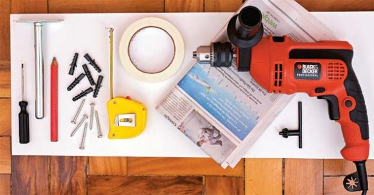
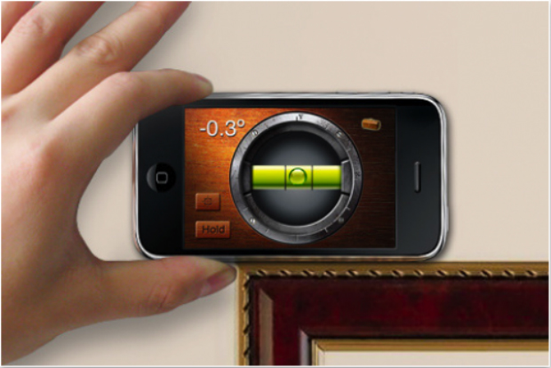
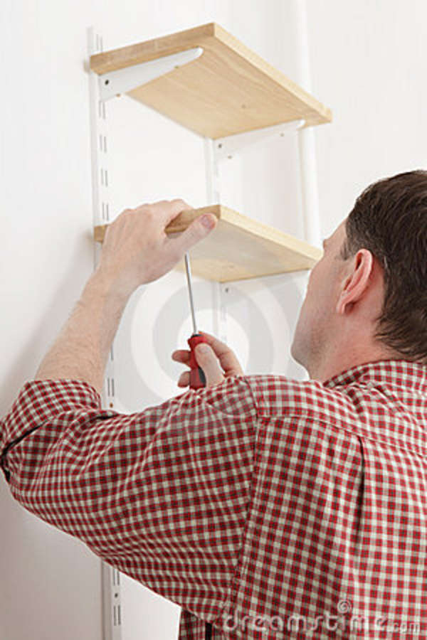
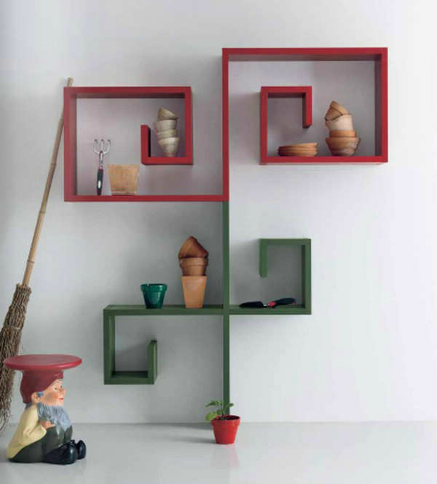
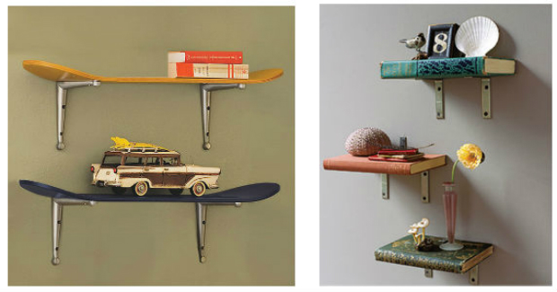
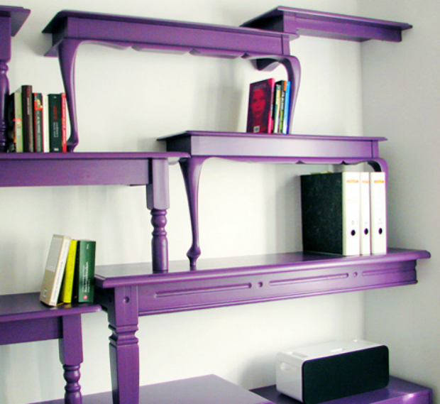

# **C**omo instalar prateleiras

Pendurar algumas prateleiras nas paredes da sua casa pode, à primeira vista, parecer uma das tarefas domésticas do tipo “faça você mesmo” mais simples de se realizar sozinho**.**

Entretanto, uma prateleira mal colocada pode render muita dor de cabeça, como por exemplo, levar todas as suas coisas ao chão quando você empilhá-las**.**

Um outro problema que uma má instalação pode causar são os danos às suas paredes, afinal, um número grande de buracos feitos imprudentemente exigirão gastos com reparo**.** Se suas prateleiras forem colocadas corretamente, podem aguentar cargas maiores do que você a projetou para receber e não vão danificar suas paredes**.**

Usando algumas ferramentas simples de carpintaria você consegue instalá-las com segurança**.**

Uma coisa legal sobre prateleiras é que elas podem ser complexas ou simples de acordo com sua vontade**.** Depois que você recolher o material necessário para a instalação, você deve começar o processo descobrindo a altura ideal para suas prateleiras**.**

Recomendo que fique entre 1**.**65 e 1.75 m, algo em torno do nível dos olhos. Isto é especialmente útil se você estiver montando prateleiras de livros**.**

Os itens básicos que você precisará para instalar sua prateleira são:

- 1 lápis;
- 1 prateleira;
- 2 suportes para cada prateleira**.** Podem ser em formato de ‘L’ ou triangulares, verifique a necessidade da sua prateleira;
- furadeira;
- 1 broca (o tamanho dependerá da espessura dos parafusos que você vai usar);
- 1 nível de bolha**.** É aquele instrumento para nivelamento de superfícies; você pode substitui-lo por outra coisa que consiga verificar se a prateleira estará reta, como uma bolinha de gude**.** Encontrei um aplicativo bem interessante que simula um nível, [vale a pena baixar](https://itunes.apple.com/br/app/ihandy-level-free/id299852753?mt=8) ;
- 1 fita métrica;
- parafusos;
- 1 chave de fenda;

Com esses materiais reunidos, agora é hora de colocar as mãos na massa**.**

**1.** Use uma fita métrica para medir a altura que você deseja que a prateleira seja instalada**.** Este é um passo bastante variável, pois vai depender da função que sua prateleira terá**.** Se você pretende colocar mais de uma, é importante pensar na localização de cada uma antes de começar, para ter certeza de que há espaço para todas**.**

**2**.**** Pegue sua prateleira e a encoste na parede, colocando o nível de bolha sobre ela até que consiga se certificar de que a bolha está dentro do nível**.** Se a bolha se desloca para a esquerda ou para a direita da marcação, então sua prateleira está torta**.**

**3.** Mantenha a prateleira na parede e pegue os suportes, colocando-os por baixo da prateleira**.** Talvez você vá precisar de um ajudante para não perder o nivelamento**.**

**4**.**** Marque com o lápis uma linha sob a prateleira e, através dos furos do suporte, aonde você fará o furo na parede**.** Faça a marcação de todos os furos necessários antes de remover qualquer peça da sua posição**.** É importante que a distância entre os suportes seja suficiente para equilibrarem bem a prateleira sobre eles**.** Fique atento a isso**.**

**5.** Quando terminar, remova a prateleira e os suportes de encontro à parede**.**

**6.** Faça um furo na parede usando a furadeira e a broca adequadas**.** Depois que terminar os furos, insira as buchas na parede**.** Em seguida, coloque os suportes de volta no lugar, certificando-se de que estão alinhados com a linha da prateleira e com os orifícios de entrada dos parafusos**.**

**7.** Insira os parafusos em cada um dos buracos feitos e verifique se o suporte ainda está alinhado**.** Se estiver tudo ok, aperte com a chave de fenda até o fim**.**

Puxe o parafuso para garantir que as buchas se expandiram na parede, de modo que os parafusos não sairão da parede**.**

**8**.**** Coloque a prateleira sobre os suportes e verifique o com nível de bolha se ela está nivelada**.** Para fixar as prateleiras, você pode usar parafusos ou cola**.** No caso da cola, use uma pequena quantidade sobre os suportes antes de posicionar a prateleira, deixando secar por cerca de 15 minutos para secar**.** Usando os parafusos, você deve fazer um furo de baixo para cima na prateleira**.** Depois, adicione os parafusos, apertando com a chave de fenda até que estejam bem fixados nos suportes**.**

Dependendo do comprimento da prateleira, você terá que optar por usar três suportes em vez dos dois habituais**.** Recomendo que faça isso com prateleiras maiores que 150cm**.** No entanto, isso também pode mudar dependendo do que você pretende colocar sobre ela**.**

Se você pensa em colocar livros na sua prateleira, não esqueça de que de nada adianta montá-la e não conseguir organizar as coisas sobre ela**.** Aqui tem um artigo ensinando um jeito simples de organizar livros**.**

Para finalizar, deixo também algumas ideias de prateleiras que achei sensacionais para decorar diferentes ambientes**.**

