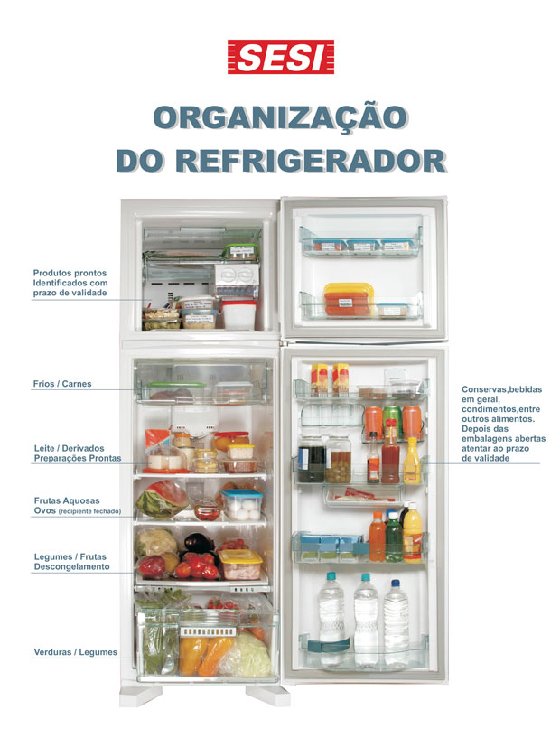

# **C**omo organizar a geladeira

Saber como organizar a geladeira é importante porque estamos falando dos alimentos que vamos ingerir, ou seja, nossa saúde**.** Muitas pessoas não sabem como organizar seus alimentos na geladeira e acabam perdendo-os mais rápido**.** Se for o seu caso, confira este post com algumas dicas para organizá-la**.**

Imagem: SESI

- Tire tudo de dentro da geladeira para poder limpá-la**.**
- Descarte os alimentos vencidos ou estragados**.**
- Pequenas sobras de comida podem ser armazenadas em potes de plástico ou de vidro**.** Prefira os transparentes e em formato quadrado ou retangular, que se encaixam nos cantos**.** Guarde as sobras juntas para ficar mais fácil de visualizar no dia a dia e não desperdiçar**.**
- Carnes devem ser guardadas no congelador ou no lugar mais frio da geladeira, se o consumo for no mesmo dia**.** Nunca lave as carnes**.**
- A gaveta grande da geladeira serve para manter os legumes e verduras frescos**.** Procure manter esses alimentos em saquinhos, pois isso aumenta a sua durabilidade e ainda mantém a gaveta limpa**.**
- Somente as frutas maduras ou já cortadas devem ser guardadas na geladeira**.** O restante pode permanecer em temperatura ambiente**.**
- Na porta, dê preferência para bebidas e todos os mantimentos que forem armazenados em garrafas ou potes**.**
- Ovos não podem ser guardados na porta, pois estragam mais rápido**.**
- Procure etiquetar todos os alimentos guardados em potes de plástico ou vidro, tanto na geladeira quanto no congelador**.** É interessante colocar também a data de validade em cada uma das etiquetas**.** Existem etiquetas reaproveitáveis vendidas em lojas de produtos organizadores**.**
- Você pode usar cestos de plástico para setorizar os alimentos na geladeira, se as prateleiras forem grandes**.**
- Quem tem crianças em casa pode ter uma cestinha para lanches e petiscos na altura dos pequenos, para que eles mesmos tenham acesso**.**
- Você também pode ter uma cestinha para artigos do café-da-manhã- assim, quando puser a mesa, basta pegar a cestinha com tudo dentro**.**

Tome cuidado para não sobrecarregar a geladeira, pois o ar precisa circular**.** Por esse motivo, evite colocar toalhinhas e outros tipos de obstruções nas prateleiras**.**

### Veja o tempo de vida de cada alimento

Peixe – 1 dia

Frango – 2 dias

Carne – 1 a 2 dias

Salsichas e bacon – 7 dias depois de abertos

Sopas e carnes cozidas – 3 a 4 dias

Maionese industrializada – 2 meses depois de aberta

Frios – 3 dias

Ovos – 15 a 30 dias

Sobras – 1 a 2 dias

Leite – 2 dias

Doces – 3 dias

Legumes e frutas – 3 a 7 dias

Verduras e temperos – 2 a 3 dias

Molhos – 20 a 30 dias

Organizar direitinho a geladeira faz com que você economize dinheiro e não desperdice alimentos**.**

**Sua geladeira está organizada**?****
