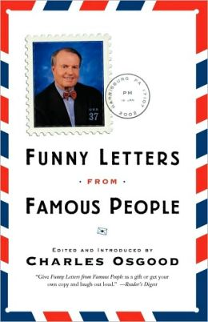
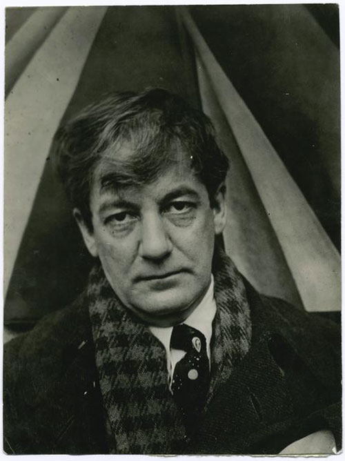

# [How to Quit Your Job Like Sherwood Anderson: The Best Resignation Letter Ever Written](http://www.brainpickings.org/index.php/2013/07/25/sherwood-anderson-resignation-letter/)

**by [Maria Popova](http://www.brainpickings.org/index.php/author/mpopova/ "Posts by Maria Popova")** 

*“He is a nice fellow**.** We will let him down easy but let’s can him.”*

Like a number of celebrated creators — including [Dr**.** Seuss](http://www.brainpickings.org/index.php/2012/08/10/dr-seusss-wartime-propaganda-cartoons/) , [F. Scott Fitzgerald](http://www.brainpickings.org/index.php/tag/f-scott-fitzgerald/) , and [Wendy MacNaughton](http://www.brainpickings.org/index.php/2013/05/06/wendy-macnaughton-caroline-paul-design-matters/)  — **Sherwood Anderson** started out in advertising to make ends meet, first as an advertising solicitor, then as an ad salesman and copywriter for farming equipment, and eventually as a copywriter in Chicago-based advertising agency Taylor Critchfield Co**.** until he became a successful novelist at the age of 41**.** Though he was man of [timeless, profound insight on the creative life](http://www.brainpickings.org/index.php/2013/01/09/sherwood-anderson-letter-to-son/)  and the originator of some of [history’s finest fatherly advice](http://readlists.com/dc577118/) , he was also a man of masterful humor and remarkable wit**.** In 1918, when the time came to free himself from the shackles of the corporate world and plunge wholeheartedly into his craft, Anderson wrote what’s possibly the best letter of resignation ever penned, found in the altogether delightful [***Funny Letters from Famous People***](http://www.amazon.com/Letters-Famous-People-Charles-Osgood/dp/0767911768/?tag=braipick-20)  ([*public library*](http://www.worldcat.org/title/funny-letters-from-famous-people/oclc/50554158&referer=brief_results) ):

> Dear Barton:
>
> You have a man in your employ that I have thought for a long time should be fired**.** I refer to Sherwood Anderson**.** He is a fellow of a good deal of ability, but for a long time I have been convinced that his heart is not in his work**.**
>
> There is no question but that this man Anderson has in some ways been an ornament to our organization**.** His hair, for one thing, being long and messy gives an artistic carelessness to his personal appearance that somewhat impresses such men as Frank Lloyd Wright and Mr. Curtiniez of Kalamazoo when they come into the office**.**
>
> But Anderson is not really productive**.** As I have said his heart is not in his work. I think he should be fired and if you will not do the job I should like permission to fire him myself**.** I therefore suggest that Anderson be asked to sever his connections with the company on [the first of next week]**.** He is a nice fellow. We will let him down easy but let’s can him.
>
> Respectfully submitted,
>
> Sherwood Anderson

[***Funny Letters from Famous People***](http://www.amazon.com/Letters-Famous-People-Charles-Osgood/dp/0767911768/?tag=braipick-20) , edited by none other than Charles Osgood, is a treat in its entirety**.**

Portrait by [Alfred Stieglitz](http://www.brainpickings.org/index.php/2011/10/28/my-faraway-one-love-letters-georgia-okeeffe-alfred-stieglitz/)  courtesy the [New York Public Library](http://digitalgallery.nypl.org/nypldigital/dgkeysearchdetail.cfm?strucID=136242&k=0) ; thanks, Kaye

**Donating = Loving**

Bringing you (ad-free) Brain Pickings takes hundreds of hours each month**.** If you find any joy and stimulation here, please consider becoming a Supporting Member with a recurring monthly [donation](http://www.brainpickings.org/index.php/donate/)  of your choosing, between a cup of tea and a good dinner:

You can also become a one-time patron with a single donation in any amount:

Brain Pickings has a free weekly newsletter**.** It comes out on Sundays and offers the week’s best articles**.** Here’s [what to expect](http://us2.campaign-archive1.com/?u=13eb080d8a315477042e0d5b1&id=d580cfe501) **.** Like? [Sign up.](http://www.brainpickings.org/index.php/newsletter/)

[Share on Tumblr](http://www.tumblr.com/share "Share on Tumblr")
