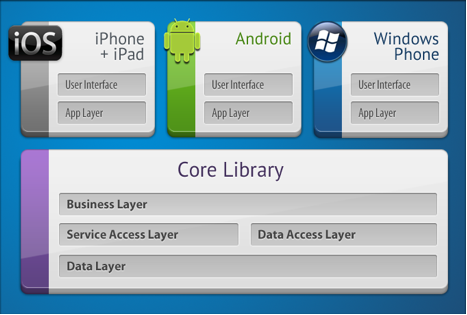
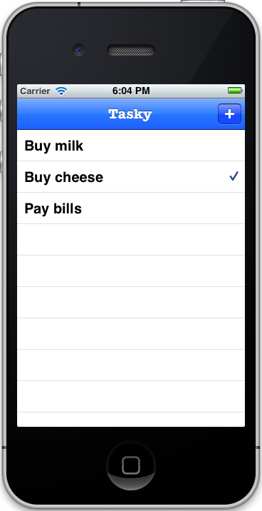
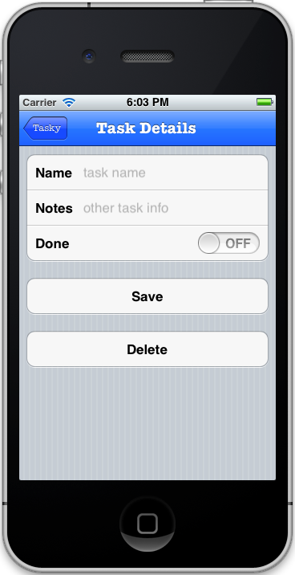
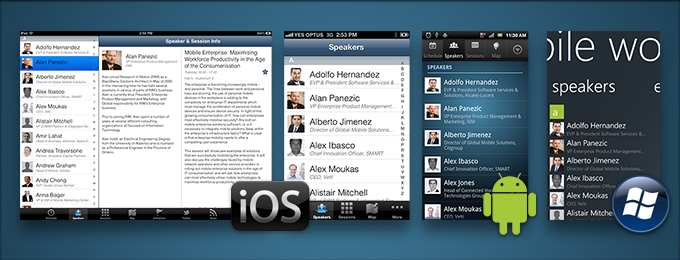

# **B**uilding Cross Platform Applications

Best Practices for Developing Mobile Applications with Xamarin

Rarely does an organization have the luxury of building mobile apps for a
single mobile platform**.** The fact is, the smartphone and tablet space is
dominated by three big platforms: iOS, Android and Windows**.** As such, in
order to reach users, apps must be designed and built for all three of
them**.** Traditionally this means using each platform’s provided technology
and SDK, i.e. Objective-C for iOS, Java for Android and .NET for Windows**.**
Most cross-platform mobile toolkits fall short in this space because they
provide a lowest-common-denominator experience and prevent developers going
“to the metal” on any given platform**.** With Xamarin, however, this
limitation does not exist**.** Not only do you get a single, modern language
(C#) and framework (.NET) across all three platforms, but you also get a
native experience on each, with code running as a native peer with direct
access to the underlying SDK and device metal, including platform-specific
UI and device capabilities**.** By choosing Xamarin and keeping a few things in
mind when you design and develop your mobile applications, you can realize
tremendous code sharing across mobile platforms, reduce your time to
market, leverage existing talent, meet customer demand for mobile access,
and reduce cross-platform complexity**.** This document outlines key guidelines
to realizing these advantages for utility and productivity applications**.**
Refer to our separate guidance document for writing cross-platform games
with Xamarin**.**

# 1**.** Overview

This guide introduces the Xamarin platform and how to architect a
cross-platform application to maximize code re-use and deliver a high-quality
native experience on all of the main mobile platforms: iOS, Android and Windows
Phone**.**

The approach used in this document is generally applicable to both
productivity apps and game apps, however the focus is on productivity and
utility (non-game applications)**.** See the [Introduction to MonoGame document] for
cross-platform game development guidance**.**

The phrase “write-once, run everywhere” is often used to extol the
virtues of a single codebase that runs unmodified on multiple platforms. While
it has the benefit of code re-use, that approach often leads to applications
that have a lowest-common-denominator feature-set and a generic-looking user
interface that does not fit nicely into any of the target platforms.

Xamarin is not just a “write-once, run everywhere” platform, because one
of its strengths is the ability to implement native user interfaces specifically
for each platform**.** However, with thoughtful design it’s still possible to
share most of the non-user interface code and get the best of both worlds: write
your data storage and business logic code once, and present native UIs on each
platform**.** This document discusses a general architectural approach to achieve
this goal**.**

Here is a summary of the key points for creating Xamarin cross-platform
apps:

- **Use C#** - Write your apps in C#**.** Existing code written in
  C# can be ported to iOS and Android using Xamarin very easily, and
  obviously used on Windows Phone**.**
- **Utilize the MVC design pattern** - Develop your
  application’s User Interface using the Model/View/Controller pattern**.**
  Architect your application using a Model/View/Controller approach or a
  Model/View/ViewModel approach where there is a clear separation between the
  “Model” and the rest**.** Determine which parts of your application will be
  using native user interface elements of each platform (iOS, Android,
  Windows Phone and Windows 8/RT) and use this as a guideline to split your
  application into two components: “Core” and “User-Interface”**.**
- **Build native UIs** - Each OS-specific application provides a
  different user-interface layer (implemented in C# with the assistance of
  native UI design tools):

1. On iOS use the MonoTouch.UIKit APIs to create native-looking
   applications, optionally utilizing Apple’s Interface Builder**.**
2. On Android, use Android.Views to create native-looking applications,
   taking advantage of Xamarin’s UI designer
3. On Windows Phone you will be using the XAML/Silverlight presentation
   layer, using Visual Studio or Blend’s UI designer
4. On Windows 8, use the Metro APIs to create a native user experience**.**

The amount of code re-use will depend largely on how much code is kept in the
shared core and how much code is user-interface specific**.** The core code is
anything that does not interact directly with the user, but instead provides
services for parts of the application that will collect and display this
information**.**

To increase the amount of code re-use, you can adopt cross-platform
components that provide common services across all these systems such as:

1. [SQLite-NET](https://github.com/praeclarum/sqlite-net)  for local SQL storage,
2. [Xamarin.Mobile](http://xamarin.com/mobileapi) 
   for accessing device-specific capabilities including the camera, contacts
   and geolocation,
3. Using framework features for networking, web services, IO and more**.**

Some of these components are implemented in the *Tasky Pro* and
*MWC 2012* case studies**.**

### Separate Reusable Code into a Core Library

By following the principle of separation of responsibility by layering your
application architecture and then moving core functionality that is platform
agnostic into a reusable core library, you can maximize code sharing across
platforms, as the figure below illustrates:

### Case Studies

There are two case studies that accompany this document – *Tasky
Pro* and *MWC**2012***.** Each case study discusses the
implementation of the concepts outlined in this document in a real-world
example**.** The code is open source and available on [github](https://github.com/xamarin/mobile-samples/) **.**

# 2**.** Sections:

[Part 1 - Understanding the Xamarin Mobile Platform](http://docs.xamarin.com/guides/ios/application_fundamentals/building_cross_platform_applications/part_1_-_understanding_the_xamarin_mobile_platform)

[Part 2 - Architecture](http://docs.xamarin.com/guides/ios/application_fundamentals/building_cross_platform_applications/part_2_-_architecture)

[Part 3 - Setting Up a Xamarin Cross Platform Solution](http://docs.xamarin.com/guides/ios/application_fundamentals/building_cross_platform_applications/part_3_-_setting_up_a_xamarin_cross_platform_solution)

[Part 4 - Handling Platform Divergence/Abstraction/Divergent
Implementation](http://docs.xamarin.com/guides/ios/application_fundamentals/building_cross_platform_applications/part_4_-_platform_divergence%2f%2fabstraction%2f%2fdivergent_implementation)

[Part 5 - Practical Code Sharing Strategies](http://docs.xamarin.com/guides/ios/application_fundamentals/building_cross_platform_applications/part_5_-_practical_code_sharing_strategies)

[Part 6 - Testing and App Store Approvals](http://docs.xamarin.com/guides/ios/application_fundamentals/building_cross_platform_applications/part_6_-_testing_and_app_store_approvals)

[Part 7 - Special Considerations](http://docs.xamarin.com/guides/ios/application_fundamentals/building_cross_platform_applications/part_7_-_special_considerations)

# 3**.** Cross-Platform Mobile Application Case Studies

The principles outlined in this document are put into practice in two sample
applications that are available for download: *Tasky Pro* and the *MWC
2012* conference app**.**

## 3.1. Tasky Pro

Tasky is a simple to-do list application for iOS, Android and Windows Phone**.**
It demonstrates the basics of creating a cross-platform application with Xamarin
and uses a local SQLite database**.**

Read the [Tasky Pro Case Study](http://docs.xamarin.com/guides/ios/application_fundamentals/building_cross_platform_applications/case_study%3a_tasky) **.**

## 3.2. MWC 2012

MWC 2012 is a conference schedule application created for the Mobile World
Congress in Barcelona, February 2012**.**

It is a sophisticated application that includes SQLite database support,
remote data download, image caching, separate UI for iPad and iPhone as well as
support for Android and Windows Phone**.** Platform-specific features like Live
Tiles on Windows Phone are included**.**

Read the [MWC 2012 Case Study](http://docs.xamarin.com/guides/ios/application_fundamentals/building_cross_platform_applications/case_study%3a_mwc) **.**

# 4**.** Summary

This document has introduced Xamarin’s application development tools and
discussed how to build applications that target multiple mobile platforms.

It covered a layered architecture that structures code for re-use across
multiple platforms, and describes different software patterns that can be used
within that architecture**.**

Examples are given of common application functions (like file and network
operations) and how they can be built in a cross-platform way**.**

Finally it briefly discusses testing, and provides references to the case
studies that put these principles into action**.**

[Part 1 - Understanding the Xamarin Mobile Platform
>>](http://docs.xamarin.com/guides/ios/application_fundamentals/building_cross_platform_applications/part_1_-_understanding_the_xamarin_mobile_platform)
