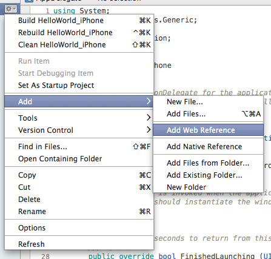
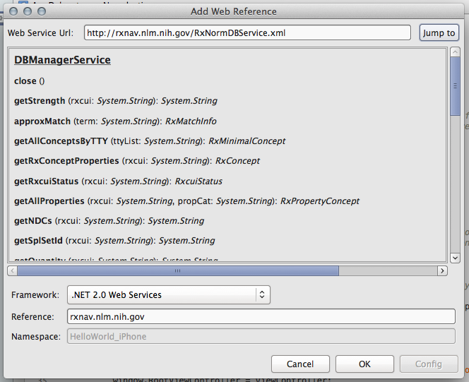
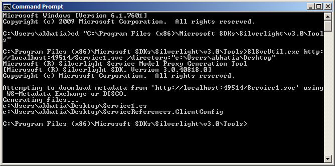

# 1**.** OvervieW

As more and more mobile applications are dependent on the cloud in order to function properly (e**.**g**.** Twitter, Facebook, news apps etc.), integrating web services into mobile applications is an increasingly common scenario**.**

The Xamarin mobile frameworks have a wide array of support for web service integration, including, built-in and third-party APIs for integrating with RESTful, SOAP and WCF services**.**

In this article we examine how to utilize the Xamarin mobile framework including built-in and third-party APIs, as well as the associated tools to integrate various web service technologies, including:

- **REST Services** – REST (or RESTful) Services are an increasingly common paradigm for creating web services because of their simplicity and inherent platform agnostic approach**.** Many of the major service providers use REST, such as Twitter, Flickr, Facebook, etc**.** REST allows for stateless, cacheable, and simple to consume client-server architecture over HTTP**.** This article examines a number of third-party options for consuming REST services, including; RestSharp, ServiceStack, Json.NET, etc**.**
- **WCF Services** – WCF is a Microsoft specific web service technology that aims at abstracting implementation from transport and data technology**.** Xamarin mobile applications support the consumption of WCF services that are exposed via the *BasicHttpBinding* protocol, by using the Microsoft Silverlight SLSvcUtil.exe utility for client proxy generation**.**
- **SOAP Services** – SOAP is a standards-based web services technology that allows providers to abstract data and transport implementations over the web**.** Xamarin mobile applications support standard SOAP 1**.**1 implementations over HTTP. Additionally, we support the Microsoft specific SOAP implementation, ASP.NET Web Services (ASMX), which allows for implementation of standard SOAP, XML and JSON responses**.**

Additionally, this article gives a basic overview of creating REST services for applications from the server perspective using the Microsoft ASP.NET MVC framework**.**

# 2. REST Services

With Xamarin.iOS and Xamarin.Android consuming RESTful services is an architecturally simple and performance conscious option**.** This section examines several mechanisms to interact with REST services from client applications, and introduce the various tools and patterns used to parse the common message formats**.**

## 2**.**1. Invoking the REST HTTP Request

The simplicity of standards-based RESTful architecture has helped make it the primary option for mobile applications, since client interaction requires basic access to HTTP in lieu of a complete SOAP runtime**.** In this section we introduce the following tools to help us interact with HTTP using it’s inherent request-response pattern:

- [HttpWebRequest](http://msdn.microsoft.com/en-us/library/system.net.httpwebrequest.aspx) **/** [WebClient](http://msdn.microsoft.com/en-us/library/system.net.webclient.aspx) – HttpWebRequest is one of the most common low-level mechanisms for grabbing data from a REST service and is at the core of many of the convenience libraries mentioned below**.** *WebClient* is another convenience class included in the System.Net namespace**.**
- [RestSharp](https://github.com/restsharp/RestSharp) – Is a library that includes support for HTTP requests ranging from simple to complex**.** This includes support for file download, complex authentication (including OAuth), async workflow, message serialization, chunking, etc**.**
- [Hammock](https://github.com/danielcrenna/hammock) – Is another library that employs the philosophy of: “REST, made easy” throughout it’s API**.** It follows a similar pattern to RestSharp and is used throughout the popular Twitter Client for .NET: [TweetSharp](https://github.com/danielcrenna/tweetsharp) **.**
- [NSURLConnection](http://developer.apple.com/library/mac/#documentation/Cocoa/Reference/Foundation/Classes/NSURLConnection_Class/Reference/Reference.html)– NSURLConnection is a common mechanism for performing an HTTP request in Objective-C**.** It uses the *NSURLRequest* parameter to define the endpoint and has mechanisms for asynchronous invocation using *Grand Central Dispatch* queues
- [ServiceStack](http://www.servicestack.net/) – ServiceStack is a performant model-oriented web services framework with a client designed to make it easy to issue and serialize requests against REST services**.**

### 2.1**.**1. Using HTTPwebREquest

Calling web services with HTTPWebRequest involves:

- Creating the request instance for a particular URI**.**
- Setting various HTTP properties on the request instance**.**
- Retrieving an HttpWebResponse from the request**.**
- Reading data out of the response.

For example, the following code retrieves data from the *U**.**S. National Library of Medicine*:

1  
2  
3  
4  
5  
6  
7  
8  
9  
10  
11  
12  
13  
14  
15  
16  
17  
18  
19  
20  
21  
22

`var rxcui = "198440"; var request = HttpWebRequest.Create(string.Format(@"http://rxnav.nlm.nih.gov/REST/RxTerms/rxcui/{0}/allinfo", rxcui)); request.ContentType = "application/json"; request.Method = "GET"; using (HttpWebResponse response = request.GetResponse() as HttpWebResponse) { if (response.StatusCode != HttpStatusCode.OK) Console.Out.WriteLine("Error fetching data. Server returned status code: {0}", response.StatusCode); using (StreamReader reader = new StreamReader(response.GetResponseStream())) { var content = reader.ReadToEnd(); if(string.IsNullOrWhiteSpace(content)) { Console.Out.WriteLine("Response contained empty body..."); } else { Console.Out.WriteLine("Response Body: \r\n {0}", content); } Assert.NotNull(content); } }`

The above example creates an HttpWebRequest that will return data formatted as JSON**.** The data is returned in an HttpWebResponse, from which a StreamReader can be obtained to read the data**.**

### 2**.**1.2. Using RESTSHARP

Another way to consume REST services is using the [RestSharp](http://restsharp.org/) library**.** RestSharp encapsulates http requests, including support for retrieving results either as raw string content or as a deserialized C# object**.** For example, the following code makes a request to the same *RXTerm* service used earlier, and retrieves the results as a JSON formatted string**.**

1  
2  
3  
4  
5  
6  
7

`var request = new RestRequest(string.Format("{0}/allinfo", rxcui)); request.RequestFormat = DataFormat.Json; var response = Client.Execute(request); if(string.IsNullOrWhiteSpace(response.Content) || response.StatusCode != System.Net.HttpStatusCode.OK) { return null; } rxTerm = DeserializeRxTerm(response.Content);`

In the above code DeserializeRxTerm is some method that will take the raw JSON string from the RestSharp.RestResponse.Content property and convert it into a C# object**.** Deserializing data returned from web services is discussed later in this article**.**

### 2**.**1.3. Using Nsurlconnection

In addition to classes available in the Mono base class library (*BCL*), such HttpWebRequest, and third party C# libraries, such as RestSharp, native platform libraries are also available for consuming web services**.** For example, in iOS NSUrlConnection and NSMutableUrlRequest can be used**.**

The following code snippet shows how to call the same RxTerm service using the native iOS classes, exposed to C# through their Xamarin.iOS bindings:

1  
2  
3  
4  
5  
6  
7  
8  
9  
10  
11  
12  
13  
14  
15  
16  
17  
18  
19  
20  
21  
22  
23  
24  
25  
26  
27  
28  
29  
30  
31  
32  
33

`var rxcui = "198440"; var request = new NSMutableUrlRequest(new NSUrl(string.Format("http://rxnav.nlm.nih.gov/REST/RxTerms/rxcui/{0}/allinfo", rxcui)), NSUrlRequestCachePolicy.ReloadRevalidatingCacheData, 20); request["Accept"] = "application/json"; var connectionDelegate = new RxTermNSURLConnectionDelegate(); var connection = new NSUrlConnection(request, connectionDelegate); connection.Start(); public class RxTermNSURLConnectionDelegate : NSUrlConnectionDelegate { StringBuilder _ResponseBuilder; public bool IsFinishedLoading { get; set; } public string ResponseContent { get; set; } public RxTermNSURLConnectionDelegate() : base() { _ResponseBuilder = new StringBuilder(); } public override void ReceivedData(NSUrlConnection connection, NSData data) { if(data != null) { _ResponseBuilder.Append(data.ToString()); } } public override void FinishedLoading(NSUrlConnection connection) { IsFinishedLoading = true; ResponseContent = _ResponseBuilder.ToString(); } }`

Although they are available, native classes for calling web services should typically be limited to scenarios where some native code is being ported to C#**.** If possible, the pure managed libraries should be used, since they are platform agnostic and will make the code portable**.**

### 2.1.4**.** Using ServiceStack Client

Another option for calling web services is the [Service Stack](http://www.servicestack.net/) library**.** Although Service Stack includes support for creating services, the focus here is on consuming services**.**

For example, the following code shows how to use Service Stack’s IServiceClient.GetAsync method to issue a service request:

1  
2  
3  
4  
5  
6  
7  
8  
9

`client.GetAsync<CustomersResponse>("", (response) => { foreach(var c in response.Customers) { Console.WriteLine(c.CompanyName); } }, (response, ex) => { Console.WriteLine(ex.Message); });`

Note: While tools like ServiceStack and RestSharp make it easy to call and consume REST services, it is sometimes non-trivial to consume XML or JSON that does not conform to the standard *DataContract* serialization conventions**.** If necessary, invoke the request and handle the appropriate serialization explicitly using the ServiceStack.Text library discussed below**.**

### 2.1.5. Calling Services Asynchronously

When a web service is called synchronously, it blocks the main user interface thread, preventing the user from interacting the application**.** In order to alleviate this, use async operations to initiate the request on a background thread and callback to the main thread to display the data when the results are returned**.**

The following code from the sample application that accompanies this article illustrates how to call a service asynchronously:

1  
2  
3  
4  
5  
6  
7  
8  
9  
10  
11  
12  
13  
14  
15  
16  
17  
18  
19  
20  
21

`public override void ViewDidAppear(bool animated) { base.ViewDidAppear(animated); //Make Call to web service async here RxTermRestClient.GetRxTermAsync(_Concept.RXCUI, FinishedGettingDrugConcept); } private void FinishedGettingDrugConcept(RxTerm term) { var section = new Section(); section.Add(new StringElement("Brand Name: ", term.BrandName)); //...create and add additional elements from response here using(var pool = new NSAutoreleasePool()) { pool.BeginInvokeOnMainThread(()=>{ this.Root.Clear(); this.Root.Add(section); this.TableView.ReloadData(); }); } }`

In the above code, the request is made from the *ViewDidAppear* method in the UIViewController**.** Once the results are returned from the service, the [BeginInvokeOnMainThread](http://iosapi.xamarin.com/?link=M:MonoTouch.Foundation.NSObject.BeginInvokeOnMainThread(MonoTouch.Foundation.NSAction)) method is called synchronize to the main thread in order to update the user interface**.** For more information on background tasks please see the guidance for [Xamarin.iOS (formerly MonoTouch)](http://docs.xamarin.com/guides/ios/advanced_topics/threading) and [Xamarin.Android (formerly Mono for Android)](http://docs.xamarin.com/guides/android/advanced_topics/writing_responsive_applications) , respectively**.**

## 2.2. Options for consuming RESTful data

After returning the response from an HTTP request, we may be interested in consuming the data in a structured format**.** This can be accomplished by deserializing the response into defined model objects**.** Of course, one of the benefits associated with using the Xamarin mobile frameworks is potential re-use of ubiquitous model objects employed throughout the overall application architecture**.** In this section we will look at the available mechanisms to consume RESTful responses in Plain-Old-*XML* (POX) and *JSON* and map these responses to objects:

- [System.Xml](http://msdn.microsoft.com/en-us/library/system.xml(v=VS.95).aspx) / [System.Json](http://msdn.microsoft.com/en-us/library/system.json(v=vs.95).aspx) – included in the BCL are the standard classes provided in the System.Xml and System.Json namespaces included in the Silverlight profile**.** “XLinq” or “Linq-to-XML” is also available in the [System.Xml.Linq](http://msdn.microsoft.com/en-us/library/system.xml.linq(v=VS.95).aspx) namespace**.**
- [NewtonSoft Json.NET](https://github.com/ayoung/Newtonsoft.Json) – Is a popular open source library for consuming JSON with support for converting between JSON and XML and [DataContract](http://msdn.microsoft.com/en-us/library/system.runtime.serialization.datacontractattribute.aspx) attributes on model objects**.**
- [ServiceStack.Text](https://github.com/ServiceStack/ServiceStack.Text) – Is an extremely [fast and compact](http://www.servicestack.net/benchmarks/NorthwindDatabaseRowsSerialization.1000000-times.2010-02-06.html) mechanism for serializing JSON and XML and also includes an elegant fluent interface for custom object mapping**.**

### 2.2.1**.** Using System.Xml.Linq

Xamarin has support for using LINQ, including Linq to XML within mobile applications**.** The following example shows how to parse XML and populate a C# object inline:

1  
2  
3  
4  
5  
6  
7  
8  
9  
10  
11  
12

`var doc = XDocument.Parse(xml); var result = doc.Root.Descendants("rxtermsProperties") .Select(x=> new RxTerm() { BrandName = x.Element("brandName").Value, DisplayName = x.Element("displayName").Value, Synonym = x.Element("synonym").Value, FullName = x.Element("fullName").Value, FullGenericName = x.Element("fullGenericName").Value, //bind more here... RxCUI = x.Element("rxcui").Value, });`

### 2**.**2**.**2. Using System.JSON

Xamarin mobile products also ship with support for JSON out of the box**.** By using a JsonObject, results can be retrieved as shown below:

```
var term = new RxTerm();
```

1  
2  
3  
4  
5  
6  
7  
8

`var obj = JsonObject.Parse(json); var properties = obj["rxtermsProperties"]; term.BrandName = properties["brandName"]; term.DisplayName = properties["displayName"]; term.Synonym = properties["synonym"]; term.FullName = properties["fullName"]; term.FullGenericName = properties["fullGenericName"]; term.Strength = properties["strength"];`

This is the familiar *key-value coding* style**.** However, it’s important to be aware that the System.Json tools load the entirety of the data into memory**.** Additionally, Linq can also be used with JSON as well**.**

### 2.2.3**.** Using ServiceStack.Text

In addition to System.Json, various third party libraries from parsing JSON can be used**.** One such library is ServiceStack.Text, which is a high performance JSON serialization library**.**

The following example shows how to parse JSON using a ServiceStack.Text.JsonObject:

1  
2  
3  
4  
5  
6  
7  
8  
9  
10  
11  
12  
13

`var result = JsonObject.Parse(json).Object("rxtermsProperties") .ConvertTo(x => new RxTerm { BrandName = x.Get("brandName"), DisplayName = x.Get("displayName"), Synonym = x.Get("synonym"), FullName = x.Get("fullName"), FullGenericName = x.Get("fullGenericName"), Strength = x.Get("strength"), RxTermDoseForm = x.Get("rxtermsDoseForm"), Route = x.Get("route"), RxCUI = x.Get("rxcui"), RxNormDoseForm = x.Get("rxnormDoseForm"), });`

### 2**.**2**.**4. Using JSON.NET

Another library that works with Xamarin is [JSON.NET](http://james.newtonking.com/projects/json-net.aspx) **.** The following code show how to parse JSON using JSON.NET to populate a C# object:

1  
2  
3  
4  
5  
6  
7  
8  
9

`var term = new RxTerm(); var properties = JObject.Parse(json)["rxtermsProperties"]; term.BrandName = properties["brandName"].Value<string>(); term.DisplayName = properties["displayName"].Value<string>(); term.Synonym = properties["synonym"].Value<string>();; term.FullName = properties["fullName"].Value<string>();; term.FullGenericName = properties["fullGenericName"].Value<string>();; term.Strength = properties["strength"].Value<string>(); term.RxCUI = properties["rxcui"].Value<string>();`

# 3**.** Consuming SOAP Services

The Xamarin mobile frameworks support the ability to consume standard SOAP 1**.**1 services over the HTTP application layer transport protocol**.** SOAP services include support for standard SOAP 1.1 XML Messaging over HTTP and many of the standard *ASP.NET Web Services* (ASMX) service configurations**.**

## 3.1. Generating the Proxy

The first step in consuming SOAP services involves the generation of a *proxy*, which allows the client to connect to the service**.** A proxy is constructed by consuming service metadata that defines the methods and associated service configuration**.** This metadata is exposed in the form of a *Web Services Description Language* (WSDL) document**.**

### 3.1.1. Generating a Proxy using Xamarin Studio

Xamarin Studio will take any compatible WSDL and generate a proxy against that definition document**.** As of MonoDevelop 2.8 (Now Xamarin Studio) you are not required to add a reference to *System.Web.Services* before adding the web reference, this will be handled automatically**.**

[](http://docs.xamarin.com/static/guides/cross-platform/application_fundamentals/introduction_to_web_services/Images/add_web_reference.png)

Web Service URL can either be a hosted remote resource or local file system resource accessible via the file:/// path prefix, for example:

```
file:///Users/myUserName/projects/MyProjectName/service.wsdl
```

[](http://docs.xamarin.com/static/guides/cross-platform/application_fundamentals/introduction_to_web_services/Images/add_webreference_dialog.png)

This adds an item in the Web or Services References folder of your project**.** Since a proxy is machine-readable generated code, it should not be modified**.**

### 3.1**.**2. Manually adding a proxy to a project

If you have an existing proxy that has been generated using compatible tools, Xamarin Studio can consume the output when included as part of your project**.** To include the proxy use the Add files…menu option in Xamarin Studio**.** Manually including a generated proxy requires *System.Web.Services**.dll* to be referenced explicitly using the Add References…dialog**.**

## 3.2**.** Invoking SOAP Services

Once we’ve configured the service to be compliant with the required transport binding and message format, calling these services is quite familiar:

```
var conceptGroup = _Service.getDrugs(text);
PopulateResults(conceptGroup);
```

### 3**.**2**.**1. Using async methods with delegates

Proxy generation creates a Completed- event and two asynchronous (“async”) methods for each synchronous method generated in the proxy**.** These Begin- and –Async methods both ship with *callback* and *userstate* parameters, which allows specification of the callback delegate and any state associated with the async invocation**.** Let’s take a look at the workflow for this pattern using the sample code for this tutorial:

```
_Service.BegingetDrugs(text, (ar) => {
        var result = _Service.EndgetDrugs(ar);
        PopulateResults(result);
}, null);
```

### 3**.**2.2**.** Using async methods with Completed eventhandlers

Proxy generation also creates an event to provide notifications related to the completion of an asynchronous method:

1  
2  
3  
4  
5  
6  
7  
8  
9  
10

`_Service = new DBManagerService(); _Service.getDrugsAsync(text); _Service.getDrugsCompleted += Handle_ServicegetDrugsCompleted; private void Handle_ServicegetDrugsCompleted(object sender, getDrugsCompletedEventArgs args) { if(args.Result == null) return; PopulateResults(args.Result); }`

### 3**.**2**.**3. UNSUBSCRIBING eventhandlers

As a general rule you should *unsubscribe* event handlers from the *publisher* after you are done with the callback**.** In this case the publisher is the \_Service and removing the delegate is accomplished using the -= operation**.**

1  
2  
3  
4  
5  
6  
7

`protected override void Dispose(bool disposing) { base.Dispose(disposing); if(disposing) { _Service.getDrugsCompleted-= Handle_ServicegetDrugsCompleted;; } }`

# 4**.** Consuming WCF Services

Xamarin.iOS enables us to consume the same *Windows Communication Foundation* (WCF) services as similar .NET clients**.** In general, Xamarin.iOS supports the same client-side subset of WCF that ships with the Silverlight runtime**.** This includes the most common encoding and protocol implementations of WCF: text-encoded SOAP messages over the HTTP transport protocol using the [BasicHttpBinding](http://msdn.microsoft.com/en-us/library/system.servicemodel.basichttpbinding.aspx) **.**

Due to the size and complexity of the WCF framework, there may be current and future service implementations that will fall outside of the scope supported Xamarin.iOS client-subset domain**.** In addition, WCF support requires the use of tools only available in a Windows environment to generate the proxy**.** Therefore, WCF support should be considered “in preview**.**”

## 4.1**.** Generating the Proxy

To generate a proxy to a WCF service for use in Xamarin.iOS projects, use the Microsoft *Silverlight**Servic**e**Model Proxy Generation Tool* (SLSvcUtil) that ships with the Silverlight SDK on Windows**.** This tool allows specifying additional arguments that may be required to maintain compliance with the service endpoint configuration**.**

To generate a proxy using SLSvcUtil, first launch the *Command Prompt* in Windows and navigate to the SDK tools directory via the following command:

```
cd C:\Program Files (x86)\Microsoft SDKs\Silverlight\v3.0\Tools
```

Then execute SLSvcUtil.exe using the WSDL endpoint address and a similar output directory as arguments:

```
SlSvcUtil.exe http://localhost:49514/Service1.svc directory:"c:\Users\abhatia\Desktop"
```

[](http://docs.xamarin.com/static/guides/cross-platform/application_fundamentals/introduction_to_web_services/Images/slsvcutil_cmd_lnie.png)

Finally, copy the output files onto the Mac OSX development environment and include them in the project using the Add files… dialog**.**

## 4.2. Configuring the Service Reference

Now that we’ve setup our service client proxy we have one final step before we are able to consume the service**.** This involves configuring the client against the service endpoint configuration**.** The client-side configuration generally varies depending on the service implementation**.** In this section we provide examples of common configuration options available to us when configuring our service client**.**

### 4.2**.**1. Configuring Service Clients in Code

Configuring our generated proxy will generally take two configuration arguments (depending on SOAP 1**.**1/ASMX or WCF) during initialization: the EndpointAddress and/or the associated binding information, as shown in the example below:

1  
2  
3  
4  
5  
6  
7  
8  
9  
10  
11  
12  
13  
14  
15  
16

`var binding = new BasicHttpBinding () { Name= "basicHttpBinding", MaxReceivedMessageSize = 67108864, }; binding.ReaderQuotas = new System.Xml.XmlDictionaryReaderQuotas() { MaxArrayLength = 2147483646, MaxStringContentLength = 5242880, }; var timeout = new TimeSpan(0,1,0); binding.SendTimeout= timeout; binding.OpenTimeout = timeout; binding.ReceiveTimeout = timeout; client = new Service1Client (binding, new EndpointAddress ("http://192.168.1.100/Service1.svc"));`

### 4**.**2.2. Calling a WCF Service with Transport Security

WCF Services may employ transport level security in order to protect against interception of messages**.** Xamarin supports bindings that employ transport level security using SSL**.** However, there may be cases in which the stack may need to validate our certificate, which results in unanticipated behavior**.** We can override this validation step by placing our override step before any service invocations:

```
System.Net.ServicePointManager.ServerCertificateValidationCallback += 
(se, cert, chain, sslerror) => { return true; };
```

This will allow us to ignore the validation of the server-side certificate while maintaining transport encryption**.** However, this approach effectively disregards the trust concerns associated with the certificate and may not be appropriate**.** For more involved discussion and guidance please see, [Using Trusted Roots Respectfully](http://www.mono-project.com/UsingTrustedRootsRespectfully) **.**

### 4.2**.**3. Calling a WCF Service with Client Credential Security

WCF Services may also require the service clients to authenticate using credentials**.** At this time Xamarin.iOS does not support the WS-Security Protocol, which allows clients to send credentials inside the SOAP message envelope**.** However, Xamarin.iOS does support the ability to send HTTP Basic Authentication credentials to the server by specifying the appropriate ClientCredentialType:

```
basicHttpBinding.Security.Transport.ClientCredentialType = HttpClientCredentialType.Basic;
```

Then we can specify our basic authentication credentials:

```
client.ClientCredentials.UserName = new System.ServiceModel.Security.UserNamePasswordClientCredential {
        UserName = @"foo",
        Password = @"mrsnuggles"
};
```

In the example above, if you get the message “Ran out of trampolines of type 0” in Xamarin.iOS, you can increase the number of type 0 trampolines by adding the âaot âtrampolines={number of trampolines}â argument to the build**.** See the [troubleshooting](http://docs.xamarin.com/guides/ios/troubleshooting#Ran_out_of_trampolines_of_type_0) doc for more information**.**

## 4.3. Sample Service

The code provided with this article includes a sample service implementation that demonstrates how to share models with a client**.**

### 4.3.1. Sharing Service Models

The previous sections mentioned how Xamarin.iOS allows us to use our server-side models in order to achieve more code reuse across our application infrastructure**.** To help illustrate this, the sample code that accompanies the article includes an ASP.NET MVC3 application that exposes a model class, along with a test client that reuses it**.**

Open the sample solution entitled *RestSample* in Visual Studio, navigate to UserController**.**cs class in the *Services* project and find the GetUser method, shown below:

1  
2  
3  
4  
5  
6  
7  
8  
9  
10  
11

`public T GetUser<T>(int id) { M.User user = new M.User() { FirstName = "FirstName" + Environment.TickCount, LastName = "LastName" + Environment.TickCount, EmailAddress = "EmailAddress" + Environment.TickCount, }; return ControllerHelper.GetReturnObject<T>(user); }`

This is a mock method designed to return an *ActionResult* with the User model object serialized into the body of the HTTP response message**.**

In the associated *ConsoleTest* project, open the Program**.**cs file. In the GetUser method, we issue a request to the REST service, print the response to standard output, and finally deserialize the response to the User object:

1  
2  
3  
4  
5  
6  
7  
8  
9

`HttpWebResponse response = GetWebResponse(url); if(response != null) { using(StreamReader sr = new StreamReader(response.GetResponseStream())) { string result = sr.ReadToEnd(); Console.WriteLine(result); user = Xamarin.Edu.ContentRepository.Web.Services.Helpers.Serializer.Deserialize<User>(result, type); } }`

As mentioned earlier, these requests are synchronous and will therefore block the main thread**.** For an optimal user experience, call REST services asynchronously as discussed in the section “Invoking the REST HTTP Request” earlier in this article**.**

# 5. Summary

This document covered various options for consuming web services seamlessly with Xamarin.iOS**.** It also evaluated several tools and patterns for consuming SOAP, WCF, and REST services**.** Finally, it examined a basic sample application designed to help get started with creating web services**.**
