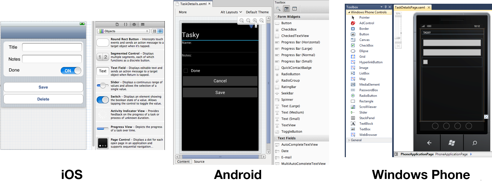

# **P**art 1 - Understanding the Xamarin Mobile Platform

The Xamarin platform consists of a number of elements that allow you to
develop applications for iOS and Android:

- **C# language** – Allows you to use a familiar syntax and
  sophisticated features like Generics, Linq and the Parallel Task Library**.**
- **Mono .NET framework** – Provides a cross-platform
  implementation of the extensive features in Microsoft’s .NET framework**.**
- **Compiler** – Depending on the platform, produces a native
  app (eg**.** iOS) or an integrated .NET application and runtime (eg**.** Android).
  The compiler also performs many optimizations for mobile deployment such as
  linking away un-used code**.**
- **IDE tools** – The Xamarin Studio IDE and the Xamarin plug-in
  for Visual Studio allow you to create, build and deploy Xamarin projects**.**

In addition, because the underlying language is C# with the .NET framework,
projects can be structured to share code that can also be deployed to Windows
Phone**.**

# 1. Under the Hood

Although Xamarin allows you to write apps in C#, and share the same code
across multiple platforms, the actual implementation on each system is very
different**.**

## 1.1. Compilation

The C# source makes its way into a native app in very different ways on each
platform:

- **iOS** – C# is ahead-of-time (AOT) compiled to ARM assembly
  language**.** The .NET framework is included, with unused classes being
  stripped out during linking to reduce the application size**.** Apple does not
  allow runtime code generation on iOS, so some language features are not
  available (see [Xamarin.iOS
  Limitations](http://docs.xamarin.com/guides/ios/advanced_topics/limitations) )**.**
- **Android** – C# is compiled to IL and packaged with MonoVM +
  JIT’ing**.** Unused classes in the framework are stripped out during linking**.**
  The application runs side-by-side with Java/Dalvik and interacts with the
  native types via JNI (see [Xamarin.Android
  Limitations](http://docs.xamarin.com/guides/android/advanced_topics/limitations) )**.**
- **Windows Phone** – C# is compiled to IL and executed by the
  built-in runtime, and does not require Xamarin tools**.** Designing Windows
  Phone applications following Xamarin’s guidance makes it simpler to re-use
  the code on iOS and Android**.**

The linker documentation for [Xamarin.iOS](http://docs.xamarin.com/guides/ios/advanced_topics/linker)  and [Xamarin.Android](http://docs.xamarin.com/guides/android/advanced_topics/linking)  provides more
information about this part of the compilation process**.**

## 1.2. Platform SDK Access

Xamarin makes the features provided by the platform-specific SDK easily
accessible with familiar C# syntax:

- **iOS** – Xamarin.iOS exposes Apple’s CocoaTouch SDK frameworks
  as namespaces that you can reference from C#**.** For example the UIKit
  framework that contains all the user interface controls can be included
  with a simple using MonoTouch.UIKit; statement**.**
- **Android** – Xamarin.Android exposes Google’s Android SDK as
  namespaces, so you can reference any part of the supported SDK with using
  statement, such as using Android.Views; to access the user
  interface controls**.**
- **Windows Phone** – Windows Phone is not part of the Xamarin
  platform**.** When building apps for Windows Phone in C# the SDK is implicitly
  available to your application, including Silverlight/XAML controls for the
  user interface**.**

## 1.3. Seamless Integration for Developers

The beauty of Xamarin is that despite the differences under the hood,
Xamarin.iOS and Xamarin.Android (coupled with Microsoft’s Windows Phone SDK)
offer a seamless experience for writing C# code that can be re-used across all
three platforms.

Business logic, database usage, network access and other common functions can
be written once and re-used on each platform, providing a foundation for
platform-specific user interfaces that look and perform as a native
application**.**

# 2. Integrated Development Environment (IDE) Availability

Xamarin development can be done in either Xamarin Studio or Visual Studio**.** The
IDE you choose will be determined by the platforms you wish to target**.**

Because Windows Phone apps can
only be developed on Windows, it is impossible to develop for all three
platforms on the same operating system**.** However following the guidance in this
document it is possible to reuse code across all these platforms.

The development requirements for each platform are discussed in more detail
below**.**

|  |  |  |  |
| --- | --- | --- | --- |
| **Development OS** | **Mac OS X** | **Windows** | |
| **IDE** | **Xamarin Studio** | **Xamarin Studio** | **Visual Studio** |
| **iOS** |  |  |  |
| **Android** |  |  |  |
| **Windows Phone** |  |  |  |

## 2**.**1. iOS

Developing iOS applications requires a Mac computer, running Mac OS X.
You can also use Visual Studio to write and deploy iOS applications with
Xamarin's iOS Visual Studio plugin, however a Mac is still needed for build
and licensing purposes**.**

Apple’s Xcode IDE must be installed to provide the compiler and simulator
for testing**.** To test on a real device and submit applications for distribution
you must join Apple’s Developer Program ($99 USD per year)**.** Each time you
submit or update an application it must be reviewed and approved by Apple before
it is made available for customers to download**.**

Code is written with the *Xamarin Studio* or *Visual Studio* IDE
and screen layouts can be edited with Apple’s *Interface Builder* or built
programmatically**.** Refer to the [Xamarin.iOS Installation Guide](http://docs.xamarin.com/guides/ios/getting_started/installation)  for
detailed instructions**.**

## 2.2**.** Android

Android application development requires the Java and Android SDKs to be
installed**.** These provide the compiler, emulator and other tools required for
building, deployment and testing**.** Java, Google’s Android SDK and Xamarin’s
tools can all be installed and run on the following configurations:

- Mac OS X with the *Xamarin Studio* IDE
- Windows 7 or 8 with the *Xamarin Studio* IDE
- Windows 7 or 8 with *Visual Studio 2010* or *Visual Studio
  2**012*

Xamarin provides a unified installer that will configure your system with the
pre-requisite Java, Android and Xamarin tools (including a visual designer for
screen layouts)**.** Refer to the [Xamarin.Android Installation
Guide](http://docs.xamarin.com/guides/android/getting_started/installation)  for detailed instructions**.**

You can build and test applications on a real device without any license from
Google, however to distribute your application through a store (such as Google
Play, Amazon or Barnes & Noble) a registration fee may be payable to the
operator**.** Google Play will publish your app instantly, while the other stores
have an approval process similar to Apple’s**.**

## 2.3. Windows Phone

Windows Phone apps are built with Microsoft’s *Visual Studio 2010*
or *2012* toolset**.** They do not use Xamarin directly, however C# code can
be shared with across Windows Phone, iOS and Android using Xamarin’s tools**.**
Visit Microsoft’s [App
Hub](http://create.msdn.com/)  to learn about the tools required for Windows Phone development**.**

# 3. Creating the User Interface (UI)

A key benefit of using Xamarin is that the application user interface uses
native controls on each platform and is therefore indistinguishable from an
application written in Objective-C or Java (for iOS and Android
respectively)**.**

When building screens in your app, you can either lay out the controls in
code or create complete screens using the design tools available for each
platform**.**

## 3.1**.** Programmatically Create Controls

Each platform allows user interface controls to be added to a screen using
code**.** This can be very time-consuming as it can be difficult to visualize the
finished design when hard-coding pixel coordinates for control positions and
sizes**.**

Programmatically creating controls does have benefits though, particularly on
iOS for building views that resize or render differently across the iPhone and
iPad screen sizes**.**

## 3**.**2. Visual Designer

Each platform has a different method for visually laying out screens:

- **iOS** – Xamarin Studio and Visual Studio integrate with Apple’s Xcode Interface
  Builder which allows you to create individual screen layouts or storyboards
  that describe multiple screens**.** This results in .XIB or .STORYBOARD files
  that are included in your project**.**
- **Android** – Xamarin provides an Android drag-and-drop UI
  designer for both Xamarin Studio and Visual Studio**.** Android screen layouts are
  saved as .AXML files when using Xamarin tools**.**
- **Windows Phone** – Microsoft provides a drag-and-drop UI
  designer in Visual Studio and Blend**.** The screen layouts are stored as .XAML
  files**.**

These screenshots show the visual screen designers available on each
platform:

[](http://docs.xamarin.com/static/guides/cross-platform/application_fundamentals/building_cross_platform_applications/part_1_-_understanding_the_xamarin_mobile_platform/Images/Designer-ALL.png)

In all cases the elements that you create visually can be referenced in your
code**.**

## 3.3**.** User Interface Considerations

A key benefit of using Xamarin to built cross platform applications is that
they can take advantage of native UI toolkits to present a familiar interface to
the user**.** The UI will also perform as fast as any other native application**.**

Some UI metaphors work across multiple platforms (for example, all three
platforms use a similar scrolling-list control) but in order for your
application to ‘feel’ right the UI should take advantage of
platform-specific user interface elements when appropriate**.** Examples of
platform-specific UI metaphors include:

- **iOS** – hierarchical navigation with soft back button, tabs
  on the bottom of the screen**.**
- **Android** – hardware/system-software back button, action
  menu, tabs on the top of the screen**.**
- **Windows Phone** – hardware back button, panorama layout
  control, live tiles**.**

It is recommended that you read the design guidelines relevant to the
platforms you are targeting:

# 4**.** Library and Code Re-use

The Xamarin platform allows re-use of existing C# code across all platforms
as well as the integration of libraries written natively for each platform**.**

## 4.1. C# Source and Libraries

Because Xamarin products use C# and the .NET framework, lots of existing
source code (both open source and in-house projects) can be re-used in Xamarin.iOS
or Xamarin.Android projects**.** Often the source can simply be added to a Xamarin
solution and it will work immediately**.** If an unsupported .NET framework feature
has been used, some tweaks may be required**.**

Examples of C# source that can be used in Xamarin.iOS or Xamarin.Android
include: SQLite-NET, NewtonSoft.JSON and SharpZipLib**.**

## 4.2**.** Objective-C Bindings + Binding Projects

Xamarin provides a tool called *btouch* that helps create bindings
that allow Objective-C libraries to be used in Xamarin.iOS projects**.** Refer to the
[Binding
Objective-C Types documentation](http://docs.xamarin.com/guides/ios/advanced_topics/binding_objective-c_types)  for details on how this is done**.**

Examples of Objective-C libraries that be used in Xamarin.iOS include: RedLaser
barcode scanning, Google Analytics and PayPal integration**.** Open-source Xamarin.iOS
bindings are available on [github](https://github.com/mono/monotouch-bindings) **.**

## 4.3. .jar Bindings + Binding Projects

Xamarin supports using existing Java libraries in Xamarin.Android**.** Refer to
the [Binding a Java Library documentation](http://docs.xamarin.com/guides/android/advanced_topics/java_integration_overview/binding_a_java_library_(.jar))  for details on how to use a .JAR file
from Xamarin.Android**.**

Open-source Xamarin.Android bindings are available on [github](https://github.com/mono/monodroid-bindings) **.**

## 4.4. C via PInvoke

"Platform Invoke" technology (P/Invoke) allows managed code (C#) to call
methods in native libraries as well as support for native libraries to call back
into managed code**.**

For example, the [SQLite-NET](https://github.com/praeclarum/sqlite-net)  library uses statements like this:

```
[DllImport("sqlite3", EntryPoint = "sqlite3_open", CallingConvention=CallingConvention.Cdecl)]
public static extern Result Open (string filename, out IntPtr db);
```

to bind to the native C-language SQLite implementation in iOS and Android**.**
Developers familiar with an existing C API can construct a set of C# classes to
map to the native API and utilize the existing platform code**.** There is
documentation for [linking native
libraries](http://docs.xamarin.com/guides/ios/advanced_topics/native_interop)  in Xamarin.iOS, similar principles apply to Xamarin.Android**.**

## 4**.**5. C++ via Cxxi

Miguel explains CXXI on his [blog](http://tirania.org/blog/archive/2011/Dec-19.html) **.** An
alternative to binding to a C++ library directly is to create a C wrapper and
bind to that via P/Invoke**.**

[Part 2 - Architecture](http://docs.xamarin.com/guides/ios/application_fundamentals/building_cross_platform_applications/part_2_-_architecture)  >>
