# 1**.** Overview

Xamarin Components provide a variety of different components to use in *Xamarin.iOS* and *Xamarin.Android* applications**.**
Components range from user interface controls to code libraries, as well as user interface themes**.** They allow applications built on
Xamarin to create rich user experiences and integrate with many different third party services with very little work**.**

In this article, we’ll look at how to include a component in a project and demonstrate the tool chain that makes the process seamless**.**

# 2. Walkthrough

Let’s walk through the process to incorporate a component from the *Xamarin Components Store***.**
For this walkthrough, we’ll work with a project named HelloComponents, created from the Xamarin.iOS
`Single View Application` template in Xamarin Studio or the `HelloWorld` `Application`
template in Visual Studio respectively**.** However, the steps to include a component are the same irrespective of the project template used**.**

## 2.1**.** Component Store from Xamarin Studio

### 2**.**1**.**1. Creating a New Project

First, create a project named HelloComponents as shown below for Xamarin Studio:

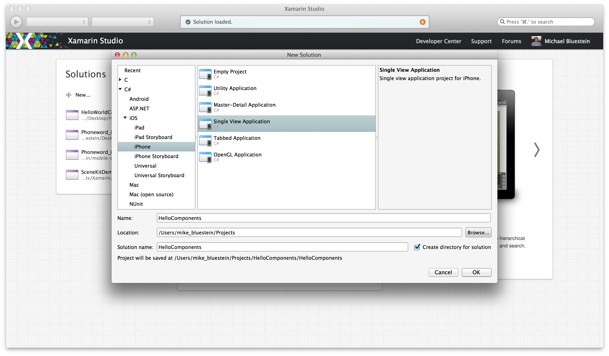

### 2**.**1.2**.** Launching the Component Manager

With the project loaded in Xamarin Studio, either double-click on the Components folder
in the Solution Pad, or and select `Component` `Manager`:

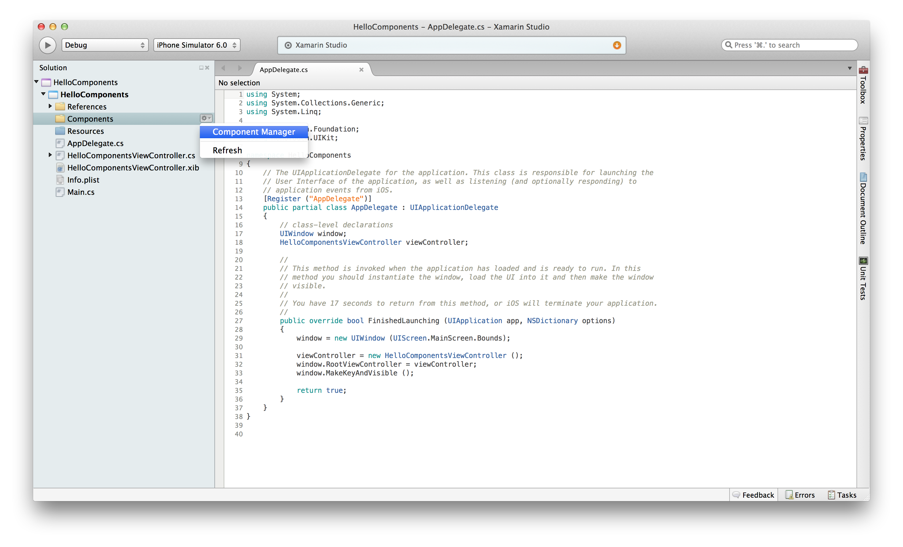

This launches the *Xamarin* *Component* *Manager***.**
The Component Manager is where all previously downloaded components are displayed**.**
The first time the Component Manager opens, no components will have yet been added, so it shows default screen below:

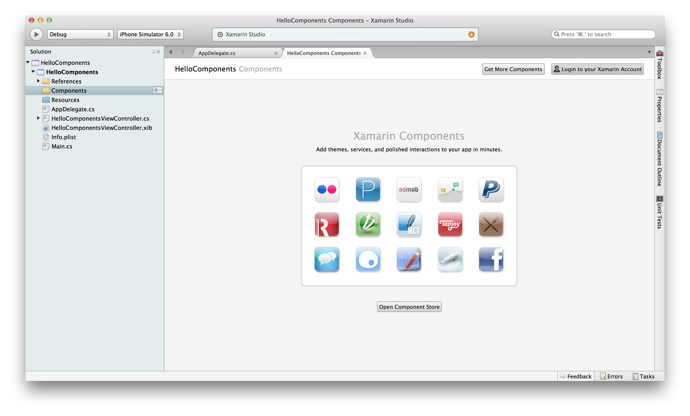

### 2**.**1**.**3. Logging into the Component Store

Accessing the Components Store requires a Xamarin Store account**.** To log in from the Component Manager,
click the `Login to your Xamarin Account` button in the upper right**.** This will launch a browser to
connect to a Xamarin account as shown below:

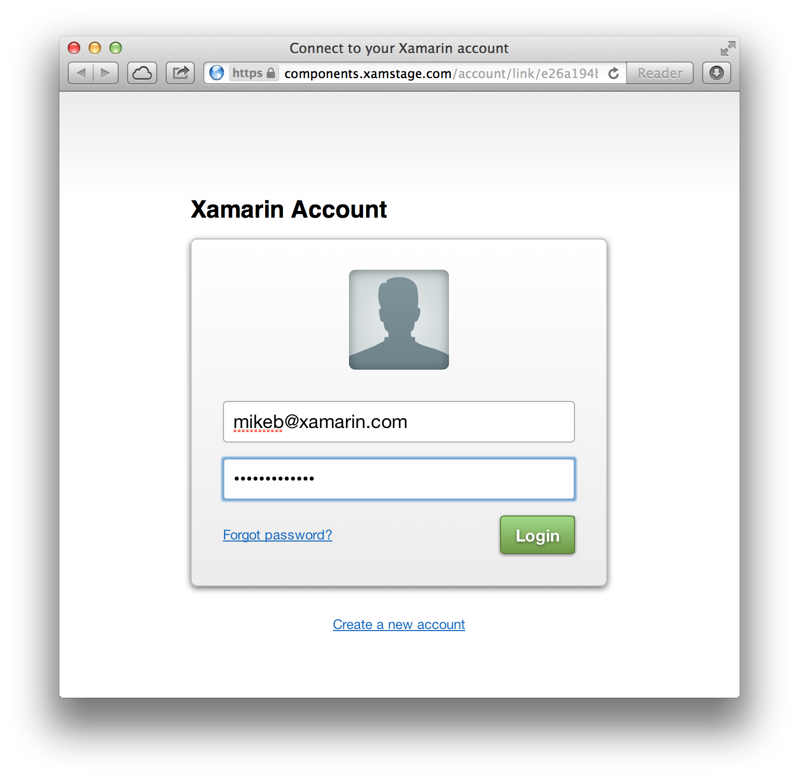

In the browser, select the `Log into Xamarin Studio` button to connect a Xamarin account
to Xamarin Studio**.** Once this is done, the browser shows the following message indicating the account is successfully connected:

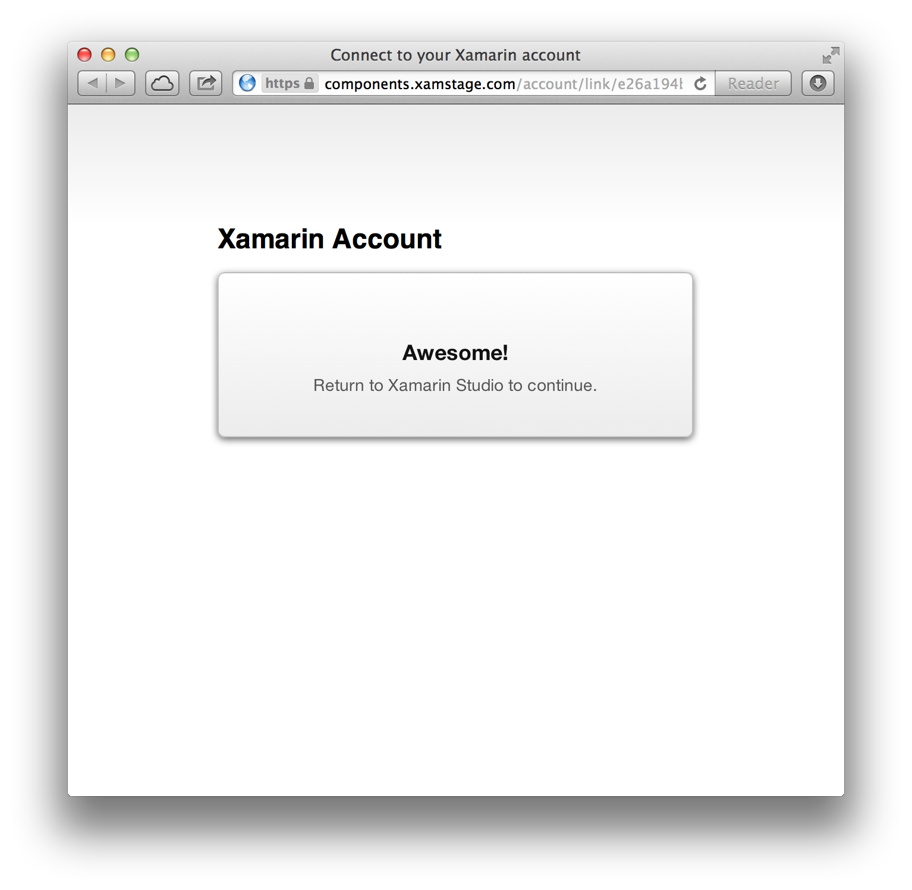

Next, we can close the browser and return to Xamarin Studio to include a component**.**

## 2.2. Component Store from Visual Studio

### 2**.**2.1. Login to Xamarin Account

To use Xamarin.iOS from Visual Studio, the workflow is a bit different than from Xamarin Studio,
as it requires being connected to a Xamarin Account before creating an iOS project**.** To log in to a
Xamarin account, select `Tools > Xamarin Account` from the main menu in Visual Studio,
and then enter your credentials in the Xamarin Account dialog**.**

After logging in, the browser shows the following message indicating the account is successfully
connected and Xamarin.iOS is ready to use from Visual Studio:

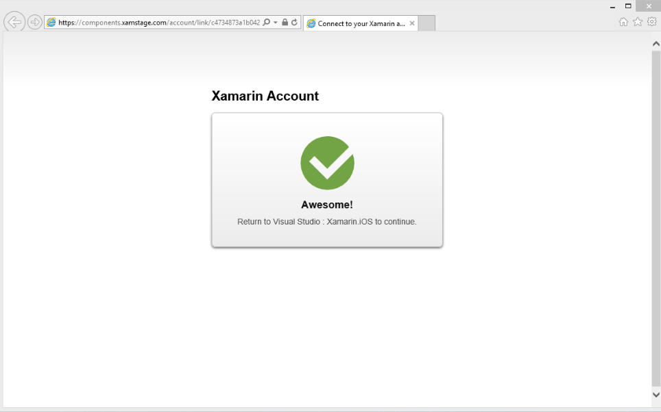

### 2**.**2.2. Create New Project

After logging in to a Xamarin account, create a new iOS project by selecting `File > New > Project`**.** Select the
`HelloWorld Application` template under the `iOS > iPhone` section and name the project HelloComponents,
as shown below:

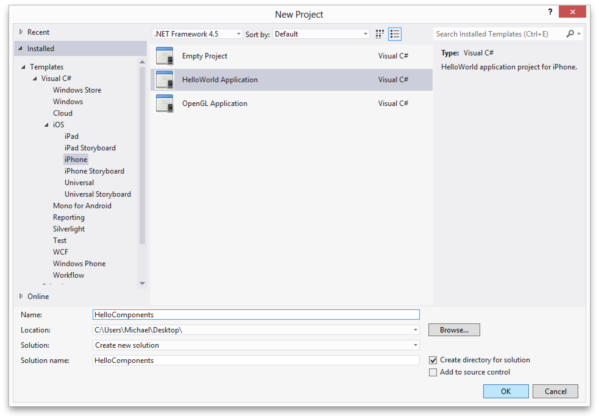

### 2**.**2**.**3. Launching the Component Manager

With the project created, right-click on the `Components` folder in the `Solution Explorer` and select
`Get More Components`:

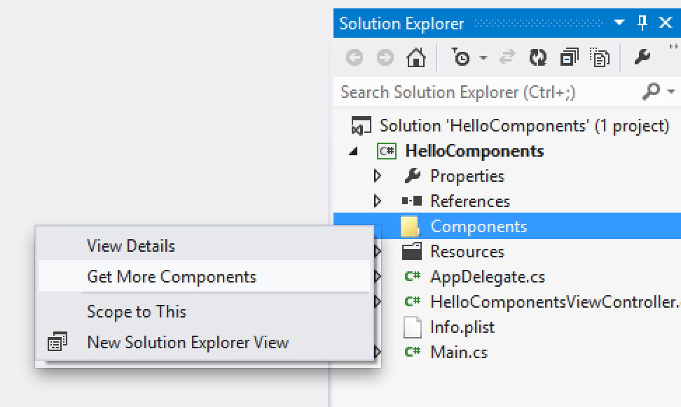

This loads the Components List shown below:

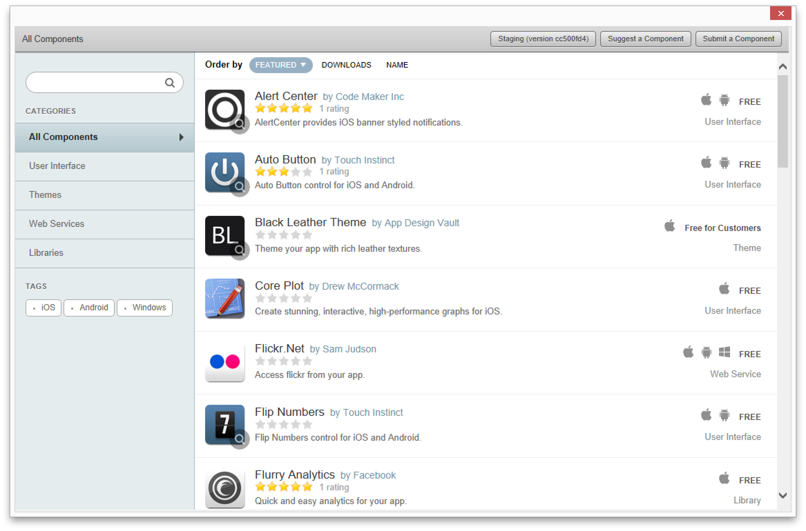

## 2**.**3. Xamarin Components List

After connecting to the Component Store in either Xamarin Studio or Visual Studio, the following window shows all the
components available in the Component Store:

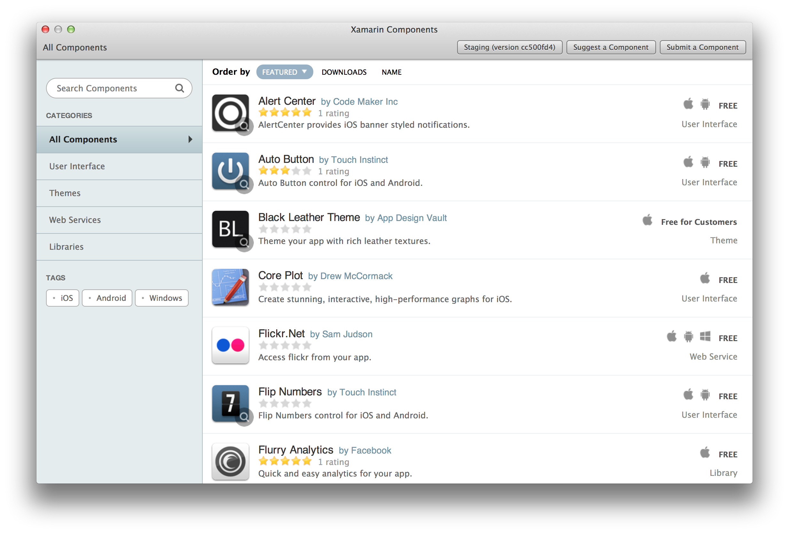

From this window we can:

- Search for components by name**.**
- Filter components by category and tag**.**
- Sort components by whether they are featured, number of downloads and name**.**
- Make suggestions for Components.
- Submit Components**.**
- Select a component to include in a project**.**

### 2.3.1**.** Including a Component

Let’s include the Alert Center Component**.** Double-click on the Alert Center component in the list to open the component’s page:

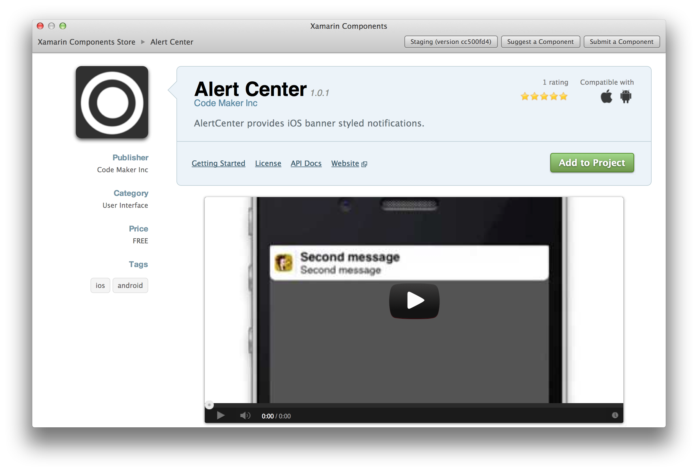

From the component page, select the `Add to Project`
button to download the component and add it to the current project**.** When the download completes, the component
will be displayed under the `Components` folder in the Solution Pad, with a screen showing details about
the component loaded in the tabbed section of Xamarin Studio**.**

In Visual Studio, double-click the component in the Solution Explorer in Visual Studio to show the detail screen:

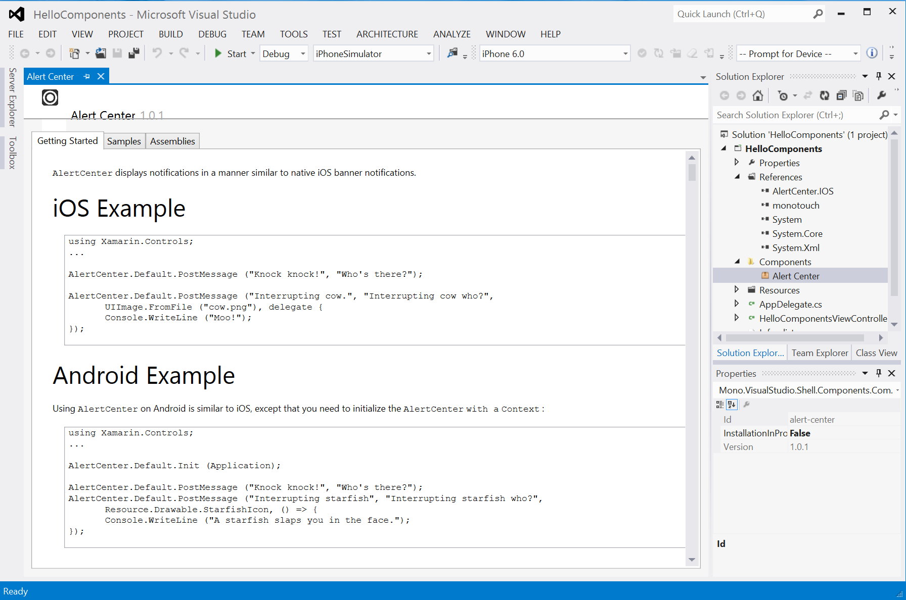

### 2**.**3.2. Component Detail Screen

The detail screen under the tab includes the following sections:

- `Getting Started` – Code snippets to get started using the component**.**

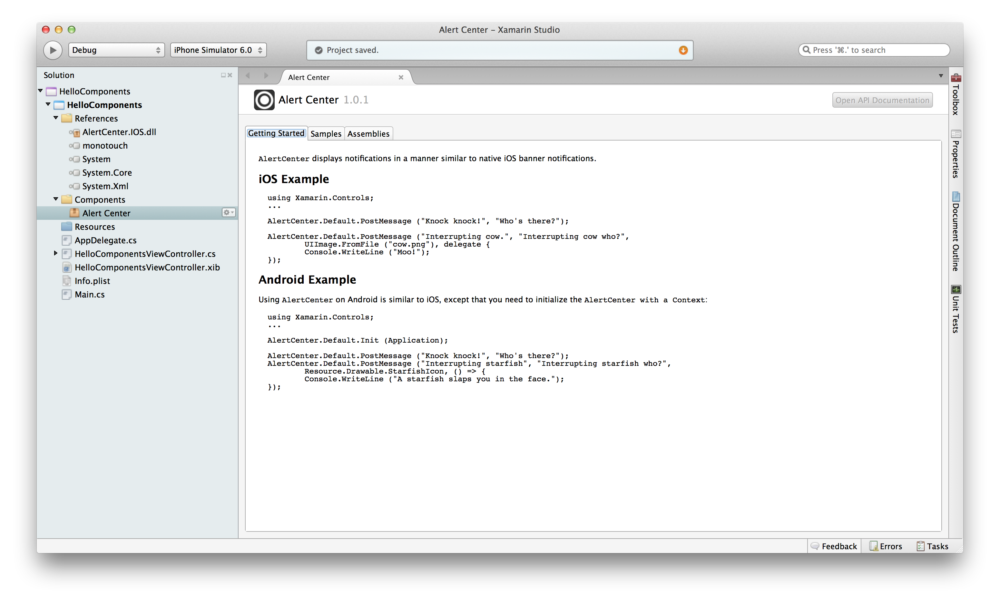

- `Samples` – Sample projects that use the component, which can be added to the current solution**.**

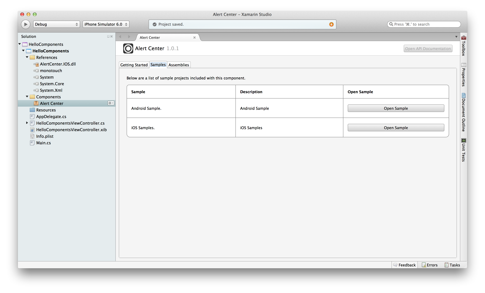

- `Assemblies` – Assemblies included with the component**.**

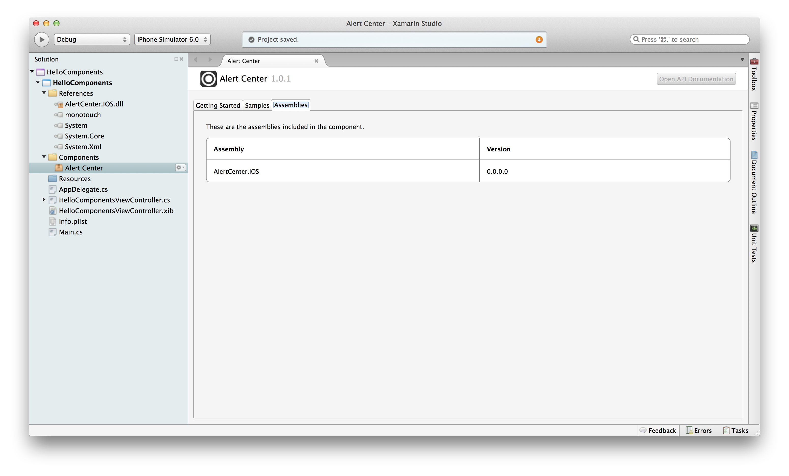

### 2**.**3.3**.** Adding Component Code

Let’s use the code sample from the Getting Started tab to add the Alert Center component to our project**.**

In the HelloComponentsViewController class, add the following code to the ViewDidLoad method:

1  
2  
3  
4  
5  
6  
7  
8  
9  
10

`public override void ViewDidLoad ()
{
base.ViewDidLoad ();
AlertCenter.Default.PostMessage (
"First message",
"Hello world",
UIImage.FromFile ("sample_icon.png"),
() => { Console.WriteLine ("First message clicked");
});
}`

Also add an image named sample\_icon.png, which the AlertCenter code above will display in the alert**.**
In lieu of creating an image, there is a sample\_icon.png in the sample code that accompanies this article that can be used**.**
Also, there is a Default-568h@2x.png file included so that the application will launch in full screen on an iPhone 5**.**
See the [iPhone 5 Resolution](http://docs.xamarin.com/ios/Guides/Platform_Features/Introduction_to_iOS_6#iPhone_5_Resolution)
section of the [Introduction to iOS 6](http://docs.xamarin.com/ios/Guides/Platform_Features/Introduction_to_iOS_6)  article
for more information about the Default-568h@2x.png file**.**

With the code and images above added, running the application now displays an alert as shown below:

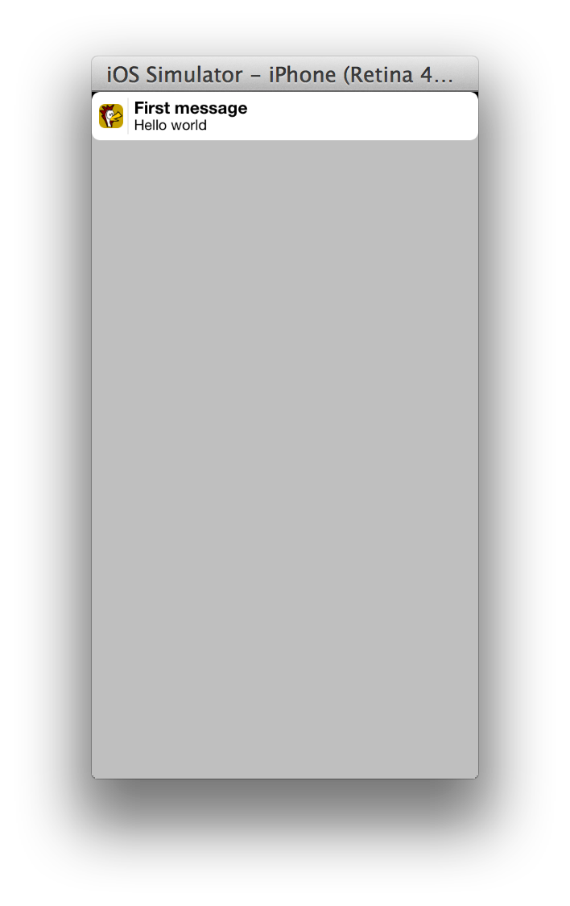

# 3**.** Summary

This document covered how to use the Xamarin Component Store to incorporate a component into an application**.**
It showed the IDE integration with the Component Store as well as features of the store itself, such as searching and filtering,
which make finding the right component a breeze**.** It also showed how to download and include a component with a single click,
as well as using the code provided with a component to get up and running quickly**.**
