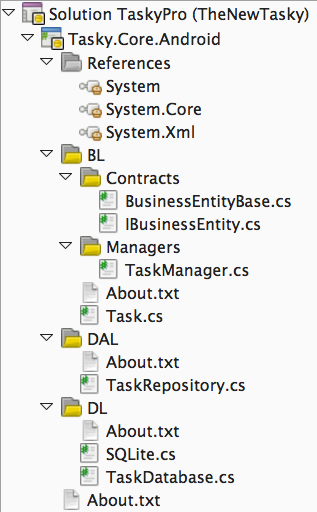
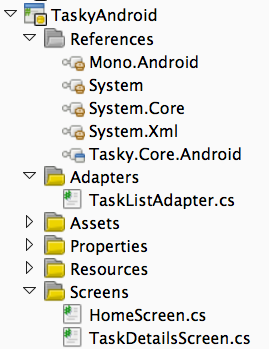
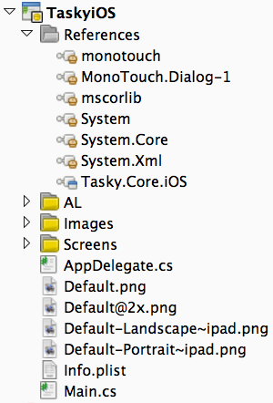

# **P**art 3 - Setting Up A Xamarin Cross Platform Solution

  
  

PDF for Offline Use:
:   - [Download PDF](http://docs.xamarin.com/sites/xamarin.com/files/pdfs/part_3_-_setting_up_a_xamarin_cross_platform_solution-18628.pdf)

Regardless of what platforms are being used, Xamarin projects all use the
same solution file format (the Visual Studio “.SLN” file format)**.** Solutions
can be shared across development environments, even when individual projects
cannot be loaded (such as a Windows phone project in Xamarin Studio)**.**

When creating a new cross platform application, the first step is to create a
blank solution**.** This section what happens next: setting up the projects for
building cross platform mobile apps**.**

# 1. Sharing Code

Refer to the [Sharing
Code Options](http://docs.xamarin.com/guides/cross-platform/application_fundamentals/building_cross_platform_applications/sharing_code_options)  document for a detailed description of how to implement
code-sharing across platforms.

## 1**.**1. File-linking into each App Project

The simplest approach to sharing code files is to place them in a separate
directory and use file-linking to include them directly into each of your mobile
application projects**.** When a file is added, moved or deleted then each mobile
application project must be manually updated to reflect the change**.**

This method allows you to share the same across different platform projects,
and use compiler directives to include different, platform-specific code
paths**.**

## 1.2. Platform-specific Library Projects

If a Portable Class Library is not suitable for your needs, it is possible to
share code across platform-specific applications using file linking or cloned
project files**.** These project types remain targeted to a specific framework, and
share code at the individual C# file level**.** Both these mechanisms require manual
synchronization of the files included in the project**.**

Platform-specific projects allow the definition and use of compiler
directives to include different code-paths in the shared code**.** They also allow
you to reference platform specific assemblies (so long as all the code
referencing the assembly is also bounded by a compiler directive)**.**

## 1.3. Portable Class Libraries (PCL)

Historically a .NET project file (and the resulting assembly) has been
targeted to a specific framework version**.** This prevents the project or the
assembly being shared by different frameworks**.**

A Portable Class Library (PCL) is a special type of project that can be used
across disparate CLI platforms such as Xamarin.iOS and Xamarin.Android, as well
as Silverlight, WPF, Windows Phone and Xbox**.** The library can only utilize a
subset of the complete .NET framework, limited by the platforms being
targeted**.**

Xamarin’s support for Portable Class Libraries is currently under
development**.**

# 2. Populating the Solution

Regardless of which method is used to share code, the overall solution
structure should implement a layered architecture that encourages code sharing**.**
The Xamarin approach is to group code into two project types:

- **Core project** – Write re-usable code in one place, to be
  shared across different platforms. Use the principles of encapsulation to
  hide implementation details wherever possible**.**
- **Platform-specific application projects** – Consume the
  re-usable code with as little coupling as possible**.** Platform-specific
  features are added at this level, built on components exposed in the Core
  project**.**

Within each project the source is grouped physically (using directories) and
logically (using namespaces) to enforce architectural separation and make large
applications easier to manage**.**

## 2.1**.** Core Project

Shared code projects should only reference assemblies that are available
across all platforms – ie**.** the common framework namespaces like
System, System.Core and System.Xml**.**

Shared projects should implement as much non-UI functionality as is possible,
which generally includes the following layers:

- **Data Layer** – Code that takes care of physical data storage
  eg**.** [SQLite-NET](https://github.com/praeclarum/sqlite-net) , an alternative database like [CoolStorage](http://viciproject.com/wiki/projects/coolstorage/home)  or even XML files**.** The data layer classes are
  normally only used by the data access layer**.**
- **Data Access Layer** – Defines an API that supports the
  required data operations for the application’s functionality, such as
  methods to access lists of data, individual data items and also
- **Service Access Layer** – An optional layer to provide cloud
  services to the application**.** Contains code that accesses remote network
  resources (web services, image downloads, etc) and possibly caching of the
  results**.**
- **Business Layer** – Definition of the Model classes and the
  Façade or Manager classes that expose functionality to the
  platform-specific applications**.**

## 2.2. Platform-Specific Application Projects

Platform-specific projects must reference the assemblies required to bind to
each platform’s SDK (Xamarin.iOS, Xamarin.Android or Windows Phone) as well as
the Core shared code project**.**

The platform-specific projects should implement:

- **Application Layer** – Platform specific functionality and
  binding/conversion between the Business Layer objects and the user
  interface**.**
- **User Interface Layer** – Screens, custom user-interface
  controls, presentation of validation logic**.**

## 2.3. EXAMPLE

The application architecture is illustrated in this diagram:

These screenshots show a solution setup with the shared Core project, iOS and
Android App Projects**.** The Core project contains folders for each of the
architectural layers, plus minimal references to .NET framework assemblies:

Specific examples of how projects should be structured are given in the case
studies**.**

# 3**.** Project References

Project references reflect the dependencies for a project**.** Core projects
limit their references to common assemblies so that the code is easy to share**.**
Platform-specific application projects reference the shared Core, plus any other
platform-specific assemblies they need to take advantage of the target
platform**.**

The application projects each reference their respective platform SDKs
(Xamarin.iOS and Mono.Android) as well as the Core project, and contain the
user-interface code required to present functionality to the user, as shown in
these screenshots:

Specific examples of how projects should be structured are given in the case
studies**.**

# 4. Adding Files

As discussed in the
[Code Sharing Strategies](http://docs.xamarin.com/guides/cross-platform/application_fundamentals/building_cross_platform_applications/building_cross_platform_applications/part_5_-_practical_code_sharing_strategies) 
document, when adding
shared-code files the same file must be manually added or linked in each Core
project (one for each platform)**.**

The platform-specific application projects can be treated like any regular
.NET project: code and resources should be managed independently of the other
projects**.** Add code, image, XML and other files directly to the platform-specific
projects**.**

## 4.1**.** Build Action

It is important to set the correct build-action for certain file types**.** This
list shows the build action for some common file types:

- **All C# files** – Build Action: Compile
- **Images in Xamarin.iOS & Windows Phone** – Build Action:
  Content
- **XIB and Storyboard files in Xamarin.iOS** – Build Action:
  InterfaceDefinition
- **Images and AXML layouts in Android** – Build Action:
  AndroidResource
- **XAML files in Windows Phone** – Build Action: Page

Generally the IDE will detect the file type and suggest the correct build
action**.**

## 4.2. Case Sensitivity

Finally, remember that some platforms have case-sensitive file systems (eg**.**
iOS and Android) so be sure to use a consistent file naming standard and make
sure that the file names you use in code match the filesystem exactly**.**

[Part 4 - Handling Platform Divergence/Abstraction/Divergent Implementation](http://docs.xamarin.com/guides/cross-platform/application_fundamentals/building_cross_platform_applications/part_4_-_platform_divergence_abstraction_divergent_implementation) 
>>
