# 1**.** File Linking into each App Project

The simplest approach to sharing code files is to place them in a separate
directory (ie**.** outside of your various mobile application projects) and use
file-linking to include them**.**

This screenshot shows a solution file containing three application projects
(for Android, iOS and Windows Phone), each with a ‘Tasky.Core’ folder that
contains links to the same set of C# source code files:

[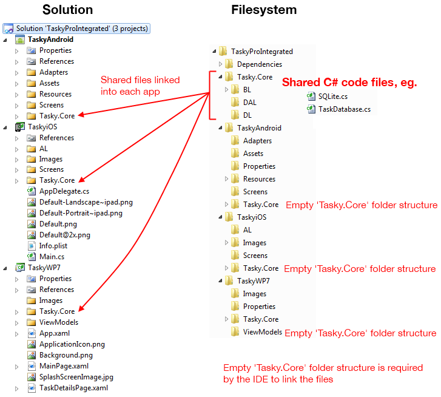](http://docs.xamarin.com/static/guides/cross-platform/application_fundamentals/building_cross_platform_applications/sharing_code_options/Images/Integrated-Solution-with-files.png)

The conceptual architecture is shown in the following diagram, where each
project includes links to all the shared source files:

[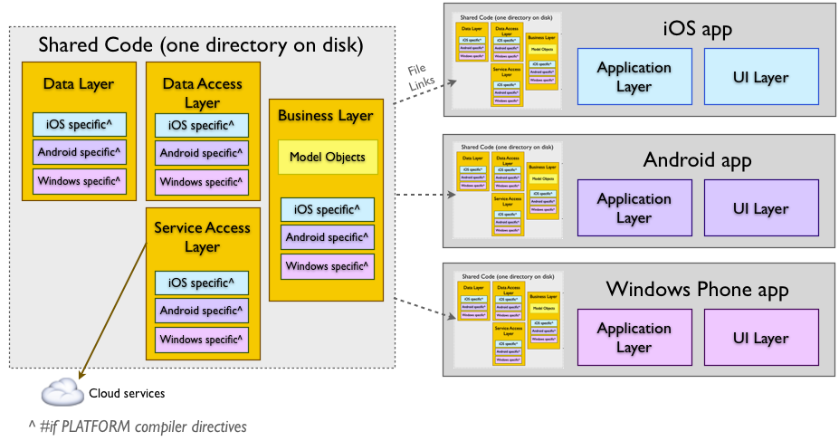](http://docs.xamarin.com/static/guides/cross-platform/application_fundamentals/building_cross_platform_applications/sharing_code_options/Images/Integrated.png)

## 1**.**1**.** Example

A cross platform application that supports iOS, Android and Windows Phone
would require an application project for each platform**.** The shared code lives in
a separate filesystem directory from all the projects, and all the shared source
code files are linked in to each application’s project**.**

An example solution would contain the following folders and projects (project
names have been chosen for expressiveness, your projects do not have to follow
these naming guidelines):

- **Core** – Filesystem directory containing the shared code**.**
  *Optionally* create a “csproj” file to manage the source, but this
  project file will not be referenced by any other part of the solution**.**
- **AppAndroid** – Xamarin.Android application that contains
  linked-files for all the source code in the Core directory**.**
- **AppiOS** – Xamarin.iOS application that contains linked-files
  for all the source code in the Core directory**.**
- **AppWP7** – Windows Phone application that contains
  linked-files for all the source code in the Core directory**.**

In this way the three application projects are effectively sharing the same
source code (the C# files in Core.Android)**.** Any edits to the shared code will be
shared across all three projects – however, file additions or deletions must
be done manually**.** Add files in the filesystem (or use a separate library project
to contain them) and then update all the application projects’ linked files to
keep them in sync**.**

## 1.2. Benefits

- Allows you to share code across multiple projects**.**
- Shared code can be branched based on the platform using compiler
  directives (eg**.** using #if \_\_ANDROID\_\_, as discussed in the
  [Building Cross Platform Applications](http://docs.xamarin.com/guides/cross-platform/application_fundamentals/building_cross_platform_applications) 
  document)**.**
- Application projects can include platform-specific references that the
  shared code can utilize (such as using
  Community.CsharpSqlite**.**WP7 in the Tasky and MWC samples).

## 1**.**3. Disadvantages

- In Visual Studio there is no simple way to add an entire filesystem
  ‘tree’ to a project, so files must be individually added**.** The directory
  hierarchy must also be manually created**.**
- If you add, delete or move a file in one project you must remember to
  perform the same action in all the other project files**.**
- Refactoring will only work within one platform type**.**
- Empty subdirectories must also exist before you can ‘link’ files
  contained within a subdirectory**.**
- If you forget to choose Add As Link (in Visual
  Studio), it will *copy* the file into your target project instead of
  linking**.** If you don’t notice this has occurred you could accidentally edit
  both the original file and the copy, getting them out-of-sync**.**

## 1.4**.** Remarks

Works for all platforms but requires careful, manual management of file
links**.**

## 1**.**5. Using File Linking

### 1.5.1**.** Visual Studio

When you Add Existing Item in Visual Studio, choose
the Add As Link drop down option in the Open dialog, and
a link to the file will be added to the project**.**

1) Right-click in the linked project and choose Add >
Existing Item…

[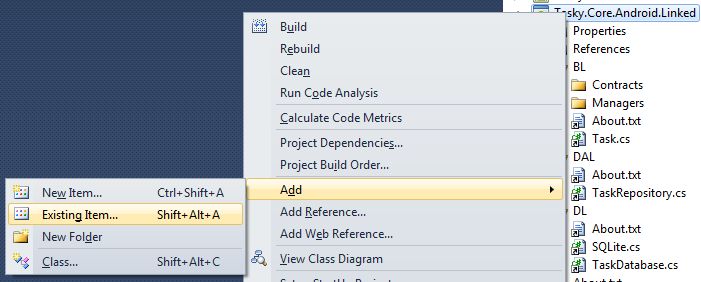](http://docs.xamarin.com/static/guides/cross-platform/application_fundamentals/building_cross_platform_applications/sharing_code_options/Images/Linked-visualstudio-addexisting.png)

2) Choose Add As Link from the drop-down button –
DO NOT press Add because Visual Studio will make a copy
of the file instead of linking it**.**

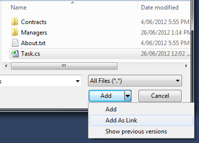

3) Repeat this process for every file in the shared project**.** Whenever a new
file is added, or existing files are moved or deleted, the linked projects must
be manually kept synchronized**.**

### 1.5.2. Xamarin Studio

When you Add Existing Files in Xamarin Studio, it will
detect that the file lives under a different directory and will offer to add a
link to the file**.**

1) Right-click in your linked project and choose Add
Files..**.**

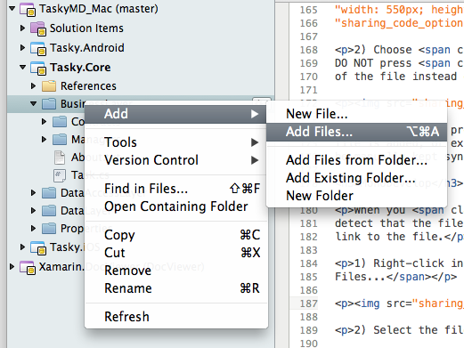

2) Select the file/s to link**.**

[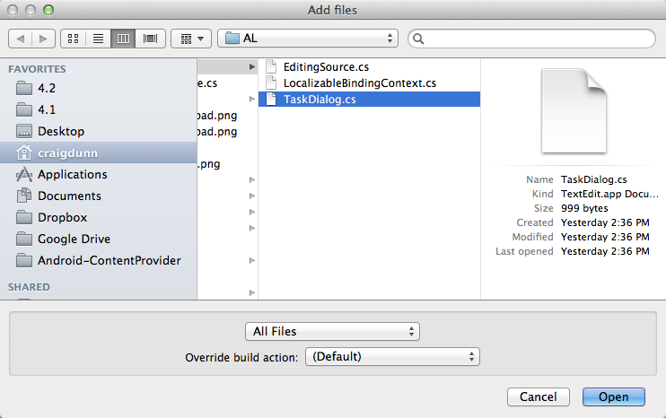](http://docs.xamarin.com/static/guides/cross-platform/application_fundamentals/building_cross_platform_applications/sharing_code_options/Images/Linked-monodevelop-adddialog.png)

3) Xamarin Studio will detect that the file is outside your linked project’s
directory, and offer the following options**.** Choose Add a link
to the file and press OK**.**

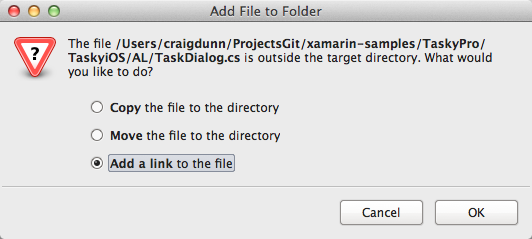

4) Repeat this process for every file in the shared project**.** Whenever a new
file is added, or existing files are moved or deleted, the linked projects must
be manually kept synchronized**.**

# 2. File Linking to Separate Projects

The previous section describes linking shared code files directly into each
platform-specific project**.** For larger apps it may be preferable to create a
separate library project to manage the shared code**.**

To do this, create one library project as the ‘source’ of the shared
files**.** For any other platforms that are being supported, create a new project in
its own directory and link all the files in the source project**.**

These screenshots show an example source project and linked projects**.** The
icon indicates when a file is linked.

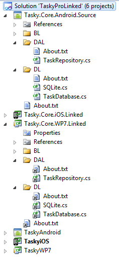

In the file system linked projects consist of the “.csproj” and a lot of
empty folders, because the folders must exist on disk even if the source files
in the project are only ‘linked’**.** This screenshot shows a ‘source’
project with “.cs” files in one of the directories, and the two linked
projects with complete directory structures (which are totally empty on the
filesystem, because files are only ‘linked’ in the project itself)**.**

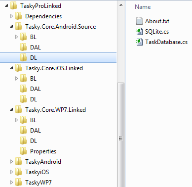

The conceptual architecture is shown in this diagram:

[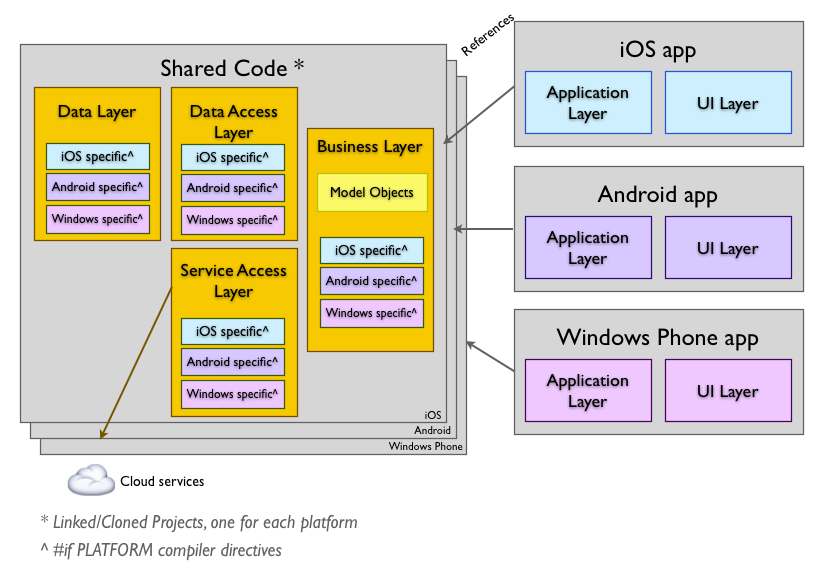](http://docs.xamarin.com/static/guides/cross-platform/application_fundamentals/building_cross_platform_applications/sharing_code_options/Images/LinkedFiles.png)

## 2**.**1. Example

A cross platform application that supports iOS, Android and Windows Phone
would require three shared-code project files and three application projects**.**
Because the Android project can be loaded in both Xamarin Studio and Visual Studio
it makes sense to use it as the ‘source’ project**.**

An example solution would contain the following folders and projects (project
names have been chosen for expressiveness, your projects do not have to follow
these naming guidelines):

- **Core.Android.Source** – Xamarin.Android Library Project
  that *contains* the shared source files**.**
- **Core.iOS.Linked** – Xamarin.iOS Library Project that
  *links* to all the files in Core.Android**.** This project contains the
  same directory structure as Core.Android but NO physical C# files, they are
  all linked**.**
- **Core.WP7.Linked** – Windows Phone Library Project that
  *links* to al the files in Core.Android**.** This project contains the
  same directory structure as Core.Android but NO physical C# files, they are
  all linked**.**
- **AppAndroid** – Xamarin.Android application that references
  Core.Android**.**
- **AppiOS** – Xamarin.iOS application that references Core.iOS**.**
- **AppWP7** – Windows Phone application that references
  Core**.**WP7.

In this way the three application projects are effectively sharing the same
source code (the C# files in Core.Android)**.** Any changes to the shared code
should be done in the Core.Android project – file additions or deletions must
then be manually re-done in the other two Core projects with linked files to
keep them in sync**.**

## 2.2**.** Benefits

- Allows you to share code across multiple projects**.**
- Platform-specific projects can each have different compiler directives
  defined, so you can branch code based on the platform (eg**.** using #if
  \_\_ANDROID\_\_, as discussed in the [Building Cross Platform
  Applications] document)**.**
- Platform-specific projects can include platform-specific references (such
  as using Community.CsharpSqlite**.**WP7 in the Tasky and MWC
  samples). The code using these references can be managed with compiler
  directives**.**

## 2.3**.** Disadvantages

- In Visual Studio there is no simple way to add an entire filesystem
  ‘tree’ to a project, so files must be individually added**.** The directory
  hierarchy must also be manually created**.**
- If you add, delete or move a file in one project you must remember to
  perform the same action in all the other project files**.**
- Refactoring will only work within one platform type**.**
- The project file must live in a separate directory to enable files to be
  linked**.** Empty subdirectories must also exist before you can ‘link’ files
  contained within a subdirectory**.**
- If you forget to choose Add As Link (in Visual
  Studio), it will *copy* the file into your target project instead of
  linking**.** If you don’t notice this has occurred you could accidentally edit
  both the original file and the copy, getting them out-of-sync**.**

## 2.4. Remarks

Works for all platforms but requires careful, manual management of file
links**.**

# 3. Clone Project Files

All shared source files (including the project files) live in the same
directory**.**

Create new Library project for each platform and move it into the same
location as the source files**.**

When you Add Existing Files, the IDE will detect that
the file lives under the same directory tree and will add a ‘real’ file
reference (ie**.** not a linked file). The three Core projects in this screenshot
live in the same directory as shown**.** The same set of directories and C# files
are referenced by all three “.csproj” project files**.**

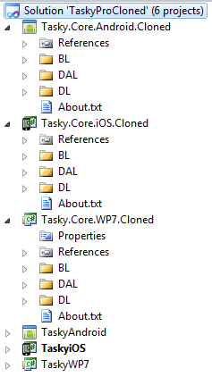

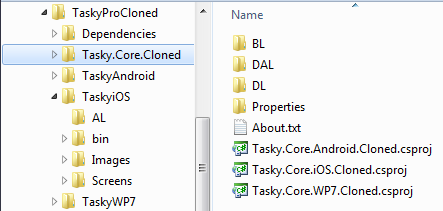

The platform-specific application projects then reference the relevant Core
project and implement the user interface for the target platform**.**

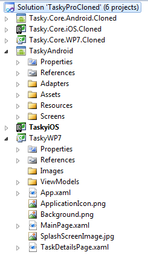

## 3**.**1. Example

A cross platform application that supports iOS, Android and Windows Phone
would require three shared-code project files and three application projects**.**
The shared-code projects are located in the same folder (unlike file linking,
where a separate folder is required for each) and they all reference the source
files directly**.**

An example solution would contain the following folders and projects:

- **Core** – A folder containing all the shared source files and
  three manually-created project files: **Core.Android**,
  **Core.iOS**, **Core**.**WP7**. Each project file has
  a direct file reference to the complete set of C# files**.**
- **AppAndroid** – Xamarin.Android application that references
  Core.Android**.**
- **AppiOS** – Xamarin.iOS application that references Core.iOS**.**
- **AppWP7** – Windows Phone application that references
  Core**.**WP7.

In this way the three application projects are effectively sharing the same
source code (the C# files in the Core folder)**.** Any changes to the shared code
(file additions or deletions) must be manually effected in all three Core
projects to keep them in sync**.**

## 3.2**.** Benefits

- Allows you to share the same code across multiple projects**.**
- Platform-specific Core projects can include platform-specific references**.**
  The code using these references can be managed with compiler directives**.**
- Unlike file linking, there are no ‘empty’ directory structures to
  maintain to support linked projects**.**
- Easy to keep in sync in Xamarin Studio, simply ‘remove’ (NOT delete) all the
  files from a project and use the Add Existing Folder…
  feature to re-add the entire filesystem tree**.**

## 3**.**3. Disadvantages

- In Visual Studio there is no simple way to add an entire filesystem
  ‘tree’ to a csproj, so files must be individually added**.** Folder hierarchy
  must also be manually created.
- If you add, delete or move a file in one project you must remember to
  perform the same action in all the other csproj files**.**
- Refactoring will only work within one platform type**.**

## 3**.**4. Remarks

Works best in Xamarin Studio for iOS and Android projects on Mac OS X, because
of the Add Existing Folder feature**.**

Works for all platforms but requires careful, manual management of files**.**

## 3.5. Using Cloned Project Files

When first setting up your solution, you need to create the “.csproj”
project file for each platform then move them into a common Core directory**.**

Unlike the guidance for Linked Projects, there is no recommendation to
maintain a ‘source’ project when using Cloned Projects**.** When a new source
file is required, simply create it in *any* of the Cloned Project files
then to add it manually to the others**.**

### 3.5.1. Visual Studio

When you Add Existing Item in Visual Studio, choose
the Add button in the Open dialog to include files in
each project**.**

1) Right-click in the linked project and choose Add >
Existing Item…

2) Press the Add button and Visual Studio will
include the file in the current project**.**

### 3**.**5.2. Xamarin Studio

When you Add Existing Files in Xamarin Studio, it will
detect that the file lives under the same directory and automatically include
the file directly in the project**.**

1) Right-click in each project and choose Add
Files…

2) Select the file/s to add**.**

3) Xamarin Studio will detect that the file is under the project’s directory
and include it directly in the current project**.**

# 4. Microsoft’s Project Linker

“This tool helps to automatically create and maintain links from a source
project to a target project to share code that is common to Silverlight and WPF**.**
Therefore, shared code can be written once and built for the target
environment**.**”

[Project Linker: Synchronization Tool documentation](http://msdn.microsoft.com/en-us/library/ff921108(v=pandp.20).aspx)

Search in the [Visual Studio 2010 Extension Manager](http://www.global-webnet.net/blogengine/post/2010/09/12/VS2010-Project-linker.aspx)  for the Project Linker
(or try the [Project Linker Visual Studio Extension download](http://visualstudiogallery.msdn.microsoft.com/5e730577-d11c-4f2e-8e2b-cbb87f76c044) )**.**

Some people in the community have found this tool useful, however Xamarin
does not officially support it**.** The Project Linker tool is mentioned here for
completeness**.**

## 4.1. Benefits

- Allows you to share code across multiple project files**.**
- Takes care of sync’ing multiple project files automatically – files added
  in one project are automatically added to the others (so you don’t forget**!**)**.**

## 4.2. Disadvantages

- Only runs on Windows with Visual Studio**.**
- Refactoring operations will only work within one platform**.**

# 5. Summary

Portable Class Libraries are the simplest way to share code across multiple
platforms, however they have some disadvantages including the custom
configuration currently required to install PCL support**.**

File linking or cloned project files are simpler to create but require
constant manual intervention to keep them synchronized**.**

The code sharing strategy you choose will be driven by the platforms you are
targeting**.** Choose a method that works best for your project.

## 5**.**1. Overview

This document discusses methods of sharing C# code files (**.**cs files) across
multiple projects, so that the code can be shared across iOS, Android and
Windows Phone applications**.**

The goal is to support the architecture shown in this diagram, where shared
code can be utilized by multiple platforms.

[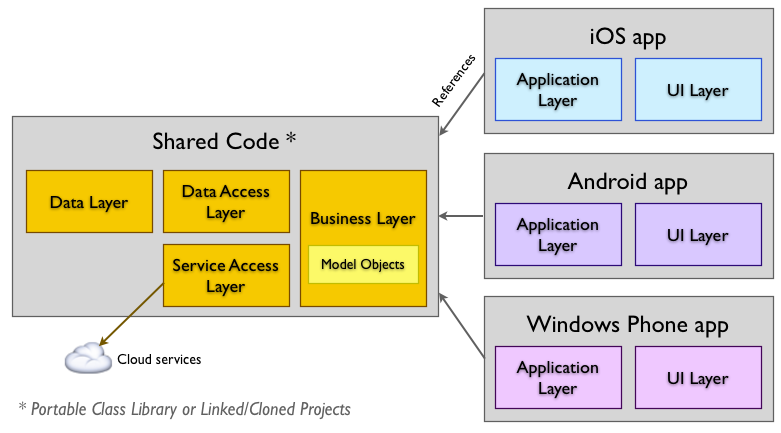](http://docs.xamarin.com/static/guides/cross-platform/application_fundamentals/building_cross_platform_applications/sharing_code_options/Images/ConceptualArchitecture.png)

The following alternatives are discussed:

- **File Linking into each App Project** – Use the ‘file
  linking’ feature of Visual Studio & Xamarin Studio to include the same
  file in each platform’s application**.**
- **File Linking into Separate Projects** – Use the ‘file
  linking’ feature of Visual Studio & Xamarin Studio to include the same
  file in multiple library projects (one for each platform)**.**
- **Cloned Project Files** – Rather than linking, directly
  include the same files in multiple projects (one for each platform)**.**
- **Microsoft Project Linker** – A tool that only runs on
  Windows, which keeps multiple project files synchronized as source files
  are added to each**.**

Each method has benefits and disadvantages that are discussed in this
document**.**
