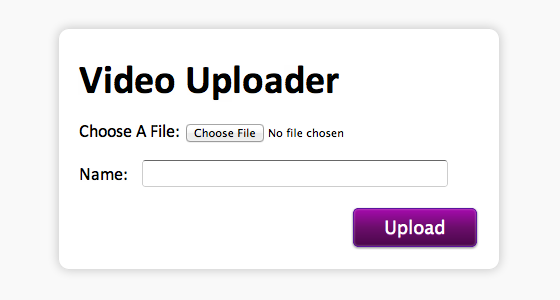
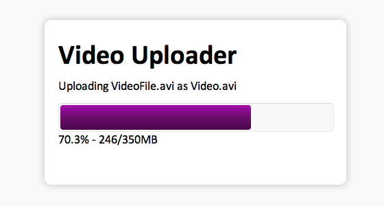
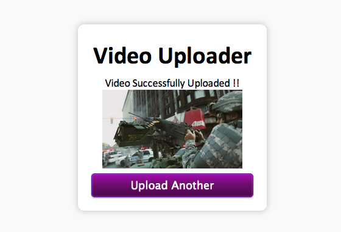

# **H**ow to Create a Resumable Video Uploader in Node.js

[Download Source Files](http://nettuts.s3.amazonaws.com/2060_resumableVideoUploader/source.zip)

If you’ve ever uploaded a considerably large video file, then you know this feeling: you’re 90% done, and accidentally refresh the page – having to start all over again**.**

In this tutorial, I’ll demonstrate how to make a video uploader for your site that can resume an interrupted upload, and generate a thumbnail upon completion**.**

---

## Intro

To make this uploader resumable, the server needs to keep track of how much a file has already been uploaded, and be able to continue from where it left off**.** To accomplish this task, we will give full control to the Node**.**js server to request specific blocks of data, and the HTML form will pickup these requests and send the necessary information to the server**.**

To handle this communication, we’ll use Socket**.**io. If you’ve never heard of Socket.io, it is a framework for real-time communication between Node**.**js and an HTML web page – well dig more into this shortly**.**

This is the basic concept; we will start with the HTML form**.**

---

## Step 1: The HTML

I am going to keep the HTML fairly simple; all we need is an input to choose a file, a text box for the name, and a button to begin the upload**.** Here’s the necessary code:

|  |  |
| --- | --- |
|  | `<``body``>`  `<``div` `id``=``"UploadBox"``>`  `<``h2``>Video Uploader</``h2``>`  `<``span` `id``=``'UploadArea'``>`  `<``label` `for``=``"FileBox"``>Choose A File: </``label``><``input` `type``=``"file"` `id``=``"FileBox"``><``br``>`  `<``label` `for``=``"NameBox"``>Name: </``label``><``input` `type``=``"text"` `id``=``"NameBox"``><``br``>`  `<``button`  `type``=``'button'` `id``=``'UploadButton'` `class``=``'Button'``>Upload</``button``>`  `</``span``>`  `</``div``>`  `</``body``>` |

Notice that I have wrapped the contents in a span; we will use this later to update the page’s layout with JavaScript**.** I’m not going to cover the CSS in this tutorial, but you can download the source code, if you’d like to use mine**.**

---

## Step 2: Making it Work

HTML5 is still relatively new, and isn’t yet fully supported in all browsers**.** The first thing we need to do, before moving forward, is ensure that the user’s browser supports the HTML5 File API and FileReader class**.**

The FileReader class allows us to open and read parts of a file, and pass the data as a Binary string to the server**.** Here is the JavaScript for the feature detection:

|  |  |
| --- | --- |
|  | `window.addEventListener(``"load"``, Ready);`  `function` `Ready(){`  `if``(window.File && window.FileReader){` `//These are the relevant HTML5 objects that we are going to use`  `document.getElementById(``'UploadButton'``).addEventListener(``'click'``, StartUpload);`  `document.getElementById(``'FileBox'``).addEventListener(``'change'``, FileChosen);`  `}`  `else`  `{`  `document.getElementById(``'UploadArea'``).innerHTML =` `"Your Browser Doesn't Support The File API Please Update Your Browser"``;`  `}`  `}` |

The code above additionally adds event handlers to the button and file input in the form**.** The `FileChosen` function simply sets a global variable with the file – so that we can access it later – and fills in the name field, so that the user has a reference point when naming the file**.** Here is the `FileChosen` function:

|  |  |
| --- | --- |
|  | `var` `SelectedFile;`  `function` `FileChosen(evnt) {`  `SelectedFile = evnt.target.files[0];`  `document.getElementById(``'NameBox'``).value = SelectedFile.name;`  `}` |

Before we write the `StartUpload` function, we have to setup the Node**.**js server with socket**.**io; let’s take care of that now.

---

## Step 3: The Socket**.**io Server

As I mentioned earlier, I’ll be using Socket**.**io for communication between the server and the HTML file**.** To download Socket.io, type `npm install socket.io` into a Terminal window (assuming that you’ve installed Node**.**js), once you have navigated to this projects directory**.** The way socket.io works is: either the server or the client “emits” an event, and then the other side will pickup this event in the form of a function with the option of passing JSON data back and forth**.** To get started, create an empty JavaScript file, and place the following code within it**.**

|  |  |
| --- | --- |
|  | `var` `app = require(``'http'``).createServer(handler)`  `, io = require(``'socket.io'``).listen(app)`  `, fs = require(``'fs'``)`  `, exec = require(``'child_process'``).exec`  `, util = require(``'util'``)`  `app.listen(8080);`  `function` `handler (req, res) {`  `fs.readFile(__dirname +` `'/index.html'``,`  `function` `(err, data) {`  `if` `(err) {`  `res.writeHead(500);`  `return` `res.end(``'Error loading index.html'``);`  `}`  `res.writeHead(200);`  `res.end(data);`  `});`  `}`  `io.sockets.on(``'connection'``,` `function` `(socket) {`  `//Events will go here`  `});` |

The first five lines include the required libraries, the next line instructs the server to listen on port 8080, and the handler function simply passes the contents of our HTML file to the user, when he accesses the site**.**

The last two lines are the socket.io handler and will be called when someone connects, via Socket**.**io.

Now, we can go back to the HTML file and define some socket**.**io events.

---

## Step 4: Some Socket**.**io Events

To begin using Socket.io in our page, we first need to link to its JavaScript library**.** You do this in the same way that you would reference any library: reference it in the head area**.** Add the following to the page, before your scripts, obviously**.**

|  |  |
| --- | --- |
|  | `<``script` `src``=``"/socket.io/socket.io.js"``></``script``>` |

Don’t worry about getting this file, as it is generated at runtime by the Node**.**js server.

Now, we can write the `StartUpload` function that we connected to our button:

|  |  |
| --- | --- |
|  | `var` `socket = io.connect(``'http://localhost:8080 '``);`  `var` `FReader;`  `var` `Name;`  `function` `StartUpload(){`  `if``(document.getElementById(``'FileBox'``).value !=` `""``)`  `{`  `FReader =` `new` `FileReader();`  `Name = document.getElementById(``'NameBox'``).value;`  `var` `Content =` `"Uploading "` `+ SelectedFile.name +` `" as "` `+ Name +` `""``;`  `Content +=` `'

0%'``;`  `Content +=` `" - 0/"` `+ Math.round(SelectedFile.size / 1048576) +` `"MB"``;`  `document.getElementById(``'UploadArea'``).innerHTML = Content;`  `FReader.onload =` `function``(evnt){`  `socket.emit(``'Upload'``, {` `'Name'` `: Name, Data : evnt.target.result });`  `}`  `socket.emit(``'Start'``, {` `'Name'` `: Name,` `'Size'` `: SelectedFile.size });`  `}`  `else`  `{`  `alert(``"Please Select A File"``);`  `}`  `}` |

The first line connects to the Socket**.**io server; next, we’ve created two variables for the File Reader and the name of the file, as we are going to need global access to these**.** Inside the function, we first ensured that the user selected a file, and, if they did, we create the `FileReader`, and update the DOM with a nice progress bar**.**

The FileReader’s `onload` method is called every time it reads some data; all we need to do is emit an `Upload` event, and send the data to the server**.** Finally, we emit a `Start` event, passing in the file’s name and size to the Node**.**js server.

Now, let’s return to the Node.js file, and implement handlers for these two events**.**

---

## Step 5: Handling The Events

> You have to clear the buffer every so often, or the server will crash, due to memory overload**.**

The socket**.**io events go inside the handler that we have on the last line of our Node**.**js file**.** The first event that we’ll implement is the `Start` event, which is triggered when the user clicks the *Upload* button**.**

I mentioned earlier that the server should be in control of which data it wants to receive next; this will allow it to continue from a previous upload that was incomplete**.** It does this by first determining whether there was a file by this name that didn’t finish uploading, and, if so, it will continue from where it left off; otherwise, it will start at the beginning**.** We’ll pass this data in half-megabyte increments, which comes out to 524288 bytes**.**

In order to keep track of different uploads happening at the same time, we need to add a variable to store everything**.** To the top of your file, add `var Files = {};'` Here’s the code for the `Start` event:

|  |  |
| --- | --- |
|  | `socket.on(``'Start'``,` `function` `(data) {` `//data contains the variables that we passed through in the html file`  `var` `Name = data[``'Name'``];`  `Files[Name] = {` `//Create a new Entry in The Files Variable`  `FileSize : data[``'Size'``],`  `Data   :` `""``,`  `Downloaded : 0`  `}`  `var` `Place = 0;`  `try``{`  `var` `Stat = fs.statSync(``'Temp/'` `+  Name);`  `if``(Stat.isFile())`  `{`  `Files[Name][``'Downloaded'``] = Stat.size;`  `Place = Stat.size / 524288;`  `}`  `}`  `catch``(er){}` `//It's a New File`  `fs.open(``"Temp/"` `+ Name,` `"a"``, 0755,` `function``(err, fd){`  `if``(err)`  `{`  `console.log(err);`  `}`  `else`  `{`  `Files[Name]['Handler``'] = fd; //We store the file handler so we can write to it later`  `socket.emit('``MoreData``', { '``Place' : Place, Percent : 0 });`  `}`  `});`  `});` |

First, we add the new file to the `Files` array, with the size, data and amount of bytes downloaded so far**.** The `Place` variable stores where in the file we are up to – it defaults to 0, which is the beginning**.** We then check if the file already exists (i.e. it was in the middle and stopped), and update the variables accordingly**.** Whether it’s a new upload or not, we now open the file for writing to the `Temp/` folder, and emit the `MoreData` event to request the next section of data from the HTML file**.**

Now, we need to add the `Upload` event, which, if you remember, is called every time a new block of data is read**.** Here is the function:

|  |  |
| --- | --- |
|  | `socket.on(``'Upload'``,` `function` `(data){`  `var` `Name = data[``'Name'``];`  `Files[Name][``'Downloaded'``] += data[``'Data'``].length;`  `Files[Name][``'Data'``] += data[``'Data'``];`  `if``(Files[Name][``'Downloaded'``] == Files[Name][``'FileSize'``])` `//If File is Fully Uploaded`  `{`  `fs.write(Files[Name][``'Handler'``], Files[Name][``'Data'``],` `null``,` `'Binary'``,` `function``(err, Writen){`  `//Get Thumbnail Here`  `});`  `}`  `else` `if``(Files[Name][``'Data'``].length > 10485760){` `//If the Data Buffer reaches 10MB`  `fs.write(Files[Name][``'Handler'``], Files[Name][``'Data'``],` `null``,` `'Binary'``,` `function``(err, Writen){`  `Files[Name][``'Data'``] =` `""``;` `//Reset The Buffer`  `var` `Place = Files[Name][``'Downloaded'``] / 524288;`  `var` `Percent = (Files[Name][``'Downloaded'``] / Files[Name][``'FileSize'``]) * 100;`  `socket.emit(``'MoreData'``, {` `'Place'` `: Place,` `'Percent'` `:  Percent});`  `});`  `}`  `else`  `{`  `var` `Place = Files[Name][``'Downloaded'``] / 524288;`  `var` `Percent = (Files[Name][``'Downloaded'``] / Files[Name][``'FileSize'``]) * 100;`  `socket.emit(``'MoreData'``, {` `'Place'` `: Place,` `'Percent'` `:  Percent});`  `}`  `});` |

The first two lines of this code update the buffer with the new data, and update the total bytes downloaded variable**.** We have to store the data in a buffer and save it out in increments, so that it doesn’t crash the server due to memory overload; every ten megabytes, we will save and clear the buffer**.**

The first `if` statement determines if the file is completely uploaded, the second checks if the buffer has reached 10 MB, and, finally, we request `MoreData`, passing in the percent done and the next block of data to fetch**.**

Now, we can go back to the HTML file and implement the `MoreData` event and update the progress**.**

---

## Step 6: Keeping Track of the Progress

I created a function to update the progress bar and the amount of MB uploaded on the page**.** In addition to that, the `More Data` event reads the block of data that the server requested, and passes it on to the server**.**

To split the file into blocks, we use the File API’s `Slice` command**.** Since the File API is still in development, we need to use `webkitSlice` and `mozSlice` for Webkit and Mozilla browsers, respectively**.**

|  |  |
| --- | --- |
|  | `socket.on(``'MoreData'``,` `function` `(data){`  `UpdateBar(data[``'Percent'``]);`  `var` `Place = data[``'Place'``] * 524288;` `//The Next Blocks Starting Position`  `var` `NewFile;` `//The Variable that will hold the new Block of Data`  `if``(SelectedFile.webkitSlice)`  `NewFile = SelectedFile.webkitSlice(Place, Place + Math.min(524288, (SelectedFile.size-Place)));`  `else`  `NewFile = SelectedFile.mozSlice(Place, Place + Math.min(524288, (SelectedFile.size-Place)));`  `FReader.readAsBinaryString(NewFile);`  `});`  `function` `UpdateBar(percent){`  `document.getElementById(``'ProgressBar'``).style.width = percent +` `'%'``;`  `document.getElementById(``'percent'``).innerHTML = (Math.round(percent*100)/100) +` `'%'``;`  `var` `MBDone = Math.round(((percent/100.0) * SelectedFile.size) / 1048576);`  `document.getElementById(``'MB'``).innerHTML = MBDone;`  `}` |

With this final function, the uploader is completed**!** All we have left to do is move the completed file out of the `Temp/` folder and generate the thumbnail**.**

---

## Step 7: The Thumbnail

Before we generate the thumbnail, we need to move the file out of the temporary folder**.** We can do this by using file streams and the `pump` method**.** The `pump` method takes in a read and write stream, and buffers the data across**.** You should add this code where I wrote ‘Generate Thumbnail here’ in the `Upload` event:

|  |  |
| --- | --- |
|  | `var` `inp = fs.createReadStream(``"Temp/"` `+ Name);`  `var` `out = fs.createWriteStream(``"Video/"` `+ Name);`  `util.pump(inp, out,` `function``(){`  `fs.unlink(``"Temp/"` `+ Name,` `function` `() {` `//This Deletes The Temporary File`  `//Moving File Completed`  `});`  `});` |

We’ve added the unlink command; this will delete the temporary file, after we finish copying it**.** Now onto the thumbnail: we’ll use ffmpeg to generate the thumbnails, because it can handle multiple formats, and is a cinch to install**.** At the time of this writing, there aren’t any good ffmpeg modules, so we’ll use the `exec` command, which allows us to execute Terminal commands from within Node**.**js.

|  |  |
| --- | --- |
|  | `exec(``"ffmpeg -i Video/"` `+ Name  +` `" -ss 01:30 -r 1 -an -vframes 1 -f mjpeg Video/"` `+ Name  +` `".jpg"``,` `function``(err){`  `socket.emit(``'Done'``, {``'Image'` `:` `'Video/'` `+ Name +` `'.jpg'``});`  `});` |

This ffmpeg command will generate one thumbnail at the 1:30 mark, and save it to the `Video/` folder with a `.jpg` file type**.** You can edit the time of the thumbnail by changing the `-ss` parameter**.** Once the thumbnail has been generated, we emit the `Done` event**.** Now, let’s go back to the HTML page and implement it**.**

---

## Step 8: Finishing Up

The `Done` event will remove the progress bar and replace it with the thumbnail image**.** Because Node.js is not setup as a web server, you have to place the location of your server (e**.**g. Apache) in the `Path` variable, in order to load the image**.**

|  |  |
| --- | --- |
|  | `var` `Path =` `"http://localhost/ "``;`  `socket.on(``'Done'``,` `function` `(data){`  `var` `Content =` `"Video Successfully Uploaded !!"`  `Content +=` `" ";`  `Content +=` `"<button  type='button' name='Upload' value='' id='Restart' class='Button'>Upload Another</button>"``;`  `document.getElementById(``'UploadArea'``).innerHTML = Content;`  `document.getElementById(``'Restart'``).addEventListener(``'click'``, Refresh);`  `});`  `function` `Refresh(){`  `location.reload(``true``);`  `}` |

Above, we’ve added a button to begin uploading another file; all this does is refresh the page**.**

---

## Conclusion

That’s all there is to it, but, surely, you can imagine the possibilities when you pair this up with a database and an HTML5 player**!**

I hope you’ve enjoyed this tutorial**!** Let me know what you think in the comment section below**.**
