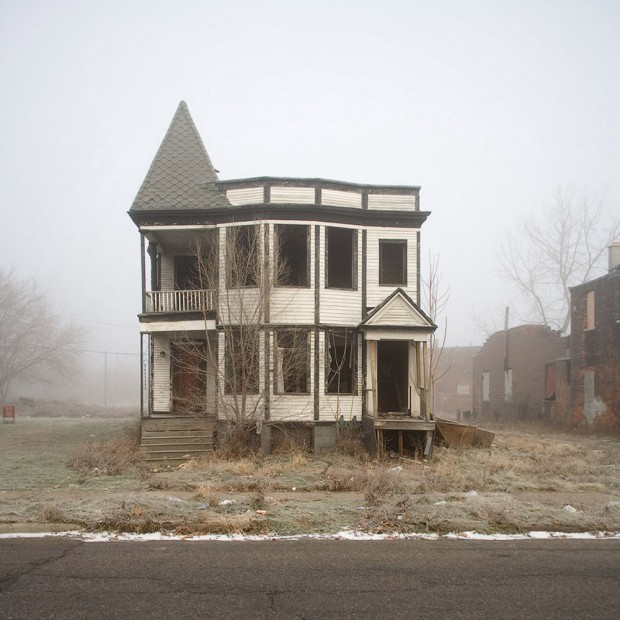

# **C**omo organizar sua mudança, passo-a-passo

### O Bom, o Mau e o Feio de uma Mudança

Existem três tipos de mudança: a mudança de cidade, a simples mudança de endereço, e a mudança para um lugar recém construído**.** Eu, feliz ou infelizmente, já passei pelos três tipos e posso falar uma coisa ou outra sobre o processo, o que pode facilitar e o que quase sempre é zica**.**

Cuidado

Se você já se mudou uma pá de vezes, vai se identificar (tenho certeza)**.** Se você está pensando em se mudar, acho bom anotar**.**

E, que fique claro: **eu detesto me mudar**.****

A minha primeira vez foi bem tranquila**.** Precisei só levar umas trouxas, umas malas, uns livros e tava tudo certo**.** Já tinha onde ficar e eu já conhecia o lugar**.** Ia morar em BH com o meu irmão, para trabalhar e começar minha faculdade**.**

Até então, se mudar para mim tinha sido só isso, sem traumas, sem problema, sem stress**.** Até me mudar de novo e descobrir como é trabalhoso entregar um apartamento**.**

### Entrada e saída: a vistoria

A vistoria técnica é uma das maiores dores de cabeça na vida de quem vive de aluguel (ou mesmo de quem compra um apartamento)**.** O grande problema é que, quando estamos saindo ou indo para um apê, a maioria de nós não presta tanta atenção assim aos detalhes**.** Você só se lembrará dessa danada quando, para seu terror, precisar cumprir os tópicos descritos lá**.**

Sem contar que, quanto mais tempo você passa num lugar, mais difícil é “cumprir” a tal vistoria**.** Pesquisando sobre o assunto, achei no site da revista Casa, [uma matéria ótima](http://casa.abril.com.br/materia/tudo-o-que-voce-precisa-saber-sobre-vistoria-de-apartamentos)  com dicas específicas para vistoria**.** vale a pena dar uma olhada.

Para mim, essa prática é um pouco injusta, já que as benfeitorias não são levadas em conta**.**

De qualquer forma, **acompanhe de perto a vistoria, cada linha, cada coisinha**, preste atenção em tudo e coloque tudo o que você vir**.** Isso facilitará muito quando for sair do apartamento**.**

Eu não sabia disso quando me mudei a primeira vez**.** Meu irmão havia alugado aquele apartamento há anos, e eu fiquei responsável por entregar o negócio**.** Fiquei completamente perdido. O dono do apartamento era um turco**.** Já escrevi algumas vezes sobre ele, o querido [Seu Nabi](http://ocrepusculo.com/como-a-copasa-fudeu-o-meu-dia/) **.** Ele jamais aceitaria faltar várias das coisas da “vistoria”, mas estava difícil e eu tinha que trabalhar, estava morando longe e tudo isso foi se tornando um peso pra mim**.**

No fim das contas, combinamos que eu iria apenas pintar**.** E um apartamento grande é terrível numa hora dessas**.** A minha dica de ouro é: **junte alguns amigos e faça o serviço você mesmo****.** Eu me ferrei durante 3 meses pagando o aluguel desse apartamento enquanto era enrolado por pintores**.**

*[Link YouTube](http://youtu.be/a0BVWos-n0E)  | Pintores no seu apartamento antigo**.** Exatamente assim**.***

Acabei entregando o saudoso apartamento do Santo Antônio**.** Não sem ter traumas gigantescos**.**

Acabo de me mudar novamente, e a medonha vistoria ainda está em voga no apartamento agora-antigo**.** Coisas absurdas como *“*tampas de tomada retangulares na cor creme com detalhes em dourado*”* vão tirar sua sanidade**.** Nunca na vida você vai achar as mesmas tampas de tomada**.**

Por isso, se não for o seu apartamento **guarde o diabo das tampas de tomadas a qualquer custo****.**

Procurei rapidamente e não encontrei quase nada discutindo o assunto**.** Por exemplo quando não existe mais no mercado, as coisas listadas na vistoria (como a tampa da tomada)**?** Podem te processar? Te impedir de entregar o apartamento e manter seu nome no contrato**?**

Bem, eu sempre tentei resolver fazendo um acordo**.** Esse foi sempre o melhor caminho.

### Suas coisas

Eu escrevi, aqui no Papo de Homem, [um guia prático](http://papodehomem.com.br/morar-sozinho-e-sensacional/)  para organização das suas tranqueiras**.** A filosofia que venho seguindo o máximo que posso já há um tempo é *“*tenha menos coisas*”**.*** Siga essa dica quando for se mudar. É a hora certa para se desfazer de um monte de coisas que você não precisa mais**.**

Se você tiver uma casa completa para levar com você (sofá, cama, eletrodomésticos, guarda-roupas), meu conselho de amigo **é contratar uma empresa para fazer sua mudança****.** Daquelas empresas que empacotam tudo e depois montam tudo certinho no novo endereço**.** Sim, é mais caro do que alugar um carreto, uma Kombi, um primo ou um australiano**.** Mas o custo benefício é enorme**.**

Imagine você cobrando sua televisão quebrada pelo *“*Zezinho do Caminhão*”**.*** **Esse é o tipo de coisa que não vale a pena economizar** **tanto****.**

Afinal de contas, são as suas preciosas coisas que passaram por várias “peneiras”**.** Se elas sobraram é porque são importantes para você**.**

Os australianos não têm cuidado com nada

### O primeiro mês

Você nunca vai conhecer um lugar de verdade indo lá algumas vezes**.** Eu diria que você demora mais ou menos uns 3 meses para saber tudo sobre o lugar que você está**.** É um ciclo trimestral que tudo que tiver para acontecer, **acontecerá****.**

Você vai descobrir como são os vizinhos e vai classificá-los**.** Vai descobrir se seu síndico é meio babaca ou não. Onde estão os melhores locais para comprar qualquer coisa**.** Nesse tempo, você vai conhecer tudo que se tem para conhecer no seu prédio (ou o que o valha) e as redondezas**.**

Além disso, **tudo de ruim que existe no apartamento vai aparecer no período de tempo desse ciclo de três meses**.**** Entupimentos, vazamentos, problemas na fiação, tomadas que param de funcionar, chuveiro estragando e você comprando na voltagem errada, infiltrações, pequenas reformas, e por aí vai**.**

A lista é interminável.

Se você for bem sortudo, a maioria delas vai acontecer logo no primeiro mês**.** Para mim, particularmente, são os piores dias. Eu não gosto de mudança. Nunca gostei**.** Você muda, se acostuma, faz daquele lugar o seu lugar e… depois… tá lá você mudando de novo e sentindo… bem, eu me sinto torto**.**

Você começa a se endireitar ali logo depois do primeiro mês**.** A partir daí, a construção do novo ninho, do novo lar inconsciente vai automático**.**

### A pressa é inimiga do bem-estar

Quando for se mudar para um apartamento recém construído, **meu melhor conselho é paciência****.** Vai ter coisa que só vai funcionar mesmo com o “olho do dono”**.**

A regra do primeiro mês aqui é ouro**.**

Existem contratos, vistorias, combinados, pagamentos, sofrimentos, ataque de nervos e sanhas assassinas envolvendo uma mudança**.** Não deixe que isso tire o seu prazer de se fazer em casa**.** Não importa onde for, a gente se acostuma e faz desses metros quadrados um lar de verdade com o tempo**.**

*[Link Vimeo](http://vimeo.com/27160302)  | Afinal, nosso lar é o nosso lar**.** Igualzinho esse.*

E você, tem outras dicas, manias ou regras que segue quando vai fazer uma mudança**?** Quais os perrengues que você já passou?
