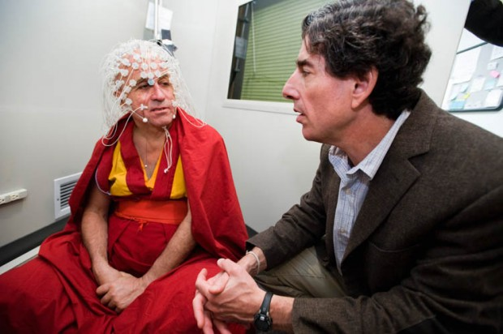
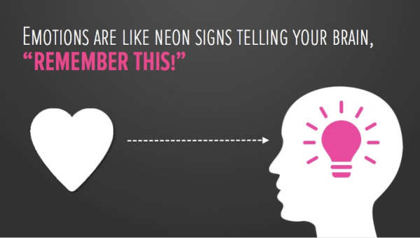
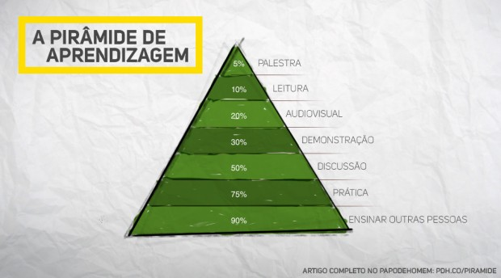
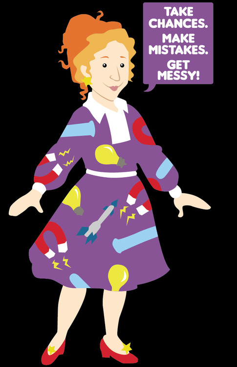

# **C**rie mais do que consome

Algumas noites atrás, fiz algo pela primeira vez na vida**.**  
  
Escutei um álbum completo (“[Magna Carta…Holy Grail](http://en.wikipedia.org/wiki/Magna_Carta..._Holy_Grail) “, do Jay-Z), da primeira à última música, sem interrupções**.** Coloquei meus fones, fechei os olhos e somente escutei**.**

Tenho me dedicado um bocado a ler de maneira mais atenciosa para absorver mais, mas nunca havia tentado isso com música**.**

Depois de escutar esse álbum, desse modo, pareci me conectar de maneira mais profunda com o trabalho**.** Pesquisei sobre Jay-Z e escutei o álbum inteiro novamente no dia seguinte**.**

Essa experiência de conexão profunda foi recompensadora o bastante – mas acabou por levar a algo mais**.** Me inspirou a escrever esse artigo**.**

Mesmo que eu não tenha feito nada “criativo” enquanto escutava ao álbum, **ele ainda inspirou criação****.**

É importante sempre criar**.** Mas integrar doses de consumo cuidadoso é frequentemente parte importante do processo criativo**.**

### O que acontece em sua mente quando consome de maneira atenta

Quando estava na universidade, trabalhei em um centro de pesquisa psicológica sob a direção de uma das 100 pessoas mais influentes segundo a revista Time, Dr**.** Richie Davidson.

Dr**.** Richie Davidson trabalhando com o monge budista Matthieu Ricard | Foto: Jeff Miller

Um dos estudos revisados por nosso laboratório era sobre meditação e como estar no momento [diminui o ruído em sua mente, levando a maior pontuação em testes de memória ativa e inteligência](http://well.blogs.nytimes.com/2013/04/03/how-meditation-might-boost-your-test-scores/) **.**

Quando você se permite imergir completamente em uma experiência, você dá a seu cérebro a chance de fazer conexões mais profundas, aumentando sua habilidade em retomar essas conexões no futuro**.**

### A importância de ficar emocional

Todos nós temos memórias vívidas de certos momentos em nossas vidas**.** Talvez de uma música em um show ao vivo ou aquela certa coisa que vivemos em uma viagem e nunca mais vamos esquecer**.**

Essas experiências são memoráveis porque provavelmente te fizeram feliz, triste ou o deixaram com raiva**.**

Quando você junta emoção a uma experiência, um hormônio que lubrifica as engrenagens de certas reações químicas no cérebro é liberado, bem onde os nervos se reconectam para formar novos circuitos de memória**.**

“Emoções são como sinais de neon dizendo a sua mente: lembre-se disso**!**”

É por isso que momentos de seu passado que o fizeram realmente sentir algo vêem à tona quando precisa pensar de modo criativo**.**

Uma experiência que se conecta com suas emoções é mais fácil de ser lembrada**.**

Se você se colocar disponível para focar de maneira profunda no que está consumindo, estará dando a si mesmo uma melhor oportunidade de se conectar emocionalmente, retendo mais do que consome e usando isso em seu favor quando necessitar ser criativo mais tarde**.**

### A pirâmide de aprendizado: uma técnica para reter 90% do que consome

Já passei por toneladas de tweets, artigos e vídeos pensando estar retendo tudo – sendo que, na realidade, a maior parte do que eu supunha estar aprendendo estava passando direto**.**

Quando você consome de modo passivo, “escaneando” e logo indo para o próximo tópico, está em desvantagem para aprender**.**

**[A pirâmide de aprendizado](http://www.psychotactics.com/blog/art-retain-learning/)**  nos explica que o caminho eficaz para aprender é ensinando outra pessoa ou tentando colocar o que aprendeu em prática imediatamente**.**

A pirâmide diz que as pessoas vão reter:

> 90% do que aprendem quando ensinam outro ou aplicam o conceito imediatamente  
> 75% do que aprendem quando praticam o que foi ensinado a elas  
> 50% do que aprendem se engajarem em uma discussão de grupo  
> 30% do que aprendem quando verem uma demonstração  
> 20% do que aprendem por meio de áudio-visual  
> 10% do que aprendem por meio da leitura  
> 5% do que aprendem por meio de uma palestra

Taí, desenhamos pra facilitar

É por isso que, não raro, grandes escritores calham de ser grandes leitores**.** Eles precisam submergir em assuntos específicos para conseguir criar diálogos de significado**.**

Indíviduos que aprendem por conta própria, também chamados autodidatas, são mestres em reter informação – em grande parte por conta da habilidade de refletir e colocar em prática tanto do que consomem quanto possível**.**

Leonardo Da Vinci era um autodidata e costumava usar um [sistema de ações práticas e recompensas](http://en.wikipedia.org/wiki/Autodidacticism)  para reter informação**.**

Essas ações resultavam em erros ao longo do caminho e eram esses erros que solidificariam seus aprendizados**.**

Como Sean D’Souza, autor do [Psychotactics.com](http://www.psychotactics.com/blog/art-retain-learning/) , diz:

> Escutar ou ler algo é apenas escutar ou ler**.**
>
> Não é aprendizado real.
>
> Aprendizado real vem de cometer erros**.**
>
> E erros acontecem quando tentamos.

### Como transformar consumo em criação

Ler um livro ou assistir a um filme é uma parte importante de meu processo criativo, mas sempre tento me certificar de estar amplamente imerso nessas experiências**.**

Aqui estão algumas coisas que têm funcionado para mim ao usar consumo como um combustível para a criatividade**.**

### 1. Tome um posicionamento

Ao invés de apenas tentar chegar ao fim do seu *feed* de artigos que guardou para mais tarde, leia cada artigo como se fosse contar sobre ele para um amigo depois**.**

Isso é fundamental para reter mais do que consome e absorver informação – ao contrário do que aconteceria se apenas passasse pelo conteúdo, logo clicando em compartilhar ou curtir**.**

O psicólogo [Robert Cialdini](http://en.wikipedia.org/wiki/Robert_Cialdini)  usa uma técnica em que pega um pedaço de papel e escreve um sumário de uma página imediatamente após terminar cada capítulo lido**.**

[Pesquisas mostram que essa técnica pode ajudá-lo a reter 50% além do que conseguiria normalmente](http://www.farnamstreetblog.com/2013/05/how-to-retain-more-of-what-you-read/) , mesmo se lesse o mesmo capítulo múltiplas vezes, tentando memorizá-lo**.**

### 2**.** Consuma como se fosse ensinar

Pense que vai precisar ensinar a alguém sobre aquele assunto**.** Melhor ainda, faça isso**.**

Quer seja seu filho, sua namorada ou seus pais, compartilhe o que aprendeu e tente colocar em prática**.**

Ninguém colocou isso melhor do que a [Miss Frizzle do “Magic School Bus”](http://en.wikipedia.org/wiki/The_Magic_School_Bus) :

“Arrisque-se**.** Erre. Faça bagunça!”

Esse aprendizado por meio da ação e dos erros é uma das principais razões pelas quais [estudos sugerem que as pessoas que viajam ou estudam fora tendem a ser mais criativas](http://www.kcet.org/arts/artbound/counties/los-angeles/does-traveling-make-you-more-creative.html) **.**

Pesquisadores observaram que as pessoas que estudaram no exterior eram aptas a fazer conexões mentais mais rapidamente, sugerindo que imersão completa em novas experiências pode turbinar sua capacidade criativa**.**

Nada vai ajudá-lo a absorver mais do que consome do que colocar a mão na massa**.** É por meio dos erros feitos que o real aprendizado acontece**.**

### 3. Procure o inesperado: crie oportunidades para colisão de ideias

Estudos mostram que [experiências fora do comum introduzem novas conexões neurais e aumentam as chances de conceitos únicos serem descobertos](http://www.spring.org.uk/2012/06/creativity-why-you-should-seek-out-unusual-or-downright-weird-experiences.php) , à medida em que essas conexões colidem com os pensamentos existentes**.**

Saia com diferentes tipos de pessoas ou tente coisas que nunca fez antes**.** Quando conhece novas pessoas ou tenta algo inesperado, **um coquetel de ideias explode em sua mente****.**

Inspiração pode vir de algo tão simples quanto um sinal no muro ou uma interação com um garçom(uma experiência que nunca vai fazer o mesmo sentido se não estiver presente)**.**

Quer seja um jantar com amigos próximos ou uma sessão de cinema noturna, ao se focar em estar presente, seus sentidos podem absorver cada elemento de uma experiência**.**

Não é necessariamente o que, mas sim o modo como você consome, que faz toda a diferença**.** Ao invés de lutar para vencer a batalha para consumir o máximo de informação possível, aceite o fato de que já perdeu a guerra**.**

Isso vai tornar tudo mais prazeroso e, coincidentemente, ajudá-lo a fazer melhores trabalhos**.**

*Para mais artigos como esse(em inglês), [coloque seu email aqui](https://docs.google.com/a/papodehomem.com.br/spreadsheet/viewform?formkey=dE5qRU9obkZjTGlIWTZkckd4bWxfRHc6MA#gid=0)**.** Ou vá até o blog [ooomf](https://ooomf.com/blog/) .*

**Nota do editor:** esse texto foi originalmente publicado no [Medium](https://medium.com/life-hacks/9c1bc89dc71d)  e traduzido por nós mediante autorização do autor**.**
