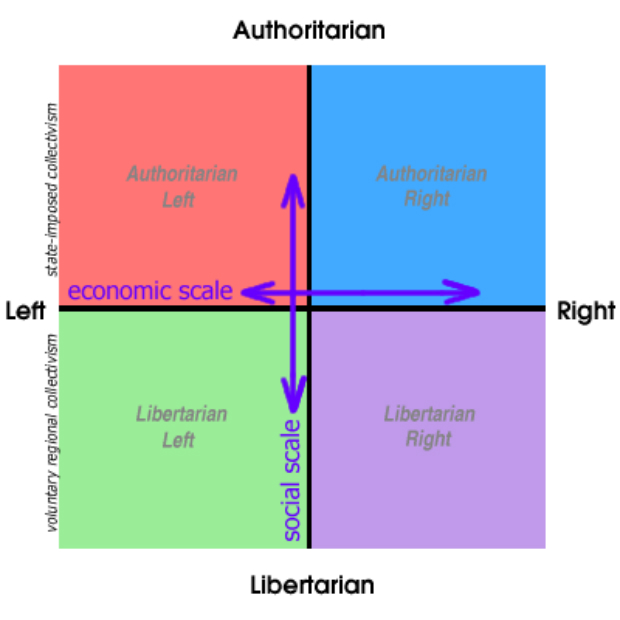

# **D**ireita vs Esquerda: a política não é mais tão simples assim

### Work and Play**.**

A West Coast apresenta sua campanha de verão: "Profissionais que nos inspiram com o seu trabalho"**.**

Venho muito comentar no Papo de Homem sobre temas políticos, de sociedade e governo, e gosto muito de discutir, conhecer e debater**.** Acho ótima essa oportunidade que o PapodeHomem nos dá de conhecer, compartilhar e trocar idéias**.** Gosto também do incentivo à discussão, e do incentivo aos autores de se engajarem na discussão, ao contrário de outros veículos aonde o autor fica inalcançável para te responder**.**

Estava comentando o post do Guilherme “[We are legion](http://papodehomem.com.br/we-are-legion-a-historia-do-hacktivismo/) ”, sobre como a internet mudou as relações e como certas burocracias e necessidades do processo democrático ficam datadas em vista de como estamos conectados**.**

Durante a discussão, lembrei de um site que um amigo meu me apresentou há alguns dias, o [Political Compass](http://www.politicalcompass.org/) **.** Um site no qual a premissa é determinar seus alinhamentos políticos através de algumas perguntas e plotar num gráfico sua posição**.**

Apesar de parecer banal, isso é muito interessante, pois ele ajuda a quebrar alguns conceitos que temos sobre a política, e sobre a visão de nossos posicionamentos**.**

O site é bem simples, sem muito pensamento em design ou estética**.** Ele está ali apenas para cumprir seu objetivo. Infelizmente está disponível apenas em inglês, mas acredito que alguém com um domínio intermediário já consiga responder às perguntas**.**

Fiz uma tradução livre de um trecho da introdução do site:

> O velho e unidimensional gráfico de ‘direita’ e ‘esquerda’, estabelecido na época da assembléia nacional francesa de 1789, se mostra muito simplista em vista do cenário complexo da politica atual**.** Por exemplo, quem são os ”conservadores” na política moderna da Rússia**?** São eles os Stalinistas reconstruídos ou os reformistas que adotaram as visões de direita dos conservadores como Margaret Thatcher**?**
>
> No antigo padrão de esquerda-direita, como você distingue esquerdistas como Stalin e Gandhi**?** Não basta dizer que Stalin é mais esquerdista que Gandhi**.** Existem diferenças politicas fundamentais entre eles que as velhas categorias sozinhas não podem explicar**.** Igualmente, se classifica os reacionários sociais, como os integrantes do “Tea Party” americano, a direita, mas como podemos classificar os reacionários de esquerda, como Robert Mugabe e Pol Pot corretamente**?**
>
> O site então lhe pede para responder um questionário, com várias perguntas, sobre alguns temas, e sendo algumas polêmicas, como “Pessoas como deficiências severas não deveriam ter permissão de se reproduzirem**?**”, aonde você pode escolher uma das quatro opções: Concordo Fortemente, Concordo, Discordo, Discordo Fortemente**.**

Depois de responder ao questionário vem a outra parte interessante, pois a página começa explicando como o gráfico do Compasso Social funciona**.** Importante aqui é a explicação dos eixos do gráfico**.**

*[Link Youtube](http://youtu.be/HxYUdePqYE0)  | Como funciona esse eixo esquerda-direita**?***

Na explicação ele expõe como num eixo, que ele chama agora de esquerda-direita econômica, Stalin, Mao Tse Tung e Pol Pot, com seu compromisso pelo controle estatal pleno sobre a economia, ficariam na ponta esquerda do eixo, enquanto Gandhi e Robert Mugabe ocupariam uma posição menos extrema a esquerda**.** Margaret Thatcher ficaria bem à direita, mas mais à direita ainda ficaria um grande defensor do livre mercado, Augusto Pinochet**.**

Mas esse eixo deixa de mostrar o aspecto social da política, por isso eles adicionaram um eixo vertical que vai do extremamente autoritário, ao extremamente libertário**.** Ambas as dimensões – a econômica e a social – são importantes em qualquer análise política**.**

*[Link Youtube](http://www.youtube.com/watch?v=Pjl4hnbLAzo)  | E a ditadura militar brasileira, era de esquerda ou de direita**?** Tem certeza?*

Ao adicionar a dimensão social você pode, por exemplo, mostrar que Stalin era um autoritário esquerdista (o Estado é mais importante que o indivíduo) enquanto Gandhi, acreditando no valor supremo de cada individuo, foi um liberal esquerdista**.**

Enquanto no canto superior esquerdo temos o coletivismo sendo arbitrariamente imposto pelo Estado, no canto inferior esquerdo temos o coletivismo voluntário em um nível regional, sem envolvimento estatal**.** Centenas dessas pequenas comunidades anárquicas existiram na Espanha durante a guerra civil**.**

Você pode colocar Pinochet, que estava preparado para aprovar o assassinato em massa em nome do livre mercado, bem à direita e também numa posição bem autoritária**.** No lado não-socialista, você pode distinguir alguém como Milton Friedman, que era anti-Estado mais por razões fiscais do que sociais de Hitler – que queria fazer o estado cada vez mais forte, mesmo que ele eliminasse metade da humanidade no processo**.**

*[Link Youtube](http://youtu.be/ikVtaE30kqA)  | E o FHC**?*** 

O gráfico ainda deixa claro, que a despeito da percepção popular, o oposto do fascismo não é o comunismo, mas sim o anarquismo (isto é, Socialismo Liberal), e que o oposto de comunismo (uma economia totalmente planejada pelo Estado) é o neo-liberalismo (uma economia extremamente desregulada)**.**

E no fim ele mostra nossa posição num gráfico**.** Eu, por exemplo, fiquei como levemente libertário (-2**.**41) e praticamente de centro (0.25). Sempre me considerei de direita, mas dentro das normas e análises do gráfico, agora percebi que devo me considerar bem de centro e levemente libertário**.**

Esse teste é bom pra mostrar como nossos conceitos políticos podem estar defasados, precisando de um revisão**.** E, como tudo na humanidade, dá cada vez menos pra usar as mesmas regras do século 18 para definir nossas visões modernas**.**

Agora é com você.

Se puder, faça o teste  e posta a imagem pra gente ver**.** É rapidinho.

E aí, o que achou dos resultados apresentados**?** Concorda? Discorda?

Continuamos o papo nos comentários.
