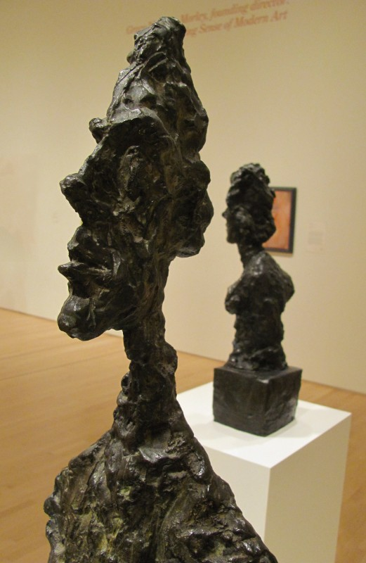
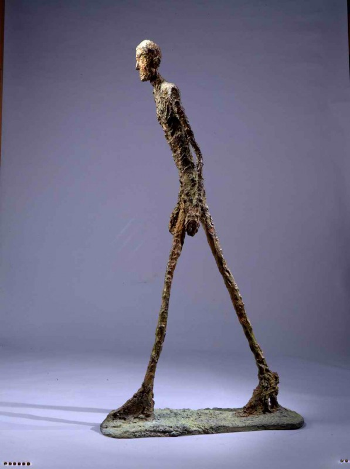
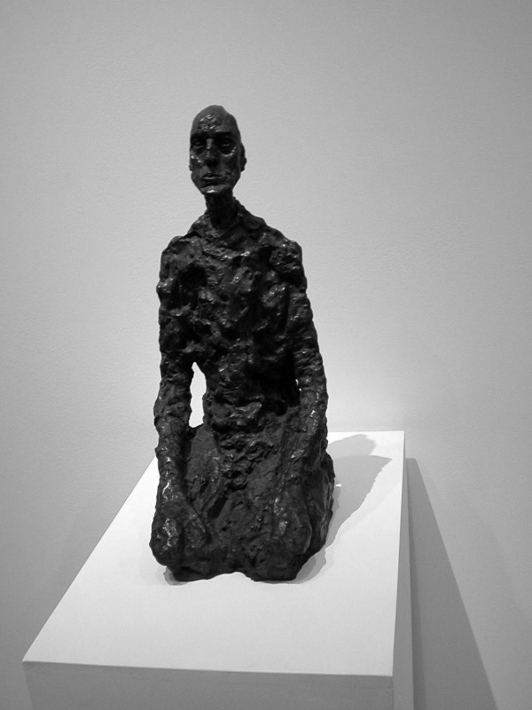
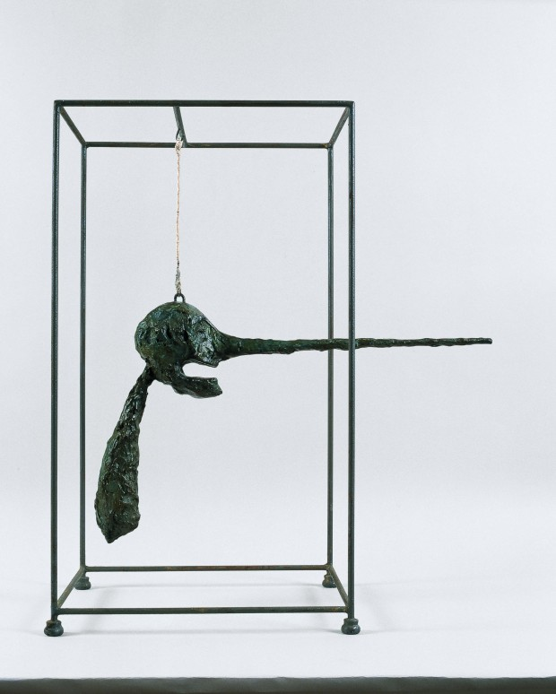
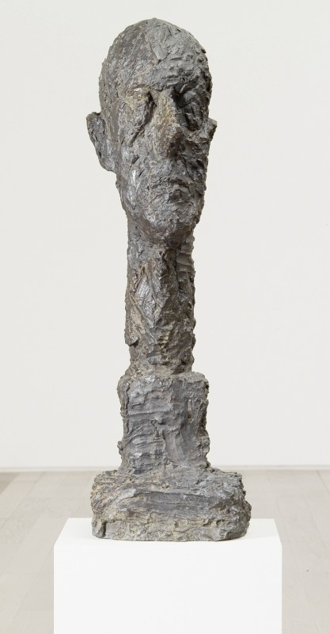

# **H**istória de um homem ridículo

### Work and Play**.**

A West Coast apresenta sua campanha de verão: "Profissionais que nos inspiram com o seu trabalho"**.**

Um homem ridículo pode mudar a vida da gente**.**

Estava eu sentado em uma mesa de calçada, tomando meu café da manhã, quando passa por mim um homem ridículo**.**

Andando pela rua de forma confiante e decidida**.** Completamente ignorante do fato de ser tão ridículo**.** De estar tão fora do padrão, da regra, do correto. De ser tão feio, tão mal-vestido, tão tosco**.** O homem ridículo estava todo errado.

Não vou descrever o homem ridículo**.** Seria impossível descrevê-lo sem ser cúmplice de sua ridicularização, sem fazer vocês também o acharem ridículo**.**

Porque, um segundo depois, bateu a culpa, caiu a ficha, estourou a consciência**.**

E pensei: para uma ou mais pessoas, esse homem ridículo é a pessoa mais amada da vida, a pessoa mais importante do mundo**.** Para algumas pessoas idosas, ele sempre vai ser o bebê lindo que foi um dia, a criança cheia de promessa, o adolescente vigoroso e energético**.**

Que apesar dele estar passando pela rua a vinte metros de mim, de eu só estar enxergando-o por breves segundos, de eu nunca ter ouvido sua voz ou interagido com ele de qualquer maneira, de ele ser para mim só um figurante sem fala no ó-tão-importante filme da minha vida, de ele ser apenas uma figura de cartolina exemplificando o total oposto do padrão de beleza vigente…**.**

Que ele era uma pessoa**.**

Caralho, uma pessoa.

Vocês entendem a enormidade disso**?**

Uma pessoa igual a mim**.** A MIM! Com os mesmos sentimentos. Que dá tanta importância a si mesmo quanto eu me dou**.** Que sempre viu tudo pelos seus próprios olhos. Que sempre sentiu todas as suas dores**.** Uma pessoa plena. Um homo sapiens adulto**.** Um indivíduo da espécie dominante do único planeta habitado que conhecemos**.** Por tudo que se sabe, ele é o ápice da evolução do cosmos**.** Ali, passando por mim, já se afastando. Tão ridículo**.**

Se esse homem ridículo morresse hoje, agora, fulminado por meu implacável julgamento, haveria gente sofrendo dor profunda, chorando, trabalhando o luto, relembrando melhores momentos compartilhados**.** Aquele homem ridículo deixaria um vazio talvez insuperável em corações que nem conheço**.**

Então, ele sumiu atrás de uma esquina, mas apareceu uma senhora de vestido verde, depois, uma adolescente patinadora, um ruivo e seu beagle, um gari de laranja, e foi quase que como uma sobrecarga de informação: todos pessoas**.** Cada um. Nenhum deles figurantes do filme da minha vida. Todos protagonistas de seus próprios filmes**.** Pessoas plenas.

Aí, finalmente, me dei conta: o único homem ridículo ali era eu**.**

As ilustrações desse texto são obras do artista plástico suiço [Alberto Giacometti](http://pt.wikipedia.org/wiki/Alberto_Giacometti "Alberto Giacometti")  (1901-1966)**.**
