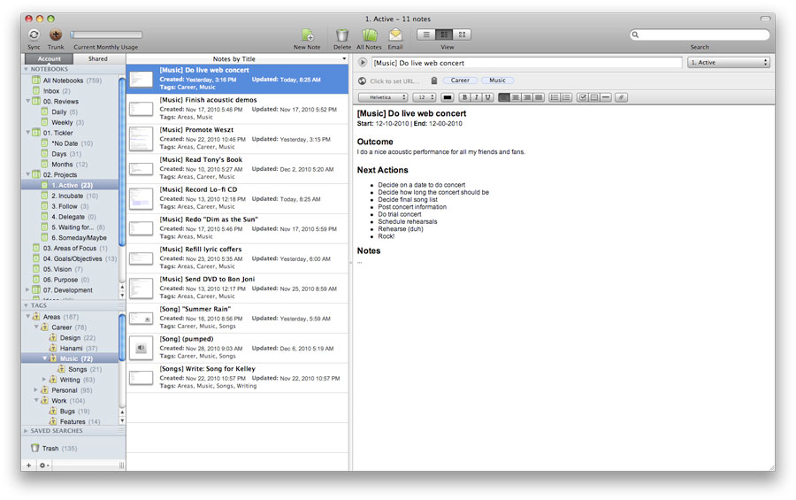

# **C**omo usar o Evernote para organizar projetos

Tenho usado bastante o [Evernote](http://www.evernote.com)  para organizar as minhas informações de projetos**.** Para quem não sabe, o Evernote é um serviço na nuvem de armazenamento de notas que pode ser acessado pelo computador, pelo smartphone e pelo tablet**.** Basta ter uma conta e configurar.

[anexo ausente]

Como eu uso o método GTD, o Evernote acaba servindo como meu **arquivo de referência para projetos****.** O que isso significa? Que uso o [Toodledo](http://www.toodledo.com)  para gerenciar projetos e tarefas ([veja aqui um post onde explico direitinho como eu faço](http://vidaorganizada.com/organizacao/comece-a-se-organizar/como-eu-utilizo-o-metodo-gtd-e-o-toodledo/ "Como eu utilizo o método GTD e o Toodledo") ) e o Evernote para juntar todas as informações que preciso ter referente a projetos**.** Uma pauta de reunião, por exemplo, não é uma ação, mas pode estar vinculada a um projeto**.** Isso é um exemplo de arquivo de referência de projeto**.**

Eu divido o Evernote em **Projetos pessoais**, **Projetos profissionais**, **Rotinas** e **Control journal****.** As pastas de projetos têm sub-pastas com nomes das [áreas da minha vida](http://vidaorganizada.com/bem-estar/desenvolvimento-pessoal/pensando-sobre-os-papeis-que-exercemos-na-vida/ "Pensando sobre os papéis que exercemos na vida")  e, dentro delas, os arquivos de referência**.** As pastas com rotinas e meu control journal não têm sub-pastas, somente arquivos**.**

Por que dá certo**?** Porque é prático e acessível. Costumo deixar o Evernote sempre aberto quando estou no computador para consultá-lo ou editá-lo com frequência**.**

A pasta de rotinas é recente. Antes eu utilizava o Toodledo para as tarefas de rotina, mas percebi que estava atrapalhando a minha visão das tarefas prioritárias nas minhas listas de contexto (no post lá em cima eu explico sobre essas coisas todas direitinho)**.** Exemplos de rotinas: Revisão diária, Revisão semanal, Rotina diária de limpeza em casa etc**.**

Control journal, muito resumidamente, é uma ferramenta que a [FLY Lady](http://vidaorganizada.com/organizacao/comece-a-se-organizar/como-comecar-no-sistema-fly-lady/ "Como começar no sistema FLY Lady")  recomenda que a gente tenha como uma espécie de “agenda da casa”**.** Ali, salvo listas de limpeza detalhadas do apartamento inteiro e outras informações relevantes**.** [Leia um post específico sobre o control journal para entender melhor como ele funciona](http://vidaorganizada.com/casa/diariamente/como-criar-o-seu-control-journal/ "Como criar o seu control journal") **.** Eu usei um control journal de papel durante muitos anos, mas percebi que, estando online, facilita a minha vida**.** Eu também estou tentando reduzir as coisas físicas ao máximo ultimamente**.**

### Outros usos para o GTD

Algumas pessoas costumam usar o Evernote inclusive para controlar suas **listas de tarefas****.** Como eu disse acima, eu uso o Toodledo para isso, então não faço esse uso do Evernote**.** Mesmo assim, achei legal indicar, caso alguém se adapte dessa forma**.** Basta criar pastas com o “@” antes, como nas listas do GTD (ex: “@casa”) para deixar claro que ali você centralizará as tarefas e projetos daquele contexto, e está tudo certo**.** Se alguém que estiver lendo o post quiser falar sobre a sua experiência com relação a esse uso, eu agradeço**.**

Outra forma de usar o Evernote é como **caixa de entrada** para coletar informações, ideias e tarefas antes de processá-las**.** Pode ser uma boa para quem prefere tecnologia a papel**.** Para isso, você pode criar uma pasta chamada “Entrada” ou mesmo uma única nota para isso, ou até uma nota por dia**.** Cada um deve fazer de acordo com as suas necessidades**.**

Encontrei a imagem abaixo pesquisando para o post e dá para ter uma ideia de como usar para organizar projetos:

Imagem: Hanami Design

Ele usa uma Inbox (“entrada”), uma pasta para as revisões diária e semanal (Reviews), uma pasta para arquivo de referência rápida ([veja mais aqui sobre isso](http://vidaorganizada.com/casa/comodos/escritorio/arquivo-de-referencia-rapida/ "Arquivo de referência rápida") ), uma pasta para projetos (divididos por Ativos, Incubados, Delegados, Aguardando etc), uma pasta para as áreas de foco (ou os papéis que exercemos na vida), outra para objetivos, visão etc**.** Achei muito boa a organização do menino, bem aplicada ao GTD mesmo**.** Fica como exemplo de uso**.** =)

Acho que vou começar a usar algumas pastinhas inspiradas nesse modelo, especialmente referente às áreas de foco e objetivos**.**

**Mais alguém utiliza o Evernote para gerenciar projetos**?** Como você faz?**
