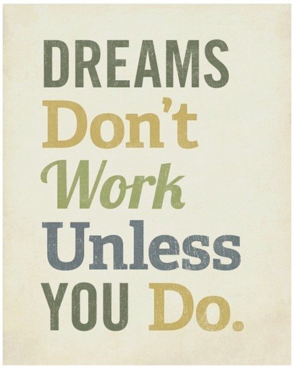

# **P**or que eu me organizo?

“Sonhos não funcionam se você não fizer alguma coisa”

Esses dias estava me perguntando por que, afinal, eu gosto de organizar as coisas**.** Como a resposta me pareceu interessante, resolvi escrever aqui para vocês**.**

Há alguns anos, eu resolvi simplesmente abrir mão dessa organização**.** Não que eu tenha me tornado bagunceira, mas eu deixei as rotinas de lado e parei de pensar em objetivos**.** Queria viver um dia de cada vez, sem pensar no futuro**.** O resultado? Pedi demissão de um emprego que não me acrescentava mais nada, comecei uma faculdade que eu queria há tempos e tive tempo para ler muito, estudar, ficar mais intelectualizada e pensar em mim**.**

Tudo isso é muito bonito mas, na prática, significou ficar desempregada, entrar em uma faculdade que, quando eu começasse a trabalhar, teria que trancá-la (porque não tinha mais tempo) e deixar de guardar dinheiro para uma situação que ficou complicada mais tarde, quando meu pai ficou doente**.**

Desempregada em si eu não fiquei, porque fazia trabalhos *freelancers* diversos e trabalhava em casa**.** Mas eu realmente estava sem emprego, sem um salário fixo e sem contribuições com o INSS**.** Nada de garantias, décimo terceiro etc**.** Além do que, a faculdade era paga, eu precisava comprar livros e pagar transporte**.** Apesar de ter dinheiro guardado, não preciso dizer que ele logo começou a me fazer falta**.**

E o mais engraçado de tudo foi o seguinte: eu me sentia perdida**.** Foi um momento de descobertas, sem dúvida, mas, sem saber para onde eu iria, eu me sentia até certo ponto depressiva**.** Foi difícil. Quando percebi que viver sem objetivos estava me deixando naquele estado, resolvi voltar a ser como eu sempre fui e as coisas começaram a entrar nos eixos**.**

Refleti longamente sobre o meu papel enquanto ser humano vivo neste planeta e percebi que queria algumas coisas**.** Queria ser mãe. Queria me casar. Queria voltar a ter um emprego, pois adoro a minha área (Publicidade)**.** Quando eu defini esses objetivos, no mesmo ano eu estava em um bom emprego na minha área, meu namorado (atual marido) e eu fomos morar juntos e eu fiquei grávida**.** Incrível como a lei da atração exerce influência sobre a gente**.** Basta focar.

A partir de então, eu decidi que não viveria mais sem objetivos, porque eu preciso deles**.** Nem que sejam de curto prazo, mas preciso, porque eles são o meu norte**.** Isso não significa que eu já saiba o que quero estar fazendo daqui a 50 anos (apesar de que, para algumas coisas, sim), mas significa que eu sei o que quero que aconteça em determinadas áreas da minha vida**.**

De nenhuma maneira estou dizendo que esse é o jeito certo de fazer as coisas e viver a vida, mesmo porque não existe fórmula correta para isso, como todos sabem**.** Isso é como eu me sinto e essa é a experiência que posso passar para vocês**.**

Eu me organizo, enfim, porque sei que, assim, eu consigo fazer as coisas acontecerem na minha vida**.** Eu trabalho bem com metas, listinhas, planejamento**.** A organização tem muito disso né, de a gente saber que não perde tempo na vida**.** Tenho pavor de chegar daqui a cinco anos, por exemplo, e descobrir que eu deveria ter começado a pensar em algo com antecedência e que isso prejudicou minha vida de alguma forma**.** Nosso carro. Se eu tivesse me informado melhor, poderia ter feito um consórcio há uns três anos e ter comprado o carro mais barato do que com o financiamento atual**.** Ou você pode perceber, com 30 anos de idade, que poderia ter guardado 200 reais por mês para dar entrada em um apartamento dez anos mais tarde**.** Enfim, a organização faz a gente se programar e otimizar todo o processo, mas algumas coisas vêm só da experiência de vida mesmo**.**

O fato é que a organização me mostra que praticamente tudo é possível**!** Se eu quiser ir morar na Itália quando tiver 50 anos, oras, vou me planejar para isso**!** Se eu quiser faculdade daqui a três anos, basta planejar**.** Se eu quiser abrir um negócio, igualmente**.**

Eu também costumo ter um pensamento positivo e pró-ativo com relação à minha vida**.** Eu não consigo imaginar nada que eu não possa fazer, porque todos os seres humanos são iguais**.** Já vi gente que não tinha nada ficar milionário e gente muito rica perder tudo**.** Já vi gente que estava à beira da morte viver mais 30 anos porque mudou sua atitude**.** Então eu nunca me conformo com situações porque o poder de mudança é algo que todos nós temos**.**

Tenho uma amiga que, sempre que me vê estudando, fala assim: “aff, não sei como você aguenta, eu não gosto de estudar, nunca conseguiria fazer tal coisa”**.** Eu falo para ela: “poxa, se você decidisse começar a gostar, acabaria dando um jeito”**.** Tem uns professores que dizem “se você não gosta da matéria X, passe a amá-la a partir de hoje**!**”. Quando a gente muda a nossa atitude, o resto começa a mudar**.**

Bom, eu já viajei nesse post! Mas acho que consegui passar para vocês o motivo pelo qual me organizo: porque valorizo meu tempo na Terra**.** Porque quero aproveitar bem, fazer tudo o que eu quero fazer e o que acredito ser o melhor que possa proporcionar às pessoas que eu amo e me preocupo**.** A ideia de “perder tempo” me apavora, pois nunca sabemos o dia em que vamos morrer e eu não quero, quando esse dia chegar, concluir que deveria ter feito isso ou aquilo**.** Eu não gosto de deixar meus sonhos para depois, e eu gostaria que vocês fizessem o mesmo**.** Afinal, a vida é uma só**.** VIVA!
