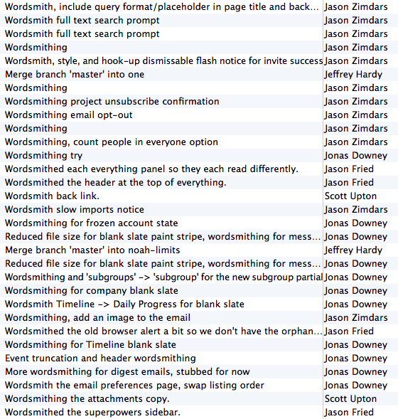

On Writing Interfaces Well  
  
<http://37signals.com/svn/posts/3633-on-writing-interfaces-well>  
  

Interface designers like to talk shop about visual styling: colors, icons, type, gradients, shadows, spacing. If it can be tweaked in Photoshop, there’s probably a lengthy Twitter debate about it.

  

Aesthetics are debatable, but writing is essential. [Peel away the layers of styling](http://arstechnica.com/apple/2013/09/death-to-textures-ios-6-and-ios-7-compared-in-pictures/#image-7) and you’ll be left with words. Writing is [the meat of a design](http://37signals.com/svn/posts/3404-reminder-design-is-still-about-words), and it’s one of the hardest things to get right.

  

So why don’t designers talk about writing more often? I think there are three reasons:

  

1. **It’s not sexy.** 15 edits of a single sentence don’t make for a flashy portfolio piece (although I’d love to see more portfolios like that.)

     

   **We’re all pretty bad at it.** Writing is difficult, and most of us probably weren’t trained to do it well.

     

   **We think people don’t read.** Jakob Nielsen’s research showed that [people don’t read on the web](http://www.nngroup.com/articles/how-users-read-on-the-web/), and on average, they’ll read only [20% of the words on a page](http://www.nngroup.com/articles/how-little-do-users-read/).

As a result, designers undervalue text. We cut copywriting back to the bare minimum. Sometimes we exclude important details to keep things short. We overload interfaces with obscure icons, invisible gestures, and no explanatory text at all. Instead of “writing” or “copy” we even call it something generic: “content.” The measly text we have left is often a low quality afterthought.

  

Who cares, right? People don’t read anyway. Well, maybe they don’t read because they know what they want, and this junky writing is a waste of their time. How can we improve?

  

## Write better words, not less words.

  

Writing for interfaces isn’t just about brevity. Brevity is a luxury that you can occasionally get away with. It may take quite a few words to explain what’s happening, and that’s fine — a paragraph of clear instructions is better than a vague sentence. (Though a clear sentence is better than both of those.)

  

Here’s an example. I worked on the recurring events feature for the Basecamp calendar, so you can schedule an event that happens more than once. When you edit a recurring event, Basecamp asks what you intended to do. Did you want to change just that one event? Or subsequent events too? Maybe you didn’t know this event repeated, so you might be surprised at the question.

  

At first, I wrote a concise, robotic version of this dialog:

  

```
 You're moving a repeating event. Which events to do you want to update?  
   
 * Only this event  
 * All events in the series  
 * Never mind
```

  

Good enough? Nope. What’s a “series”? What does any of this mean? Exactly what’s going to change? There’s no way to know. This text makes too many assumptions.

  

After a round of feedback, I tried a second version:

  

```
 You're moving an event that repeats. Do you want to move all future versions?  
   
 * Move all future versions.  
 * Move this one only.  
 * Never mind, don't move anything.
```

  

This is a little better. Now we know that we’re only concerned with future versions. But this copy still feels repetitive and mechanical. After a bit more feedback, we ended here:

  

```
 You're moving a repeating event. Do you want to move all future versions of this event too?  
   
 * Yes, move all future versions.  
 * No, just move this one and keep the others where they were.  
 * Never mind, don't move anything.
```

  

We added a lot of words! But now the choices are clear, and the tone of this text feels more natural and friendly.

  

## Write for your friend.

  

Most of us learned to write in the [Official Style](http://ezinearticles.com/?Richard-Lanhams-Official-Style-of-Writing&amp;id=4018417), in which your message is mostly obfuscated by nouns, buzzwords, and other garbage. It’s the writing you’d use to meet the 1,000-words length requirement on a term paper.

  

That’s the opposite of how you should write copy for your website or app (or anything, really.) Instead, write like you’re talking to a friend who needs help. Be casual, positive, and encouraging. If you wouldn’t naturally say it out loud, it’s not right. Keep working until it feels natural.

  

## Edit relentlessly.

  

Good writing is good editing. Remember that people will only read your words when they’re motivated, so make it worth their while. Say everything that needs to be said, but no more. Set a high standard for yourself — would you want to take the time to read this? Edit, edit, and edit again until you nail it.

  

We call this “wordsmithing,” and we do it a lot. Just look at some of Basecamp’s commits:

  



  

Quality writing is hard work that takes time, but it’s worth it. Accumulated across your entire website or app, consistently good writing will help reduce your users’ confusion, and your customer support burden to boot.

  

Forget about Jakob’s 20% rule. Make your writing 100% worth reading, and people will read it.

  

[[anexo ausente]](http://feeds.feedburner.com/~ff/37signals/beMH?a=KDhoaAW1DiA:QTecQHiWCp4:yIl2AUoC8zA) [[anexo ausente]](http://feeds.feedburner.com/~ff/37signals/beMH?a=KDhoaAW1DiA:QTecQHiWCp4:7Q72WNTAKBA)

  
[anexo ausente]  
  
  
  
  
  
via Signal vs. Noise <http://37signals.com/svn/posts>  
  
September 24, 2013 at 01:36PM
