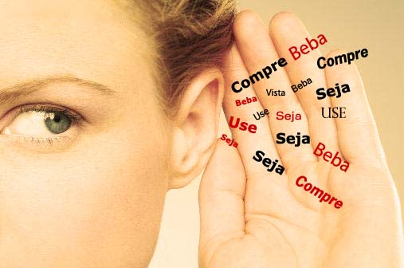
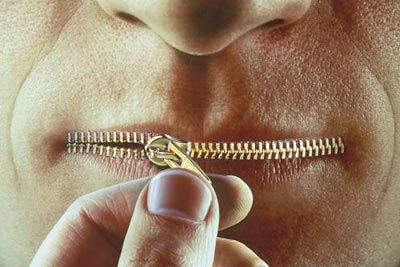

# [Os 12 defeitos insuportáveis dos Brasileiros](http://ahduvido.com.br/os-11-defeitos-insuportaveis-dos-brasileiros "Os 12 defeitos insuportáveis dos Brasileiros")

Se você me perguntasse qual o melhor país do mundo, sem dúvida, responderia Brasil**.** A resposta seria a mesma se perguntasse sobre o povo**.** Os brasileiros são incríveis, além de únicos, pois entre os povos que habitam esse planeta, os brasileiros são os mais acolhedores**.** Entretanto, certos comportamentos, melhor dizendo, caraterísticas do nosso povo são extremamente irritantes**.** Talvez sejam resultados de fatos históricos, talvez seja resultado dessa cultura tão miscigenada…**.** não dá de saber ao certo de onde provém esses defeitos mas é certo que eles estão presentes do norte ao sul desse país**.** Não que tais sejam exclusividades brasileiras, apesar de que nas terras tupiquinis pareça muito mais acentuado que em outros lugares**.** Veja a lista e dê sua opinião:

**Obs:**.**** Lembrando que o post fala da maioria dos brasileiros e não está generalizando**.** Maioria = Número excedente a metade do todo; Grupo preponderante**.**

Ressalto também que os itens também não estão por ordem de importância**.**

**12. Brasileiro reclama de tudo e não resolve nada**

Reclamação vem do latim *reclamatione,* que designa o ato de “desaprovação manifestada por gritos”, e do verbo *reclamare* (reclamar) que significa exigir ou reivindicar**.** Essa, sem sombras de dúvida, é a atitude mais adorada e praticada pelos brasileiros**.** Nosso povo reclama de tudo!

Apesar do abuso desse ato, o problema não está em reclamar: o problema está em apenas reclamar**.** Não existe o hábito do segundo passo por aqui. A pessoa reclama, xinga muito no Twitter e fica por isso mesmo**.** A parte mais importante, que seria achar a solução para reclamação, simplesmente é abandonada, transformando a atitude de reclamar em algo totalmente inútil**.**

**11. Brasileiros são um bando de maria-vai-com-as-outras**

A explicação para o excesso de reclamação e para a falta de reação já virou estudo aqui no Brasil**.** O resultado não apresentou nenhuma novidade: O brasileiro não tem o hábito de protestar no cotidiano**.** A corrupção dos políticos, o aumento de impostos, o descaso nos hospitais, as filas imensas nos bancos e a violência diária só levam a população às ruas em circunstâncias excepcionais**.** Por que isso acontece? A resposta a tanta passividade pode estar em um estudo de Fábio Iglesias, doutor em Psicologia e pesquisador da Universidade de Brasília (UnB)**.** Segundo ele, o brasileiro é protagonista do fenômeno “ignorância pluralística”, termo cunhado pela primeira vez em 1924 pelo americano Floyd Alport, pioneiro da psicologia social moderna**.**

“Esse comportamento ocorre quando um cidadão age de acordo com aquilo que os outros pensam, e não por aquilo que ele acha correto fazer**.** Essas pessoas pensam assim: se o outro não faz, por que eu vou fazer**?**”, diz Iglesias. O problema é que, se ninguém diz nada e conseqüentemente nada é feito, o desejo coletivo é sufocado**.** O brasileiro, de acordo com Iglesias, tem necessidade de pertencer a um grupo**.** “Ele não fala sobre si mesmo sem falar do grupo a que pertence**.**”

Iglesias começou sua pesquisa com filas de espera**.** Ele observou as reações das pessoas em bancos, cinemas e restaurantes**.** Quando alguém fura a fila, a maioria finge que não vê**.** O comportamento-padrão é cordial e pacífico. Durante dois meses, ele analisou o pico do almoço num restaurante coletivo de Brasília**.** Houve 57 “furadas de fila”. “Entravam como quem não quer nada, falando ao celular ou cumprimentando alguém**.** A reação das pessoas era olhar para o teto, fugir do olhar dos outros”, afirma**.** O aeroviário carioca Sandro Leal, de 29 anos, admite que não reage quando vê alguém furar a fila no banco**.** “Fico esperando que alguém faça alguma coisa. Ninguém quer bancar o chato”, diz**.**

Iglesias dá outro exemplo comum de ignorância pluralística: “Quando, na sala de aula, o professor pergunta se todos entenderam, é raro alguém levantar a mão dizendo que está com dúvidas”, afirma**.** Ninguém quer se destacar, ocorrendo o que se chama “difusão da responsabilidade”, o que leva à inércia**.**

Mesmo quem sofre uma série de prejuízos não abre a boca**.** É o caso da professora carioca Maria Luzia Boulier, de 58 anos**.** Ela já comprou uma enciclopédia em que faltava um volume; pagou compras no cartão de crédito que jamais fez; e adquiriu, pela internet, uma esteira ergométrica defeituosa**.** Maria Luzia reclamou apenas neste último caso**.** Durante alguns dias, ligou para a empresa. Não obteve resposta**.** Foi ao Procon, mas, depois de uma espera de 40 minutos, desistiu de dar queixa**.** “Sou preguiçosa. Sei que na maioria das vezes reclamar não adianta nada”, afirma**.**

O “não-vai-dar-em-na-da” é um discurso comum entre os “não-reclamantes”**.** O estudante de Artes Plásticas Solano Guedes, de 25 anos, diz que evita se envolver em qualquer situação pública**.** “Sou omisso, sim, como todo brasileiro. Já vi brigas na rua, gente tentando arrombar carro**.** Mas nunca denuncio. É uma mistura de medo e falta de credibilidade nas autoridades”, afirma**.**

A apatia diante de um escândalo público também é freqüente no Brasil**.** Nas décadas de 80 e 90, o contador brasiliense Honório Bispo saiu às ruas para lutar pelas Diretas Já e pelo impeachment do ex-presidente Fernando Collor**.** Caso que apenas se concretizou pelo massivo uso da imprensa**.** Estudiosos acreditam que o Impeachment nunca aconteceria se a mídia não colocasse no ar o ataque massivo ao presidente: 10 das 24 horas de programação das emissoras nas semanas anteriores ao ato divulgavam a  ideia das Diretas Já e Impeachment**.**

O estudo da UnB constatou que a “cultura do silêncio” também acontece em outros países**.** “Portugal, Espanha e parte da Itália são coletivistas como o Brasil”, afirma o psicólogo**.** Em nações mais individualistas, como em certos países europeus e a vizinha Argentina, o que conta é o que cada um pensa**.** “As ações são baseadas na auto-referência”, diz o estudo**.** Nos centros de Buenos Aires e Paris, é comum ver marchas e protestos diários dos moradores**.** A mídia pode agir como um desencadeador de reclamações, principalmente nas situações de política pública**.** “Se o cidadão vê na mídia o que ele tem vontade de falar, conclui que não está isolado”, afirma o pesquisador**.**

O antropólogo Roberto DaMatta diz que não se pode dissociar o comportamento omisso dos brasileiros da prática do “jeitinho”**.** Para ele, o fato de o povo não lutar por seus direitos, em maior ou menor grau, também pode ser explicado pelas pequenas infrações que a maioria comete no dia-a-dia**.** “Molhar a mão” do guarda para fugir da multa, estacionar nas vagas para deficientes ou driblar o engarrafamento ao usar o acostamento das estradas são práticas comuns e fazem o brasileiro achar que não tem moral para reclamar do político corrupto**.** “Existe um elo entre todos esses comportamentos. Uma sociedade de rabo preso não pode ser uma sociedade de protesto”, diz o antropólogo**.**

O sociólogo Pedro Demo, autor do livro Cidadania Pequena s (ed**.** Autores Associados), diz que há baixíssimos índices de organização da sociedade civil – decorrentes, em boa parte, dos também baixos índices educacionais**.** Em seu livro, que tem base em dados do Instituto Brasileiro de Geografia e Estatística (IBGE), o sociólogo conclui que o brasileiro até se mobiliza em algumas questões, mas não dá continuidade a elas e não vê a importância de se aprofundar**.** Um exemplo é o racionamento de energia ocorrido há doze anos: rapidamente as pessoas compreenderam a necessidade de economizar**.** Passada a urgência, não se importaram com as razões que levaram à crise**.** Para o sociólogo, além de toda a conjuntura atual, há o fator histórico: a colonização portuguesa voltada para a exploração e a independência declarada de cima para baixo, por dom Pedro I, príncipe regente da metrópole**.** “Historicamente aprendemos a esperar que a decisão venha de fora**.** Ainda nos falta a noção do bem comum. Acredito que, ao longo do tempo, não tivemos lutas suficientes para formá-la”, diz Demo**.**

A historiadora e cientista política Isabel Lustosa, autora da biografia Dom Pedro I, um Herói sem Nenhum Caráter (ed**.** Companhia das Letras), acredita que os brasileiros reclamam  mas têm dificuldades de levar adiante esses protestos sob a forma de organizações civis**.** “Nas filas ou mesas de bar, as pessoas estão falando mal dos políticos**.** As seções de leitores de jornais e revistas estão repletas de cartas de protesto**.** Mas existe uma espécie de fadiga em relação aos resultados das reclamações, especialmente no que diz respeito à política**.**” Segundo Isabel, quem mais sofre com a falta de condições para reclamar é a população de baixa renda**.** Diante da deterioração dos serviços de educação e saúde, o povo fica sem voz**.** “Esses serviços estão pulverizados**.** Seus usuários não moram em suas cercanias. A possibilidade de mobilização também se pulveriza”, diz**.**

Apesar das explicações diversas sobre o comportamento passivo dos brasileiros, os estudiosos concordam num ponto: nas filas de espera, nos direitos do consumidor ou na fiscalização da democracia, é preciso agir individualmente e de acordo com a própria consciência**.** “Isso evita a chamada espiral do silêncio”, diz o pesquisador Iglesias**.** O primeiro passo para a mudança é abrir a boca.

**10**.** Brasileiro acha que a vida é resumida em futebol, fofoca, carnaval, cerveja e putaria**

Oito em cada dez brasileiros tem o assunto do seu dialogo com outrem resumido nesses termos**.** Quando não está falando de futebol, está falando de sexo ou fofocando ou falando do quanto bebeu no final de semana e vice-versa**.** Qualquer tema que saia dessa esfera é rejeitado pela maioria, exceto, se o tema for inicio de um reclamação coletiva (do tipo que não vai dar em nada)**.** Não é de estranhar que a definição do Brasil seja “o país do futebol e do carnaval”**.**

Tanto a filosofia quanto a Psicologia e a Sociologia explicam que essas paixões comprometem o intelecto humano**.** Tal como um homem apaixonado pela sua amada, o ser apaixonado não pensa, somente age de acordo com suas emoções**.** Os brasileiros dão provas que essas paixões os transformam em verdadeiros “trouxas”, entre os quais podemos destacar os seguintes fatos decorridos dessa passionalidade:

1. Ronaldinho Gaúcho ganhando medalha Machado de Assis da Academia Brasileira das Letras;
2. Bruna Surfistinha virando best-seller e depois blockbusters;
3. Brigas de torcidas;
4. Brigas anuais nas apurações das campeãs do Carnaval;
5. Pelé sendo reconhecido como um dos maiores brasileiros de todos os tempos pela Times;
6. Pesquisas mostrando que brasileiro gasta mais com cerveja do que com Educação;
7. Xvideo como o vigésimo segundo site mais acessado do Brasil, perdendo apenas para sites de funções essenciais(como Google e sites de bancos) e para redes sociais**.**

Muito se pergunta se o Brasil poderá suportar seu crescimento diante de pensamento tão rudimentar**.** Existe uma estimativa construída em cima das pesquisas realizadas pelo IBGE que diz que provavelmente daqui a 5 anos o Brasil venha a atingir índices de países de primeiro mundo em diversas áreas**.** Porém, como comportar tamanho avanço se a cultura brasileira continua a mesma**?** É por esse motivo que a entrada de estrangeiros no nosso mercado de trabalho cresce a cada dia**.** Importar “cabeças-pensantes” é lucrativo para empresas já que aqui as cabeças estão ocupadas com outros pensamentos**.** Enquanto os gringos buscam soluções para os setores da indústria e da sociedade, nós continuamos com a imaturidade de apoiar nosso micro-universo na preocupação com nossos times de futebol e quantos dias de folga vamos pegar no carnaval**.** A carência de ambição e a passividade diante do que precisa ser feito converte a maior parte dos brasileiros em cartas fora do baralho do setor industrial quando o assunto exige dedicação e disciplina**.**

**9. Brasileiro gosta da hipocrisia**

 “Sem as pequeninas hipocrisias mútuas nos tornaríamos intoleráveis uns para os outros”**.** A frase é atribuída ao filósofo alemão Emanuel Wertheimer, coincidindo com as práticas gerais do mundo até nas grandes hipocrisias, como freqüentemente chega ao nosso conhecimento por meio das manchetes diárias**.** Há milênios condenada pela sociedade, a Hipocrisia se encontra presente, acompanhando o Homem desde do seu engatinhar pela superfície terrestre**.** Sua definição é difícil de lidar e sua complexidade é relevante, já que, em certas situações, o que parece hipocrisia, na verdade não é**.**

“Impostura, fingimento, simulação, falsidade”**.** Dessas quatro facetas ligadas à definição da hipocrisia provavelmente a menos conhecida é a impostura, como “artifício para iludir, embuste, vaidade ou presunção extrema”**.** De qualquer maneira, o que se ressalta aí é a presença da mentira**.** No caso da hipocrisia, a mentira social por excelência**.**

O conceito mais comum de hipocrisia, conceito qual iremos adotar aqui para discutir a situação brasileira, seria o ato de fingir ter crenças, virtudes, ideias, devoção, comportamento e sentimentos para alcançar o apreço publico, mesmo sendo o acusador vítima da sua própria crítica**.** Ou seja, o assassino que condena o homicídio, o funkeiro que critica a música ruim do Latino, o analfabeto que reclama da falta de leitura do povo**.**

Brasileiro adora uma boa hipocrisia**.** São tantos os exemplos para provar essa ultima afirmação que até fiquei em dúvida sobre qual deveria escolher**.** Optei pelo mais conhecido: Brasileiros versus emissoras de TV**.** Não deve ser novidade para ninguém que o Brasileiro critica e repudia programas de TV os quais assiste**.** BBB, o maior exemplo de hipocrisia brasileira, mostra a real face desse povo: de um lado, pessoas engajadas, criticando, dizendo para os outros não assistirem o programa**.** De outro, um dos programas com uma das maiores audiências da era dos “reality shows”**.** Nem é preciso ser especialista comportamental para saber que alguém está mentindo nessa história, ou precisa**?** De maneira semelhante temos o Zorra Total, o programa mais odiado pelo público brasileiro e líder de audiência do seu horário**.** Oras, de onde provém essa controvérsia senão da mentira e falsidade de alguns que condenam diante do olhar alheio mas, no aconchego do seu lar, passa parte do seu tempo livre assistindo esses programas**.**

Além dessa hipocrisia direta temos a hipocrisia indireta**.** Assumindo o mesmo exemplo anterior, podemos dizer que é um hipócrita de forma indireta aquele que reclama de quem assiste BBB, alegando que o último é um programa sem caráter cultural, contudo, não perde o jogo de futebol de quarta a noite ou mesmo, faz questão de assinar um canal de TV exclusivo de Futebol**.** São dois lados de uma mesma moeda.

**8**.** Brasileiro não sabe lidar com o politicamente correto e politicamente incorreto**

Quem tem boa memória e passa algumas horas do seu dia na frente do computador deve lembrar do caso do Stand Up do Rafinhas Bastos ano passado**.** Durante um dos seus shows, Rafinha resolveu utilizar do *humor negro extreme nonsense*, típico dele, fazendo uma piadinha um tanto sem graça sobre o estuprador fazer um favor à uma feia quando a estupra**.**

Quando essa notícia se espalhou foi o caos**.** Todo mundo condenou o humorista**.** Foi um tal de “esse cara tem que ser preso” para lá e um “que absurdo, é o fim do mundo” para cá**.**

Algum tempo depois, começou o novo BBB e aconteceu o  tal “estupro”**.** O que você pensa que o povo brasileiro fez? Criticou**?** Não, pelo contrário, ele brincou com a situação, fazendo piadinhas sobre o ocorrido**.** O politicamente correto foi esquecido, o que leva ao pensamento que aqui no Brasil parece que ele é de lua, ou vem por estação…**.** não dá para definir. Em certa hora o brasileiro desaprova, condena, critica tal ato incorreto, em outra, pratica e apoia**.**

**7. Brasileiro tem o pé no extremismo para babaquices**

Fanatismo ideológico é o estado psicológico que caracteriza qualquer pessoa como idiota**.** O Fanático é irracional, inflexível, persistente e teimoso**.** Sua natureza irregular, baseada em paixões, leva a paranoias e gera preconceitos e agressividade com quem discorda de seus valores e crenças**.** Nos países árabes, esse estado é bastante comum por causa da religião**.** Em alguns países europeus, extremismo e fanatismo se misturam na busca de alguns grupos por liberação de certos estados de seus países**.** Já aqui no Brasil…. bem, aqui é uma coisa inexplicável**.** Brasileiro adota o fanatismo para as coisas mais idiotas, por exemplo:

1. Defender partidos políticos ( PT e PSDB é tudo farinha do mesmo saco, mermão**!**)
2. Defender crenças religiosas ( Evangélico conservador que paga dízimo para pastor e se acha no direito de julgar a vida de todo mundo)
3. Brigar por times de futebol ( Enquanto você briga, eles recebem um salário gordo e riem da sua cara de otário)
4. Arrumar confusão por causa de celebridades, atores, atrizes, músicos ( Familia Restart é o cacete da Maria João**!** Lady Gaga não canta, apenas troca de roupa! Justin Bieber fez sucesso apenas por causa do cabelo**!** Tarantino é uma farsa! Chorem mimimimi…)

Esses são exemplos somente de uma pequena fração de todos os tipos de fanatismos babacas verde e amarelo**.** Deveria existir um projeto de lei que classificasse as pessoas por grau de idiotice fanática**.** Quem fosse reprovado deveria ser jogado, de imediato para evitar a contaminação aos demais, na Ilha de Queimada Grande para servir de alimento para as cobras do local**.**

**6. Brasileiro não admite a própria culpa**

“A culpa é minha e eu coloco ela em quem eu quiser” uma das famosas frases de Homer Simpson faz total sentido nessa republica**.** Segundo International Stress Management Association – em pesquisa com mais de com 1 000 profissionais – praticamente metade dos brasileiros analisados (47%) apresentam um comportamento agressivo quando algo dá errado e tende a negar a participação no erro**.** Percentual altíssimo se comparado aos países orientais e alguns europeus, os quais não ultrapassam os 14%**.**

Já faz parte da nossa cultura colocar a culpa nos outros**.** Não unicamente no trabalho mas em tudo que estamos envolvidos**.** O Brasil não funciona é culpa dos políticos e não nossa e do nosso voto e apatia frente a tanta corrupção**.** Enchetes ocorrem por causa do acumulo de lixo nos bueiros e a culpa é do El nino**.** Para tudo há sempre um bode expiatório.

Um exemplo clássico disso é a falta de leitura dos brasileiros atribuída aos preços dos livros**.** O Brasileiro consumiu a média 120 litros de cerveja por habitante em 2010**.**  A estimativa é que ultrapasse a marca de 15 bilhões de litro de cerveja em 2012 segundo a Sindicerv**.** Acredita-se que o gasto do brasileiro de classe C2 a B2 seja de R$ 360 reais anuais**.** O estudo da CBL (Camara Brasileira dos Livros) mostra que o brasileiro lê em média 1,8 livros/ano e os livros mais comprados no nosso mercado tem preço em torno de 35 reais**.** Desse modo, assumindo todos esses fatos, fica claro que a falta de leitura do brasileiro vem pela ausência de vontade**.** Oras, comprar R$ 360 reais de cerveja pode mas gastar R$ 35 reais com um livro é muito caro**?** Eita “paísinho”….

**5. Brasileiro não sabe resolver um problema de cada vez**

Eis que existe um problema que incomoda muita gente e que ninguém nunca mexeu um dedo para solucionar**.** Certo dia, um brasileiro resolve sair do seu estado apático e coloca a mão na massa**.** Consegue um percentual razoável de apoio para sua idéia e ela começa a evoluir até que se torna popular**.** Nesse momento, o outro lado dos brasileiros apresenta-se: o de querer resolver tudo de uma vez só**.**

Você apresenta uma proposta para reduzir os impostos da importação de produtos e aparece sujeito dizendo que *“enquanto perdemos tempo querendo diminuir os impostos, políticos roubam verbas em Brasília”***.** Você apresenta uma proposta para acabar com a violência nos esportes e aparece um brasileiro dizendo que *“enquanto perdemos tempo querendo cessar a violência nos esportes, faltam medicamentos nas farmácias populares”***.** PORRA! Mas que diabos esse sujeito estava fazendo que não tomou a iniciativa para resolver esses problemas…**.** ficou esperando alguém tomar a iniciativa para resolver outro problema que não tem nada a ver com aquele que ele exalta para ficar reclamando**.** E assim, ninguém nunca resolve nada**!** Achar que tudo pode ser resolvido de uma só vez é um pensamento de babaca que leva ao fracasso**.** Se você acha que tal problema não é prioridade, faça a sua campanha para resolver o problema que você considera principal e não fique criticando quem está tentando melhorar o nosso país**.**

**4. Brasileiro acha que os EUA é o melhor em tudo**

Você deve conhecer algum brasileiro que foi para os EUA e voltou para a nossa amada terra parecendo um robozinho defensor do Tio Sam, ou não**?**  Eu conheço muitos. Sujeito vai para o exterior, principalmente para os EUA, e volta desdenhando tudo**.**

Esse hábito é de visitar o exterior e adotar o lado do extremo-negativo quando volta é típico de brasileiro**.** Comparações que, por muitas vezes, não fazem qualquer sentido, como as reclamações por não haver aqui um fast-food em cada esquina**.**

O que brasileiro tem que compreender é que cada país é um país**.** São culturas diferentes, são histórias diferentes, são povos diferentes**.** Você adotar o que há de positivo lá fora e implantar aqui é ótimo**.** Ruim é você ver o que há de positivo lá fora para ficar desdenhando o que há de simples por essas bandas**.**

**3. Brasileiro é o câncer da Internet**

A raça mais odiada da Internet tem nome: Brasileiros**.** Não é questão de xenofobia, o repúdio dos brasileiros por outros povos na Internet é pela total falta de postura e ética nossa no meio virtual**.** O comportamento baderneiro incomoda muitos povos, por isso que os brasileiros tem seu acesso restrito em diversos MMORPG, fóruns, sites, redes sociais, entre outros**.** Somos o povo mais irritante e troll da Internet.

O Orkut e Facebook são exemplos disso**.** Quando o Orkut era febre nos outros países, tudo era muito organizado, até que os brasileiros colocaram os pés nas terras googleanas**.** Foi um deus nos acuda, tamanha a bagunça que a rede virou**.** As comunidades de idioma inglês foram invadidas pelos brasileiros que começavam a falar em português no meio de debates em inglês**.** Os gringos irritados com tanta bagunça mudaram para o Facebook**.** E assim foi até que os brasileiros migraram para o Facebook e o abrasileiraram ( leia-se Orkutizaram)**.** O reflexo dessa mudança canarinho já foi demonstrado na ultima pesquisa de ingresso e saída da empresa que mostram a migração dos gringos para redes sociais alternativas**.** A invasão brasileira acabou se tornando ameaças para essas empresas da web por representarem grandes baixas nos países onde a empresa já possui determinado sucesso, levando a mesma proibir a nossa entrada com o intuito de manter o negócio**.**

Brasileiro enche essas redes de spam, de gifs que brilham, de páginas de humor, de páginas de putaria… compartilham qualquer coisa a qualquer tempo**.** Embora não exista nenhum Código de Ética para Internet, o bom senso deve estar sempre presente**.** Assim, compartilhar no Facebook, por exemplo, a foto de um gato esquartejado ou algo do gênero não é legal, todo mundo sabe disso, exceto a massa brasileira**.**

[De modo parecido os brasileiros invadem os MMORPG’s](http://e621.net/data/99/cb/99cb9e882c32b64306dca3384a92fdb7.png) **.** Em semanas eles destroem com os servers**.** Talvez devido a nossa natureza corrupta, corrompemos tudo que tocamos**.** E daí surge os BOTS, hacks, cheats e tantos outros mecanismos para obter vantagens sobre os outros que nós inventamos e que fazem os jogos perderem toda a graça**.**

Espero que com o tempo nós percebamos o quanto somos inconvenientes e irritantes, adquirindo uma postura mais sensata antes que sejamos expulso de tudo que é canto da web**.**

**2**.** Brasileiro não sabe a própria Língua**

A Educação no Brasil é lastimável, isso não é segredo para ninguém**.** Uma pesquisa do Instituto de Pesquisa Econômica Aplicada (Ipea) mostrou que para  2**.**773 entrevistados (27,3% ), que avaliaram nosso sistema educacional, não houve mudanças na qualidade do ensino e quase um quarto (24,2%) acredita que o sistema piorou**.** Já o IBGE mostrou no seu estudo de 2011 que apenas 11% dos brasileiros conseguiram concluir o ensino superior ( percentual baixo se analisarmos outros países, tais como Russia (54%) , Cuba (92%), Chile (24%))**.**

Apesar dos pesares, com toda essa estrutura educacional precária, ainda é inexplicável o domínio débil do brasileiro sobre a sua língua**.** Não estou me referindo ao domínio completo – compreendendo todas aquelas regras exageradas e chatas -, estou dizendo do “basicão”**.**

Você leitor deve estar pensando que isso é resultado da falta de investimento do governo, ou não**?** Logicamente, essa é uma das possíveis causas, contudo, não é a única**.** Existem outras causas para explicar as anomalias do nosso sistema educacional, como a pesquisa feita por uma das principais empresas de contratos de estágio do país, que constatou no primeiro semestre de 2011 que  nem mesmo os graduando de jornalismo dominam a língua**.** Através de um ditado de 30 palavras, a empresa verificou que o índice de erro ficou na média 1/3 das palavras**.**

Esse defeito pode ser verificado em todas as áreas, desde das melhores escolas particulares até mesmo no próprio Sistema Judiciário**.**

Percebeu leitor**?** Estamos falando do topo da escala financeira e não um bando de pobre coitado que não tem aonde cair morto**.** Os grandes nomes da Língua Portuguesa do país, como o autor do livro “Preconceito Linguístico” Marcos Bagno, afirmam que a explicação para esses acontecimentos é mais simples do que parece:

1. o completo desinteresse do povo por sua Língua devido a dificuldade que a mesma apresenta;
2. a ausência do hábito da leitura**.**

Por esse e outros motivos, nesse país, a Língua virou arma de manipulação e fator gerador de preconceito**.**

**1**.** Brasileiro adora dar reconhecimento para quem não merece**

Quantas vezes você viu uma homenagem para o Carlos Chagas no horário nobre da TV**?** Releia a pergunta e substitua “Carlos Chagas” por Pelé e mentalize  a resposta**.** No Brasil, quanto mais você faz pela sociedade, menos reconhecimento você tem dela**.** Em contrapartida, quanto menos você faz, maior notoriedade tem o seu trabalho**.** Assim temos cientistas, pesquisadores, juízes, médicos, engenheiros, bombeiros, policiais, professores, entre outros, que dedicam a sua vida em prol de todos e tem reconhecimento zero pela sociedade**.** Muitos deles sequer recebem um salário justo**.**

Já quem não faz nada pela sociedade, como atletas – principalmente jogadores de futebol – , artistas, atores, músicos, mulheres de bundas grandes e perfeitas, entre outros que exercem uma “profissão” que não presta qualquer serviço para o bem comum, somente beneficiando aos próprios, além de receber salários altíssimos, são ovacionados pelo público**.**

Esse hábito não é exclusivamente brasileiro, boa parte dos países ocidentais, em especial aqueles que importam a cultura americana, se comportam dessa maneira**.** Esse culto as celebridades e o total descaso com quem realmente faz acaba gerando a insatisfação da maior parte das pessoas cultas seja aqui ou em qualquer parte do mundo**.** Como as pessoas com considerável grau intelectual são minorias, tal comportamento se espalha feito vírus, recebendo o apoio das mídias**.** Cabe a você e eu, que temos consciência desse tumor, espalhar nossa ideologia e derrubar essa idolatria e admiração aos falsos feitores originada da ignorância humana**.**

**Deixe seu comentário sobre o texto**.** Porém peço que faça diferente: ao invés de reclamar e falar sobre outros possíveis defeitos dos brasileiros, indique a solução para esses**.****

**Veja também:**

**Antes de comentar, leia o post abaixo também**.** Ele tira algumas dúvidas comuns sobre esse post.**

### Posts Relacionados
