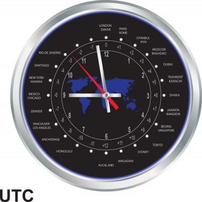
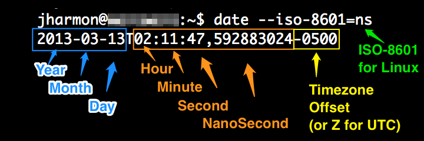

# **T**he 5 laws of API dates and times

[20 Replies](http://apiux.com/2013/03/20/5-laws-api-dates-and-times/#comments "Comment on The 5 laws of API dates and times")

Let’s say you’re building your first API**.** Be it public, private, or some hybrid thereof, don’t be surprised if your first defect is date/time-related**.** Do not underestimate how much trouble you can get into when it comes to handling date and times**.** Here are some tips which might keep you out of this potential future**.**

*Caveat: I’m presuming you’re using a Gregorian calendar**.** In certain international situations, this might be a bad assumption**.** If you’re operating on a different calendar, this won’t help you**.***

**Law #1: Use ISO-8601 for your dates**

There’s really no debate here**.** From the [W3C](http://www.w3.org/QA/Tips/iso-date "W3C: Use ISO 8601")  to the [IETF](http://tools.ietf.org/html/rfc3339 "RFC 3339") , and even [XKCD](http://xkcd.com/1179/ "XKCD: ISO 8601") , the Internet has come to operate on this standard**.** Don’t try to be smart and do it differently**.** ISO-8601 provides a host of varieties on how to display dates/times/timezones**.**

For a quick glimpse from your \*nux console, try the following:

ISO 8601 addresses many issues, including:

- Natural sorting – So simple and elegant, it sorts without any extra work**.**
- Timezone offset – Respecting user location and timezone is critical for an increasingly global and mobile world**.**
- Locale neutrality – Imagine the nightmare date 2/3/4**.** Depending on if you’re in the US, EU, or otherwise…that date could be Feb 3, 2004 in the US, or Mar 2, 2004 for most of the rest of the world**.** In ISO 8601 terms, 2004-02-03 takes away that ambiguity**.**
- Support in a wide variety of programming languages – While not all languages come with this date format in the default installation (for example, Java), there are typically mature libraries available for parsing ISO 8601 formats**.** Don’t be a hero and do it yourself**.**

**Law #2: Accept any timezone**

Now that you have a tool set with ISO 8601 whereby you can capture relevant timezone offset data, use it**!** We are in a global age**.** Especially if your API is open to the public, you will unquestionably be dealing with consumers from around the globe**.** Do not make any assumptions about what timezone your API users will utilize**.**

**Law #3: Store it in UTC**

This one is really more of a systems design law in general**.** I’ve lost count of how many times I have seen systems built with the timezone of the original company headquarters**.** Inevitably, unless you are quite disciplined, users will end up seeing their dates in your companies’ timezone**.** This is pretty annoying, especially if they are located on the other side of the globe**.**

UTC, or Coordinated Universal Time, is the least common denominator in storing times, as it does not denote any timezone offset**.** This allows you to purpose dates as needed throughout your system in whatever timezone is appropriate**.**

**Law #4: Return it in UTC**

UTC will allow your API consumers the freedom to offset the date to whatever suits their needs**.** More importantly for you, your API team will not have to fret over calculating all of those offsets for every hit**.** Documenting and supporting your API, in terms of how you deal with dates, is simple: “you get UTC”**.**

**Law #5: Don’t use time if you don’t need it**

ISO 8601 also allows us the flexibility to provide a date without a time**.** In scenarios in which time is not important, only the date (something like “target completion date”): do not store or return the time**.** While it seems like no harm done in just storing 11:59pm, or some other random time, this can get messy when it comes to internationalizing that date**.**

Imagine you stored 2013-03-01T23:59:59 in UTC to represent Mar 1, 2013**.** Now offset that time based on China Standard Time (UTC+0800), and you are looking at Mar 2, 2013 at 8am**.** This could be real trouble, as dates get misinterpreted**.** In this case, we would simply use 2013-03-01 without any additional time/timezone offset info to reduce time interpretation ambiguity**.** Most modern database systems support this notion of date-only storage**.**

**Summary**

While all of that gritty date talk can be a little mind numbing, rest assured that virtually all RESTful platforms in the wild are utilizing these formats**.** Just be cautious when you start mucking around in the data serialization libraries, that you pay attention to what it does to your dates by the time it leaves your API platform**.**

Most of us have worked, lived, or communicated in different timezones and/or countries, we can respect how confusing it can be to communicate something as simple as scheduling an appointment**.** Also if you have had the displeasure of writing lots of legacy date parsing and formatting, you can appreciate how one standard for time representations is such a blessing**.** Stick to these basic laws of handing dates and times in your API, and you’ll save yourself these potential headaches**.**

*Image credit: [hermione13 / 123RF Stock Photo](http://www.123rf.com/photo_7266401_silver-clock-with-time-zones.html)*
