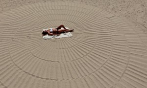

# **W**hy a medieval peasant got more vacation time than you

By Lynn Parramore

August 29, 2013

Life for the medieval peasant was certainly no picnic**.** His life was shadowed by fear of famine, disease and bursts of warfare**.** His diet and personal hygiene left much to be desired**.** But despite his reputation as a miserable wretch, you might envy him one thing: his vacations**.**

Plowing and harvesting were backbreaking toil, but the peasant enjoyed anywhere from eight weeks to half the year off**.** The Church, mindful of how to keep a population from rebelling, enforced [frequent mandatory holidays](http://history-world.org/peasant.htm) **.** Weddings, wakes and births might mean a week off quaffing ale to celebrate, and when wandering jugglers or sporting events came to town, the peasant expected time off for entertainment**.** There were labor-free Sundays, and when the plowing and harvesting seasons were over, the peasant got time to rest, too**.** In fact, [economist Juliet Shor](http://groups.csail.mit.edu/mac/users/rauch/worktime/hours_workweek.html)  found that during periods of particularly high wages, such as 14th-century England, peasants might put in no more than 150 days a year**.**

As for the modern American worker**?** After a year on the job, she gets an average of [eight vacation days](http://www.bls.gov/news.release/ebs.t05.htm)  annually**.**

It wasn’t supposed to turn out this way: John Maynard Keynes, one of the founders of modern economics, made a famous [prediction](http://money.howstuffworks.com/five-day-weekend2.htm)  that by 2030, advanced societies would be wealthy enough that leisure time, rather than work, would characterize national lifestyles**.** So far, that forecast is not looking good.

What happened**?** Some cite the victory of the modern eight-hour a day, 40-hour workweek over the punishing 70 or 80 hours a 19th century worker spent toiling as proof that we’re moving in the right direction**.** But Americans have long since [kissed the 40-hour workweek goodbye](http://www.businessinsider.com/americans-40-hour-work-week-not-enough-2011-6) , and Shor’s examination of work patterns reveals that the 19th century was an aberration in the history of human labor**.** When workers fought for the eight-hour workday, they weren’t trying to get something radical and new, but rather to restore what their ancestors had enjoyed before industrial capitalists and the electric lightbulb came on the scene**.** Go back 200, 300 or 400 years and you find that most people did not work very long hours at all**.** In addition to relaxing during long holidays, the medieval peasant took his sweet time eating meals, and the day often included time for an afternoon snooze**.** “The tempo of life was slow, even leisurely; the pace of work relaxed,” notes Shor**.** “Our ancestors may not have been rich, but they had an abundance of leisure**.**”

Fast-forward to the 21st century, and the U.S. is the only advanced country with [no national vacation policy whatsoever](http://www.theatlantic.com/business/archive/2012/07/the-only-advanced-country-without-a-national-vacation-policy-its-the-us/259317/) **.** Many American workers must keep on working through public holidays, and vacation days often go unused**.** Even when we finally carve out a holiday, many of us answer emails and “check in” whether we’re camping with the kids or trying to kick back on the beach**.**

Some [blame the American worker](http://www.theatlantic.com/business/archive/2012/08/no-vacation-nation-why-dont-americans-know-how-to-take-a-break/260759/)  for not taking what is her due**.** But in a period of consistently high unemployment, job insecurity and weak labor unions, employees may feel no choice but to accept the conditions set by the culture and the individual employer**.** In a world of “at will” employment, where the work contract can be terminated at any time, it’s not easy to raise objections**.**

It’s true that the New Deal brought back some of the conditions that farm workers and artisans from the Middle Ages took for granted, but since the 1980s things have gone steadily downhill**.** With secure long-term employment slipping away, people jump from job to job, so seniority no longer offers the benefits of additional days off**.** The rising trend of hourly and part-time work, stoked by the Great Recession, means that for many, the idea of a guaranteed vacation is a dim memory**.**

Ironically, this cult of endless toil doesn’t really help the bottom line**.** [Study](http://accounting.smartpros.com/x43420.xml)  after [study](http://www.lostgarden.com/2008/09/rules-of-productivity-presentation.html)  shows that overworking reduces productivity**.** On the other hand, performance increases after a vacation, and workers come back with restored energy and focus**.** The longer the vacation, the [more relaxed and energized](http://familiesandwork.org/site/newsroom/releases/2005overwork.html)  people feel upon returning to the office**.**

Economic crises give austerity-minded politicians excuses to talk of decreasing time off, increasing the retirement age and cutting into social insurance programs and safety nets that were supposed to allow us a fate better than working until we drop**.** In Europe, where workers average 25 to 30 days off per year, politicians like French President Francois Hollande and Greek Prime Minister Antonis Samaras are [sending signals](http://www.bloomberg.com/news/2013-08-25/hollande-bids-adieu-to-eu-vacation-culture-as-crisis-lingers.html)  that the culture of longer vacations is coming to an end**.** But the belief that shorter vacations bring economic gains doesn’t appear to add up**.** According to the Organisation for Economic Co-operation and Development (OECD) the Greeks, who face a horrible economy, work more hours than any other Europeans**.** In Germany, an economic powerhouse, workers rank second to last in number of hours worked**.** Despite more time off, German workers are the eighth most productive in Europe, while the long-toiling Greeks rank 24 out of 25 in productivity**.**

Beyond burnout, vanishing vacations make our relationships with families and friends suffer**.** Our health is deteriorating: [depression](http://familiesandwork.org/site/newsroom/releases/2005overwork.html)  and [higher risk of death](http://www.ncbi.nlm.nih.gov/pubmed/11020089)  are among the outcomes for our no-vacation nation**.** Some forward-thinking people have tried to reverse this trend, like progressive economist Robert Reich, who has [argued in favor](http://www.marketplace.org/topics/economy/commentary/mandatory-extended-vacation-good-economy)  of a mandatory three weeks off for all American workers**.** Congressman Alan Grayson proposed the Paid Vacation Act of 2009, but alas, the bill didn’t even make it to the floor of Congress**.**

Speaking of Congress, its members seem to be the only people in America getting as much down time as the medieval peasant**.** They get [239 days off this year](http://www.policymic.com/articles/38177/want-a-job-with-239-vacation-days-become-a-member-of-congress) .

*PHOTO: Caitlin, an Australian tourist, enjoys the sun on a beach of the Croisette during a hot summer day in Cannes July 31, 2013**.** REUTERS/Eric Gaillard*
