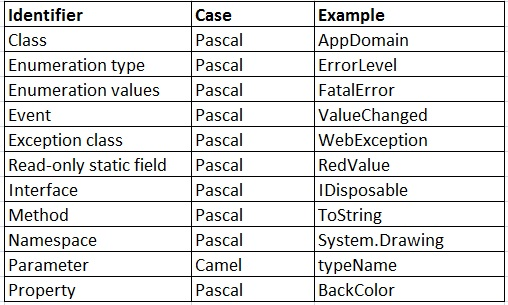
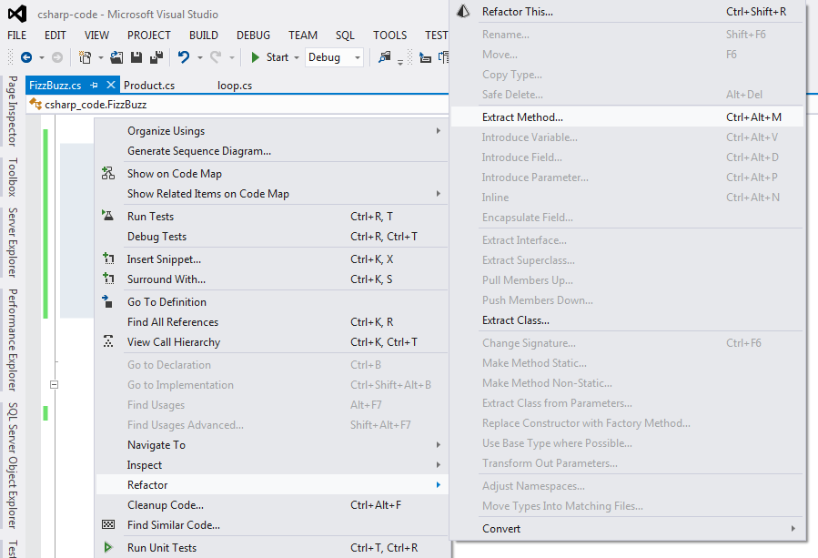
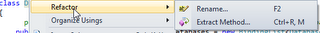
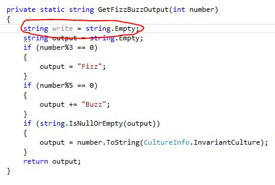
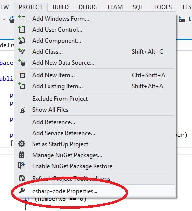
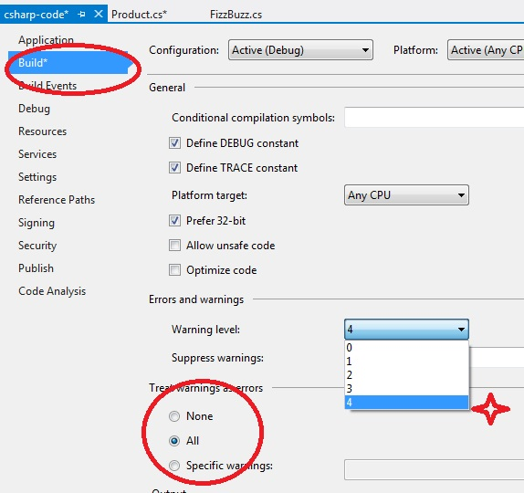
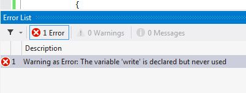

# **S**ome practices to write better C#/.NET code

By [Monjurul Habib](http://www.codeproject.com/script/Membership/View.aspx?mid=3500082) , 9 Jun 2013

Prize winner in Competition "Best overall article of February 2013"

Prize winner in Competition "Best C# article of February 2013"

## Introduction

Developers always love to fight about coding standards**.** But it is very vital to follow coding standards to achieve consistency throughout the project or code**.** All should be of the same mind that conventions are very influential**.** I will show some good practices that I have learned during my professional years, those are lower level but very important for all levels**.**

## Quick Test   ;

Let us demonstrate a FizzBuzz example**.** The FizzBuzz test is to write a program that goes through the numbers 1 to 100**.** For every multiple of 3, the program should output "Fizz" and for every multiple of 5 it should output "Buzz"**.** If both above conditions are met it should output "FizzBuzz"**.** If none of the above conditions are met, it should just output the number**.**


Example 1:

```
public void Test()
{
    for (int i = 1; i < 101; i++)
    {
        if (i % 3 == 0 && i % 5 == 0)
        {
            Console.WriteLine("FizzBuzz");
        }
        else if (i % 3 == 0)
        {
            Console.WriteLine("Fizz");
        }
        else if (i % 5 == 0)
        {
            Console.WriteLine("Buzz");
        }
        else
        {
            Console.WriteLine(i); 
        }
    }
}
```

What do you think**?** Do we need to make the code better?

Example 2:

```
public void Check()
{
   for (int i = 1; i <= 100; i++)
   {
       string output = "";
       if (i % 3 == 0) { output = "Fizz"; }
       if (i % 5 == 0) { output = output + "Buzz"; }
       if (output == "") { output = i.ToString(); }
       Console.WriteLine(output);
   }
}
```

What do you think now **?** Do we need to make the code even better?

Ok, let me help to make it better**.** Naming thing is one of the hardest job we have as a software developer**.** Because we spend a lot of time naming things, there are so many things to name properties, methods, classes, files, projects etc**.** We should spend some energies for naming things because names can be meanings**.** Adding meaning to code is readability all about**.**

```
public void DoFizzBuzz()
{
   for (int number = 1; number <= 100; number++)
   {
       var output = GetFizzBuzzOutput(number);
       Console.WriteLine(output);
   }
}

private static string GetFizzBuzzOutput(int number)
{
   string output = string.Empty;
   if (number%3 == 0)
   {
       output = "Fizz";
   }
   if (number%5 == 0)
   {
       output += "Buzz";
   }
   if(string.IsNullOrEmpty(output))
   {
       output = number.ToString();
   }
   return output;
}
```

What do you think now**?** Is this better than previous examples **?** Is it more readable?

## What is better Code**?**

Write code for People First, Computers Second**.** Readable code doesn't take any longer to write than confusing code does, at least not in the long run**.** It’s easier to be sure your code works, if you can easily read what you wrote**.** That should be a sufficient reason to write readable code**.** But code is also read during reviews. Code is read when you or someone else fixes an error**.** Code is read when the code is modified. Code is read when someone tries to use part of your code in a similar project or different project but similar feature or part of a feature**.**

*“ What if you just writing code for yourself **?** Why should you make it readable ? ”*

Ok, the major reason behind writing readable is , a week or two from now you’re going to be working on another project**.** What will happen when any other HUMAN needs to fix an error on that project**?** I can guarantee you that you will also lost within your own horror code**.**


From my point of view a better should carried out the following characteristics:

- Code that is easy to write , modify and extend
- Code that is clean and talks/convey meaning
- Code that has values and cares about quality

So, write with the human reader in mind while satisfying the needs of the machine to the degree necessary**.**

## How can you improve the Readability**?** ;


First you have to read other peoples code and figure out what is good and what is bad within that code**.** What makes you easy to understand and what makes you feel more complicated**.** Then apply those things to your own code. Finally you need sometime, some experience and you need some practice to improve the readability of your code**.** It is very hard but obvious to implement standards in any software company, through methods like Trainings, Peer Code Reviews, Introducing automated code review tools, etc**.** The most popular tools are as follows:

- **FxCop** is a tool that performs static code analysis of .NET code**.** It provides hundreds of rules that perform various types of analysis**.**
- **StyleCop** is an open source project that analyzes C# source code to enforce a set of style and consistency rules**.** It can be run from inside of Visual Studio or integrated into an MSBuild project**.** StyleCop has also been integrated into many third-party development tools**.**
- **JetBrains ReSharper** is a renowned productivity tool that makes Microsoft Visual Studio a much better IDE**.** Thousands of .NET developers worldwide wonder how they’ve ever lived without ReSharper’s code inspections, automated code refactoring, blazing fast navigation, and coding assistance**.**

## What are Conventions?


According to [Wikipedia](http://en.wikipedia.org/wiki/Coding_conventions) "*Coding conventions are a set of guidelines for a specific programming language that recommend programming style, practices and methods for each aspect of a piece program written in this language**.** These conventions usually cover file organization, indentation, comments, declarations, statements, white space, naming conventions, programming practices, programming principles, programming rules of thumb, architectural best practices, etc**.** These are guidelines for software structural quality**.** Software programmers are highly recommended to follow these guidelines to help improve the readability of their source code and make software maintenance easier**.** Coding conventions are only applicable to the human maintainers and peer reviewers of a software project**.** Conventions may be formalized in a documented set of rules that an entire team or company follows, or may be as informal as the habitual coding practices of an individual**.** Coding conventions are not enforced by compilers. As a result, not following some or all of the rules has no impact on the executable programs created from the source code**.***"

You should be able to tell the difference between a property, local variable, method name, class name etc**.** because they use different capitalization conventions**.** These type of conventions has values. You will be able to get lots of guidelines and conventions over internet**.** So find a convention or build your own and stick with it**.**

The source of the following ([Design Guidelines for Developing Class Libraries](http://msdn.microsoft.com/en-us/library/ms229042.aspx "Design Guidelines for Developing Class Libraries") ) was developed by the Microsoft special interest group**.** I just made some addons.

### Capitalization Conventions ;

Below are some examples of our C# coding standards, naming conventions, and best practices**.** Use these according to your own needs.

#### Pascal Casing ;

The first letter in the identifier and the first letter of each subsequent concatenated word are capitalized**.** You can use Pascal case for identifiers of three or more characters**.**

#### Camel Casing

The first letter of an identifier is lowercase and the first letter of each subsequent concatenated word is capitalized**.**



Ref**.** [Capitalization Rules for Identifiers](http://msdn.microsoft.com/en-us/library/ms229043.aspx)

### Examples of Some Naming Conventions Guidelines

You will find enough resources over internet**.** I am just highlighting some of my favorites among them

I am providing some basic level examples below but as I already mentioned, find a good convention that fits for you and stick with it**.**

**Do** use PascalCasing for class names and method names**.**

```
public class Product
{
    public void GetActiveProducts()
    {
      //...
    }
    public void CalculateProductAdditinalCost()
    {
        //...
    }
}
```

**Do** use camelCasing for method arguments and local variables**.**

```
public class ProductCategory
{
  public void Save(ProductCategory productCategory)
   {
       // ...
   }
}
```

Do **not** use Abbreviations**.**

```
// Correct
ProductCategory productCategory;
 
// Avoid
ProductCategory prodCat;
```

Do **not** use Underscores in identifiers**.**

```
// Correct
ProductCategory productCategory;
 
// Avoid
ProductCategory product_Category;
```

**Do** prefix interfaces with the letter `I`**.**

```
public interface IAddress
{
 
}
```

**Do** declare all member variables at the top of a class, with static variables at the very top**.**

```
public class Product
{
    public static string BrandName;
 
    public string Name{get; set;}
    public DateTime DateAvailable {get; set;}
 
    public Product()
    {
        // ...
    }
}
```

**Do** use singular names for enums. Exception: bit field enums.

```
public enum Direction
{
    North,
    East,
    South,
    West
}
```

Do **not** suffix enum names with Enum**.**

```
//Avoid
public enum DirectionEnum
{
    North,
    East,
    South,
    West
}
```

## Why We Need Conventions**?**

Programmers on large projects sometimes go overboard with conventions**.** They establish so many standards and guidelines that remembering them becomes a full-time job**.** The computer doesn’t care whether your code is readable**.** It’s better at reading binary machine instructions than it is at reading high-level-language statements**.**

Conventions offer several specific benefits**.** They let you take more for granted. By making one global decision rather than many local ones, you can concentrate on the more important characteristics of the code**.**

- They help you transfer knowledge across projects
- They help you learn code more quickly on a new project**.**
- They emphasize relationships among related items.

You should write readable code because it helps other people to read your code**.** Naming thing is one of the hardest job we have as a software developer**.** Because we spend a lot of time naming things, there are so many things to name properties, methods, classes, files, projects etc**.** We should spend some energies for naming things because names can be meanings**.** Adding meaning to code is readability all about**.**

So it will help you better sleep at night**.**


## Top Rules Developers Should Follow


### Keep Class Size Small

I have seen and written some gigantic  classes**.** But unfortunately those were never turns out well. Later I found the reason that is, those large classes try to do too many things**.** That violates the Single Responsibility Principle. `S` in [SOLID](http://en.wikipedia.org/wiki/SOLID_%28object-oriented_design%29) (Object Oriented Design)**.**

*“The single responsibility principle states that every object should have a single responsibility, and that responsibility should be entirely encapsulated by the class**.** All its services should be narrowly aligned with that responsibility**.**”*

According to [Martin’s definition](http://www.objectmentor.com/resources/articles/srp.pdf) :"*THERE SHOULD NEVER BE MORE THAN ONE REASON FOR A CLASS TO CHANGE**.***"


Why was it important to separate these two responsibilities into separate classes**?** Because each responsibility is an axis of change. When the requirements change, that change will be manifest through a change in responsibility amongst the classes**.** If a class assumes more than one responsibility, then there will be more than one reason for it to change**.** If a class has more then one responsibility, then the responsibilities become coupled**.** Changes to one responsibility may impair or inhibit the class’ ability to meet the others**.** This kind of coupling leads to fragile designs that break in unexpected ways when changed**.**

### Avoid Obsolete Comments

Let us start with Obsolete Comments**.** According to [Robert C. Martin:](http://en.wikipedia.org/wiki/Robert_Cecil_Martin)

"*A comment that has gotten old, irrelevant, and incorrect is obsolete**.**  Comments get old quickly.  It is best not to write a comment that will become obsolete**.**  If you find an obsolete comment, it is best to update it or get rid of it as quickly as possible**.**  Obsolete comments tend to migrate away from the code they once described**.**  They become floating islands of irrelevance and misdirection in the code**.***"

This is topic create some interesting conversations among all level of developers**.** Try to avoid comments on individual method or short class**.** Because most comments i have ever seen is trying to describe the purpose/intentions**.** Some cases comments are meaningless. Developers writes comments to increase the readability & maintainability **.** Make sure your comments are not making any noise. It will be great if you could name a method more meaningful instead of comments**.** I am suggesting because method names are more affective than comments**.** Most of the comments are meaningless noise**.** Let us check comments below:

```
//ensure that we are not exporting
//deleted products
if(product.IsDeleted && !product.IsExported )
{
   ExportProducts = false;
}

// This is a for loop that prints the 1 million times
for (int i = 0; i < 1000000; i++)
{
    Console.WriteLine(i);
}
```

If we name the method like `CancelExportForDeletedProducts()` instead of comments what will happen**?** So, method names are more affective than comments. Methods execute and they are real**.** But comment is good for some cases like, when visual studio will take comments for creating an API documentation and those comments are different, you can use "///" for those comments so that other developers can get intelligence of API or Library**.**

I am **not** telling you that avoid comment is a must for all the times**.** According to Kent's oral tradition point goes more to large-scale comments about how the whole thing works, not to individual method comments**.** If comment is trying to describe the purpose/intentions then it is wrong**.** If you look at thickly commented code, you will notice that most of those comments are there because the code is bad**.** Please read the following books for further detail:

- **Professional Refactoring in C# and ASP.NET** by ***Danijel Arsenovski***
- "**Refactoring: Improving the Design of Existing Code**" by ***Martin Fowler***, ***Kent Beck***, ***John Brant***, ***William Opdyke***, ***don Roberts***

### Avoid Unnecessary Regions in Class

Regions are a feature of VS that allow you to surround blocks of code**.** It could be a single or multiple methods. The region exists because it is easier to navigate around the large file**.** The regions are used to hide ugly code or class that have exploded in size **.** If a class does too many things it also violates the Single Responsibility Principle**.** So next time whenever you will think for adding a new region to your file take step back and ask that is it possible to separate your region into a separate class**.**

### Keep Method Short

The more lines of code in a method the harder it is to understand**.** Everyone recommends 20-25 lines of code is ok. But some geeks prefer 1-10 lines for safety, this their personal preference**.** There is no hard and fast rule. Extract Method is one of the most common refactoring**.** If you consider a method that is too long or needs a comment to understand its purpose**.** You can apply Extract Method there with little effort**.** People always keep asking on the length for a method**.** But length is not the issue**.** When you are dealing with complex methods, keeping track of all local variables can be complicated and time-consuming**.** Where extracting a method can be a real time-saver**.** You can use the Visual Studio extract method which will track which variables are passed to a new method, which are returned by the method’s return value as output parameters**.**

**Using ReSharper**



**Using Microsoft Visual Studio**



For more detail on each step, please navigate the [MSDN link](http://msdn.microsoft.com/en-us/library/0s21cwxk.aspx) **.**

According to ***Refactoring: Improving the Design of Existing Code by Martin Fowler, Kent Beck (Contributor), John Brant (Contributor), William Opdyke, don Roberts***

"*Extract Method is one of the most common refactoring I do**.** I look at a method that is too long or look at code that needs a comment to understand its purpose**.** I then turn that fragment of code into its own method**.** I prefer short, well-named methods for several reasons**.** First, it increases the chances that other methods can use a method when the method is finely grained**.** Second, it allows the higher-level methods to read more like a series of comments**.** Overriding also is easier when the methods are finely grained**.** It does take a little getting used to if you are used to seeing larger methods**.** And small methods  
really work only when you have good names, so you need to pay attention to naming**.** People sometimes ask me what length I look for in a method**.** To me length is not the issue. The key is the semantic distance between the method name and the method body**.** If extracting improves clarity, do it, even if the name is longer than the code you have extracted**.***"

### Avoid Too Many Parameters  ;

Declare a class instead of too many parameters**.** Creating a class that puts all these parameters together**.** This is generally a better design and valuable abstraction**.**

```
//avoid
public void Checkout(string shippingName, string shippingCity, 
       string shippingSate, string shippingZip, string billingName, 
       string billingCity, string billingSate, string billingZip)
{

}
```

```
//DO
public void Checkout(ShippingAddress shippingAddress,BillingAddress billingAddress)
{
}
```

We should introduce class instead of all parameters**.**

### Avoid Complex Expressions

```
if(product.Price>500 && !product.IsDeleted && 
            !product.IsFeatured && product.IsExported)
{
   // do something
}
```

Complex expression have some meaning behind them it is just hidden by those multiple expressions**.** We can encapsulate the complex expression into that object by using a property**.** That code will be easier to read**.**

### Consider Warnings as Errors



If you notice the code you will find a variable that was declared but never used**.** Normally if we build the project we will get a warning and we can run our project without any error**.** But we should remove warning as much as possible. So setup your build to treat warning as Errors like the following steps:







### Minimize the Number of Returns

Minimize the number of returns in each routine**.** It's harder to understand a routine if, reading it at the bottom, you're unaware of the possibility that it returned somewhere above**.**

Use a return when it enhances readability**.** In certain routines, once you know the answer, you want to return it to the calling routine immediately**.** If the routine is defined in such a way that it doesn't require any cleanup, not returning immediately means that you have to write more code**.**

```
//avoid
if(product.Price>15)
{
   return false;
}
else if(product.IsDeleted)
{
   return false;
}
else if(!product.IsFeatured)
{
   return false;
}
else if()
{
   //.....
}
return true;
```

```
//DO
var isValid = true;
if(product.Price>15)
{
   isValid= false;
}
else if(product.IsDeleted)
{
   isValid= false;
}
else if(!product.IsFeatured)
{
   isValid= false;
}
return isValid;
```

You can imagine 4 exit points scattered around 20- 30 lines of code**.** That makes you more harder to understand and see what is happening inside the method and what will execute and when will execute**.**

I got too many responses, some agreeing but mostly disagreeing that it was a good  "standard" to enforce**.** To find out the potentiality I did some unit testing and found that for complex method that have multiple exit points usually have a set of tests for each of those paths**.**

```
if( BADFunction() == true)
{
    // expression
    if( anotherFunction() == true )
    {
     // expression
     return true;
    }
    else
    {
         //error
    }
}
else
{
    //error
}
return false;
```

```
if( !GoodFunction())
{
    // error.
    return false
} 
// expression
if( !GoodFunction2())
{
    //error.
    return false;
}
// more expression
return true;
```

Ref**.** "**Code Complete**" by ***Steve McConnell***for further detail clarification**.**

### Move Declaration Near Reference

Some programmers are used to placing temporary variable declarations at the top of the method.But by placing the variable declaration far away from the line where it is first referenced, you are making code more difficult to read, because it is not immediately clear how the variable was initialized**.** In addition, declaring variables well ahead of time makes the method more difficult to refactor**.** If you try to extract a part of the method in which the variable was referenced, you have to pass the variable as a parameter to a newly extracted method, even though the declaration could possibly have been placed inside the extracted block**.**

### Assertion    ;

An assertion is code that’s used during development—usually a routine or macro—that allows to check itself as it runs**.** True means everything is operating as expected. False means it has detected an unexpected error in the code**.** An assertion usually takes two arguments: a Boolean expression that describes the assumption that’s supposed to be true and a message to display if it isn’t**.**

Assertions are especially useful in large, complicated and in high reliability system**.**

Example: If a system assumes that there will be maximum 100,000 user records, the system might contain an assertion that the number of records is less than or equal to 100,000**.** So assertion will be silent within that range. If it encounters more than that records, it will loudly “assert” that there is an error in the program**.**

### Checking Loop Endpoints ;

A single loop usually has three cases of interest: the first case, an arbitrarily selected middle case, and the last case**.** If you have any special cases that are different from the first or last case, check those too**.** If the loop contains complex computations, get out your calculator and manually check the calculations**.**

## Conclusion

It is obvious to implement standards in any software company according to organizational behavior, project nature, and domain**.** So I would like to repeat "Find a convention and stick with it"**.**

If you think I missed any prominent guideline, please leave that in the comments section**.** I’ll try to include that in the main post. Coding For Fun**.**

## Article Update Log

- **10 June 2013**: New Point *"Move Declaration Near Reference"*
- **30 May 2013**: Content and example updated**.**
- **4 March 2013**: Content updated *"Avoid Obsolete Comments"***.**
- **1 March 2013**: Content added *"Avoid Obsolete Comments"***.**
- **1** **March 2013**: Content added *"Try to Avoid Comments"**.***
- **28 Feb. 2013**: Added Keep Class Size Small**.**
- **15 Feb. 2013**: Content and reference added**.**
- **10 Feb. 2013**: Content added (Keep Method Short)**.**
- **9 Feb. 2013**: Content and Example added (Keep Method Short)**.**
- **8 Feb. 2013**: Modified Try to Avoid Comments**.**
- **8 Feb. 2013**: Content and Code example added (Avoid Multiple Exit Points)**.**
- **6 Feb. 2013**: Content and reference added**.**
- **4 Feb. 2013** : Initial release**.**
