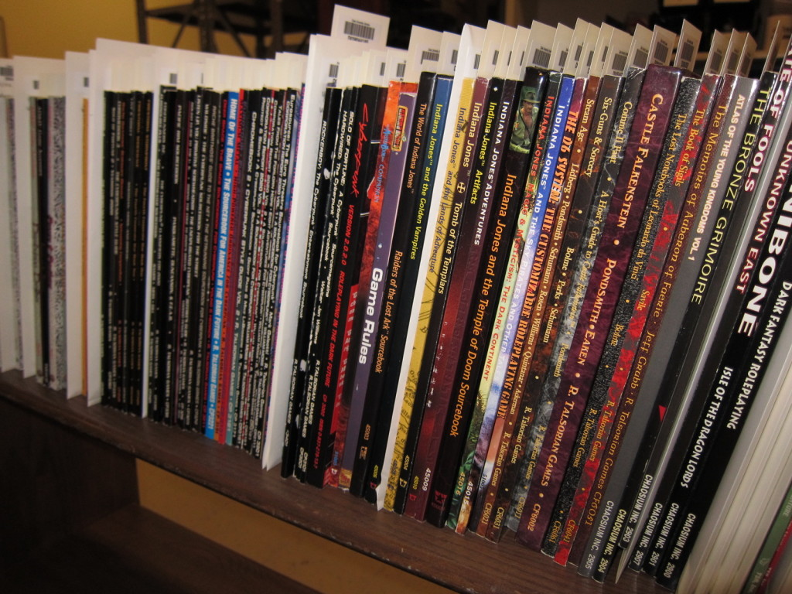

# O Mercado de RPG

Escrito por [Dodaro](http://dungeoncarioca.com/?author=3 "Dodaro") em 5 de setembro de 2013. Publicado em [RPG](http://dungeoncarioca.com/?cat=3 "Ver todos os posts em RPG")[1 Comentário](http://dungeoncarioca.com/?p=1066#comments "Comentário para O Mercado de RPG")

Nos últimos dias fui surpreendido pela enxurrada de anúncios de venda de material de RPG nas redes sociais. Levantei um breve questionamento no grupo da DC e grande parte das opiniões que surgiram, justificavam a oferta repentina com o desejo dos jogadores em comprar coisas novas. Se desfazer do que está encostado na prateleira por jogos que realmente possam parar nas mesas.

Outras opiniões falavam sobre privilegiar o mercado nacional. Realmente é uma grande sacada se livrar de quem não dá suporte e investir em editoras que não vão nos deixar órfãos de suplementos. É sempre reconfortante valorizar o cenário nacional e principalmente quando este está trabalhando muito bem, obrigado.

Sempre vai existir também a pessoa que precisa de grana, outra que não consegue formar grupo ou comparecer aos eventos. Pessoas que estão vendendo por vender mesmo. E é claro, aquela pessoa que não quer vender, ou tem medo de se arrepender, então anuncia produtos com valores surreais e impraticáveis. Mas vamos combinar que essas pessoas em alguns momentos têm sucesso crítico e conseguem vender suplementos supervalorizados a quem tem disposição e desprendimento financeiro para pagar.

Mas a venda em si, e o momento de abundância das ofertas de material de RPG não é o foco dessa matéria. Essa “bolha” RPGística só me alertou para uma necessidade que eu já havia percebido mas que se tornou bem mais palpável com essa situação essa semana:

A necessidade de se multiplicar o RPG.

As editoras nacionais estão a TODO vapor. As facilidades na obtenção de material importado de qualidade também é um fator “mercadológico” relevante. Como se isso não bastasse, financiamentos coletivos pipocam todo mês mais do que o orçamento apertado de determinados jogadores. Sem falar da concorrência indireta que o RPG sofre com Board, card game, literatura convencional, quadrinhos e outros desejos compartilhados pelo público alvo. Esse crescimento da oferta de produtos em progressão aritmética está prestes a se tornar crescimento em progressão geométrica. Eu prevejo que não demorará para a oferta se tornar maior que a demanda (se já não estiver acontecendo isso).

Eu acredito que em breve haverá mais produtos de RPG do que jogadores de RPG.

Eu, e um número considerável de pessoas do meu círculo na comunidade que eu conheço, já não possuímos orçamento mensal para adquirir tudo que gostaríamos no que diz respeito a RPG. Sem contar que essa oferta repentina de bons usados de RPG também vai desfalcar o salário de muita gente.

Outro detalhe. É evidente que vivemos uma outra época do RPG. Tivemos um salto da década de 90 para cá, no que tange mercado consumidor. Todo mundo sabe que os nerds de 15 anos cresceram, arrumaram emprego e se tornaram economicamente ativos. Mas outro salto está por vir. Esses mesmos nerds vão envelhecer. Pretendo jogar até os 80 anos, mas romantismo a parte, quando uma boa parte estiver aposentado, porque não começar a se dedicar a outras atividades. Viajar, montar outro negócio, curtir a família e não acho que o RPG vai se extinguir da vida da pessoa, mas pode muito bem perder espaço. E não acho que esses mesmos Nerds RPGístas estão “procriando” o suficiente… Precisamos de novos Nerds!

A perspectiva pessimista dessa história é perder algo tão legal e que levamos tempo e muito esforço pra conseguir, que são bons fornecedores de RPG. O mercado internacional não vai nem se arranhar com uma ausência de mercado consumidor no Brasil. Mas não tenho a mesma certeza quanto ao mercado nacional.

Quero deixar uma coisa bem clara nesse post. Eu nem de longe sou um adepto apocalíptico do**“O RPG ESTÁ EM CRISE”**. Muito pelo contrário. Não acreditaria na *Dungeon Carioca* se fosse. Mas sou um realista que evita ao máximo qualquer chance dessa premissa tornar-se realidade. Possuo pensamento a longo prazo.

E você? O que acha disso? O que fazer (curto e longo prazo), para manter vivo o mercado consumidor do RPG? Se houver interesse nesse post, posso fazer uma série de postagens conclamando o Marketing para estabelecer soluções de mercado visando a manutenção e crescimento do nosso hobby favorito. Aguardo comentários (educados).
