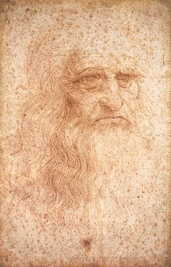
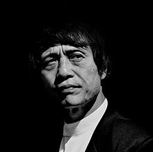

# Autodidacticism

From Wikipedia, the free encyclopedia

"Autodidact" redirects here. For the 1997 rock album, see [Autodidact (album)](http://en.wikipedia.org/wiki/Autodidact_(album) "Autodidact (album)").

"Self-taught" redirects here. For the hip hop group, see [Self Taught](http://en.wikipedia.org/wiki/Self_Taught "Self Taught").

"Self-taught learner" redirects here. For the 2009 pop rock album, see [Self-Taught Learner](http://en.wikipedia.org/wiki/Self-Taught_Learner "Self-Taught Learner").

[[anexo ausente]](http://en.wikipedia.org/wiki/File:Leonardo_da_Vinci_-_Self-Portrait_-_WGA12798.jpg "Enlarge")

Renaissance [polymath](http://en.wikipedia.org/wiki/Polymath "Polymath") [Leonardo da Vinci](http://en.wikipedia.org/wiki/Leonardo_da_Vinci "Leonardo da Vinci") is one of history's best known autodidacts.

**Autodidacticism** (also **autodidactism**) or **self-education** is self-directed learning that is related to but different from [informal learning](http://en.wikipedia.org/wiki/Informal_learning "Informal learning"). In a sense, autodidacticism is "learning on your own" or "by yourself", and an **autodidact** is a self-teacher. Autodidacticism is a contemplative, absorptive procession. Some autodidacts spend a great deal of time reviewing the resources of [libraries](http://en.wikipedia.org/wiki/Library "Library") and [educational websites](http://en.wikipedia.org/wiki/Educational_website "Educational website"). One may become an autodidact at nearly any point in one's life. While some may have been informed in a conventional manner in a particular field, they may choose to inform themselves in other, often unrelated areas. Many [notable contributions](http://en.wikipedia.org/wiki/List_of_notable_autodidacts "List of notable autodidacts") have been made by autodidacts.

Autodidactism is only one facet of learning, and is usually, but not necessarily, complemented by learning in formal and informal spaces: from classrooms to other social settings. Many autodidacts seek instruction and guidance from experts, friends, teachers, parents, siblings, and community. Inquiry into autodidacticism has implications for [learning theory](http://en.wikipedia.org/wiki/Learning_theory_(education) "Learning theory (education)"), [educational research](http://en.wikipedia.org/wiki/Educational_research "Educational research"), [educational philosophy](http://en.wikipedia.org/wiki/Educational_philosophy "Educational philosophy") and [educational psychology](http://en.wikipedia.org/wiki/Educational_psychology "Educational psychology").

## Contents

  [[hide](http://en.wikipedia.org/wiki/Autodidacticism#)]

- [1 Etymology](http://en.wikipedia.org/wiki/Autodidacticism#Etymology)
- [2 Modern education and autodidactism](http://en.wikipedia.org/wiki/Autodidacticism#Modern_education_and_autodidactism)
- [3 Autodidacticism in history, philosophy and literature](http://en.wikipedia.org/wiki/Autodidacticism#Autodidacticism_in_history.2C_philosophy_and_literature)
- [4 Autodidacticism in architecture](http://en.wikipedia.org/wiki/Autodidacticism#Autodidacticism_in_architecture)
- [5 Future Impact](http://en.wikipedia.org/wiki/Autodidacticism#Future_Impact)
- [6 See also](http://en.wikipedia.org/wiki/Autodidacticism#See_also)
- [7 References](http://en.wikipedia.org/wiki/Autodidacticism#References)
- [8 Further reading](http://en.wikipedia.org/wiki/Autodidacticism#Further_reading)

## Etymology[[edit source](http://en.wikipedia.org/w/index.php?title=Autodidacticism&amp;action=edit&amp;section=1 "Edit section: Etymology")]

The term has its roots in the [Ancient Greek](http://en.wikipedia.org/wiki/Ancient_Greek "Ancient Greek") words αὐτός (*autós*, or "self") and διδακτικός (*didaktikos*, meaning "teaching"). The related term *[Didacticism](http://en.wikipedia.org/wiki/Didacticism "Didacticism")* defines an artistic [philosophy of education](http://en.wikipedia.org/wiki/Philosophy_of_Education "Philosophy of Education").

## Modern education and autodidactism[[edit source](http://en.wikipedia.org/w/index.php?title=Autodidacticism&amp;action=edit&amp;section=2 "Edit section: Modern education and autodidactism")]

Autodidactism is always a complement of modern education.[[1]](http://en.wikipedia.org/wiki/Autodidacticism#cite_note-1) Armstrong (2012) claimed that in higher education students should be given more materials suitable for self-study. Students should be encouraged to do more independent work.[[2]](http://en.wikipedia.org/wiki/Autodidacticism#cite_note-2) While [Leonardo da Vinci](http://en.wikipedia.org/wiki/Leonardo_da_Vinci "Leonardo da Vinci") was a privileged autodidact, the [Industrial Revolution](http://en.wikipedia.org/wiki/Industrial_Revolution "Industrial Revolution") created a new situation. The creation of [secular](http://en.wikipedia.org/wiki/Secular "Secular") societies allowed many to pursue scientific interests and to develop scientific knowledge through academic or autodidactic learning.[[3]](http://en.wikipedia.org/wiki/Autodidacticism#cite_note-3)

Before the 20th century only a small minority of people received an advanced academic education. As stated by [Joseph Whitworth](http://en.wikipedia.org/wiki/Joseph_Whitworth "Joseph Whitworth") in his influential report on industry dated from 1853, literacy rates were higher in the United States. However, even in the United States, most children were not completing high school. High school education was necessary to become a teacher. A large percentage of those completing high school also attended college, usually to pursue a professional degree, such as law or medicine, or a divinity degree.[[4]](http://en.wikipedia.org/wiki/Autodidacticism#cite_note-Thomson_2009-4)

Collegiate teaching was based on the classics (Latin, philosophy, ancient history, theology) until the early 19th century. There were few if any institutions of higher learning offering studies in engineering or science before 1800. Institutions such as the [Royal Society](http://en.wikipedia.org/wiki/Royal_Society "Royal Society") did much to promote scientific learning, including public lectures. In England there were also itinerant lecturers offering their service, typically for a fee.[[5]](http://en.wikipedia.org/wiki/Autodidacticism#cite_note-Robinson_and_Musson-5)

Prior to the 19th century, there were many important inventors working as millwrights or mechanics who had typically received an elementary education and served an apprenticeship.[[4]](http://en.wikipedia.org/wiki/Autodidacticism#cite_note-Thomson_2009-4) Mechanics, instrument makers and surveyors had various mathematics training. [James Watt](http://en.wikipedia.org/wiki/James_Watt "James Watt") was a surveyor and instrument maker and is described as being "largely self-educated".[[6]](http://en.wikipedia.org/wiki/Autodidacticism#cite_note-6) Watt, like some other autodidacts of the time, became a Fellow of the [Royal Society](http://en.wikipedia.org/wiki/Royal_Society "Royal Society") and a member of the [Lunar Society](http://en.wikipedia.org/wiki/Lunar_Society "Lunar Society"). In the 18th century these societies often gave public lectures and were instrumental in teaching chemistry and other sciences with industrial applications, which were neglected by traditional universities. Academies also arose to provide scientific and technical training.

Years of schooling in the United States began to increase sharply in the early 20th century. This phenomenon was seemingly related to increasing mechanization displacing child labor. The automated glass bottle making machine is said to have done more for education than child labor laws, because boys were no longer needed to assist.[[7]](http://en.wikipedia.org/wiki/Autodidacticism#cite_note-7) However, the number of boys employed in this particular industry was not that large; it was mechanization in several sectors of the industry that displaced child labor toward education. For males in the U.S. born 1886-90, years of school averaged 7.86, while for those born from 1926–30, years of school averaged 11.46.[[8]](http://en.wikipedia.org/wiki/Autodidacticism#cite_note-8)

One of the most recent trends in education is that the classroom environment should cater towards students’ individual needs, goals and interests. This model adopts the idea of [inquiry-based learning](http://en.wikipedia.org/wiki/Inquiry-based_learning "Inquiry-based learning") where students are presented with scenarios to identify their own research, questions and knowledge regarding the area. As a form of [discovery learning](http://en.wikipedia.org/wiki/Discovery_learning "Discovery learning"), students in today’s classrooms are being provided with more opportunity to “experience and interact” with knowledge, which has its roots in autodidacticism.

For autodidacts to be successful in their self-teaching, they must possess self-discipline and reflective capability. Some research suggests that being able to regulate one’s own learning is something which must be modeled to students, for it is not a natural human tendency for the population at large.[[9]](http://en.wikipedia.org/wiki/Autodidacticism#cite_note-9) In order to interact with the environment, a framework has been identified to determine the components of any learning system: a reward function, incremental action value functions and action selection methods.[[10]](http://en.wikipedia.org/wiki/Autodidacticism#cite_note-10) Rewards work best in motivating learning when they are specifically chosen on an individual student basis. New knowledge must be incorporated into previously existing information as its value is to be assessed. Ultimately, these [scaffolding](http://en.wikipedia.org/wiki/Instructional_scaffolding "Instructional scaffolding") techniques, as described by [Vygotsky](http://en.wikipedia.org/wiki/Vygotsky "Vygotsky") (1978) and problem solving methods are a result of dynamic decision making.

The secular and modern societies gave foundations for a new system of education and a new kind of autodidacts. While the number of schools and students raised from one century to the other, so did the number of autodidacts. The industrial revolution produced new educational tools used in schools, universities and outside academic circles to create a post-modern era that gave birth to the World Wide Web and encyclopaedic data banks such as [Wikipedia](http://en.wikipedia.org/wiki/Wikipedia "Wikipedia"). As this concept becomes more widespread and popular, web locations like [Udacity](http://en.wikipedia.org/wiki/Udacity "Udacity") and [Khan Academy](http://en.wikipedia.org/wiki/Khan_Academy "Khan Academy") are developed to be learning centers for many people to actively and freely learn together.

## Autodidacticism in history, philosophy and literature[[edit source](http://en.wikipedia.org/w/index.php?title=Autodidacticism&amp;action=edit&amp;section=3 "Edit section: Autodidacticism in history, philosophy and literature")]

|  |  |
| --- | --- |
| [anexo ausente] | This section includes a [list of references](http://en.wikipedia.org/wiki/Wikipedia:Citing_sources "Wikipedia:Citing sources"), related reading or [external links](http://en.wikipedia.org/wiki/Wikipedia:External_links "Wikipedia:External links"), but **the sources of this section remain unclear because it lacks [inline citations](http://en.wikipedia.org/wiki/Wikipedia:Citing_sources#Inline_citations "Wikipedia:Citing sources")**. Please[improve](http://en.wikipedia.org/wiki/Wikipedia:WikiProject_Fact_and_Reference_Check "Wikipedia:WikiProject Fact and Reference Check") this article by introducing more precise citations. *(February 2012)* |

The first philosophical claim supporting an autodidactic program to the study of nature and God was in the philosophical novel *Hayy Ibn-Yaqzan* (Alive Son of the Vigilant), who is considered as the quintessential autodidact.[[11]](http://en.wikipedia.org/wiki/Autodidacticism#cite_note-ben-zaken-11) The story is a medieval autodidactic utopia, a philosophical treatise in a literary form, which was written by the Andalusian philosopher Abu Baker Ibn-Tufayl in the 1160s, Marrakesh. It is a story about a wild-boy, an autodidact prodigy that takes control over nature with instruments, discovers laws of nature by practical exploration and experiments, and gained an ultimate felicity through a mystical mediation and communion with God. The story relates to human knowledge, as it rises from a blank slate to a mystical or direct experience of God after passing through the necessary natural experiences. The focal point of the story is that human reason, unaided by society and its conventions or by religion, can self-achieve scientific knowledge, preparing the way to the mystical or highest form of human knowledge. Commonly translated as "The Self-Taught Philosopher" or "The Improvement of Human Reason," Ibn-Tufayl's story Hayy Ibn-Yaqzan inspired debates about autodidacticism in a range of historical fields from classical Islamic philosophy through Renaissance humanism and the European Enlightenment. In his book *Reading Hayy Ibn-Yaqzan: a Cross-Cultural History of Autodidacticism* Avner Ben-Zaken showed how the text traveled from late medieval Andalusia to early modern Europe and demonstrated the intricate ways in which autodidacticism was contested in and adapted to diverse cultural settings.[[11]](http://en.wikipedia.org/wiki/Autodidacticism#cite_note-ben-zaken-11) Autodidacticism, apparently, intertwined with struggles over Sufism in twelfth-century Marrakesh; controversies about the role of philosophy in pedagogy in fourteenth-century Barcelona; quarrels concerning astrology in Renaissance Florence in which Pico della Mirandola plead for autodidacticism against the strong authority of intellectual establishment notions of predestination; and debates pertaining to experimentalism in seventeenth-century Oxford. Pleas for autodidacticism echoed not only within close philosophical discussions; they surfaced in struggles for control between individuals and establishments.[[11]](http://en.wikipedia.org/wiki/Autodidacticism#cite_note-ben-zaken-11)

In the story of African American self-education, Heather Andrea Williams presents a historical account to examine African American’s relationship to literacy during [slavery](http://en.wikipedia.org/wiki/Slavery "Slavery"), the [Civil War](http://en.wikipedia.org/wiki/Civil_War "Civil War") and the first decades of freedom.[[12]](http://en.wikipedia.org/wiki/Autodidacticism#cite_note-12) Many of the personal accounts tell of individuals who have had to teach themselves due to [racial discrimination](http://en.wikipedia.org/wiki/Racial_discrimination "Racial discrimination") in education.

The [working-class](http://en.wikipedia.org/wiki/Working-class "Working-class") protagonist of [Jack London's](http://en.wikipedia.org/wiki/Jack_London%27s "Jack London's") *[Martin Eden](http://en.wikipedia.org/wiki/Martin_Eden "Martin Eden")* (1909) embarks on a path of self-learning in order to gain the affections of Ruth, a member of cultured society. By the end of the novel, Eden has surpassed the intellect of the bourgeois class, leading him to a state of indifference and, ultimately, suicide.

[Jean-Paul Sartre](http://en.wikipedia.org/wiki/Jean-Paul_Sartre "Jean-Paul Sartre")'s *[Nausea](http://en.wikipedia.org/wiki/Nausea_(Book) "Nausea (Book)")* (1938) depicts, as a secondary character, an autodidact.

In *The Ignorant Schoolmaster* (1987), [Jacques Rancière](http://en.wikipedia.org/wiki/Jacques_Ranci%C3%A8re "Jacques Rancière") describes the emancipatory education of [Joseph Jacotot](http://en.wikipedia.org/wiki/Joseph_Jacotot "Joseph Jacotot"), a post-Revolutionary [philosopher](http://en.wikipedia.org/wiki/Philosopher "Philosopher") of education who discovered that he could teach things he did not know. The book is both a history and a contemporary intervention in the philosophy and politics of education, through the concept of autodidacticism; Rancière chronicles Jacotot's "adventures", but he articulates Jacotot's theory of "emancipation" and "stultification" in the present tense.

The 1997 drama film *[Good Will Hunting](http://en.wikipedia.org/wiki/Good_Will_Hunting "Good Will Hunting")* follows the story of autodidact Will Hunting, played by [Matt Damon](http://en.wikipedia.org/wiki/Matt_Damon "Matt Damon"). Hunting demonstrates his breadth and depth of knowledge throughout the film, but especially to his therapist and in a heated discussion in a [Harvard](http://en.wikipedia.org/wiki/Harvard "Harvard") bar.

On the television show *[Criminal Minds](http://en.wikipedia.org/wiki/Criminal_Minds "Criminal Minds")* (2005–present), Supervisory Special Agent Dr. [Spencer Reid](http://en.wikipedia.org/wiki/Spencer_Reid "Spencer Reid") is an autodidact with an [eidetic memory](http://en.wikipedia.org/wiki/Eidetic_memory "Eidetic memory"), meaning that he can remember and easily recall almost everything he sees (this, however, only applies to visual information). He holds doctoral degrees in mathematics, chemistry, and engineering. He also holds bachelor degrees in sociology and psychology, and is working on completing another in philosophy. He is known on the show for being a genius; he has an [IQ](http://en.wikipedia.org/wiki/IQ "IQ") of 187 and is certainly the smartest member of the FBI's Behavioral Analysis Unit stationed at Quantico, Virginia. Most of his autodidacticism comes from reading books, which he prefers over traditional forms of education, including schooling. He reads at a rate of 20,000 words per minute.

One of the main characters in *[The Elegance of the Hedgehog](http://en.wikipedia.org/wiki/The_Elegance_of_the_Hedgehog "The Elegance of the Hedgehog")* (2006), by [Muriel Barbery](http://en.wikipedia.org/wiki/Muriel_Barbery "Muriel Barbery"), is an autodidact. The story is told from the view point of Renee, a middle-aged autodidact concierge in a Paris upscale apartment house and Paloma, a 12-year-old daughter of one of the tenants who is unhappy with her life. These two people find they have much in common when they both befriend a new tenant, Mr. Ozu, and their lives change forever.

In the Hindu epic, the *[Mahabharata](http://en.wikipedia.org/wiki/Mahabharata "Mahabharata")*, Ekalayva is depicted as a tribal boy who was denied education in the science of arms from royal teachers from the house of Kuru. Ekalavya went to the forest, where he taught himself archery in front of an image of the Kuru teacher, Drona, that he had built for himself. Later, when the royal family found that Ekalavya had practiced with the image of Drona as his teacher, Drona asked for Ekalavya's thumb as part of his tuition. Ekalavya complied with Drona's request, thus ending his martial career.

## Autodidacticism in architecture[[edit source](http://en.wikipedia.org/w/index.php?title=Autodidacticism&amp;action=edit&amp;section=4 "Edit section: Autodidacticism in architecture")]

[[anexo ausente]](http://en.wikipedia.org/wiki/File:Tadao_Ando_2004.jpg "Enlarge")

[Tadao Ando](http://en.wikipedia.org/wiki/Tadao_Ando "Tadao Ando") is a famous autodidact architect of the 21st century.

Many successful and influential [architects](http://en.wikipedia.org/wiki/Architect "Architect"), such as [Mies Van Der Rohe](http://en.wikipedia.org/wiki/Mies_Van_Der_Rohe "Mies Van Der Rohe"), [Frank Lloyd Wright](http://en.wikipedia.org/wiki/Frank_Lloyd_Wright "Frank Lloyd Wright"), [Violet-Le-Duc](http://en.wikipedia.org/wiki/Violet-le-Duc "Violet-le-Duc"), and [Tadao Ando](http://en.wikipedia.org/wiki/Tadao_Ando "Tadao Ando") were self-taught.

There are very few countries allowing autodidacticism in [architecture](http://en.wikipedia.org/wiki/Architecture "Architecture") today. The practice of architecture, or the use of the title: "architect", are now [protected in most countries](http://en.wikipedia.org/wiki/Professional_requirements_for_architects "Professional requirements for architects").

Self-taught architects have generally studied and qualified in other fields such as [engineering](http://en.wikipedia.org/wiki/Engineering "Engineering") or [arts and crafts](http://en.wikipedia.org/wiki/Handicraft "Handicraft"). [Jean Prouvé](http://en.wikipedia.org/wiki/Jean_Prouv%C3%A9 "Jean Prouvé") was first a structural engineer. [Le Corbusier](http://en.wikipedia.org/wiki/Le_Corbusier "Le Corbusier") had an academic qualification in decorative arts. [Tadao Ando](http://en.wikipedia.org/wiki/Tadao_Ando "Tadao Ando") started his career as a draftsman and [Eileen Gray](http://en.wikipedia.org/wiki/Eileen_Gray "Eileen Gray") studied [fine arts](http://en.wikipedia.org/wiki/Fine_arts "Fine arts").

When a [political state](http://en.wikipedia.org/wiki/Political_state "Political state") starts to implement restrictions on the profession, there are issues related to the rights of established self-taught architects. In most countries the legislation includes a[grandfather clause](http://en.wikipedia.org/wiki/Grandfather_clause "Grandfather clause"), authorising established self-taught architects to continue practicing. In the UK, the legislation,[[13]](http://en.wikipedia.org/wiki/Autodidacticism#cite_note-13) allowed self-trained architects with 2 years of experience to register. In France,[[14]](http://en.wikipedia.org/wiki/Autodidacticism#cite_note-14) it allowed self-trained architects with 5 years of experience to register. In Belgium,[[15]](http://en.wikipedia.org/wiki/Autodidacticism#cite_note-15) the law allowed experienced self-trained architects in practice to register. In Italy,[[16]](http://en.wikipedia.org/wiki/Autodidacticism#cite_note-16) it allowed self-trained architects with 10 years of experience to register. In The Netherlands, the "*wep op de architectentitel van 7 juli 1987*" along with additional procedures, allowed architects with 10 years of experience and architects aged 40 years old or over, with 5 years of experience, to access the register.[[17]](http://en.wikipedia.org/wiki/Autodidacticism#cite_note-17)

However, other [sovereign states](http://en.wikipedia.org/wiki/Sovereign_states "Sovereign states") made the choice to omit such clause and many established and competent practitioners were stripped of their professional rights.[[18]](http://en.wikipedia.org/wiki/Autodidacticism#cite_note-18) In the Republic of Ireland, a group named "[Architects' Alliance of Ireland](http://en.wikipedia.org/wiki/Architects%27_Alliance_of_Ireland "Architects' Alliance of Ireland")" is defending the interests of long-established self-trained architects[[19]](http://en.wikipedia.org/wiki/Autodidacticism#cite_note-19) who were recently deprived from their rights to practice as per Part 3 of the Irish Building Control Act 2007.[[20]](http://en.wikipedia.org/wiki/Autodidacticism#cite_note-20)

Theoretical research such as "*Architecture of Change, sustainability and humanity in the built environment*[[21]](http://en.wikipedia.org/wiki/Autodidacticism#cite_note-21)" or older studies like "[Vers une Architecture](http://en.wikipedia.org/wiki/Toward_an_Architecture "Toward an Architecture")" from [Le Corbusier](http://en.wikipedia.org/wiki/Le_Corbusier "Le Corbusier") describe the practice of architecture as an environment changing with new technologies, sciences and legislations. All architects must be autodidacts to keep up to date with new [standards](http://en.wikipedia.org/wiki/Technical_standard "Technical standard"), new[regulations](http://en.wikipedia.org/wiki/Regulations "Regulations"), or new [methods](http://en.wikipedia.org/wiki/Methodology "Methodology").

Self-taught architects like [Eileen Gray](http://en.wikipedia.org/wiki/Eileen_Gray "Eileen Gray"), [Luis Barragán](http://en.wikipedia.org/wiki/Luis_Barrag%C3%A1n "Luis Barragán") and many others, created a system where working is also learning, where self-education is associated with creativity and productivity within a working environment.

While he was primarily interested in [naval architecture](http://en.wikipedia.org/wiki/Naval_architecture "Naval architecture"), [William Francis Gibbs](http://en.wikipedia.org/wiki/William_Francis_Gibbs "William Francis Gibbs") learned his profession through his own study of [battleships](http://en.wikipedia.org/wiki/Battleships "Battleships") and [ocean liners](http://en.wikipedia.org/wiki/Ocean_liners "Ocean liners"). Through his life he could be seen examining and changing the designs of ships that were already built, that is, until he started [Gibbs and Cox](http://en.wikipedia.org/wiki/Gibbs_and_Cox "Gibbs and Cox").

## Future Impact[[edit source](http://en.wikipedia.org/w/index.php?title=Autodidacticism&amp;action=edit&amp;section=5 "Edit section: Future Impact")]

The role of self-directed learning continues to be investigated in learning approaches, along with other important goals of education, such as content knowledge, epistemic practices and collaboration.[[22]](http://en.wikipedia.org/wiki/Autodidacticism#cite_note-22) As colleges and universities offer[distance learning](http://en.wikipedia.org/wiki/Distance_learning "Distance learning") degree programs and secondary schools provide [cyber school](http://en.wikipedia.org/wiki/Cyber_school "Cyber school") options for K-12 students, technology provides numerous resources that enable individuals to have a self-directed learning experience. Several studies show these programs function most effectively when the “teacher” or facilitator is a full owner of virtual space to encourage a broad range of experiences to come together in an online format.[[23]](http://en.wikipedia.org/wiki/Autodidacticism#cite_note-23) This allows self-directed learning to encompass both a chosen path of information inquiry, self-regulation methods and reflective discussion among experts as well as novices in a given area.
