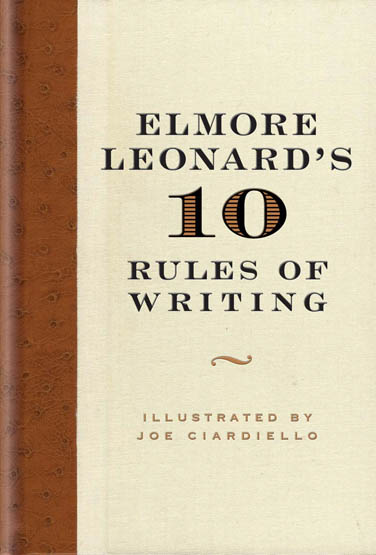

# 10 regras para escrever ficção do escritor e roteirista Elmore Leonard

Conheça 10 regras para escrever ficção do escritor e roteirista americano Elmore Leonard, extraídas do livro “*[Elmore Leonard’s 10 Rules of Writing](http://www.amazon.com/Elmore-Leonards-10-Rules-Writing/dp/0061451460/?tag=braipick-20) “***.**

No prefácio do livro, o autor adverte:

*Essas são regras que eu colhi ao longo da minha jornada para me ajudar a permanecer invisível quando estou escrevendo um livro, para me ajudar a [mostrar ao invés de conta](http://ficcao.emtopicos.com/2012/11/contar-mostrar-historias/ "A diferença crucial entre contar e mostrar em histórias.") r o que está acontecendo na história**.***

*Se você tem facilidade com a linguagem, [a criação] de imagens, e o som da sua [voz [de escritor]](http://ficcao.emtopicos.com/voz-de-escritor/ "Estilo")  agrada você, invisibilidade não é o que você deve almejar, e você pode ignorar estas regras**.** Ainda assim, é uma boa ideia conhecê-las.*

### **1**.** Nunca comece um livro com o clima**

Se for apenas para criar atmosfera, e não para mostrar a reação de um [personagem](http://ficcao.emtopicos.com/criar-personagem/ "personagem")  ao tempo, você não deve se estender muito**.** O leitor terá a tendência de folhear adiante a procura de pessoas**.** Existem exceções. Se você é o Barry Lopez, que tem mais formas de descrever gelo e neve do que um esquimó, você pode relatar o clima por quantas páginas quiser**.**

### **2. Evite prólogos**

Eles podem ser irritantes, especialmente um prólogo seguido de uma introdução que vem depois de prefácio**.** Mas esses são normalmente encontrados em não-ficção**.** Um prólogo em uma novela é contextualização, e você pode colocar essas informações onde quiser**.**

### **3. Nunca use o verbo “disse” para conduzir um diálogo**

A linha de diálogo pertence ao personagem; o verbo é o escritor enfiando seu nariz [e se intrometendo]**.** Mas o verbo “disse” é menos invasivo do que resmungou, engasgou, advertiu, mentiu**.** Uma vez eu percebei Mary McCarthy terminando uma linha de diálogo com ”ela asseverou”, e tive que parar de ler para pegar o dicionário**.**

### **4. Nunca use um advérbio para modificar o verbo “disse”**

… ele admoestou gravemente**.** Usar um advérbio dessa forma (ou quase de qualquer outra forma) é um pecado mortal**.** O escritor está expondo-se imensamente, usando uma palavra que distrai e pode interromper o ritmo do diálogo**.**

### **5. Mantenha seus pontos de exclamação sob controle**

Você não pode colocar mais de dois ou três para cada 100,000 palavras de prosa**.** Se você tem o dom de brincar com exclamações como Tom Wolfe, você pode usá-las como e quando quiser**.**

### **6**.** Nunca use a expressão “de repente” ou “caiu a casa”**

Essa regra não precisa de explicações**.** Eu percebi que escritores que usam “de repente” tendem a ter menos controle no uso de pontos de exclamação**.**

### **7. Use sotaques regionais, interioranos, com moderação**

Uma vez que você começar a soletrar foneticamente palavras no diálogo, você não será capaz de parar**.** Observe a forma como Annie Proulx captura o sabor das vozes de Wyoming no seu livro de contos **[“Curto Alcance”](http://www.livrariacultura.com.br/scripts/resenha/resenha.asp?nitem=3212620&sid=77401467013729484876651860)** **.**

### **8. Evite descrições detalhadas de personagens**

No livro *[“Colinas Parecendo Elefantes Brancos”](http://www.livrariacultura.com.br/scripts/resenha/resenha.asp?nitem=55969&sid=77401467013729484876651860)* , de Ernest Hemingway, qual a aparência do “americano e a garota com ele”**?** “Ela tirou seu chapéu e o colocou na mesa”. Essa é a única referência de uma descrição física na história, e ainda assim nós vemos o casal e distinguimos cada um pelo tom da sua voz, sem o uso de nenhum advérbio**.**

### **9. Não entre em muitos detalhes ao descrever lugares e objetos**

A não ser que você seja Margaret Atwood e consegue pintar [cenas](http://ficcao.emtopicos.com/estrutura/escrever-cenas-historias-ficcao/ "cenas")  com linguagem ou escrever paisagens no [estilo](http://ficcao.emtopicos.com/voz-de-escritor/ "estilo")  de Jim Harrison**.** Mas mesmo se você é bom nisso, você deve evitar que descrições imobilizem a ação e o desenrolar da história**.**

### **10. Tente deixar de fora a parte que os leitores tendem a pular**

Pense no que você pula durante a leitura de um romance: parágrafos grossos de prosa que têm muitas palavras**.** O que o escritor está fazendo, está escrevendo, [enchendo linguiça], talvez descrevendo mais uma vez o tempo, ou talvez mergulhando na cabeça do personagem; e o leitor ou sabe o que o cara está pensando ou não se importa**.** Aposto que você não pula os [diálogos](http://ficcao.emtopicos.com/estrutura/escrever-dialogos-historias-ficcao/ "diálogos") **.**

Minha regra mais importante é a que resume as 10**.**

Se soar como escrita, eu reescrevo**.**

Ou, se o uso correto da linguagem estiver no caminho, talvez ele deva ser ignorado**.** Não posso permitir que o que aprendi nas aulas de gramática e redação interrompam o ritmo da narrativa**.** Essa é minha tentativa de permanecer invisível, não distrair o leitor da história escrevendo o óbvio**.**

Se escrevo cenas sempre do ponto de vista de um certo personagem – aquele cuja perspectiva dá mais vida para a cena – posso me concentrar nas vozes dos personagens dizendo ao leitor quem eles são, como eles estão se sentindo em relação ao que eles estão vendo e ao que está acontecendo, enquanto eu permaneço invisível**.**

E você? O que acha dessas regras? Discorda, concorda? Deixe um comentário**.**
