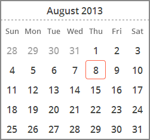
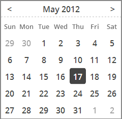

# **M**inimal-markup Web Components for Faster App Development ✩ Mozilla Hacks – the Web developer blog

Those of you on the cutting [HTML5](https://developer.mozilla.org/en/html/html5 "HTML5") edge may have already heard of the exciting [Web Components](http://www.w3.org/TR/2013/WD-components-intro-20130606/) specification**.** If you haven’t, [you’ll probably want to read up on what makes this so exciting](http://techcrunch.com/2013/05/19/google-believes-web-components-are-the-future-of-web-development/) , but long story short, Web Components promise to open up a new realm of development by letting web developers write custom, reusable HTML tags**.** Think of them as JavaScript plugins without the need for additional code initialization or boilerplate markup/styling**.**

Unfortunately, it will be a while before we see native browser support for the spec, but that doesn’t mean developers can’t start taking advantage of the component concept now, thanks to [Google’s Polymer framework](http://www.polymer-project.org/) and [Mozilla’s x-tags polyfill library](https://hacks.mozilla.org/2013/05/speed-up-app-development-with-x-tag-and-web-components/) (both X-Tag and Polymer share the same low-level, Web Component polyfills)**.**

We’re proud to announce the beta release of [Brick](http://mozilla.github.io/brick/) , a cross-browser library that provides new **custom HTML tags** to abstract away common user interface patterns into easy-to-use, flexible, and semantic Web Components**.** Built on Mozilla’s [x-tags](http://www.x-tags.org/) library, Brick allows you to plug simple HTML tags into your markup to implement widgets like sliders or datepickers, speeding up development by saving you from having to initially think about the under-the-hood HTML/CSS/JavaScript**.**

## Putting Brick into Action

Say that you wanted to implement a cross-browser, mobile-friendly calendar widget in your application**.** With current JavaScript plug-ins, such as jQuery UI, this would require putting boilerplate, non-semantic markup into your HTML, as well as explicitly initializing and managing it through JavaScript**.** However, with Brick, you can implement such a component simply by adding a custom HTML tag that you can treat as a normal native tag**.**

For our calendar example, this means just including the library’s CSS and Javascript file in your application, then adding the following tag to your markup:

|  |
| --- |
| ``` <x-calendar></x-calendar> ``` |

which creates a DOM element that looks like this:



Want to edit how the component behaves, such as by adding navigational controls or pre-selecting a date**?** Like any other native tag, you can change how a component behaves just by changing the attributes of the tag**!**

|  |
| --- |
| ``` <x-calendar controls chosen='2012-05-17'></x-calendar> ``` |



## Available Bricks

At the time of writing, Brick consists of thirteen different tags, most of which are completely independent of one another, and can even be downloaded separately instead of a single bundle**.**

Some tags abstract away complex widgets into simple HTML tags, such as:

- [<x-calendar>](http://mozilla.github.io/brick/demos/calendar/index.html) (calendars, as seen from the example)
- [<x-deck>](http://mozilla.github.io/brick/demos/deck/index.html) (a cyclable slide gallery)
- [<x-tooltip>](http://mozilla.github.io/brick/demos/tooltip/index.html) (exactly as it sounds)**.**

Others are cross-browser polyfill implementations of existing native not-yet-globally-supported elements, such as:

which polyfill `<input type="range">` and `<input type="date">`, respectively**.** Still others are structural components simplifying the styling and markup of certain components, such as [<x-layout>](http://mozilla.github.io/brick/demos/layout/index.html) , which ensures that content, headers, and footers can fill a container element without explicit styling markup**.**

Each tag comes with a flexible attribute/JavaScript API and can be fully styled to match your application**.**

## Start Building with Bricks

Want to start using components in your own applications**?** Head to [mozilla.github**.**io/brick](http://mozilla.github.io/brick/) to download a release bundles, view demos, and read the documentation for the available tags**.** Alternatively, visit the [Brick Github page](https://github.com/mozilla/brick/) to view the source code and contribute to the effort**!**

The library is still in a beta release, so we appreciate all user feedback**!** Brick is already [starting to crop up in the wild](https://developer.mozilla.org/en-US/docs/Web/Apps/app_layout/responsive_design_building_blocks) , so we’d love to hear about how you’re using it**!**

Posted by [Leon Zhang](https://hacks.mozilla.org/author/leonzhang/ "Posts by Leon Zhang") and [Robert Nyman [Editor]](https://hacks.mozilla.org/author/robertnyman/ "Posts by Robert Nyman [Editor]") on August 27, 2013 at 5:23 am
