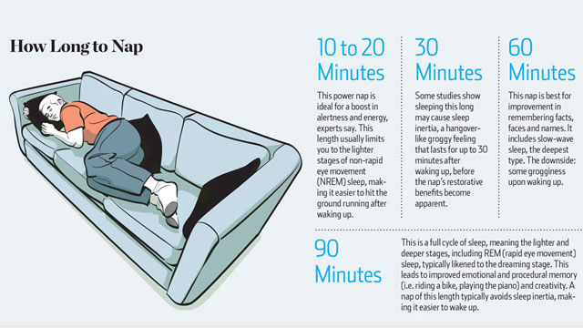

# [How Long to Nap for the Biggest Brain Benefits](http://lifehacker.com/how-long-to-nap-for-the-biggest-brain-benefits-1251546669)

[1](http://lifehacker.com/nap-is-really-useful-i-usually-sleep-ten-minutes-to-tw-1252494264) [2](http://lifehacker.com/wasnt-there-a-time-when-4-hours-was-rem-and-then-3-hour-1253787270) Related

Taking a nap, [we've seen time and again](http://lifehacker.com/tag/naps) , is like rebooting your brain**.** But napping may be as much of an art as it is [a science](http://lifehacker.com/5950732/the-science-of-the-perfect-nap) **.** The Wall Street Journal offers recommendations for planning your perfect nap, including how long to nap and when**.**P

The sleep experts in the article say a 10-to-20-minute power nap gives you the best "bang for your buck," but depending on what you want the nap to do for you, other durations might be ideal:P

> For a quick boost of alertness, experts say a 10-to-20-minute power nap is adequate for getting back to work in a pinch**.**
>
> For cognitive memory processing, however, a 60-minute nap may do more good, Dr**.** Mednick said. Including slow-wave sleep helps with remembering facts, places and faces**.** The downside: some grogginess upon waking.
>
> Finally, the 90-minute nap will likely involve a full cycle of sleep, which aids creativity and emotional and procedural memory, such as learning how to ride a bike**.** Waking up after REM sleep usually means a minimal amount of sleep inertia, Dr**.** Mednick said**.**P

In addition to those recommendations, one surprising suggestion is to sit slightly upright during your nap, because it will help you avoid a deep sleep**.** And if you find yourself dreaming during your power naps, it may be a sign you're sleep deprived**.**P

Related

While you're planning your nap, don't forget to [time it during the right time of day](http://lifehacker.com/5874738/calculate-the-best-time-to-nap-with-this-interactive-nap-wheel)  as well**.** P

[The Perfect Nap: Sleeping Is a Mix of Art and Science](http://online.wsj.com/article/SB10001424127887323932604579050990895301888.html#project%3DSLEEP0902%26articleTabs%3Darticle) | The Wall Street Journal via [NextDraft](http://nextdraft.com/) P
