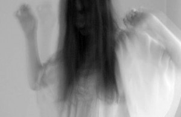
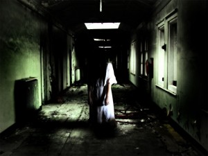
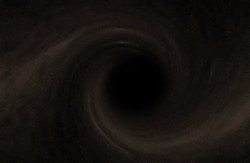
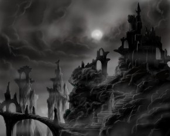
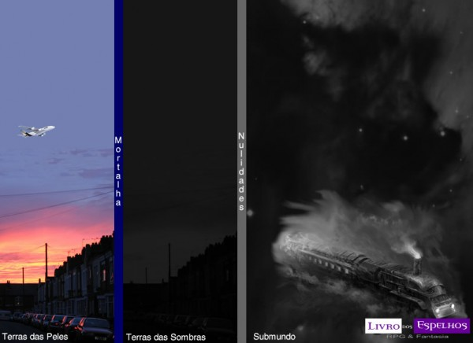

# [Guia da Umbra para o Mundo das Trevas – Parte 5](http://livrodosespelhos.com/guia-da-umbra-para-o-mundo-das-trevas-parte-5/)

03/09/2013

[5 Comentários](http://livrodosespelhos.com/guia-da-umbra-para-o-mundo-das-trevas-parte-5/#comments "Comentário para Guia da Umbra para o Mundo das Trevas – Parte 5")

Desenterrando a série de artigos **Guia da Umbra para o Mundo das Trevas**, hoje trago para vocês a minha interpretação da misteriosa Umbra Baixa**.** Agora, nós já passamos pela Película, pela Periferia, pela Umbra Próxima e pela Umbra Média, então nada mais justo antes de avançar para as Zonas, certo**?**

Como sempre salientei, se trata da minha interpretação enquanto Narradora**.** Outras visões não são só possíveis como também prováveis – afinal, se um personagem acredita que vai cruzar a Película que separa a Terra da Umbra Baixa por um cemitério, é provável que, se procura bem, ele o faça**.** Assim como em um antigo hospital psiquiátrico abandonado, ou mesmo viajando para as profundezas da Terra através de antigas cavernas cujo final não se alcançou**.** Num mundo punk-gótico onde tudo é possível, quem garante que um dos mais antigos medos da humanidade não possa tomar muitas formas de pesar e arrependimento**?**

Se escrever sobre a Umbra Alta foi complicado, nem chegou perto do que tentei fazer aqui, que me exigiu muita pesquisa, ~~uma longa~~ duas longas chamada no Skype com o JotaPê e muitas horas diante de livros diversos com os quais não tenho tanta intimidade**.** Se muitas vezes eu soar confusa, peço que me desculpem – e quaisquer contribuições, colaborações e acréscimos nos comentários serão super bem-vindos**.**

Outro aviso: não pretendo aqui apresentar uma visão completa do Mundo Inferior sob o ponto de vista de **Wraith: the Oblivion****.** Está nos nossos planos futuros incluir **Wraith**, assim como outros títulos do **Clássico Mundo das Trevas**, no conteúdo do blog**.** Entretanto, ainda não é o momento – uma coisa de cada vez, combinado**?** xD

Se você perdeu algum dos artigos anteriores desta série, basta acompanhar abaixo:

[Guia da Umbra para o Mundo das Trevas – Parte 1](http://livrodosespelhos.com/guia-da-umbra-para-o-mundo-das-trevas-parte-1/ "Guia da Umbra para o Mundo das Trevas – Parte 1")   
[Guia da Umbra para o Mundo das Trevas – Parte 2](http://livrodosespelhos.com/guia-da-umbra-para-o-mundo-das-trevas-parte-2/ "Guia da Umbra para o Mundo das Trevas – Parte 2")   
[Guia da Umbra para o Mundo das Trevas – Parte 3](http://livrodosespelhos.com/guia-da-umbra-para-o-mundo-das-trevas-parte-3/ "Guia da Umbra para o Mundo das Trevas – Parte 3")   
[Guia da Umbra para o Mundo das Trevas – Parte 4](http://livrodosespelhos.com/guia-da-umbra-para-o-mundo-das-trevas-parte-4/ "Guia da Umbra para o Mundo das Trevas – Parte 4")

## A Umbra Baixa

Enquanto a Umbra Média é animista e a Umbra Alta é conceitual, a Umbra Baixa é feita de memórias densas**.** Acredita-se que, se viajar para as maiores profundezas da Umbra Baixa, um improvável viajante compreenderia os segredos da própria Morte – ou acabaria encontrando o local onde o Deus cristão aprisionou aqueles que se juntaram a Lúcifer em sua rebelião**.** A Umbra Baixa é assim chamada pelos magos, mas também é chamada de Mundo Inferior pelos seus principais “habitantes” – as Aparições, de Mundo Yin para os orientais do Reino do Meio, ou mesmo de Umbra Negra ou Pós-Mundos**.**

Enquanto na Umbra Média as coisas são, na Alta as coisas refletem um fluxo de consciência, aqui na Umbra Baixa as coisas são como são lembradas**.**

Se a Umbra Média é o lar natural dos Garou e a Umbra Alta é facilmente alcançada pelos magos, a Umbra Baixa é o destino certo daqueles que desencarnam**.** Todos os que morrem acabam aqui – embora apenas alguns permaneçam**.** Apenas 5% dos que morrem acabam se tornando habitantes deste lugar triste**.** – exceto em tempos de grandes catástrofes, como guerras e outras calamidades, quando então a população de Aparições pode aumentar rapidamente**.**

A dificuldade aqui é compreender – o que acontece com a memória de algo que não mais existe**?** O que acontece com todo o *pathos* gerado na Terra**?** E onde estão as *coisas escuras* que nunca nasceram**?** De onde surgem alguns dos piores medos que reside no fundo da mente de cada ser vivo**?**

### Entrando na Umbra Baixa

Bem… eis algo complicado**.** Alguns grupos, no entanto, possuem alguma experiência com isto, como os [**Presas de Prata**](http://livrodosespelhos.com/os-presas-de-prata/ "Os Presas de Prata")  (e apenas o Sacerdócio de Marfim, os demais grupos da tribo simplesmente, se alcançam tal grau de merecimento, descobrem como enganar a morte através de Dom), os [**Peregrinos Silenciosos**](http://livrodosespelhos.com/os-peregrinos-silenciosos-lobisomem-o-apocalipse/ "Os Peregrinos Silenciosos – Lobisomem: O Apocalipse") , os [**Eutanatos**](http://livrodosespelhos.com/tradicao-eutanatos/ "Eutanatos") , os [**Engenheiros do Vácuo**](http://livrodosespelhos.com/convencao-tecnocrata-engenheiros-do-vacuo/ "Convenção Tecnocrata: Engenheiros do Vácuo") , alguns [**Oradores dos Sonhos**](http://livrodosespelhos.com/tradicao-oradores-dos-sonhos/ "Oradores dos Sonhos")  e os [**Giovanni**](http://livrodosespelhos.com/cla-giovanni-vampiro-20-anos/ "Clã Giovanni – Vampiro 20 Anos")  (que evitam ir pessoalmente até lá, afinal, os mestres da **Necromancia** são sábios o bastante pra saber que não é bom encontrar uma aparição, que eles gostam de controlar, em seu próprio território) – embora isso não exclua outros habitantes do Mundo das Trevas de explorar os segredos do Mundo Inferior**.** Bem, dizem que os **Dançarinos da Espiral Negra** encontram seu próprio caminho para o Mundo Inferior, enquanto dançam sua espiral de loucura galopante e selvagem…

Existem alguns rituais que permitem a entrada nestas terras de pesar, embora muitas pessoas, sem saber, já tenham trilhado seu começo – seja naquela casa mal-assombrada, seja aquele frio na espinha ao passar diante de um cemitério durante a noite**.** Aqui, os mortos e outras entidades vigiam as fronteiras – para seus próprios propósitos**.** Via de regra qualquer um que descubra como, por acidente ou intencionalmente, pode cruzar a **Película** da **Umbra Baixa**, chamada também de Mortalha**.** Agora, o viajante está por sua conta e risco – e a mercê das coisas que vivem lá**.**

Caminhos para as Terras dos Mortos podem ser encontrados em Locais Assombrados, lugares onde os Mortos permanecem, e que causam frios na espinha até mesmo do mais descrente dos vivos**.** Às vezes, uma junção de diversos Locais Assombrados formam Necrópolis que, se for vasta o bastante, pode até mesmo compor uma Cidadela, sob o comando de um dos líderes dos mortos**.**

Bem, as aparições, a seu próprio modo, acabam indo parar lá – o guia pretende explicar do ponto de vista de um viajante muito do corajoso**.**

### Terras das Peles e Terras das Sombras

As Aparições chamam as terras dos vivos de Terras das Peles (*Skinlands*) – que, em alguns pontos, encontram as Terras da Sombras (*Shadowlands*), lar deles mesmos**.** As Terras das Sombras são, então, o equivalente à Penumbra da Umbra Baixa, o lugar onde os dois mundos se encontram**.** As duas terras estão separadas pela Mortalha – a Película da Umbra Baixa cujo atravessar é equivalente à experiência da própria morte**.** Poucos são os que realmente passam por ela sem ter morrido**.** Sua aparência é membranosa, opaca em alguns lugares e transparente em outros**.** Embora as Terras das Sombras espelhem, praticamente, o mundo dos vivos, a Mortalha que sempre os separa parece distorcer a visão daqueles vivos ou mortos que estão vendo o mundo dos vivos a partir do outro lado**.** Tudo o que está do outro lado parece podre e decadente, sua majestade em ruínas, o som atravessa distorcido e as vozes ecoam… vazias**.** Ainda assim, lugares, seres e acontecimentos parecem sólidos o bastante para que se acredite que possa tocar as visões que se têm das Terras das Peles**.**

### Caminhos para a Umbra Baixa

Se chegar à Umbra Alta é uma descida metafórica, ir para a Umbra Baixa é seu oposto – é uma descida metafórica, mais grave do que se tornar a subida para os Alcances Astrais**.** Embora você possa se tornar a descida, é de se duvidar que você queira isto**.** Você realmente quer**?** Para caminhar nestas terras, você, de certa forma, vibra no mesmo peso e gravidade dela – e quanto mais se desce, mais difícil fica retornar, estejam avisados caso estejam vivos (ou morto-vivos, mas ainda possuam um corpo feito de matéria e não de, bom, plasma)**.** Vibrar a vibração das Terras das Sombras é vibrar cada vez mais próximo da própria inexistência, da própria entropia**.** Mas em seu começo, vibra-se nesta vibração de pesar, de arrependimento e assuntos inacabados, já que as emoções negativas são as mais acentuadas nestas paragens**.**

Cabe notar que é possível até mesmo encontrar caminhos e atalhos que levem da Umbra Média para a Umbra Baixa – afinal, quem procura, acha**.**

Se você ficar por lá tempo o bastante, ou tiver azar, você vai acabar encontrando as nulidades…

### As Camadas da Umbra Baixa

Antes de chegar a outras áreas do Submundo, devemos passar por dias de suas camadas – as Terras das Sombras e a Tempestade**.** Tudo aqui é feito de energia entrópica que se manifesta como plasma, que não é matéria e ao mesmo tempo é**.** Embora algumas criaturas consigam abrir caminhos a força (dizem ser uma especialidade dos **Engenheiros do Vácuo**), o único jeito de viajar é passar por uma nulidade**.**

### Como é o Submundo**?**

Bem, tudo aqui é feito de memórias**.** Aparições e até mesmo Espectros são lembranças de si mesmos, embora isto possa ser distorcido – como aquelas lembranças antigas que temos e que vão ficando cada vez menos claras e mais confusas, dependendo da influência de estados emocionais referentes a estas lembranças ou que venham a alterá-las, além do tempo decorrido em si**.** Estados emocionais é uma frase chave, já que ***Pathos*** e ***Angústia*** são forças emocionais simbólicas que, aqui, se tornam físicas e ao mesmo tempo continuam a ser estados emocionais que tocam e alteram a tudo, como metáforas que assumem uma existência real neste estado de vibração**.**

Até mesmo as construções são lembranças de como elas eram (ou são) nas Terras das Peles, e continuarão assim até que sejam alteradas usando os materiais do Submundo (ou seja, plasma, matéria que só pode ser conseguida dos corpos *não-exatamente-físicos* de aparições**.** Sim, usam fantasmas pra construir e reformar objetos no Submundo)**.**

Se você conseguiu espiar através da Mortalha, teve um vislumbre disto e não se horrorizou, bem, você está pronto para seguir adiante**.**

#### Terras das Sombras

Tudo nas Terras das Sombras é feito de plasma – a matéria de que são feitos os mortos inquietos e as coisas que foram esquecidas, destruídas ou que por algum motivo vieram parar aqui**.** Ou assim se acredita…

As coisas das terras dos vivos possuem seus correspondentes aqui no Submundo, obedecendo inclusive às regras de distância, de tempo e espaço**.** Dizem que, a partir daqui, os mortos que espiam o mundo dos vivos conseguem dizer quando alguém está para morrer**.** É também através daqui que os Mortos Inquietos, com suas artes chamadas de **Arcanoi**, conseguem interagir em qualquer nível com o mundo dos Breves (ou seja, dos vivos)**.**

#### Nulidades

Nulidades são buracos negros que ligam pontos do Submundo, na ou através da Tempestade**.** Podem ser vias de mão dupla – embora para saber onde elas vão dar sem conhecer os caminhos, só enfiando a cabeça lá pra ver**.** Algumas podem conduzir direto até caminhos do Labirinto, ou mesmo do Esquecimento (se é que o Esquecimento está em um lugar específico, afinal, pode ser apenas o estado emocional do viajante que o conduza a tal acontecimento catastrófico), então estejam avisados**.**

Estas nulidades são eventos vistos como eventos naturais do Submundo – embora nulidades tendam a surgir espontaneamente em lugares onde ocorreu grande dor ou sofrimento, como é o caso da nulidade de Auschwitz, que dizem que pode conduzir um azarado direto para o Vácuo**.**

Enquanto podem ser extremamente hipnóticas para as aparições, algumas nulidades (as especialmente grandes) podem agir como buracos negros que puxam o desavisado para seu interior**.** A partir daí, ele está por sua conta, muitas vezes navegando na Tempestade**.**

#### Tempestade

Separando as Terras das Sombras do que está mais além, está a mística Tempestade, um turbilhão perpétuo de energia, memórias e Espectros que surgem do Labirinto, uma chuva constante de plasma e energia e outras coisas que surgem das Terras das Sombras e dos Reinos Sombrios**.** Ela percorre todo o Mundo Inferior, e alguém que saiba navegar na Tempestade pode viajar de um ponto a outro no Submundo**.** Isso significa que, por exemplo, um vampiro que saiba o que está fazendo poderia entrar nas Terras das Sombras no Uruguai, chegar na Tempestade, pegar o Atalho correto, voltar para as Terras das Sombras e sair em Milão no mundo físico**.** Sim – assim como dá para navegar pela Umbra Alta para pegar atalhos e cruzar a Terra, é possível fazer o mesmo através do Submundo, embora eu acredite que aqui a coisa é mais arriscada**.**

Por toda a Tempestade, existem os Atalhos – caminhos naturais ou construídos que são super importantes para a movimentação dos habitantes do Submundo**.** O principal Atalho natural que existe é o **Rio da Morte**, embora muitos Atalhos tenham sido construídos pelos mortos de Reinos Sombrios para facilitar a passagem**.**

Em si, a Tempestade é atemporal. Nela, se encontram tanto coisas de todas as épocas que já se passaram ou está acontecendo quanto a noção de tempo e de espaço se perde totalmente**.** O modo mais seguro de se viajar pela Tempestade é viajar com os Barqueiros que conhecem os caminhos pela Tempestade**.** A forma clássica de pagá-los é com **óbolos**, a moeda do Submundo – mas eles também aceitarão como pagamento **Artefatos**, **Fetiches**, **Talismãs** ou **Maravilhas** poderosas**.** Se você for bom o bastante, eles até aceitarão um favor seu, e uma vez que aceite um contrato, um Barqueiro levará o passageiro em segurança para onde quer que ele queira ir**.** Porém, uma vez lá, o contrato está terminado e o Barqueiro deixará o viajante a sua própria sorte**.**

Sabe-se que aparições hábeis podem viajar na Tempestade sem usar os Atalhos**.** Para tanto, precisam conhecer o **Arcanoi Argos****.**

##### O que tem na Tempestade?

Bem… tudo o que se perde acaba indo parar lá, bem como coisas que foram destruídas no mundo dos vivos**.** E Espectros. É uma mistura de caos primordial entrópico, paisagens, paragens, coisas perdidas, trens fantasmas**.** Acredita-se que sua energia seja formada de todos os sentimentos já sentidos, com a prevalência dos sentimentos ruins**.** Lá, tudo é escuro – embora as coisas lá perdidas possuam luminosidade própria, mas que só se tornam visíveis quando estão perto demais do viajante**.** Prepare-se para sustos.

Tudo o que cai em uma nulidade acaba indo parar na Tempestade**.**

#### As Ilhas na Tempestade: Os Reinos Sombrios

Se a Tempestade é o grande mar do Submundo, os Reinos Sombrios são ilhas que existem neste mar caótico**.** Cada Reino Sombrio é uma existência individual (no sentido grego de *hipóstase*) para os mortos de uma cultura particular**.** Alguns dos principais Reinos Sombrios são:

- **Estígia** – Reino Sombrio do Ferro e Hierarquia dos Mortos Ocidentais
- **Campos Amarelos** – Reino Sombrio da Jade e Império dos Mortos Asiáticos
- **Karta** – Reino Sombrio da Argila e lar dos mortos aborígenes
- **Swar** – Reino Sombrio da Cidade dos Desejos e lar dos indianos mortos
- **O Arbusto dos Fantasmas** – Reino Sombrio do Marfim e lar dos mortos da África
- **As Terras Esfoladas** – Reino Sombrio de Obsidiana e lar dos mesoamericanos mortos**.** Acreditava-se que havia desaparecido, mas… não foi exatamente o que ocorreu**.**
- **Amenti** – Reino Sombrio da Areia e lar dos Deuses e Imortais do Egito Antigo
- **Auschwitz** – Reino Sombrio do Arame que surgiu e explodiu em população graças aos crimes nazistas

Qualquer visão de céu e de inferno da humanidade existe em uma das ilhas na Tempestade, e é apenas aqui que os mortos podem alcançar a visão de céu (ou mesmo de inferno) de sua cultura ou crença após sua morte, já que as almas dos que já estiveram vivos jamais chegariam até a Umbra Alta**.** Lembre-se que a Umbra Alta é feita de puro conceito; os vivos, ao desencarnarem, caso não consigam se libertar de suas pendências no mundo que deixaram para trás, virão parar exatamente aqui**.**

#### Litorais Distantes

Além dos Reinos Sombrios, existem os misteriosos territórios dos Litorais Distantes, controlados por entidades pitônicas chamadas de Resplandecentes (*Shines Ones*)**.** Os Litorais Distantes são misteriosos, e muitas histórias circulam a seu respeito**.** O boato mais disseminado é que os Resplandecentes buscam ajudar os mortos sem descanso a alcançar a Transcendência, embora saiba-se da existência de infernos como o Paraíso dos Pescadores que, apesar do nome engraçadinho, é uma vasta câmara de tortura cristã para os pecadores**.**

#### Enoque

Sabe-se que, em algum lugar do Submundo, é possível encontrar a Primeira Cidade conhecida como Enoque**.** Depois da destruição física da primeira cidade pelo Dilúvio, o Submundo a preservou em outro plano dimensional**.** Bem, é aqui que a Verdadeira Mão Negra tem sua sede, nas Terras das Sombras**.** É a sede do poder de seu líder, Del’Roh, e onde fica o túmulo dos Aralu, adorados pelo Tal’mahe’Ra, que acredita-se serem Antediluvianos**.** A existência de Enoque foi revelada para a Mão Negra por… uma **múmia**, Inauhaten**.** Alguém se espanta de saber que uma múmia sabia da existência de Enoque no Submundo**?**

É desnecessário dizer que Enoque é odiada por muitos dos mortos inquietos, que morreram justamente pelas mãos de vampiros – inclusive, a guerra contra Enoque é um dos episódios complicados do “final” de Wraith: the Oblivion**.** Vai ser interessante ver como, na já anunciada edição de 20 anos do jogo, vão resolver esta questão**.**

Para mais informações [**confira o artigo sobre a Mão Negra**](http://livrodosespelhos.com/a-mao-negra-do-saba/ "A Mão Negra do Sabá") **.**

#### O Labirinto

Depois da Tempestade e suas “ilhas”, existe o Labirinto, domínios dos Espectros e seus mestres Malfeanos**.** O Labirinto é um lugar de mudança constante, onde as coisas do Submundo assumem novas formas ainda mais caóticas**.**

Tais mestres Malfeanos são grandes forças de escuridão e destruição que levam sofrimento, malefício e terror a qualquer coisa tocada por sua influência**.** Entretanto, são uma força invisível, cuja influência se faz sentir unicamente através de seus servos**.** Tais mestres surgiram antes mesmo da Separação (*Sundering*)**.** São criaturas de puro terror que estavam praticamente adormecidos – ou pelo menos quietos até as bombas atômicas de Hiroshima e Nagasaki, quando **Gorool**, um dos menores dos Malfeanos, despertou**.** Sabe-se que Caronte, o Imperador da Morte, lutou contra ele usando sua espada Siklos, porém os dois desapareceram na Tempestade**.** Isso foi durante o que os mortos inquietos chamam de Quinto Grande Maelstrom**.**

Mas o labirinto ainda está lá… se você chegou lá, desculpe, mas eu não queria mesmo ser você**.**

Uma entrada para o Labirinto pode surgir em qualquer lugar**.** Entretanto, a forma mais fácil de alcançá-lo é através da Escada Venosa de Estígia**.**

O que vem depois**?** Bem… você ainda quer mais?

#### O Vácuo

Bem… como definir o vácuo**?** Como se define o indefinível? Devem existir coisas por lá**.** Uma delas se tornou conhecida de um modo que ninguém imaginava**.**

#### O Abismo

Em algum lugar do vácuo, existe um lugar habitado pelos caídos **Elohim**, lugar jamais alcançado por qualquer mortal**.** É um lugar escuro, frio, vazio, a mais pura manifestação da privação sensorial, onde a única coisa que existe são os ecos do sofrimento humano – e os Elohim**.**

Os Elohim estão – ou estavam – presos lá**.** Mas isso é assunto para quem fala algo sobre as fissuras no Abismo, que permitiu que os Caídos voltassem a Terra, apesar de ainda serem atraídos pelo Abismo, a menos que… se ancorem**.** Isto também é assunto para um artigo futuro**.**

#### O Esquecimento

O que é o Esquecimento, se não a entropia em si mesmo**?** Ele não é um lugar, ou uma entidade – embora possa tocar um lugar, ele pode tocar tudo**.** Embora pareça ter uma motivação, não parece ser algo exatamente consciente**.** Como definir uma força cósmica que é mais que tudo um acontecimento**?**

O Esquecimento borbulha na raiz de tudo: dos Mundos das Sombras, da Tempestade, do Labirinto e até mesmo dos Mundos das Peles**.** A cada aparição que a ele sucumbe, ele se expande, uma vez que ele as toca em forma de suas Sombras**.** Essa… coisa, evento, força primordial ou estado, vaza através de tudo, podendo até mesmo atravessar as nulidades**.** Seus servos, acredita-se, são os Espectros, e talvez o Esquecimento seja a mítica **Avó** dos Malfeanos, mas existem aqueles seres que acreditam que a Avó é pura cria do Esquecimento, e não a própria força entrópica**.** A palavra em inglês – **Oblivion** – talvez dê uma dimensão melhor do que é o Esquecimento, se pensarmos em verbos como obliterar, que significa tornar em nada**.**

O Esquecimento é a entropia em si, personificada, uma força caótica de destruição final e loucura, de onde não há qualquer retorno possível**.** E se você olha muito pra ele, então o Esquecimento estará pronto para olhar de volta para você**.**

**\* \* \***

Cada novo texto é um novo desafio, não é mesmo**?** Muito obrigada a todos vocês que cobraram uma continuação da série, pois aprendi muito enquanto escrevia este artigo**.** Peço mais uma vez que opinem, participem e comentem**.** Logo menos a gente vai dar uma voltinha no Eterespaço, ok**?**

Não deixem de conferir o [**fórum**](http://forum.livrodosespelhos.com/ "Fórum Livro dos Espelhos") **!** Estamos trabalhando pesado, agora que o blog foi todo trabalhado, para umas novidades pro pessoal que busca ferramentas para jogos de RPG via Internet**.** Caso você possa e queira ajudar, [confira este tópico](http://forum.livrodosespelhos.com/offtopic-7/procurando-ajuda-com-phpmysql/ "ajuda com php e mysql") , estamos mesmo precisando da ajuda de alguém que manje dos paranauê de PHP e MySQL, ok**?**

Beijo e até a próxima!

**Fontes:** Série Wraith: the Oblivion (vários livros), Orpheus (Rulebook e End Game), Demon: the Fallen  
**Autora:** Eva  
**Agradecimentos:** JotaPê (favor me ajudarem a convencê-lo a escrever sobre **Wraith: the Oblivion****.** Grata u.u)

**Artigo Anterior:** [Guia da Umbra para o Mundo das Trevas – Parte 4 >](http://livrodosespelhos.com/guia-da-umbra-para-o-mundo-das-trevas-parte-4/ "Guia da Umbra para o Mundo das Trevas – Parte 4")   
**Próximo Artigo:** Guia da Umbra para o Mundo das Trevas – Parte 6 *(em breve)*
