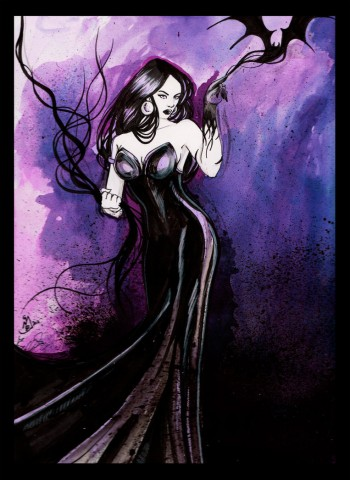
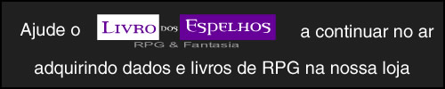

# [Tenebrosidade – Vampiro: A Máscara](http://livrodosespelhos.com/tenebrosidade-vampiro-a-mascara/)

29/08/2013

[1 Comentário](http://livrodosespelhos.com/tenebrosidade-vampiro-a-mascara/#comments "Comentário para Tenebrosidade – Vampiro: A Máscara")

Agora que tudo voltou ao normal (weee**!**), que tal voltarmos para mais uma tradução vinda da edição de 20 anos de Vampiro: A Máscara**?** Hoje é a vez da [**Disciplina**](http://livrodosespelhos.com/as-disciplinas-vampiro-a-mascara/ "As Disciplinas – Vampiro: A Máscara")  **Tenebrosidade,** pra alegria dos [**Lasombra**](http://livrodosespelhos.com/cla-lasombra-vampiro-20-anos/ "Clã Lasombra – Vampiro 20 Anos")  de plantão**.**

A tradução foi feita até o nivel 5 da Disciplina**.** Para mais informações, consulte o **Vampire: The Masquerade – 20th Anniversary Edition****.**

Agradecimentos especiais ao Hesha, que enviou esta tradução, e à [**E-Consulters**](http://www.e-consulters.com.br/central/aff/?aff=019 "E-Consulters")  por ter sido tão atenciosa conosco desde que passamos a hospedar o blog por aqui e por toda a ajuda nesta última semana**.**

## Tenebrosidade

A assinatura dos Lasombra, Tenebrosidade concede ao vampiro poder sobre a própria escuridão**.** A natureza das trevas invocadas pela Tenebrosidade é um assunto de intenso debate entre os Membros**.** Alguns acreditam que sejam meramente sombras, enquanto outros acham que o poder dá o controle sobre as coisas da alma do vampiro, tornando-a tangível**.**

Independentemente disso, os efeitos da Tenebrosidade são aterrorizantes, como ondas de escuridão que surgem a partir do Cainita, envolvendo aqueles em seu caminho como uma onda infernal**.** Como a Tenebrosidade é conhecida principalmente como uma Disciplina do [**Sabá**](http://livrodosespelhos.com/o-saba/ "O Sabá") , qualquer vampiro da [**Camarilla**](http://livrodosespelhos.com/a-camarilla/ "A Camarilla")  pego usando esse poder deve ter uma baita de uma boa explicação**.**

**Nota:**  Vampiros usando Tenebrosidade podem ver através da escuridão que eles controlam, apesar de outros vampiros (mesmo aqueles que também têm Tenebrosidade) não poderem**.** Terríveis contos que falam de Lasombra rivais lutando para cegar e sufocar uns aos outros com os mesmos fios de escuridão circulam entre os jovens membros do Clã, apesar de nenhum  ancião se manifestar para corroborar essas alegações**.**

**Jogo de Sombras:** Este poder concede ao vampiro um controle limitado sobre sombras e outros ambientes escuros**.** Embora o vampiro realmente não possa “criar” a escuridão, ele pode sobrepor-se e estender sombras existentes, criando remendos de obscuridade**.** Este poder também permite ao Membro separar as sombras de seus corpos e até mesmo moldar as trevas em sombras de coisas que não estão ali**.**

Uma vez que um vampiro assume o controle da escuridão ou sombra, ela ganha uma tangibilidade mística**.** Variando de um resultado gélido ou infernalmente quente e enjoativo, a escuridão pode ser usada para intimidar ou mesmo sufocar vítimas**.** Alguns Lasombra cruéis alegam ter visto mortais sufocando até a morte com suas próprias sombras**.**

**Sistema:** Este poder não requer testes, mas um ponto de sangue deve ser gasto para ativá-lo**.** O Jogo de Sombras dura uma cena e não requer muita concentração**.** Membros escondidos nas sombras recebem um dado extra em suas paradas de dados de Furtividade e aumentam em um a dificuldade de ataques com armas de longo alcance contra eles**.** Vampiros que usam a escuridão para se tornarem mais apavorantes adicionam um dado à Intimidação na parada de dados**.** Inimigos atacados pelas sombras ou estrangulados pela escuridão subtraem um dado de todas as paradas de dados de Vigor (incluindo para absorção)**.** Mortais, carniçais e outros que respirem ar que tenham seu Vigor reduzido a zero com o estrangulamento começam a se asfixiar; vampiros podem perder todos os dados apropriados, mas não são afetados pela asfixia**.** Apenas um alvo pode ser afetado por este poder por vez, embora um pouco de ocultação possa ser oferecido a um grupo relativamente imóvel**.**

A aparência não natural deste poder se mostra extremamente desconcertante para os mortais e animais (e, a critério do Narrador, Membros que nunca viram isso antes)**.** Sempre que este poder é invocado nas proximidades de um mortal, o indivíduo deve fazer um teste de Coragem (dificuldade 8) ou sofrer uma penalidade de um dado em todas as paradas de dados pelo restante da cena devido ao medo das monstruosas sombras**.**

**Mortalha das Trevas:** O vampiro pode criar uma nuvem de escuridão**.** A nuvem obscurece completamente a luz e mesmo o som em algum nível**.** Aqueles que forem presos dentro dela (e sobreviverem) descrevem a nuvem como viscosa e enervante**.** Esta manifestação física dá credibilidade para aqueles Lasombra que clamam que suas trevas são algo mais que meramente sombras**.**

A nuvem tenebrosa pode até se mover, se o Membro que a criou assim o desejar, embora isso exija concentração total**.**

**Sistema:** O jogador testa Manipulação + Ocultismo (dificuldade 7)**.** Um sucesso no teste gera escuridão em cerca de 3 metros de diâmetro, embora a nuvem amorfa mude e ondule constantemente, às vezes até mesmo estendendo tentáculos sombrios**.** Cada sucesso adicional dobra o diâmetro da nuvem (embora o vampiro possa voluntariamente reduzir a área que ele deseja cobrir)**.** A nuvem pode ser invocada de uma distância de até 50 metros,  embora a criação de escuridão fora da linha de visão do vampiro adicione dois na dificuldade do teste e exija gasto de ponto de sangue**.**

A massa escura e viscosa efetivamente extingue todas as fontes de luz que engole (com exceção do fogo) e abafa os sons até que se tornem indistinguíveis**.** Aqueles que estiverem dentro da nuvem perdem toda a visão e se sentem como se tivessem sido imersos no piche**.** O som também se deforma e distorce dentro da nuvem, tornando quase impossível se entender alguma coisa (+2 na dificuldade, como em Luta às Cegas)**.** Mesmo aqueles que possuem [**Sentidos Aguçados**](http://livrodosespelhos.com/auspicios-vampiro-a-mascara/ "Disciplina Auspícios") , [**Olhos da Besta**](http://livrodosespelhos.com/metamorfose-vampiro-a-mascara/ "Metamorfose – Vampiro: A Máscara") , **A Língua da Serpente** e poderes similares sofrem penalidades de cegueira devido à escuridão não natural**.** Além disso, estar cercado pela Mortalha das Trevas reduz em dois suas paradas de dados baseadas em Vigor, conforme a escuridão sufoca e chacoalha as vítimas**.** Este efeito não é cumulativo com Jogo de Sombras, embora os alvos sufoquem como em Jogo de Sombras se chegarem a 0 de Vigor; mas de um mortal sem sorte “se afogou” na escuridão**.**

Mortais e animais cercados pela Mortalha das Trevas devem fazer um teste de coragem como em Jogo de Sombras acima, ou entrarão em pânico e fugirão**.**

**Braços do Abismo:** Refinando seu controle sobre a escuridão, o Membro pode criar tentáculos preênseis que emergem de áreas de luz turva**.** Estes tentáculos podem agarrar, segurar e constringir inimigos**.**

**Sistema:** O jogador gasta um ponto de sangue e faz um teste simples (nunca estendido) de Manipulação + Ocultismo (dificuldade 7); cada sucesso permite a criação de um único tentáculo**.** Cada tentáculo possui dois metros de comprimento e possui níveis de Força e Destreza iguais aos do vampiro que invocou Tenebrosidade – pontos em [**Potência**](http://livrodosespelhos.com/potencia-vampiro-a-mascara/ "Disciplina Potência")  e [**Rapidez**](http://livrodosespelhos.com/rapidez-vampiro-a-mascara/ "Disciplina Rapidez")  são adicionados aos níveis de Força e Destreza respectivamente**.** Se o vampiro quiser, ele pode gastar um ponto de sangue para aumentar a Força ou Destreza de um único tentáculo em um ou para aumentar seu comprimento em outros dois metros**.** Cada tentáculo tem quatro níveis de vitalidade, é afetado pelo fogo e pela luz do sol como se fosse um vampiro e absorve danos  contusivos e letais usando Vigor + Fortitude do vampiro**.** Danos agravados não podem ser absorvidos**.**

Os tentáculos podem constringir seus inimigos, causando (Força +1) de dano letal por turno**.** Se libertar do agarrão de um tentáculo querer que a vítima vença um teste resistido de Força contra o tentáculo (dificuldade 6 para cada)**.** No entanto, tentáculos não podem ser usados para nenhum tipo de manipulação, como digitar ou dirigir**.**

Todos os tentáculos não precisam emanar da mesma fonte – desde que existam várias áreas de escuridão apropriadas, existem fontes para os Braços do Abismo**.** Controlar os tentáculos não requer concentração completa; se o Membro não estiver incapacitado ou em torpor, ele pode controlar os tentáculos enquanto realiza outras ações**.**

**Metamorfose Sombria:** O Cainita convoca sua escuridão interior e infunde-se a ela, tornando-se um híbrido monstruoso de matéria e sombra**.** Seu corpo se torna manchado com manchas de sombra tenebrosa, e tentáculos finos são expelidos de seu torso e abdômen**.** Embora ainda seja humanoide, o vampiro assume uma aparência quase demoníaca, como se sua escuridão interior borbulhasse para a superfície**.**

**Sistema:** O jogador gasta dois pontos de sangue e faz um teste de Manipulação + Coragem (dificuldade 7) – vampiros de Geração mais baixa podem levar dois turnos para fazer a transição**.** Uma falha indica que o vampiro não pode passar pela Metamorfose Sombria (embora ele mesmo assim gaste os pontos de sangue)**.** Uma falha crítica inflige dois níveis de vitalidade de dano letal não absorvível no vampiro como se as trevas devastassem seu corpo morto-vivo**.**

Enquanto estiver sob os efeitos de Metamorfose Sombria o vampiro possui quatro tentáculos evocados via Braços do Abismo (apesar de seus níveis de Força e Destreza sejam iguais aos próprios Atributos do vampiro, incluindo dados de Rapidez e Potência)**.** Estes tentáculos, combinados com as faixas de trevas em todo o corpo do Membro, subtraem dois dados da parada de Vigor e absorção de oponentes fisicamente tocados em combate enquanto o vampiro continuar em contato com a vítima**.** Isto não é cumulativo com outros poderes de Tenebrosidade, embora os alvos possam asfixiar com Vigor 0, como em Jogo de Sombras**.** O vampiro pode fazer um ataque extra sem penalidade usando seus tentáculos (para um total de dois ataques, não um ataque adicional para cada tentáculo)**.** Além disso, o vampiro pode sentir tudo a seu redor, mesmo na mais profunda escuridão**.**

A cabeça do vampiro e suas extremidades às vezes parecem desvanecer no nada, enquanto em outros momentos parecem estar em outro mundo envolvo em trevas**.** Isto, combinado com os tentáculos ziguezagueantes se contorcendo em seu corpo, cria uma visão perturbadora**.** Mortais, animais e outras criaturas não acostumadas a este tipo de demonstração devem fazer um teste de Coragem (dificuldade 8) ou sucumbir a um pânico equivalente ao *Rötschreck* (embora seja inspirado pela escuridão, ao invés do fogo)**.** Muitos Membros cultivam este aspecto diabólico, e a Metamorfose Sombria adiciona três dados à parada do Membro que a invocou**.**

**Corpo de Sombras:** Neste nível, a maestria das trevas do Membro é tão extensa que ele pode fisicamente fundir-se a ela**.** Após a ativação deste poder, o vampiro torna-se um sombrio ameboide retalho de sombra**.** Vampiros nesta forma são praticamente invulneráveis e podem deslizar através de rachaduras e fendas**.** Além disso, o vampiro-sombra ganha a habilidade de ver na escuridão natural**.**

**Sistema:** A transformação custa três pontos de sangue (que pode precisar ocorrer ao longo de três turnos, dependendo da Geração do vampiro)**.** O vampiro é imune a ataques físicos enquanto estiver na forma tenebrosa (embora ele ainda leve dano agravado por fogo e luz solar), mas não pode atacar fisicamente**.** Ele pode, no entanto, envolver e escorrer sobre os outros, afetando-os da mesma forma que Mortalha das Trevas, além de poder usar Disciplinas mentais**.** Vampiros em Corpo de Sombras podem até mesmo deslizar pelas paredes e em tetos ou “gotejar” sua escuridão para cima – eles não possuem massa e, portanto, não são afetados pela gravidade**.** Dificuldades para *Rötschreck* por fogo e luz do sol aumentam em um para vampiros nesta forma, uma vez que a luz é ainda mais dolorosa para seus corpos sombrios**.**

Mortais (e outros não acostumados a estas demonstrações) que testemunhem o vampiro se transformar em sombra profanam precisam fazer teste de Coragem (dificuldade 8) a fim de evitar o terror debilitante descrito em Metamorfose Sombria**.**

**Fonte:** Vampire: The Masquerade – 20th Anniversary Edition – páginas 188-191  
**Imagem:** [Lasombra: Queen of Shadows por Chihyro](http://chihyro.deviantart.com/art/Lasombra-Queen-of-Shadows-215981467 "Lasombra: Queen of Shadows")   
**Tradutor:** Hesha Roberto  
**Revisora:** Eva
