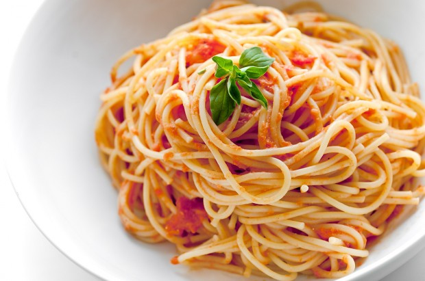

# **P**equeno guia de culinária para começar hoje: alguns procedimentos básicos

[Já relatei aqui um pouco do meu processo de aprendizado na cozinha](http://papodehomem.com.br/como-comecei-a-cozinhar-ou-o-pequeno-guia-da-culinaria-para-comecar-hoje/)  e tive o prazer de ler e responder comentários que serviram de termômetro do nível de conhecimento e interesse da galera no assunto**.**

O que percebi foi que muita gente já tem uma boa noção e a parcela que admite não saber parece estar disposta a se arriscar**.**

Em tudo o que fazemos na cozinha, o importante é desencanar de fazer certinho**.**

Permita-se errar um pouco em cada processo e também a definir um jeito seu de conduzir cada um**.**

Aqui estão só algumas dicas para se virar**.**

### Como refogar vegetais

Cebola, alho e alguns legumes devidamente cortados**.** O que fazer com esse montinho de vegetais crus e ardidos**?**

Jogar sobre a carne, acender o fogo e abrir uma gelada**?** Nada disso, meu amigo. Vamos refogar isso aí!

A chave da refoga – [nascida em Portugal, segundo chefs brasileiros](http://culinaria.terra.com.br/receitas/cozinha/tempura-e-refogado-de-alho-e-cebola-sao-portugueses-saiba-mais,7ac769ea77eab310VgnVCM3000009acceb0aRCRD.html)  – é uma pequena quantidade de gordura para trazer à tona o sabor e incorporá-lo ao que vem depois, sem deixar que a acidez desses temperos fique acentuada**.**

*[Link Youtube](http://youtu.be/c-sR_KXhNIo)* 

Se você é dos que têm não gostam de cebola desde criança – conheço muitos –, provavelmente nunca provou de verdade a cebola refogada**.** Vale o experimento para sentir o sabor adocicado que vêm à tona**.**

O alho, por sua vez, mantém o gosto forte, mas sem aquele “beliscão” na língua e deve entrar na panela um pouco depois da cebola, pois queima mais rápido**.**

O procedimento é bem simples. Ligamos o fogo, colocamos o óleo escolhido na panela ou frigideira, espalhamos bem por toda a superfície e só então vêm os outros elementos do que você quer fazer**.** Arroz, legumes, carne, cogumelos… é só ir atrás de uma receita e mandar bala**.**

No meu molho de tomate à bolonhesa, por exemplo, coloco pimentão picado desde o começo, porque gosto do leve amargo/doce na carne moída, que vem em seguida**.** Há quem curta colocar no refogado folha de louro, salsa, manjericão, que vão se destacar também**.**

Refogar dá a base para o sabor do prato e é uma prática usada em muitas receitas**.** O ato de refogar é conhecido também como ‘sauteé’, apesar de leves diferenças**.**

### Stir-fry: o princípio básico da Yakissoba

Acho genial como a simplicidade de certos termos em inglês ilustra bem as coisas**.** [*Stir-fry*](http://papodehomem.com.br/stir-fry-aprenda-a-cozinhar-como-um-verdadeiro-chines/)  é fritar-mexendo ou misturando**.**

A técnica é chinesa e não tem nada melhor para exemplificar isso do que um chow mein – ou yakissoba, que é o nome japonês do prato**.**

Tudo é feito em uma só panela, a [wok](http://pt.wikipedia.org/wiki/Wok) , com pequena quantidade de óleo, mas pode ser em uma frigideira grande**.**

*[Link Youtube](http://youtu.be/bU4zhFOeaig)  | Nessa receita não vai nem cebola e alho, é direto com a carne e os legumes*

Um lance importante é que a escolha da gordura para essas manobras não tem só a ver com sabor**.** Cada uma tem um [ponto de fumaça](http://delicitas.com.br/ponto-de-fumaca/#.UiedCtLEM7Z) – o tempo que demora até começar a queimar**.** E o que você não quer de jeito nenhum é gosto de gordura queimada no seu rango**.**

Alguns óleos têm pontos de fumaça mais altos (queimam a uma temperatura maior) e outros mais baixos (queimam mais rápido, com menos calor)**.**

Às vezes, adiciono manteiga ao azeite porque apesar de estar interessado no gostinho da manteiga, preciso do azeite para controlar o ponto de fumaça**.**

### Cozimento: alguns truques para massas

É, rapaz, pensa que ferver água é fácil**?** Claro que é**.**

O principal é ter em mente o tempo de cozimento para cada propósito**.** Em muitos casos é bom usar uma panela grande**.**

Se você quiser fazer um macarrão normalzinho, por exemplo, precisa saber algumas coisas: vai bastante sal na água e um fio de óleo, no primeiro caso, para que a massa fique temperada e não grude depois**.**

Depois de ferver a água e tacar o macarrão tradicional lá, leva de 6 a 8 minutos para ficar pronto – se você quer a massa ‘al dente’, mais durinha de morder, deixe menos tempo**.**

O macarrão asiático – que você compra especificamente para o yakissoba – pode ser mais grudento e sem sal, já que vai misturar naqueles legumes e carne que refogou e temperou depois**.**

A massa do yakissoba precisa ser cozida mais rapidamente também, pois ele vai terminar de cozinhar junto com os outros ingredientes e você não quer que ele despedace nessa etapa**.** Já aconteceu comigo e foi um desastre.

Nos dois casos, precisa escorrer a água depois, e aí vem a polêmica: tem quem ache indispensável uma enxaguada na massa com água fria, tem quem considere isso uma afronta**.**

Não digo que nenhum jeito é o certo, mas sei que esse enxágue ajuda a controlar certinho o ponto que você quer**.** De outro modo, a massa continua cozinhando com o calor residual e passa do ponto**.**

O mesmo exemplo que dei no post anterior vale aqui: fazer papinha de criança é um bom aprendizado de cozimento**.**

Você vai descobrir o tempo que leva de fervura para que cada legume fique macio (testando com um garfo) e ver como vale a pena reservar o caldo para outras receitas**.** Mas, nesse caso, os elementos entram antes, ainda que a água ferva**.**

### Molho

Essencial para sua massa, ponto final**.**

*[Link Youtube](http://youtu.be/HP9doLye26I)  | Esse molho é fodástico, quase consigo sentir o aroma no vídeo*

Refogar você já sabe, então basta escolher o restante dos ingredientes**.** Há discussões quanto ao molho de tomate “perfeito”**.** Esse do chef John, do [Food Wishes](http://foodwishes.blogspot.com.br/) , chega bem perto**.**

Veja que ele refoga colocando os vegetais e depois o azeite**.** Isso quer dizer que a ordem, realmente, não importa muito, desde que o barulhinho “ssshhh” aconteça**.** Importante experimentar.

Se você estiver sem tempo de ficar esperando os tomates murcharem, ir adicionando água, caldo etc, um segredo: faça o refogado, mas use um ou dois sachês ou latinhas de molho pronto**.** É sempre melhor usar ingredientes frescos, mas só esse toque inicial já dá outra cara para um molho trivial**.**

### Fritar ou “selar”

Selar, como dizem os chefs, nada mais é do que fazer com que a carne fique amarronzada por fora, mas mal passada por dentro**.** É mais ou menos o que faz esse cara aí embaixo.

*[Link Youtube](http://youtu.be/RW3ay3k0lek)  | Essa é a abordagem um pouquinho diferente do Gordon Ramsay de como se fauz m bife**.** Quem sou eu pra discordar?*

Sentiu falta de saber como fritar um bife**?** Minha mãe me ensinou assim: frigideira bem quente, cobrir a carne de óleo, com a mão mesmo, jogar lá**.**

Quando formar umas pocinhas de sangue na superfície, vire o bichinho, baixe o fogo, jogue sal e pimenta-do-reino, tampe e deixe mais uns 3 minutos**.** Tá pronto.

Bom apetite!

E vocês, quais fundamentos básicos estão usando na cozinha**?**
