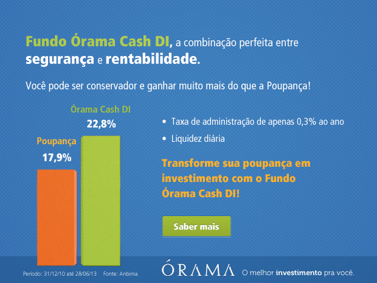

# **R**eserva financeira: o direito de chutar o balde

Eu tenho um palpite de que, se eu fosse amigo do Neymar e o convidasse para jogar uma pelada em um campinho qualquer, ele jogaria de maneira ainda mais impressionante do que joga no Barcelona ou na seleção brasileira**.**

Seria arte pura**.**

Paradoxalmente, a não obrigação de chutar a bola na gaveta, aliada a um pouco de despretensão, faria com que as chances de que ele acerte a bola lá fossem muito maiores**.** Ele jogaria solto, ousado, sem pensar em quais seriam os comentários gerados por sua atuação**.** O futebol agradeceria.

O medo de agir de maneira mais livre e despreocupada priva o mundo de uma parte fantástica de cada um de nós, nos mais diferentes setores da vida**.** É o cara recatado que não consegue tirar a mulher do eixo, ou o funcionário quadrado que deixa de fazer o que acredita ser o melhor para a empresa ou para seu time**.**

Duas esferas, estreitamente ligadas, são especialmente afetadas por essa pressão: a financeira e a profissional**.**

### O salário pode ser um fardo

É bem comum virarmos escravos do salário**.** Nos acostumamos com o valor que pinga em nossa conta bancária todo mês**.** Enxergarmos a empresa em que trabalhamos (ou a empresa que possuímos) como a responsável por nossa sobrevivência**.**

[*Link Vimeo*](http://vimeo.com/opusbou/el-empleo-the-employment) 

Nos reservamos o direito de trabalhar quietos, sem palpitar, sem ousar, sem tentar enfiar a bola na gaveta porque temos a crença (muitas vezes correta) de que, se errarmos o chute, ficaremos desempregados**.** Falidos. Perdemos a chance de propor algo inovador, evitamos bater de frente com o chefe, contemos o questionamento**.** Muitas vezes, inclusive, deixamos de assumir a postura que a situação pede**.**

Seria fantástico ir para o trabalho da mesma maneira que um jogador de futebol vai jogar bola com os amigos no final de semana: livre de tantas expectativas**.** Nosso capitalismo selvagem, porém, nos impõe um pré-requisito bastante crítico para seguir vivendo bem: dinheiro**.**

### A primeira reserva, na prática

Na série de textos sobre planejamento financeiro, [começamos do zero](http://papodehomem.com.br/planejamento-financeiro-um-comeco-para-quem-nao-sabe-por-onde-comecar/) , [seguimos](http://papodehomem.com.br/planejamento-financeiro-o-que-todo-mundo-sabe-ou-pensa-que-sabe/)  e abordamos [pontos bem capciosos](http://papodehomem.com.br/o-dinheiro-como-um-metodo-sutil-e-carinhoso-de-dominacao/) , mas ainda não abrimos espaço para falar de como montar uma reserva que possibilite se mover com mais facilidade**.**

Falamos também sobre realizar, mensalmente, [uma transferência para a poupança](http://papodehomem.com.br/2-acoes-matadoras-para-melhorar-sua-vida-financeira/)  ou para algum fundo de confiança**.** É o começo**.** A partir dessas transferências, formaremos a primeira reserva**.**

Depois de agendar a transferência, pode acontecer de perdermos a clareza do porquê estamos acumulando dinheiro**.** Cair num fetiche numérico sem propósito pode ser tão ruim quanto torrar rios de dinheiro sem pensar**.**

Vale à pena pensar em camadas**.** Para a primeira delas, **chamada reserva de emergência**, o valor equivalente a um salário é o suficiente**.**

Aqui, o foco não é rentabilidade**.** Precisamos colocar esse dinheiro em um local estável, que oscile pouco e, principalmente, que tenha liquidez**.** Tem uma série de definições técnicas e rebuscadas para liquidez, mas ainda não ouvi nenhuma melhor do que essa:

> Liquidez é a capacidade de transformar o investimento em comida**.**

Se estivermos com fome e precisarmos comprar comida, ser dono de uma casa não vai resolver muita coisa**.** O tempo que vamos demorar para transformar a casa em dinheiro (e, consequentemente, em comida) é grande demais**.** A liquidez de um investimento imobiliário é muito baixa**.**

Se o dinheiro estiver na poupança, com alguns cliques (ou com uma ida ao banco), resolvemos**.** A poupança tem liquidez altíssima. Em minutos, o dinheiro já está no nosso bolso**.**

Não vai dar pra pedir sanduíche e pagar com a casa

Pode ser bem tentador utilizar a reserva de emergência para alguma compra ou viagem**.** É reflexo da nossa mente que julga estar no controle de tudo, que acha que os imprevistos sempre acontecem com os outros, nunca com a gente**.**

Nas entrelinhas, ter a primeira reserva é respirar relaxado sabendo que os imprevistos vão acontecer e que, de um jeito ou de outro, vamos seguir**.**

Reserva de emergência montada. E ai?

Com ela bem cuidada, começamos a ganhar autonomia**.** Se as coisas derem errado, se perdermos o emprego, se um imprevisto acontecer, estamos cobertos por certo tempo, ganhamos fôlego para colocar a casa em ordem**.**

É natural que nossos sonhos e projetos cresçam e, com isso, surge a necessidade de traçarmos algumas metas de médio e longo prazo**.** A educação financeira chega a ficar chata, de tanto que bate na [questão dos juros compostos](http://dinheirama.com/blog/2008/05/12/entendendo-a-matematica-dos-juros-compostos/) **.** Mas, acredite, eles fazem a diferença**.**

Depois de uma primeira camada líquida, começamos a pensar em camadas mais rentáveis**.**

Explicando a rentabilidade com o exemplo da poupança, se tivéssemos colocado R$ 10**.**000,00 na poupança em janeiro/2012 e retirado no final do mesmo mês, teríamos R$ 10**.**048,00, pois a rentabilidade da poupança foi de 0,48%**.** Para cada 10 reais colocados na poupança, recebemos cerca de 5 centavos por mês**.**

Considerando os mesmos R$ 10**.**000,00 por períodos maiores:

- Em 1 ano, teríamos R$ 10**.**540,00;
- Em 5 anos, R$ 13**.**260,00;
- Em 10 anos, R$ 17.679,00.

É bastante dinheiro, se pensarmos que estamos considerando a poupança um dos investimentos mais seguros que o mercado oferece**.** Não vamos entrar em especificações técnicas dos fundos e das possibilidades, mas buscando uma rentabilidade melhor, de 0**.**65%  ao mês, o que é possível alcançar facilmente através de um fundo conservador, os números listados acima ficam mais interessantes ainda:

- Em 1 ano, teríamos R$ 10**.**738,00;
- Em 5 anos, R$ 14.655,00;
- Em 10 anos, R$ 21.619,00**.**

Isso tomando por base que não fizemos nenhum aporte extra**.** São só os R$ 10**.**000 iniciais.

Se após o planejamento percebemos que precisamos de R$ 3**.**500 reais por mês para viver, R$ 21.619,00 representam seis meses de vida**.** Seis meses para repensar a profissão, para respirar novos ares e fazer novas escolhas**.**

O Ernest Hemingway chutou o balde, foi pra Plaza del Castillo em 1959… beber

### Investimento não é coisa de milionário

É comum acharmos que investir é algo a ser feito por quem tem muito dinheiro**.** Não é. Diversas opções surgem, para começar com cada vez menos**.**

Deveria ser uma preocupação do nosso dia a dia**.** Muitas vezes entramos em um ciclo de preocupação e desgaste, focado em ganhar mais e mais dinheiro, em correr cada vez mais rápido, sendo que faria muito mais sentido parar e entender onde estamos e pra onde estamos indo**.**

É como se planejar o acúmulo de capital fosse um lembrete material de um percurso que estamos percorrendo, sonho por sonho, escolha por escolha**.**

Olhar lá na frente nos ajuda a compreender que esse percurso é maior**.**

Bem maior.

### Mecenas: [Órama](http://pdh.co/orama3)

*Na Órama você encontra o que nenhum outro lugar oferece: acesso com apenas R$ 5 mil aos melhores [Fundos de Investimento](http://pdh.co/orama1)  pra você**.***

*Custo zero para criação e manutenção de conta, [consultoria de investimentos](http://pdh.co/orama3)  personalizada, vídeos exclusivos, [eBooks educativos](http://pdh.co/orama2)  e ferramentas de simulação, análise e comparação são alguns dos benefícios que você só encontra na Órama**.***

*Faça uma escolha inteligente, [invista com a Órama](http://pdh.co/orama3) **!***
