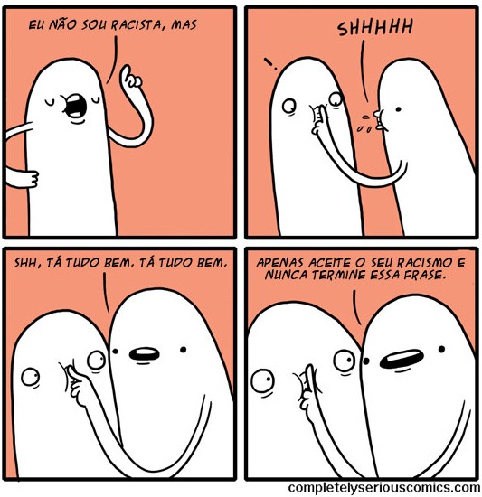
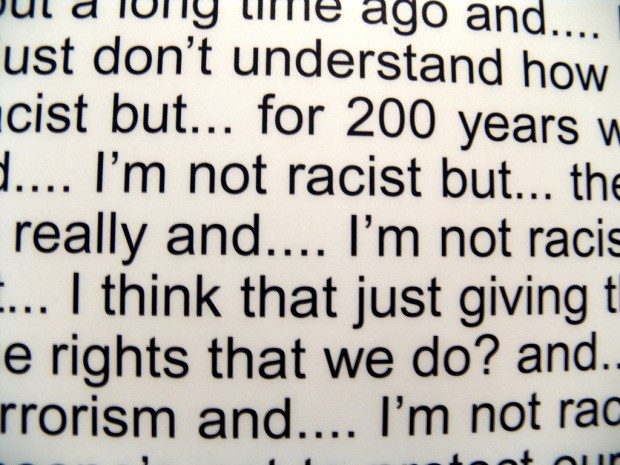

# **V**ocê é aquilo que diz não ser

Eu não te conheço**.** Mas você se conhece**.** Você quase sempre sabe quando está fazendo merda, falando besteira, se revelando**.** Basta ouvir a si mesmo**.**

> “Não sou racista, mas…”

Fique atento sempre que essa construção sair da sua boca**.** Eu não te conheço**.** Não sei se você é racista ou machista ou esquerdista**.** Mas você sabe**.**

[Você é o que você faz](http://alexcastro.com.br/voce-e-o-que-voce-faz/ "Você é o que você faz")  – não o que você pensa que é, o que você deseja ser, o que você diz que é**.**

Então, se você diz que não é machista mas, logo em seguida, faz um comentário machista – isso faz de você um machista**!** A expressão inicial “não sou machista mas…” além de NÃO servir como antídoto ou contraponto para o comentário invariavelmente machista que vem depois, ao contrário serve apenas para chamar atenção para ele**.** Machista é quem faz comentários machistas – independente da pessoa dizer ou não que é machista, de se achar ou não machista**.**

Exemplos:

> “Não sou comilão, mas vou comer um segundo prato só porque não comi nada hoje**.**”

(Você faz o comentário justamente porque sabe que vai se comportar como um comilão e pegar um segundo prato – o que, naturalmente, faz de você um comilão**.**)

> “Não sou direitista mas que aborto é assassinato, isso é**.**” Ou, ou: “Não sou de esquerda, mas acho que Fidel Castro fez bem em nacionalizar a economia**.**”

(O que faz de você um esquerdista ou um direitista são justamente suas opiniões esquerdistas ou direitistas**.** Se você diz que não é, é porque JÁ sabe que suas opiniões vão ser percebidas assim – e vão ser percebidas assim PORQUE SÃO ASSIM**.**)

> “Não sou pedante, mas essa banda parece coisa de porteiro com gumex no cabelo**.**”

(Está ficando claro**?**)

> “Não sou crítico literário, mas achei esse livro muito fraco**.**”

(Aqui, a pessoa diz que não é crítica literária porque está prestes a fazer algo que ela ACHA que é o que fazem os críticos literários, ou seja, julgar o livro**.** Naturalmente, não é isso, mas o exemplo se mantém: a gente sempre diz que não é aquilo que achamos ou tememos ser**.**)

Fiquem atentos ao que as pessoas dizem que não são**.** Especialmente se a pessoa for você.

Descobri coisas vergonhosas sobre mim mesmo quando passei a reparar quais coisas eu dizia que não era**.**

E, só assim, pude começar a mudar.

Regra de gramática para a vida: falar “mas” zera a oração anterior**.**
