# **W**hat is the best programming font?

sharetweet

## Viewpoints

158vote

## Source Code Pro

An open source programming font released by Adobe, made with the intent of maximizing usability and avoiding common design flaws in monospaced fonts**.** Available on Google Web Fonts.

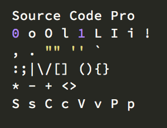

[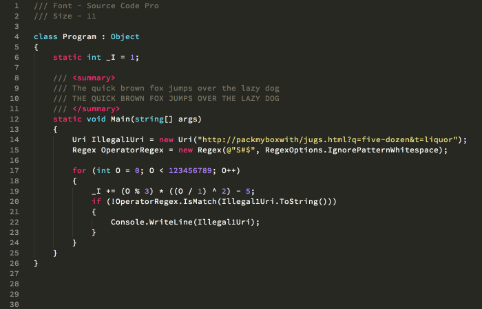](http://i.imgur.com/0U3hv1r.png)

(Click the image for a bigger image and [here](http://i.imgur.com/cipoQbe.png)  for a massive image)

[Github (Downloads and install instructions)](https://github.com/adobe/source-code-pro)

[Announcement blog post (Screenshot)](http://blogs.adobe.com/typblography/2012/09/source-code-pro.html)

[Wikipedia](http://en.wikipedia.org/wiki/Source_Code_Pro)

The font lacks italics**.**

[Edit](http://www.slant.co/topics/67/viewpoints/5/pending) [17 Comments](http://www.slant.co/topics/67/viewpoints/5/comments) [Add Another Reason](http://www.slant.co/topics/67/viewpoints/5/sections/create) 156vote

## Consolas

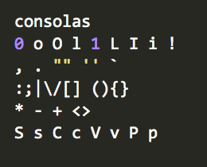

[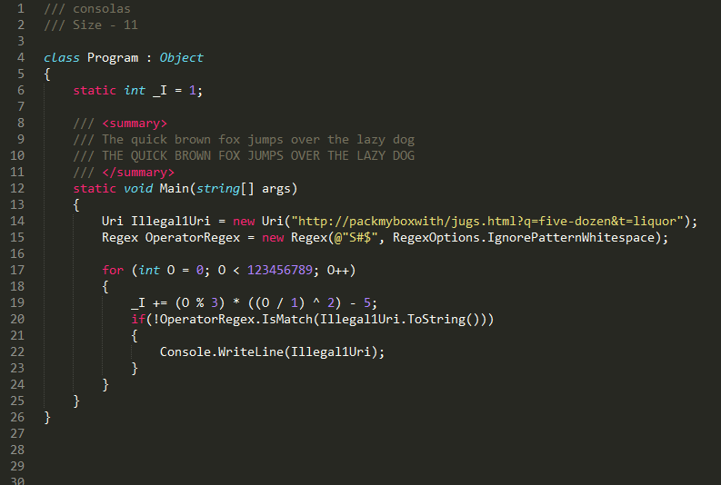](http://i.imgur.com/5n2WUSj.png)

(Click the image for a bigger image and [here](http://i.imgur.com/SdigGGD.png)  for a massive image)

Comes with Windows**.** [Download for mac](http://www.wezm.net/technical/2010/08/howto-install-consolas-font-mac/)

Consolas is specifically designed to work with ClearType, so may become highly aliased when ClearType is not turned on**.**

[Edit](http://www.slant.co/topics/67/viewpoints/11/pending) [3 Comments](http://www.slant.co/topics/67/viewpoints/11/comments) [Add Another Reason](http://www.slant.co/topics/67/viewpoints/11/sections/create) 78vote

## Monaco

Monaco rocks**!**
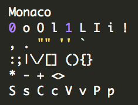
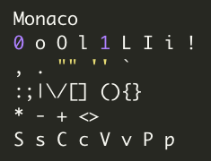

[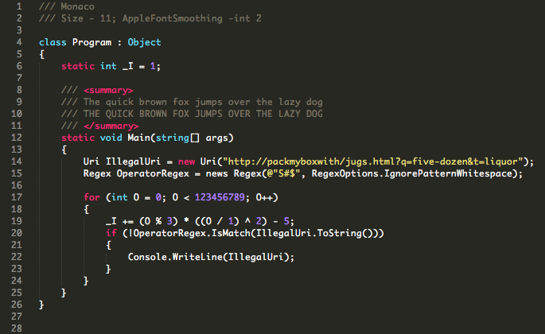](http://i.imgur.com/2bXD8WC.png)

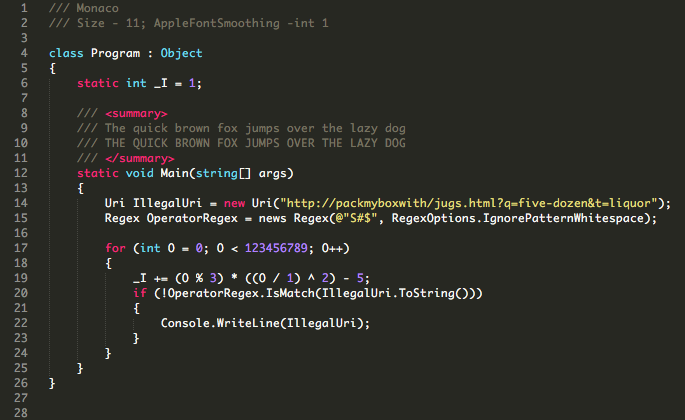

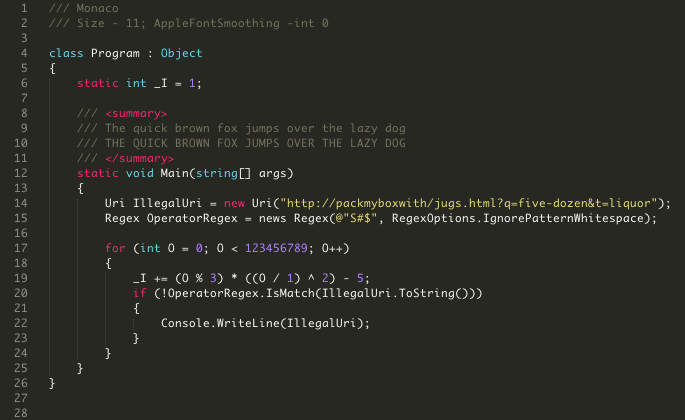

[Edit](http://www.slant.co/topics/67/viewpoints/18/pending) [3 Comments](http://www.slant.co/topics/67/viewpoints/18/comments) [Add Another Reason](http://www.slant.co/topics/67/viewpoints/18/sections/create) 75vote

## Inconsolata-g

Inconsolata-g is a variant of the popular Inconsolata that fixes the similarity between"1" [one] and the "l" [lower-case ell]**.**

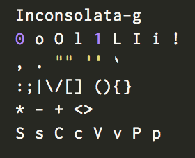

[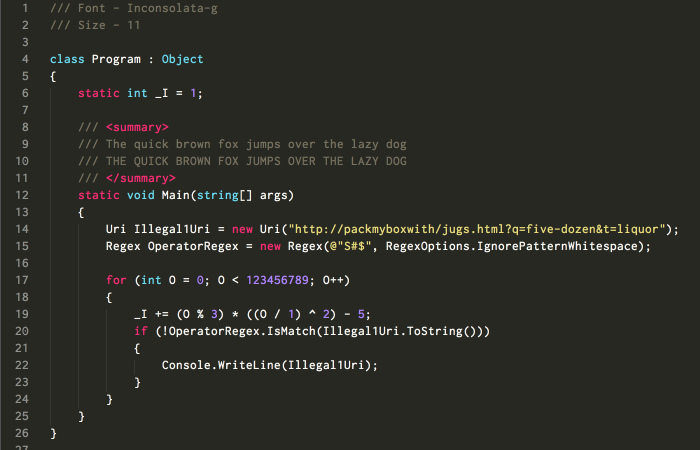](http://i.imgur.com/unh9jra.png)

(Click the image for a bigger image and [here](http://i.imgur.com/fuCvOgG.png)  for a massive image)

And compared to Inconsolata:

[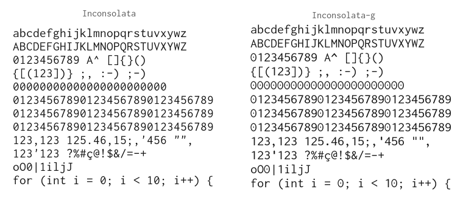](http://i.imgur.com/W70yB1C.png)

You can download it [here](http://leonardo-m.livejournal.com/77079.html) **.**

[Edit](http://www.slant.co/topics/67/viewpoints/6/pending) [2 Comments](http://www.slant.co/topics/67/viewpoints/6/comments) [Add Another Reason](http://www.slant.co/topics/67/viewpoints/6/sections/create) 70vote

## Ubuntu Mono

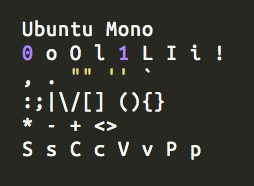

From Reddit user [chrisdoner](http://www.reddit.com/r/programming/comments/17k16a/list_of_the_best_fonts_for_programming_with/c86ales) :

> Particularly advantageous apart from its aesthetic rounded/smooth appeal is that it somehow scales to tiny sizes while retaining legibility and under subpixel rendering**.**

[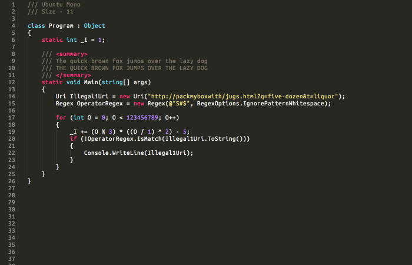](http://i.imgur.com/Pu4FHi4.png)

(Click the image for a bigger version )

[Download](http://font.ubuntu.com/)

[Edit](http://www.slant.co/topics/67/viewpoints/7/pending)  [Comments](http://www.slant.co/topics/67/viewpoints/7/comments) [Add Another Reason](http://www.slant.co/topics/67/viewpoints/7/sections/create) 43vote

## List of Fonts

> Anonymous Pro (2009) is a family of four fixed-width fonts designed especially with coding in mind**.**

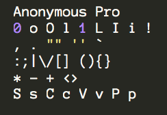

Characters that could be mistaken for one another (O, 0, I, l, 1, etc**.**) have distinct shapes to make them easier to tell apart in the context of source code**.**

[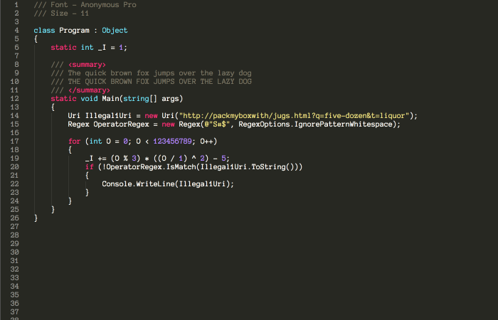](http://i.imgur.com/oI98h93.png)

(Click the image for a bigger image and [here](http://i.imgur.com/26MuFOL.png)  for a massive image)
> While Anonymous Pro looks great on Macs, Windows and Linux PCs with antialiasing enabled, it also includes embedded bitmaps for specific pixel sizes (“ppems” in font nerd speak) for both the regular and bold weight**.**

[Source](http://www.ms-studio.com/FontSales/anonymouspro.html)

[Edit](http://www.slant.co/topics/67/viewpoints/1/pending) [2 Comments](http://www.slant.co/topics/67/viewpoints/1/comments) [Add Another Reason](http://www.slant.co/topics/67/viewpoints/1/sections/create) 43vote

## DejaVu Sans Mono

This nice [open source font family](http://dejavu-fonts.org/)  is derived from the Bitstream Vera family, itself close to the Microsoft core Web fonts (see Andale Mono)**.**

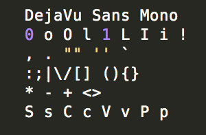

The Sans Mono version is graphically close of Andale Mono, slightly bolder, with the added bonus of the bold font being of same width than the normal one (unlike Andale Mono)**.** It is a nice property with some syntax highlighting text editors**.**

[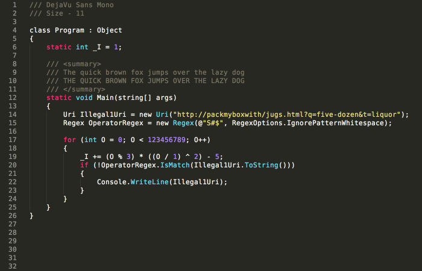](http://i.imgur.com/BnaA4NP.png)

(Click the image for a bigger image and [here](http://i.imgur.com/SGatzOZ.png)  for a massive image)[Edit](http://www.slant.co/topics/67/viewpoints/4/pending)  [Comments](http://www.slant.co/topics/67/viewpoints/4/comments) 

## Why People Chose DejaVu Sans Mono

37vote

## Menlo

Menlo is a monospaced sans-serif typeface designed by Jim Lyles**.** The face first shipped with OS X Snow Leopard. Menlo is based upon the Open Source font Bitstream Vera and the public domain font Deja Vu**.**

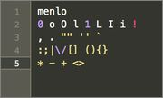

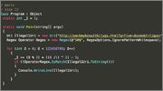

[More details and download**.**](http://9-bits.com/post/123940811/menlo-font-macosx) [Edit](http://www.slant.co/topics/67/viewpoints/23/pending)  [Comments](http://www.slant.co/topics/67/viewpoints/23/comments) [Add Another Reason](http://www.slant.co/topics/67/viewpoints/23/sections/create) 36vote

## Envy Code R

This font offers well distinct programming characters like {} vs**.** () and the classically confusing 0O and 1lI.
Quite narrow (like Anonymous Pro) but squarish, the letters are easy to read and offer a pleasing reading experience**.**

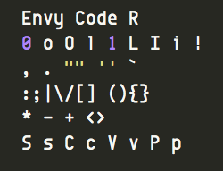

The bold version has the same width than the normal version, which is useful for syntax highlighting**.**

[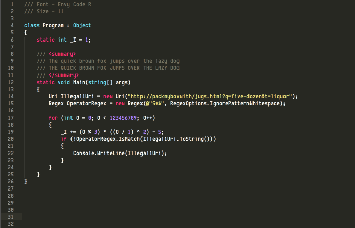](http://i.imgur.com/t62Nte9.png)

(Click the image for a bigger image and [here](http://i.imgur.com/Hck0odR.png)  for a massive image)

Envy Code R also fits more into a given width when compared to Source Code Pro**.** You can download it [here](http://damieng.com/blog/2008/05/26/envy-code-r-preview-7-coding-font-released)

[Edit](http://www.slant.co/topics/67/viewpoints/3/pending)  [Comments](http://www.slant.co/topics/67/viewpoints/3/comments) [Add Another Reason](http://www.slant.co/topics/67/viewpoints/3/sections/create) 35vote

## Droid Sans Mono

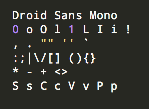

[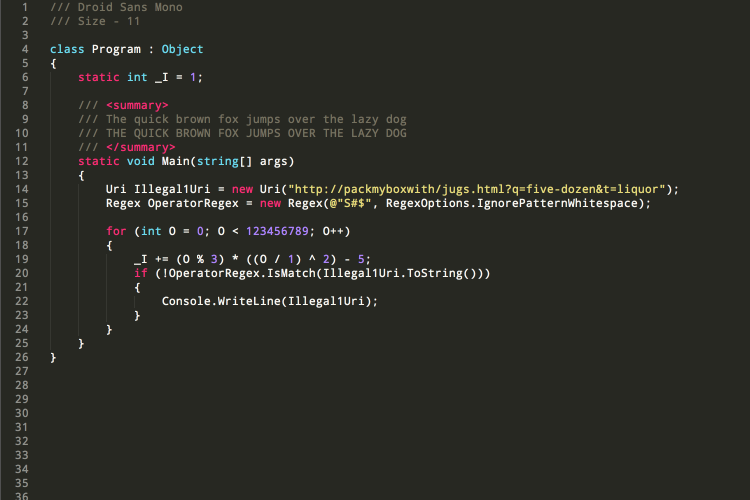](http://i.imgur.com/PVFSudT.png)

(Click the image for a bigger image and [here](http://i.imgur.com/RgXFGZH.png)  for a massive image)

[Download & more info](http://damieng.com/blog/2007/11/14/droid-sans-mono-great-coding-font)

There are also versions with [slashed](http://blog.cosmix.org/2009/10/27/a-slashed-zero-droid-sans-mono/)  or [dotted](http://blog.cosmix.org/2009/01/25/a-dotted-zero-droid-sans-mono/)  zeroes, to fit your preference**.**

[Edit](http://www.slant.co/topics/67/viewpoints/12/pending) [3 Comments](http://www.slant.co/topics/67/viewpoints/12/comments) [Add Another Reason](http://www.slant.co/topics/67/viewpoints/12/sections/create) 28vote

## Pragmata Pro

A very narrow, highly legible programming font**.** Noteworthy for having quite a bit of Unicode implemented, including the APL codepoints**.**

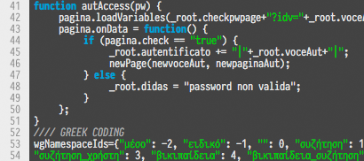

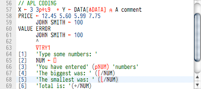

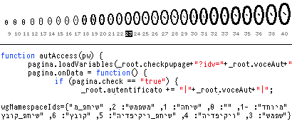

[http://www.fsd**.**it/fonts/pragmatapro.htm#.US2yeBmGYS8](http://www.fsd.it/fonts/pragmatapro.htm#.US2yeBmGYS8)

[Edit](http://www.slant.co/topics/67/viewpoints/17/pending)  [Comments](http://www.slant.co/topics/67/viewpoints/17/comments) [Add Another Reason](http://www.slant.co/topics/67/viewpoints/17/sections/create) 26vote

## Liberation Mono

Liberation Mono is styled closer to Liberation Sans than Monotype's Courier New, though its metrics match with Courier New**.** The Liberation fonts are intended as free, open-source replacements of the aforementioned closed source fonts**.**

Although similar to the popular Deja Vu monospace font, Liberation Mono takes up much less vertical space, allowing more lines code on the screen at once**.**

A notable quote from a commenter:

> This font is absolutely fantastic**.** It doesn't have as much personality as, say, Inconsolata or Consolas, but what it lacks in personality it makes up for in readability**.** It is also very similar as the font Cousine, available on Google Fonts, but supports a wider set of characters**.** My favorite features of this font are the dotted zero, perfect symbols, flush underscore, and overall transparent design**.** I've been using it for more than a year and highly recommend it to any programmer**.**

Deja Vu 12pt: [http://imageshack**.**us/a/img543/9845/dejavu12.png](http://imageshack.us/a/img543/9845/dejavu12.png)

Liberation Mono 13pt: [http://imageshack**.**us/a/img43/691/liberation13.png](http://imageshack.us/a/img43/691/liberation13.png)

Download Link: <https://fedorahosted.org/liberation-fonts/>

Wikipedia: <http://en.wikipedia.org/wiki/Liberation_fonts>

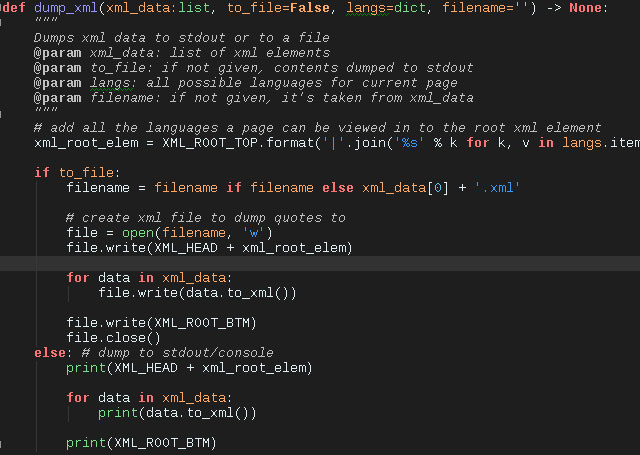

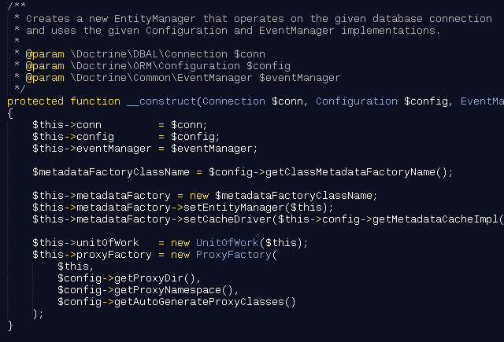

[Edit](http://www.slant.co/topics/67/viewpoints/26/pending) [3 Comments](http://www.slant.co/topics/67/viewpoints/26/comments) [Add Another Reason](http://www.slant.co/topics/67/viewpoints/26/sections/create) 25vote

## Monofur

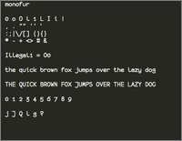

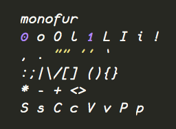

[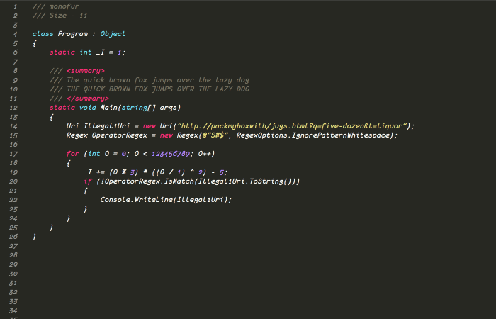](http://i.imgur.com/a5z84f8.png)

(Click the image for a bigger image and [here](http://i.imgur.com/Xzy1ULu.png)  for a massive image)

[Download](http://www.dafont.com/monofur.font)

[Edit](http://www.slant.co/topics/67/viewpoints/9/pending) [2 Comments](http://www.slant.co/topics/67/viewpoints/9/comments) [Add Another Reason](http://www.slant.co/topics/67/viewpoints/9/sections/create) 25vote

## Terminus

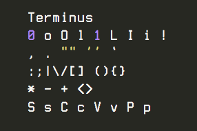

[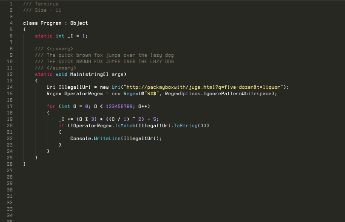](http://i.imgur.com/4NhZ3h2.png)

(Click the image for a bigger image and [here](http://i.imgur.com/ajWyhzB.png)  for a massive image)

Note: The small size of this font makes it hard to compare at 11pt, please leave a comment if you think I should up the size for the screenshots**.**

[Download](http://terminus-font.sourceforge.net/)

[Edit](http://www.slant.co/topics/67/viewpoints/16/pending) [7 Comments](http://www.slant.co/topics/67/viewpoints/16/comments) [Add Another Reason](http://www.slant.co/topics/67/viewpoints/16/sections/create) 21vote

## Andale Mono

Was offered by Microsoft as their core Web fonts, and freely redistributable, MS no longer offer it on their site, but [other places](http://web.nickshanks.com/fonts/microsoft-core-web-fonts)  make them available**.**

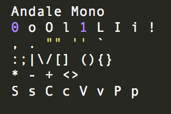

[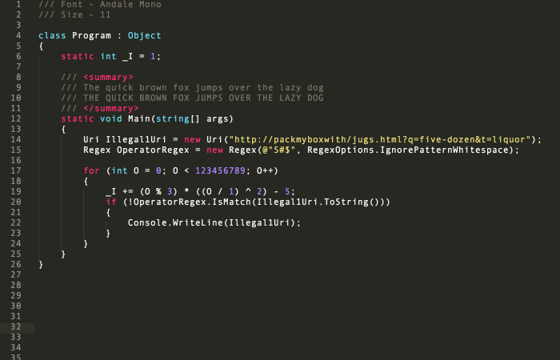](http://i.imgur.com/IJFA16Z.png)

(Click the image for a bigger image and [here](http://i.imgur.com/8uPQ3o9.png)  for a massive image)

This fixed-width font is nicely designed, and took care of distinguishing some easily confused characters like 0O or 1lI**.**

[Edit](http://www.slant.co/topics/67/viewpoints/2/pending)  [Comments](http://www.slant.co/topics/67/viewpoints/2/comments) [Add Another Reason](http://www.slant.co/topics/67/viewpoints/2/sections/create) 18vote

## Meslo LG

Meslo LG is a customized version of Apple’s Menlo-Regular font**.** Screenshots are from the M variant.

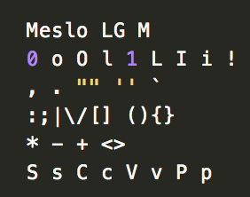

[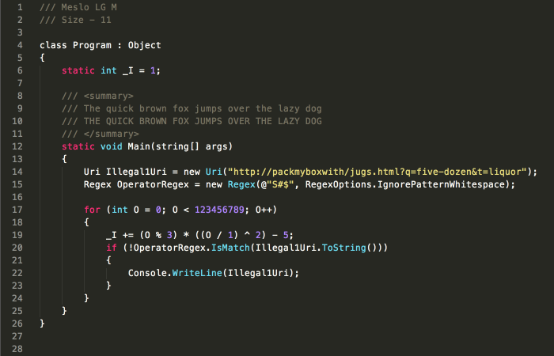](http://i.imgur.com/9XzlhVP.png)

(Click the image for a bigger image and [here](http://i.imgur.com/REoYmvQ.png)  for a massive image)

[Download](https://github.com/andreberg/Meslo-Font)

[Edit](http://www.slant.co/topics/67/viewpoints/15/pending)  [Comments](http://www.slant.co/topics/67/viewpoints/15/comments) [Add Another Reason](http://www.slant.co/topics/67/viewpoints/15/sections/create) 16vote

Dina is a monospace bitmap font, primarily aimed at programmers**.** It is relatively compact to allow a lot of code on screen, while (hopefully) clear enough to remain readable even at high resolutions**.**

In designing a programming font the following guidelines were followed:

- Needs to be monospaced
- It has to be easy to see the difference between i, l, 1, I
- It has to be easy to see the difference between o, O, 0
- The symbols used in programming languages have to look 'right'
- Braces should line up nicely
- Still has to be pleasant to read passages of text

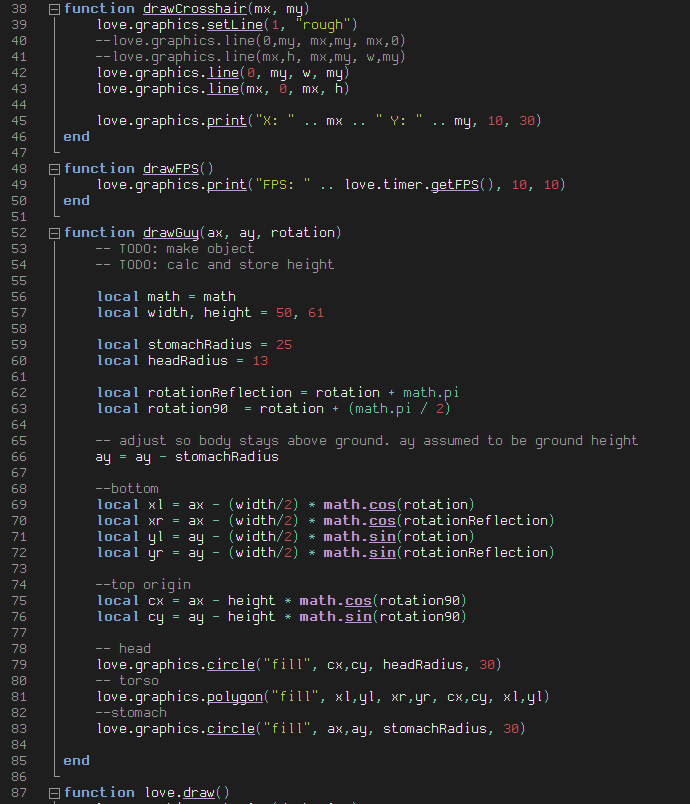

Download link: <http://www.donationcoder.com/Software/Jibz/Dina/>

[Edit](http://www.slant.co/topics/67/viewpoints/27/pending)  [Comments](http://www.slant.co/topics/67/viewpoints/27/comments) [Add Another Reason](http://www.slant.co/topics/67/viewpoints/27/sections/create) 16vote

## Lucida Console

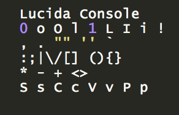

Mono-Space - Curlies, square brackets, comas, and periods are distinguishable even at 8 pt font, and comes with every windows box**.**

One of the original monospaced fonts available for X11R6**.**

[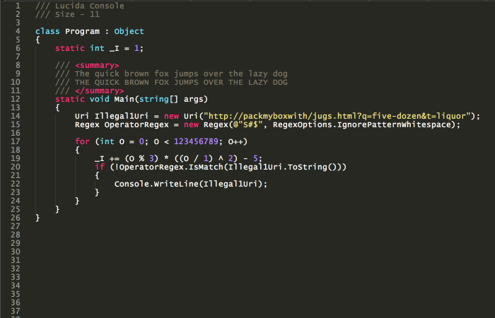](http://i.imgur.com/xX1mVct.png)

(Click the image for a bigger image and [here](http://i.imgur.com/Gq2QdlY.png)  for a massive image)

[Download](http://www.fontpalace.com/font-download/Lucida+Console/)

[Edit](http://www.slant.co/topics/67/viewpoints/13/pending)  [Comments](http://www.slant.co/topics/67/viewpoints/13/comments) [Add Another Reason](http://www.slant.co/topics/67/viewpoints/13/sections/create) 16vote

## Proggy Clean

[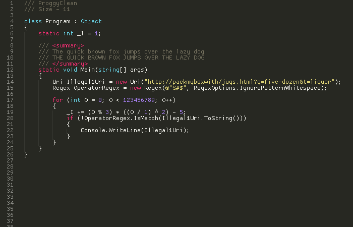](http://i.imgur.com/AFMgs16.png)

(Click the image for a bigger image and [here](http://i.imgur.com/AVfUeN3.png)  for a massive image)

[Download](http://www.proggyfonts.com/index.php?menu=download)

[Edit](http://www.slant.co/topics/67/viewpoints/8/pending)  [Comments](http://www.slant.co/topics/67/viewpoints/8/comments) [Add Another Reason](http://www.slant.co/topics/67/viewpoints/8/sections/create) 15vote

M+ M emphasize the balance of natural letterform and high legibility**.** while M+ MN is aimed at a new distinctive design for a terminal font specialized to programming**.**

The M+ fonts actually [have two](http://mplus-fonts.sourceforge.jp/mplus-outline-fonts/design/index-en.html#mono) different monospace forms in five weights each and both are very nice for programming**.** One of the major advantages for both is that the light and thin weights do a good job of compensating for OS X's overly-heavy rendering of light text on dark backgrounds**.**

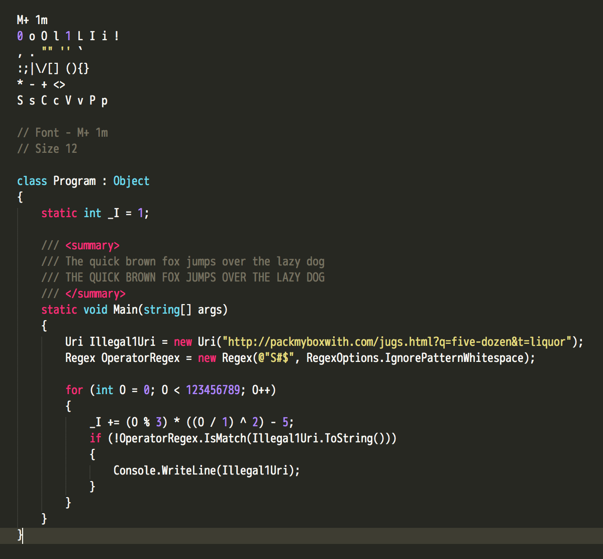

[Edit](http://www.slant.co/topics/67/viewpoints/31/pending) [5 Comments](http://www.slant.co/topics/67/viewpoints/31/comments) [Add Another Reason](http://www.slant.co/topics/67/viewpoints/31/sections/create) 14vote

## PT Mono

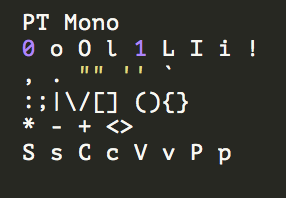

[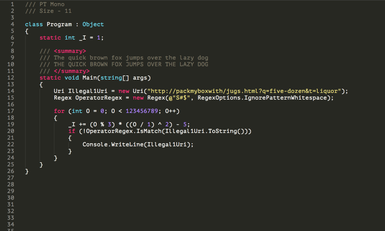](http://i.imgur.com/9DvfmMV.png)

(Click the image for a bigger image and [here](http://i.imgur.com/sM7mxML.png)  for a massive image)

[Download](http://www.google.com/webfonts/specimen/PT+Mono)

[Edit](http://www.slant.co/topics/67/viewpoints/10/pending)  [Comments](http://www.slant.co/topics/67/viewpoints/10/comments) [Add Another Reason](http://www.slant.co/topics/67/viewpoints/10/sections/create) 13vote

## Segoe UI Mono

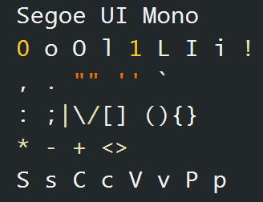

[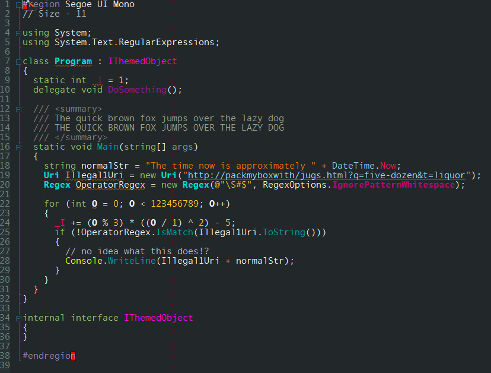](http://i.imgur.com/PFCveEZ.png)

(Click the image for a bigger image and [here](http://i.imgur.com/gbzrwZm.png)  for a massive image)

Comes with Windows**.** Need some magic to make it work with Mac (need to have Office installed, otherwise must use @font-face) - see this [StackOverflow](http://stackoverflow.com/questions/14437881/will-segoe-ui-work-on-mac)  for more**.**

[Edit](http://www.slant.co/topics/67/viewpoints/20/pending)  [Comments](http://www.slant.co/topics/67/viewpoints/20/comments) [Add Another Reason](http://www.slant.co/topics/67/viewpoints/20/sections/create) 12vote

## TheSans Mono

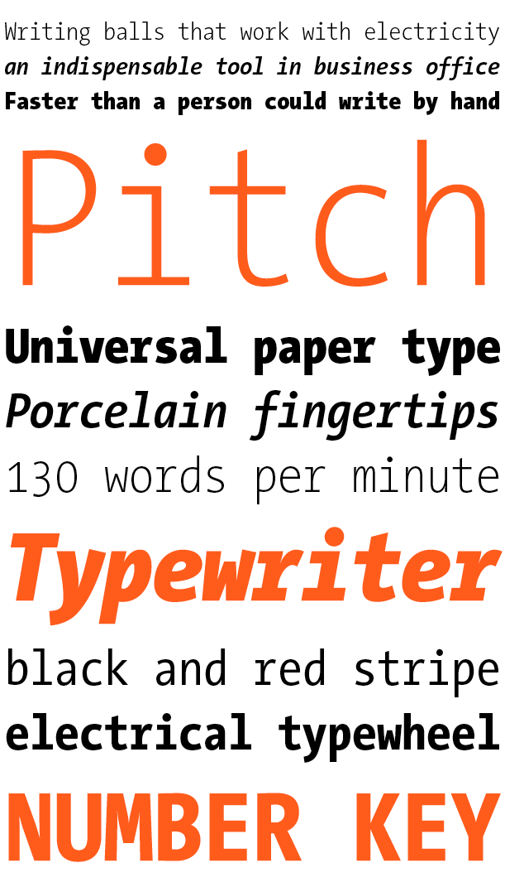

TheSans Monospace has been derived from TheSans, the sans serif part of Luc(as)'s Thesis family**.** This new variation started as a kind turn to Thomas Merz, probably the most expertised PostScript programmer in the world**.** In his book "The PostScript and PDF Bible" TheMono is being used for all PostScript code**.** The idea is simple, give all characters equal widths**.** However, it turned out to be a very interesting and time consuming job**.** It took another 9 months to grow to its final state**.**

The MonoSpace appears to function very well for correspondence**.** A written letter in ThesisMono immediately has a personal communicative touch, and doesn't look like a detouched "print type"**.**

A considerable amount of time has been invested in achieving an optimal screen display**.** For often used sizes (9, 10, 11, 12 and 14 point) the bitmaps have been hand-pixeled**.** (These work on mac only.) Because of extensive hand editing of hint-instructions, TheSans Mono is optimally readable in other sizes as well as on PCs with Adobe Type Manager**.** A delta hinted TrueType package for the office environment is on its way**.**

TheSans Mono is used by O'Reilly for printing code in most of its tech publications**.**

[Edit](http://www.slant.co/topics/67/viewpoints/30/pending) [1 Comments](http://www.slant.co/topics/67/viewpoints/30/comments) [Add Another Reason](http://www.slant.co/topics/67/viewpoints/30/sections/create) 12vote

## GohuFont

[Gohu](http://font.gohu.org/) 
Gohufont is a monospace bitmap font well suited for programming and terminal use**.**

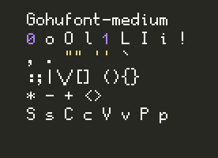

It is intended to be very legible and offers very discernable glyphs for all characters, including signs and symbols**.** Here is what it looks like

[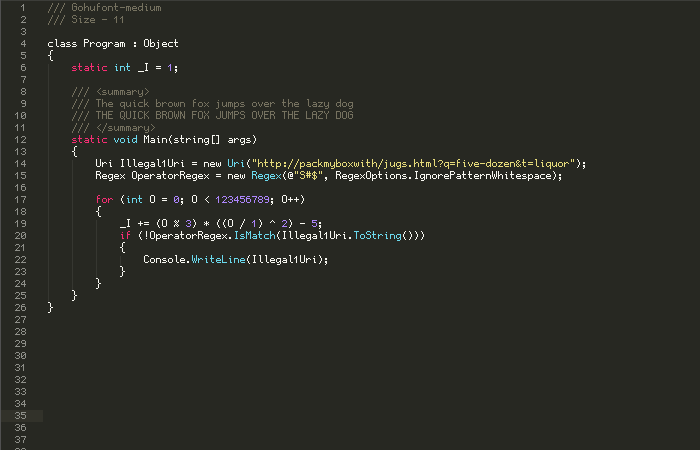](http://i.imgur.com/ognnQqg.png)

(Click the image for a bigger image and [here](http://i.imgur.com/z4UDoxW.png)  for a massive image)

[download](http://font.gohu.org/)

[Edit](http://www.slant.co/topics/67/viewpoints/14/pending) [1 Comments](http://www.slant.co/topics/67/viewpoints/14/comments) [Add Another Reason](http://www.slant.co/topics/67/viewpoints/14/sections/create) 11vote

## Latin Modern Mono

A set of free fonts based on *Computer Modern*, the default font for TeX**.** One of the main extensions is the addition of an extensive set of diacritical characters, covering many scripts based on the Latin character set, mainly european**.**

Available as Type 1 PostScript or OpenType, you can get them from the official Ubuntu repositories as `lmodern`**.**

There are also small-caps, condensed, and proportional variants**.**

[Download from FontSquirrel](http://www.fontsquirrel.com/fonts/Latin-Modern-Mono)

[Edit](http://www.slant.co/topics/67/viewpoints/32/pending)  [Comments](http://www.slant.co/topics/67/viewpoints/32/comments) [Add Another Reason](http://www.slant.co/topics/67/viewpoints/32/sections/create) 10vote

## 6x13 fixed

`6x13` is the classic *fixed* monospace bitmap font that is expected to be available on every *X* server**.** It is part of the *misc-fixed* family**.** These fonts were handcrafted for readability in a terminal**.**

Why bitmap fonts**?** At a small text size each character has a limited resolution**.** A character size of `6x13` pixels means only 78 pixels per character**.** Modern fonts are designed to be scalable, and are less legible at these small sizes**.** Using bitmap fonts increases legibility by eliminating scaling and sub-pixel aliasing artifacts**.** Some scalable fonts include "ppems" embedded bitmaps for this reason**.**

With a fixed `6x13` font, the number of characters in a terminal is easy to compute**.** Every character is `6x13` pixels, so a `1440x900` pixel display will render `240x69` characters**.** `6x13` is semi-condensed, meaning the characters are slightly thinner than usual so that more can be printed on a line**.**

The disadvantage of *misc-fixed* fonts is that they don't scale, which can cause problems with displays that vary wildly from traditional pixel density**.** Although `6x13` is the traditional fixed font, there are numerous other sizes ranging from `5x7` to `10x20`**.**

[Wikipedia](http://en.wikipedia.org/wiki/Fixed_%28typeface%29)

[How to enable fixed fonts in Ubuntu](http://ptspts.blogspot.co.uk/2010/06/how-to-enable-bitmap-fonts-on-ubuntu.html)

[Edit](http://www.slant.co/topics/67/viewpoints/36/pending)  [Comments](http://www.slant.co/topics/67/viewpoints/36/comments) [Add Another Reason](http://www.slant.co/topics/67/viewpoints/36/sections/create) 10vote

## Espresso Mono

Espresso Mono is included in the [Espresso](http://macrabbit.com/espresso/)  text editor by MacRabbit**.** The metadata indicates it was designed by the DejaVu fonts team**.**

[Edit](http://www.slant.co/topics/67/viewpoints/35/pending) [1 Comments](http://www.slant.co/topics/67/viewpoints/35/comments) [Add Another Reason](http://www.slant.co/topics/67/viewpoints/35/sections/create) 10vote

## Panic Sans

Panic, Inc**.** which makes Coda, distributes what I find to be the best code font around: Panic Sans**.** It's close to Source Code Pro & Inconsolata having added uniqueness for easily confusing characters like 0 and O, l and 1, but it has better line spacing and italics**.**

[Edit](http://www.slant.co/topics/67/viewpoints/34/pending)  [Comments](http://www.slant.co/topics/67/viewpoints/34/comments) [Add Another Reason](http://www.slant.co/topics/67/viewpoints/34/sections/create) 10vote

## Anka/Coder

The Anka/Coder family is a monospaced, courier-width (60% of height; em size 2048x1229) font that contains characters from 437, 866, 1251, 1252 and some other code pages and can be used for source code, terminal windows etc**.**

There are 3 font sets (regular**.** italic, bold, bold-italic each): 1**.** Anka/Coder (em size 2048x1229) 2. Anka/Coder Condensed (condensed by 12**.**5%; em size 2048x1075) 3. Anka/Coder Narrow (condensed by 25%; em size 2048x922)

The last, "Anka/Coder Narrow" was developed for printing of source code; it is too tight for screen resolution**.** The middle, "Anka/Coder Condensed" can be used for both printing and screen viewing of source code, also as for displaying terminal windows**.** The first, full-width "Anka/Coder" simply supplements the family**.**

[Edit](http://www.slant.co/topics/67/viewpoints/33/pending)  [Comments](http://www.slant.co/topics/67/viewpoints/33/comments) [Add Another Reason](http://www.slant.co/topics/67/viewpoints/33/sections/create) 10vote

## Nanum Gothic Coding

I have no idea how this font appeared on my computer but it is beautiful**.**

You can get it from [this mysterious site](http://dev.naver.com/projects/nanumfont)  by clicking the link in the right side bar**.**

Anyone else trying to replicate the style of the images, I pastebined the text [here](http://pastebin.com/x5YA5VwS)  and [here](http://pastebin.com/AgRBNepm) **.** Hopefully there are no typos**.**

[Edit](http://www.slant.co/topics/67/viewpoints/24/pending) [1 Comments](http://www.slant.co/topics/67/viewpoints/24/comments) [Add Another Reason](http://www.slant.co/topics/67/viewpoints/24/sections/create) 9vote

## ProFont

ProFont is a small bitmap font which is absolutely great for programming**.** It was made for Macintosh computers, but now it's also available for Windows and Linux/UNIX X Windows**.**

[http://www.tobias-jung**.**de/seekingprofont/](http://www.tobias-jung.de/seekingprofont/)

[Edit](http://www.slant.co/topics/67/viewpoints/29/pending)  [Comments](http://www.slant.co/topics/67/viewpoints/29/comments) [Add Another Reason](http://www.slant.co/topics/67/viewpoints/29/sections/create) 9vote

## Cruft

Cruft is a variable-width font designed for programming**.** It was designed to ensure all characters are easily distinguishable and all punctuation is prominent enough to not be overlooked, while still being easier on the eyes than fixed-width fonts**.**

[Download Cruft and sister fonts](http://code.google.com/p/i3project/downloads/list)

[Edit](http://www.slant.co/topics/67/viewpoints/28/pending)  [Comments](http://www.slant.co/topics/67/viewpoints/28/comments) [Add Another Reason](http://www.slant.co/topics/67/viewpoints/28/sections/create) 9vote

## Print Char 21

[The Ultimate Apple II Font](http://www.kreativekorp.com/software/fonts/apple2.shtml)

[Download](http://www.kreativekorp.com/swdownload/fonts/retro/pr.zip)  the world's most complete Apple II text font, in TrueType format**.** Works on Mac OS X, Windows, or any operating system that supports TrueType**.**

[Edit](http://www.slant.co/topics/67/viewpoints/25/pending)  [Comments](http://www.slant.co/topics/67/viewpoints/25/comments) [Add Another Reason](http://www.slant.co/topics/67/viewpoints/25/sections/create) 2vote

## VGA Font

[This](http://www.inp.nsk.su/~bolkhov/files/fonts/univga/)  guy made the original VGA font with Unicode support**.**

Personally I converted it to TrueType and use it on Visual Studio with the classic blue background like old Turbo Pascal**.**

[Edit](http://www.slant.co/topics/67/viewpoints/41/pending) [1 Comments](http://www.slant.co/topics/67/viewpoints/41/comments) [Add Another Reason](http://www.slant.co/topics/67/viewpoints/41/sections/create) 2vote

## Envy Code B

[Edit](http://www.slant.co/topics/67/viewpoints/38/pending)  [Comments](http://www.slant.co/topics/67/viewpoints/38/comments) [Add Another Reason](http://www.slant.co/topics/67/viewpoints/38/sections/create) 1vote

## Raize

The Raize Font is a clean, crisp, fixed-pitched sans serif screen font that is much easier to read than the fixed pitched fonts that come with Windows**.** Ideally suited for programming, scripting, html writing, etc**.**, the Raize Font can be used in any IDE or text editor**.**

<http://www.raize.com/DevTools/Tools/RzFont.asp>

[Edit](http://www.slant.co/topics/67/viewpoints/44/pending)  [Comments](http://www.slant.co/topics/67/viewpoints/44/comments) [Add Another Reason](http://www.slant.co/topics/67/viewpoints/44/sections/create) 1vote

## Triskweline

Triskweline is a fixed-width font especially suited for text editors and programming environments**.** It was designed for maximum legibility and tidiness and supports all important symbols and Latin-1 characters**.**

[Edit](http://www.slant.co/topics/67/viewpoints/39/pending)  [Comments](http://www.slant.co/topics/67/viewpoints/39/comments) [Add Another Reason](http://www.slant.co/topics/67/viewpoints/39/sections/create) 0vote

## I prefer "OCR A Extended"

You can clearly tell the difference between those troublesome characters like apostrophes and quotes**.**

Each character is clearly (there's that word again) different from each other to make machine reading easier and works for humans as well**.**

[Edit](http://www.slant.co/topics/67/viewpoints/43/pending)  [Comments](http://www.slant.co/topics/67/viewpoints/43/comments) [Add Another Reason](http://www.slant.co/topics/67/viewpoints/43/sections/create) 

## Are We Missing Something**?**

Help make this question more complete**.**
