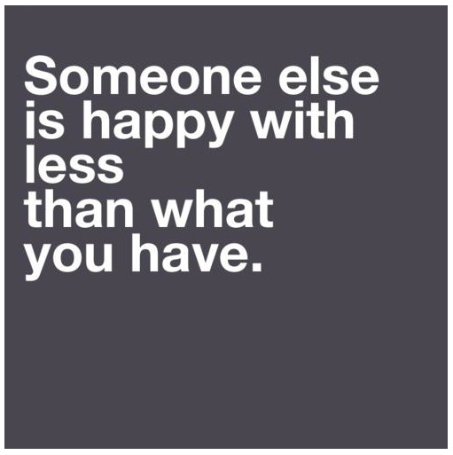

# **I**nspiração do dia: alguém com menos do que você

“Alguém está feliz com menos do que o que você tem**.**”

Só para inspirar nessa quarta-feira chuvosa**.**

### 15 comentários . [Comentar via blog](#respond)

September 4, 2013

Que incrível…

tou me sentindo tão perdida, sem rumo**.** Triste.

Tou passando por problemas no casamento (desentendimentos) “será que não devia ter esperado mais para casar**?** Será que foi um erro?”

Não estou trabalhando, só estudando para concurso, me angustia**.** Não tenho ânimo pra nada, mal estudo, mal cuido da casa**.** Na verdade, como não tou bem com meu marido não tenho vontade de fazer nada em casa**!**

Me forço pra lavar a louça, mas só tenho vontade de dormir**!**

Essa perspectiva do outro é muito boa, diz a psicologia…mas no momento só penso em como não estou feliz**!**

‘ [anexo ausente]  
Se sentindo sem rumo’

[Responder](http://vidaorganizada.com/bem-estar/inspiracao/inspiracao-do-dia-alguem-com-menos-do-que-voce/?utm_source=feedly&replytocom=52221#respond)

1. September 4, 2013

   Ju, estava passando por uma fase muito parecida com a sua**.** Até mesmo profissionalmente falando. Comecei a não ter energia pra nada, com um mega desânimo até pras coisas que eu costumava gostar**!** Cheguei a ficar preocupada, pois não reagia e já tive perdas e normes na vida, que sempre soube superar muito bem**.** Não entendia (e ainda não entendo) pq algumas épocas/situações nos derrubam tanto assim.. Sei que o que tem me tirado dessa é a atividade física**!** Tenta colocar um pouco disso nos seus dias.. Vai sem ânimo mesmo, mal-humorada, arrastada**.** Mas vai! Pelo menos meia hora**.** E me diz se sua energia não vai voltando aos poucos e te dar mais claridade mental pra repensar sua vida… e, às vezes não é hora de “só” estudar (sei que não é só, pq tbm estou nessa e fico mto mais cansada por estudar o dia todo, do que qdo estava trabalhando um monte), e talvez vc deva pensar em um emprego por uns 6 meses, um ano… mesmo ganhando pouco**!** Só pra aumentar um pouco sua auto-estima, sair, se arrumar, ver gente**!** ou se optar pelo estudo exclusivo, vá para uma biblioteca, ou um cursinho/faculdade que tenha infraestrutura.. vc vai se motivar vendo mta gente na mesma situação que a gente… conversa com um, com outro… vai ser bom**!** E qto ao casamento, é conversar e conversar e conversar… mas se ver que não dá, é não ter medo de mudar a rota da sua vida, sem se preocupar com a opinião dos outros.. às vezes Ju, é preciso ser um pouco egoísta e pensar só na gente, no que nos faz feliz**!** Vivi mto tempo tomando ferro e puxadas de tapete, pra aprender que não é errado gostar primeiro da gente**!** =)

   [Responder](http://vidaorganizada.com/bem-estar/inspiracao/inspiracao-do-dia-alguem-com-menos-do-que-voce/?utm_source=feedly&replytocom=52227#respond)
