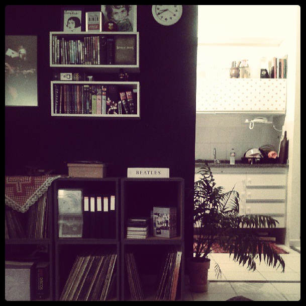

# **N**osso apartamento e decisões bem pensadas

Nós estamos passando por um período de muitas decisões aqui em casa, e uma delas é relacionada ao nosso apartamento**.** Moramos em um apartamento alugado aqui em Campinas porque não sabíamos exatamente como seriam as coisas – vamos ficar por aqui**?** Vamos voltar para São Paulo? Minha avó virá morar conosco**?** E todas essas indecisões estavam impactando nossos movimentos**.** Como o contrato do apartamento vence no meio do ano que vem, decidimos que não queremos sair daqui para ir para outro apartamento alugado, então vamos financiar um imóvel aqui em Campinas mesmo**.**

Essa decisão não foi fácil de tomar, especialmente porque não temos um valor grande para dar de entrada**.** De qualquer forma, decidimos duas coisas:

1. Estamos pagando muito caro no aluguel, assim como todo mundo que paga aluguel**.** Vale mais a pena pagar isso em algo que seja nosso, pelo menos;
2. Não vamos mais nos mudar para São Paulo – pelo menos não por enquanto**.**

Meu trabalho tem me deixado bem realizada e eu tenho diversas atividades paralelas que podem ser feitas estando onde estou ([Call Daniel](http://www.calldaniel.com.br)  e [Social Media SP](http://www.smsp.com.br) ) ou mesmo aqui em Campinas (aulas na pós-graduação de uma universidade daqui)**.** Além do que, meu marido vai começar a fazer faculdade de gastronomia ano que vem (aqui), o que vai durar pelo menos dois anos, e eu pretendo também começar a definir a linha de pesquisa que eu quero seguir em um mestrado, muito provavelmente em 2015**.**

Foto tirada do meu Instagram: /blogvidaorganizada

Vale lembrar também que estamos muito perto de São Paulo e podemos ir para lá sempre que quisermos**.** Depois que a minha mãe se mudou para outra cidade, isso me fez ver que a vontade que eu tive há dois anos de sair de São Paulo tem um motivo**.** Tudo bem, quem mora em Campinas sabe que a cidade tem mil defeitos e chega a ser mais poluída que São Paulo em alguns momentos do dia, mas não tem comparação em termos de qualidade de vida**.** Tem trânsito nos horários de pico, mas ainda assim chego em casa mais rápido do que chegaria se estivesse trabalhando e morando em São Paulo**.** Além do que, meu filho já está aprendendo a falar com o R puxado, o que eu acho uma gracinha**.** <3 (“porrrta”)

É claro que nossa decisão não foi baseada somente nesses fatores, mas em todos eles + aqueles citados lá em cima**.** Gostaria que a minha avó viesse morar comigo, mas ela não quer sair da casa dela (ela teria que vender a casa, fazer mudança etc, e não quer encarar isso nessa altura da vida)**.** É uma decisão dela e eu respeito. Além do que, ela está bem em São Paulo, morando junto com o meu tio e a família dele, então não me sinto tão mal**.** Se ela viesse morar comigo, seria mais difícil para os meus primos virem visitá-la que eu ir para lá de vez em quando**.** Portanto, ficamos assim**.**

Durante algum tempo, também considerei a possibilidade de morarmos em uma casa, mas meu marido é contra, pois viajamos e ficamos muito fora de casa**.** Concordei**.** Por isso, estamos procurando apartamentos. Estamos naquela fase de aprovar carta de crédito no banco, então prometo fazer alguns posts sobre todo esse processo quando terminá-lo**.** O que eu já posso adiantar é que é menos complicado do que eu imaginava e eu queria ter decidido fazer isso antes**.** Mas sabem como é – as decisões vêm quando tem que vir**.** Se não vieram antes, foi porque precisávamos ter aquela experiência para decidir corretamente depois**.**

A ideia não é sair correndo daqui, mesmo porque adoramos esse apartamento onde moramos**.** Queremos encontrar algo bacana, sem pressa. A única coisa que muda é que agora estamos pensando duas vezes cada vez que queremos mudar alguma coisa no apartamento, pois sabemos que não ficaremos aqui muito tempo mais**.** Nosso sofá, por exemplo, está uma tristeza, mas não vamos trocar enquanto não soubermos o tamanho da nossa nova sala**.**

Acho assim, morar de aluguel é divertido, pois você pode morar em um lugar que, se fosse comprar, estaria meio fora do seu alcance (pelo menos é o que acontece com a gente**!**). Também pode ser fundamental em um momento de transição, quando você não sabe para onde quer ir**.** Porém, a partir do momento que você decide, eu acho (eu, gente, EU acho, não a verdade universal) que vale a pena investir em um imóvel que seja só seu, especialmente pela segurança e pela liberdade que isso dá**.**

Também não penso muito na coisa da eternidade porque, se nós precisarmos nos mudar novamente para São Paulo, por exemplo, basta vender o apartamento ou colocá-lo para alugar enquanto formos para lá sem conseguir vendê-lo**.** O que não dá é para a gente tomar decisões fundamentais na vida com base no “e se”**.** Demorei mas aprendi isso.

Nós ainda temos alguns meses aqui e eu quero curtir o máximo possível meu primeiro apartamento**.** Ele não é de minha propriedade, mas é meu sim. Mãe é quem cuida.

Aos pouquinhos vou escrevendo mais sobre essa próxima aventura**.** Desejem-me sorte. =)

Foto tirada do meu Instagram: /blogvidaorganizada
