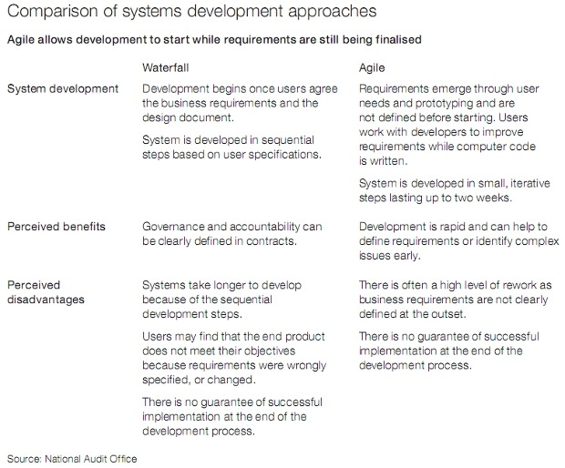

# **H**ow even agile development couldn't keep this mega-project on track

Summary: The scheme sold as the world's biggest agile software project, the UK's £2**.**4bn Universal Credit programme, has run into cost overruns and delays**.** So what went wrong?

By [Nick Heath](http://www.zdnet.com/meet-the-team/uk/nick-heath/)  | September 9, 2013 -- 15:39 GMT (08:39 PDT)

Touted as the world's biggest agile software project, the £2**.**4bn Universal Credit programme was supposed to showcase how the software methodology could be used on a grand scale**.**

But two years after the project — intended to create an IT system that would underpin a major reform the UK welfare system — got under way, crack began to show as it ran over time and over budget**.**

According to a report by the government watchdog the NAO published last week, the UK government has [had to write off at least £34m on the programme](http://www.nao.org.uk/report/universal-credit-early-progress/)  and delay the national launch for the project**.** The department in charge of the project, the Department for Work and Pensions (DWP), can't guarantee the remainder of the £303m it has spent on the project so far will offer "good value" it said**.**

[Agile](http://www.techrepublic.com/blog/cio-insights/agile-development-cheat-sheet/2)  is a flexible approach to running an IT project and an alternative to traditional 'waterfall' methods, which generally lock down specifications for a IT system at the start and then test the entire system close to the end of the project**.**

Agile development methodologies such as Scrum instead favour the delivery of systems as a series of smaller software modules, which can be pushed out to users at regular intervals so their feedback can inform subsequent software iterations**.** But it according to agile methodology specialists and the NAO which has examined the project, there have been a number of misteps in the government approach**.**

### Not agile enough?

While agile development methodologies generally emphasise the delivery of software modules at regular intervals, in Universal Credit 's case, there was a two-year gap between the DWP starting the project design and build process, and the system going live in 2013**.**

That delay suggests there was not enough of an iterative feedback loop built into the programme, according to Jose Casal-Gimenez, chairman of the BCS agile methods specialist group and expert on Kanban and Lean agile methodologies**.** "It wasn't agile enough in this fundamental area," he said, adding that in his view there wasn't enough emphasis on "real-world testing" and learning from user feedback**.**

The UK's Cabinet Office — whose Government Digital Service has successfully used agile techniques in developing the gov**.**uk website — appears to broadly agree with Casal-Gimenez's assessment, as [the NAO noted](http://www.nao.org.uk/report/universal-credit-early-progress/) **.** "The Cabinet Office does not consider that the Department has at any point prior to the reset appropriately adopted an agile approach to managing the Universal Credit programme," it wrote in its report**.**

### Contract constraints

Setting out requirements for suppliers too rigidly at the start of the programme can hinder an agile deployment, as seems to have been the case for Universal Credit**.**

The DWP contracted four major IT suppliers to deliver the project in 2011 but, according to the NAO "experienced problems incorporating the agile approach into existing contracts, governance and assurance structures"**.**

"The procurement decisions appear to have been taken before agile was even thought of as a delivery approach and appear to be at odds with agile delivery," Casal-Gimenez said**.**

Contracts need to provide freedom for software to evolve with each new iteration — a key plank to how agile works — otherwise the nature of the methodology may see suppliers' bills go up and up**.**

"Hard-nosed contract managers within large suppliers will see this as a change to the requirements and will often want to charge for each iteration," said John Turner, board director at IT and business change professional services firm Xceed Group**.**

"Here the supplier can stand to make a lot of money and as such agile can introduce contract complexities**.** Agile developments need careful cost, time, quality and outcome definitions within the contract so that the power of agile will be of benefit but also impose the discipline on the need to deliver to the targets**.**"

### Too much, too fast?

Adopting agile development can't be rushed, particularly at large organisations where hundreds of people have never delivered a project using the methodology**.**

In hindsight it is unclear whether the DWP understood the difficulty of shifting from the traditional 'waterfall' system to an unfamiliar development methodology, while also delivering a multi-billion pound IT programme intended to deliver £74bn of benefits a year to around eight million people**.**

Rather than the DWP seeing the shift to agile as something that would initially add time to project delivery, the department seemingly believed it would cut development time, allowing the Universal Credit programme to be expedited and rolled out in 2013, [two years earlier than it believed was possible](http://www.nao.org.uk/report/universal-credit-early-progress/)  under the waterfall system**.**

Underestimating how hard it is to successfully transition to agile delivery is a common mistake organisations make, according to Casal-Gimenez**.**

"Agile is very hard in some ways. It appears to be very simple when people talk about it, but it's very hard to implement," Casal-Gimenez said**.**

"Organisations that are very hierarchical will have a challenge dealing with the differing mindsets surrounding collaboration, work and being comfortable with mistakes**.**

"The bigger the organisation, the more complex and the more traditional an organisation is the longer it will take**.**

"The risk here is that many organisations have less patience than it takes to change**.** If you try to do too much, too quickly there is usually a day of reckoning where people lose patience**.**"

There are also questions over whether the DWP knew if agile was suitable for projects on the scale of Universal Credit — the department "was managing a programme which grew to over 1,000 people using an approach that is often used in small collaborative teams", the NAO report said — and how the department integrated old and new metholdologies**.** "DWP needed to integrate Universal Credit with existing systems, which use a waterfall approach to managing changes", further adding to the complexity, the NAO said**.**

In January 2012, the department changed its approach to 'Agile 2**.**0' — an evolution of the previous agile approach which is designed to try to work better with existing waterfall approaches that the department used to make changes to old systems and, while the full national rollout has been delayed, a small scale deployment has got under way**.**

A comparison of watefall and agile development methodologies by the National Audit Office**.** Image: National Audit Office

### What would have been an agile approach**?**

Casal-Gimenez believes the Universal Credit programme may now be more on track for truly agile delivery following the DWP's decision to pilot the system at a single job centre in Greater Manchester, providing benefits to just 1,000 claimants**.**

"To do it the way they're doing it with the one centre in Manchester, with the controlled number of people, with the simple benefit, feels like it's much more aligned to an agile approach," he said**.**

"They can the start learning from that and putting in the bare bones of Universal Credit and then add more benefits, locations or claimants**.**

"In that way they can keep adding to the richness of what Universal Credit can do, on the basis that this is a live system and they're getting feedback and learning lessons**.**

"It feels like a more realistic way of tackling the big challenge of connecting and creating lots of different complex systems."

### Further reading

Topics: [Software Development](http://www.zdnet.com/topic-software-development/) , [Enterprise Software](http://www.zdnet.com/topic-enterprise-software/)

### About [Nick Heath](http://www.zdnet.com/meet-the-team/uk/nick-heath/)

Nick Heath is chief reporter for TechRepublic UK**.** He writes about the technology that IT-decision makers need to know about, and the latest happenings in the European tech scene**.**

[Disclosure](http://www.zdnet.com/show-disclosure/10002246/)

Kick off your day with ZDNet's [daily email newsletter](http://www.zdnet.com/newsletters/) **.** It's the freshest tech news and opinion, served hot**.** [Get it.](http://www.zdnet.com/newsletters/)
