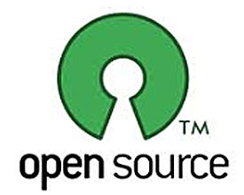

# **H**ow to Choose the Best License for Your Open Source Software Project

–
Paul Rubens,
CIO

**October 01, 2013**

You need sound coding skills to create good software, but the
success of an open source project can also depend on something much less glamorous: your choice of software license**.**

That's because the license under which you make your code available has a real impact on what you can do with your code, who will contribute to it,
and ultimately whether it gets widely used or ignored**.**

"If you are hoping to get your code incorporated into a bigger system then some open source licenses may put people off," says Mark Johnson,
development manager at [OSS Watch](http://www.oss-watch.ac.uk/) , an organization that provides advice and guidance on
the use, development, and licensing of free and open source software**.**

"If you use the [Gnu General Public License (GPL)](http://www.gnu.org/licenses/gpl.html) , for example, some people
won't touch it as they'll be worried about incorporating GPL code into their product**.** On the other hand, if you don't use the GPL then some developers
simply won't be prepared to contribute, so picking the right license really depends on who you are targeting your software at**.**"

As an independent developer you are under no obligation to use any license at all, but that may have unintended consequences**.** That's because
many people believe that by providing no licensing terms they are releasing it into the public domain**.** In fact, the reverse turns out to be the case: If you
release your code without any license then it is automatically copyrighted**.** That means that no-one can reproduce, distribute, or create derivative works
from it**.**

If you really want to turn your code over to the public domain, the surest way is to offer it with an "[unlicense](http://unlicense.org/) " -- a notice that combines a copyright waiver with a no-warranty statement, and which allows anyone to "copy, modify,
publish, use, compile, sell, or distribute the software, either in source code form or as a compiled binary, for any purpose, commercial or non-commercial,
and by any means**.**"

### 3 Types of Open Source Licenses

But if you want your project to be truly open source then you need an appropriate license, and the easiest way to understand the many licenses
that are available is to divide them in to three broad categories:

• Strong copyleft  
• Weak copyleft  
• Permissive

The concept of copyleft is designed to be the opposite of copyright -- it allows software to be freely copied and shared**.** Specifically, when a program
is copylefted the copyright is asserted, and distribution terms are added which gives others the right to use, modify and redistribute the source code, or
any program derived from that code, on condition that these distribution terms are left unchanged**.**

So what is the difference between a strong copyleft license and a weak copyleft one**?**

The answer is that while a strong copyleft license -- such as the GPL -- uses these distribution terms, a weak copyleft license -- such as the GNU [Lesser General Public License (LGPL)](http://www.gnu.org/licenses/lgpl.html)  -- uses slightly less strict licensing terms, so a
larger group of people can make use of the software **.**

For example, the LGPL is often used to license software libraries to encourage their usage**.** It does this by allowing non-free or closed source
programs to use the libraries, which can be useful if they do the same job as widely used non-free libraries**.** "In this case, there is little to gain by limiting
the free library to free software only," the LGPL explains in its preamble**.**

Permissive licenses -- as the name suggests -- allow users to do even more with the code than strong or weak copyleft licenses such as the GPL or
LGPL**.** "One reason you may use a permissive license is if you don't mind what people do with your code, including adding their own proprietary features
to it themselves," says Johnson**.** "There's a more obvious reason for adopting a permissive license as well: so that you can develop an open source base
to a product, with help from other contributors, and then add your own proprietary features yourself," he adds**.**

The best known permissive licenses include the [MIT License](http://opensource.org/licenses/MIT)  adopted by widely
used applications like jQuery and Rails, and the [Apache License](http://www.apache.org/licenses/)  used by applications
including SVN and, of course, Apache**.**

But there is a potential drawback to using a permissive license, says Johnson**.** Other developers may be unwilling to contribute their own code to
your open source project if it is licensed in this way, either for ideological reasons or because they may be unwilling to help any commercial project
without being recompensed themselves, he says**.**

### Cloud Loophole in Copyleft Licenses

It turns out that there is what could be regarded as a minor loophole in the wording of many copyleft licenses including the GPL when it comes to
the availability of source code**.**

Essentially the issue is this: under the GPL (and other licenses,) source code must be made available for any modified software that you distribute**.**
But if someone modifies your code and then offers the software as a service -- from the cloud, or using a server-based computing model , for example --
then they never actually distribute the new software**.** That means that they don't have to make the modified source code available for others to benefit
from, which goes against the open source ideal**.**

"To get around this, licenses such as the GNU [Affero General Public License
(AGPL)](http://www.gnu.org/licenses/agpl-3.0.html)  have a stipulation that users who access the software over a network are also entitled to receive the source code for the application," says
Johnson**.**

### Online Tools for Choosing Open Source Licenses

There are some useful online tools that can help you choose and understand open source licenses, including:

• [OSS Watch's License differentiator](http://www.oss-watch.ac.uk/apps/licdiff/)   
• [Github's Choose a license tool](http://choosealicense.com)   
• [Open Source Initiative's Open Source Licenses page](http://opensource.org/licenses/)

### Non-Software Licenses Needed for Image, Sound, Video Portions of Project

Copyleft and permissive licenses are appropriate for open source software projects, but Johnson points out that some parts of a project need other
types of licenses**.** "If you have images, sound or video, for example, you need to provide an appropriate license for those**.** You may want to look at a [Creative Commons license](http://creativecommons.org/licenses/)  for those types of assets," he says**.**

### Take Time to Fully Understand the Terms of Open Source Licenses

Johnson recommends getting independent advice and setting aside plenty of time to read and fully understand the terms of any license you are
considering**.**

"Don't underestimate this," he says**.** "Some licenses are just a few lines and can be understood in a few minutes**.** But some are much longer -- the
GPL, for example, is a small essay**.**"

*Paul Rubens is a technology journalist based in England**.** Contact him at paul@rubens.org.Follow everything from CIO.com on Twitter [@CIOonline](http://www.twitter.com/CIOonline) , on [Facebook](http://www.facebook.com/CIOfacebook) , and on
[Google +](https://plus.google.com/108803539780596310930/posts?hl=en) **.***

© 2013 CXO Media Inc**.**
