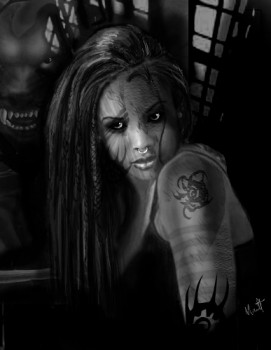
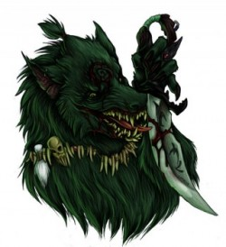
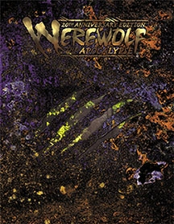

# [Os Dançarinos da Espiral Negra – Lobisomem: O Apocalipse](http://livrodosespelhos.com/os-dancarinos-da-espiral-negra-lobisomem-o-apocalipse/)

20/09/2013

[2 Comentários](http://livrodosespelhos.com/os-dancarinos-da-espiral-negra-lobisomem-o-apocalipse/#comments "Comentário para Os Dançarinos da Espiral Negra – Lobisomem: O Apocalipse")

A história dos **Dançarinos da Espiral Negra** é cheia de vergonha**.** Antes uma Tribo de orgulhosos [**Guerreiros de Gaia**](http://livrodosespelhos.com/as-tribos-de-lobisomem-o-apocalipse/ "As Tribos de Lobisomem: O Apocalipse")  conhecida por **Uivadores Brancos**, esses lobisomens de origem celta decaíram quando encontraram um labirinto – o **Labirinto Espiral** – em uma caverna**.** Foram seduzidos pela chance de glória e pela possibilidade de enfrentar a **Wyrm** diretamente, então a maior parte da Tribo desceu para o labirinto para emergir de lá completamente insana e distorcida**.** Agora, eles dançavam a espiral da loucura em favor da Wyrm**.** Entretanto, não foram todos os membros da Tribo que afundaram de uma vez**.** A queda destes outrora orgulhosos Garou foi gradual e os últimos Uivadores Brancos foram tragados para o Labirinto Espiral antes da queda do Império Romano, depois de uma valente defesa na infame Seita do Lago-Profundo**.**

Essa Tribo guarda marcas de sua descida pela espiral**.** Suas formas Crinos são disformes e de um preto/verde escuro e bilioso ou branco doentio, de narizes de morcego e guinchos de escárnio**.** Mesmo aqueles que escapam dessas formas retorcidas e apresentam imensa beleza possuem uma espécie de brilho louco no olhar**.**

Os Dançarinos podem nascer dentro da Tribo ou serem adotados de outras, como acontece com Garou decaídos ou filhotes mestiços**.** Os métodos de reprodução da Tribo são tão questionáveis quanto suas intenções: seus **Parentes** vivem em meio ao abuso, drogas, violência e degradação de toda forma, quando são sortudos o suficiente para não serem presos no fundo de uma Colmeia, como são chamados os *caerns* da Tribo**.** Os menos sortudos são acorrentados e sujeitos a estupros e toda sorte de violência durante suas curtas vidas**.** A geração de filhotes **Impuros** é vista como uma boa tática para aumentar os números da Tribo**.**

Aqueles que têm o azar de ser Parente desta Tribo não são as pessoas mais… estáveis e sãs**.** São indivíduos inexoravelmente atraídos pela Corrupção da Wyrm**.** Pior ainda são os raros, mas infelizes Parentes lupinos desta Tribo, geralmente aprisionados em cativeiros miseráveis – com sorte, conseguem estar em uma reserva, para azar de um eventual… viajante inocente que pise em uma reserva onde exista um Parente lobo desta Tribo corrompida**.**

Dançarinos da Espiral Negra passam por Ritos de Passagem e tem postos como os outros Garou**.** No entanto, são medidos por quão avançados estão na dança da espiral da Wyrm**.** Um filhote só passa à vida adulta quando finalmente dança a espiral e em geral seu nome adulto é a primeira palavra que o Garou fala quando volta de sua viagem louca**.**

A tribo segue uma versão própria da **Litânia** conhecida como **Litania Negra** e é completamente fanática pela Wyrm, ainda que sigam facetas diferentes dela como indivíduos**.** Da mesma forma, apesar de serem completamente insanos, muitos Dançarinos podem parecer completamente inofensivos e funcionais em forma humana – até que seja tarde demais**.** Muitos Dançarinos trabalham dentro da própria **Pentex** ou seguem agendas particulares com suas alcateias**.**

Os Dançarinos modernos são uma paródia dos demais lobisomens**.** A maioria deles possui mutações diversas e desfigurações que sugerem a sua corrupção**.** Na forma Crinos, podem possuir malformações cranianas, e seus olhos geralmente ardem como uma chama de um verde doentio ou um vermelho alarmante**.** Aqueles que são recrutados de outras tribos parecem uma versão distorcida do que é o ideal de sua Tribo original**.** Entretanto, alguns podem vir a apresentar a aparência de um Uivador Branco, com pelos de um branco muito puro, herdando algo da linhagem de seus desafortunados ancestrais**.**

Compre a edição de 20 anos de Lobisomem: O Apocalipse

### Campos

- Cluithi
- Consultores
- Geração Hex
- Irregulares Genéticos

> *Você vai entender**.***  
>  *Depois de passar pelos portões, seus sentidos vão se abrir**.***  
>  *Você vai sentir o cheiro das feridas podres,*  
>  *ouvir as vozes sob a pele da terra**.***  
>  *Você vai ver a verdade sobre o mundo quando a ilusão for arrancada**.***  
>  *Venha dançar com a gente.*  
>  *Você vai entender**.***

**Fonte:** Lobisomem: O Apocalipse 3ª Edição, Werewolf: the Apocalypse 20th Anniversary Edition e Book of Wyrm Revised Edition  
**Imagens:** [Black Spiral Dancer](http://childofdune.deviantart.com/art/Black-Spiral-Dancer-Clr-136969032 "Black Spiral Dancer")  por Childofdune e [Black Spiral Dancer](http://www.elfwood.com/~mfoster/Black-Spiral-Dancer.3033763.html "Black Spiral Dancer")  por Matthew Foster  
**Autora:** Emi  
**Extras:** Eva
