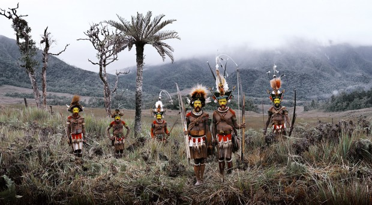
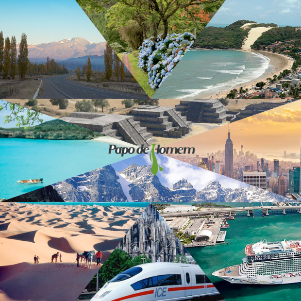

Como você escolhe para onde vai viajar? Seria muito mais fácil se desse para seguir aquela ideia romântica de girar um globo e ir para o país que o dedo apontasse. 

Mas a vida não é assim e decisões costumam ser bem mais complicadas. Felizmente, todo mundo tem preferências. Ou você consegue imaginar aquele seu amigo fresco desembarcando [na Índia](http://papodehomem.com.br/180-dias-na-india/)? Ou quem sabe alguém que odeia frio partindo para Sibéria?

Ainda bem que o mundo é grande o bastante para agradar a todos os gostos, manias e obsessões. E também interessante o suficiente para surpreender aos que estão abertos a pensar fora da caixinha.

Pensando em algumas dessas possibilidades, preparei um guia de como escolher um destino de viagem, levando em consideração diferentes tipos de personalidade.

### Party Like Hell

Ibiza

Tem gente que viaja com uma ideia na cabeça: **festas, festas e festas**. No meio disso, costumam estar mulheres e bebedeira. Apesar dessa não ser exatamente a minha praia, não faltam destinos no mundo que se encaixem nessas características.

Para quem quer ir dormir quando o mundo inteiro acordar, a melhor opção é pensar lugares que já tenham festas tradicionais ou fama de baladas históricas.

Como [Ibiza](http://pt.wikipedia.org/wiki/Ibiza) pode ser fora da realidade financeira de muita gente, opções como [Barcelona](http://pt.wikipedia.org/wiki/Barcelona), também na Espanha, ou [Rimini](http://pt.wikipedia.org/wiki/Rimini), na Itália podem ser mais acessíveis. Festa na praia também é o que não falta na [Tailândia](http://pt.wikipedia.org/wiki/Tail%C3%A2ndia), que celebra a Festa da Lua Cheia durante todo o ano.

A Europa também tem cidades com fama de boas baladas. Entra elas, destaco [Praga](http://pt.wikipedia.org/wiki/Praga), que é extremamente barata; [Berlim](http://pt.wikipedia.org/wiki/Berlim), **onde as festas duram até 72 horas**; e [Amsterdã](http://pt.wikipedia.org/wiki/Amesterd%C3%A3o) com seus Coffeeshops.

***Dica de ouro:** quem quer curtir baladas como se não houvesse amanhã, pode marcar suas férias de acordo com o calendário de festas do mundo. Por exemplo, vale ter folga no final de setembro para aproveitar o [Oktoberfest](http://pt.wikipedia.org/wiki/Oktoberfest), em [Munique](http://pt.wikipedia.org/wiki/Munique), na Alemanha. Ou em agosto, para ir ao [Burning Man](http://pt.wikipedia.org/wiki/Burning_Man), em [Nevada](http://pt.wikipedia.org/wiki/Nevada), Estados Unidos*

### Sombra e água fresca

Bora Bora

Indo na contramão dos festeiros, tem gente que só quer saber de ficar deitado de pernas para o ar e não fazer nada além de relaxar em uma viagem.

Essas pessoas podem até ir a uma festinha aqui, um tour acolá, mas nada muito longo ou cansativo. **Se obrigação e horário são coisas que você não quer nem ouvir** durante as suas férias, seu lugar no mundo, em geral, envolve praia ou montanha.

Um resort no [Caribe](http://pt.wikipedia.org/wiki/Caribe) ou um hotelzinho aconchegante nos [Andes](http://pt.wikipedia.org/wiki/Cordilheira_dos_Andes) parece ser bem a sua cara. O Brasil é um país ótimo para quem só quer relaxar, porque as praias no nordeste, cidades históricas em Minas ou o friozinho no Sul são opções que atendem esses desejos.

***Dica de ouro:** uma boa opção para quem só quer curtir o ócio é escolher lugares próximos à vinícolas. Por exemplo, a região da [Toscana](http://pt.wikipedia.org/wiki/Toscana), na Itália, combina paisagens lindas, com vinhos, queijos e tranquilidade. [Chile](http://pt.wikipedia.org/wiki/Chile) e [Argentina](http://pt.wikipedia.org/wiki/Argentina) também tem regiões que combinam vinho e conforto, fora que são opções mais em conta.*

### Indiana Jones

Nova Zelândia

Correr, atravessar um rio, escalar uma montanha, mergulhar num mar gelado…

Se essas são as memórias das férias perfeitas para você, sem dúvida seu destino é um lugar que preencha todos os requisitos do seu espirito de aventura.

Para pessoas com esse perfil, na maioria das vezes o lugar certo para viajar é aquele que oferece bastante contato com a natureza e fonte inesgotável de adrenalina.

A [Nova Zelândia](http://pt.wikipedia.org/wiki/Nova_Zel%C3%A2ndia) é um destino bem tradicional para quem curte esse tipo de atividade, porque o país oferece surf, esqui, snowboarding, caminhadas e escaladas, além do bungee jumping — tudo isso combinado a um visual incrível.

***Dica de Ouro:** quem não tem como ir para o outro lado do mundo, pode correr atrás de aventura nos nossos vizinhos. O [deserto do Atacama](http://pt.wikipedia.org/wiki/Deserto_de_Atacama), o [Salar de Uyuni](http://pt.wikipedia.org/wiki/Salar_de_Uyuni), [Machu Picchu](http://pt.wikipedia.org/wiki/Machu_Picchu) e a [trilha Inca](http://pt.wikipedia.org/wiki/Caminhos_Incas), [Torres del Paine](http://pt.wikipedia.org/wiki/Parque_Nacional_Torres_del_Paine) e a [Patagônia](http://pt.wikipedia.org/wiki/Patag%C3%B3nia) – todos esses são exemplos de lugares aqui na América do Sul que incluem aventura e paisagens impressionantes, imperdíveis para quem curte emoção.*

### Choques culturais

Papua-Nova Guiné

***Obs do editor:** quem parou para ler com mais calma essa parte do artigo, não deixe também de ler o artigo [Antes que eles deixem de existir: 29 tribos e culturas que resistem aos nossos tempos](http://papodehomem.com.br/antes-que-eles-deixem-de-existir-29-tribos-e-culturas-que-resistem-aos-nossos-tempos/). Lindo.*

Quanto mais diferente, melhor.

Para a turma que tem como objetivo ver tudo que há de diferente no mundo, comer as comidas mais estranhas, conversar com monges tibetanos, entre outros, a Ásia pode ser um destino de intermináveis surpresas. Os templos em [Angkor Wat](http://pt.wikipedia.org/wiki/Angkor_Wat), no [Camboja](http://pt.wikipedia.org/wiki/Camboja), são únicos, misturando arquitetura, religião e arqueologia num cenário digno de filme ou videogame.

O [Nepal](http://pt.wikipedia.org/wiki/Nepal) é outro país que parece ser de outro planeta, com suas montanhas nevadas, construções diferentes e povo simpático. A [Indonésia](http://pt.wikipedia.org/wiki/Indon%C3%A9sia) combina praias com uma cultura rica e uma religião bem diferente da que estamos acostumados. E não dá para esquecer da África: [Quênia](http://pt.wikipedia.org/wiki/Qu%C3%A9nia), [Nigéria](http://pt.wikipedia.org/wiki/Nig%C3%A9ria), [Etiópia](http://pt.wikipedia.org/wiki/Eti%C3%B3pia) são países que tem que estar na *bucket list* de quem quer ver um mundo diferente.

***Dica de ouro:** Se é para ter um choque cultural de verdade, a [Incredible India](http://pt.wikipedia.org/wiki/%C3%8Dndia) é, sem dúvida, o melhor destino. No mesmo [rio Ganges](http://pt.wikipedia.org/wiki/Rio_Ganges), o rio sagrado, dá para fazer rafting na nascente, em [Rishikesh](http://en.wikipedia.org/wiki/Rishikesh), e depois presenciar as cerimônias de cremação de corpos, em [Varanasi](http://pt.wikipedia.org/wiki/Varanasi).*

*A Índia tem templos, fortes, elefantes e camelos. Tem pobreza, riqueza, sujeira, bagunça e todos os outros ingredientes para deixar qualquer viajante experiente impressionado. Eu, que morei lá e já contei essa experiência por aqui, nunca deixo de recomendar uma visita.*

***Mas só se essa viagem se encaixar no seu perfil**.*

### Tradicional, mas nem tanto

High Line, em Nova Iorque

Essa opção pode ser vista por muitos como mais chata do que as outras. Mas não precisa ser. Não é porque a pessoa quer conhecer lugares tradicionais, nem pensa em ficar em hostel e não tem muito ânimo para aventuras extremas, que a viagem tem que ser chata.

Afinal, para o turista tradicional, o mundo está cheio de destinos, em especial na [Europa](http://pt.wikipedia.org/wiki/Europa) e nos [Estados Unidos](http://pt.wikipedia.org/wiki/Estados_Unidos). A dica para quem vai conhecer clássicos como [Paris](http://pt.wikipedia.org/wiki/Paris) ou [Nova York](http://pt.wikipedia.org/wiki/Nova_Iorque) não é sobre qual lugar visitar, **mas sim o que não fazer**.

Evitar excursões com 395 pessoas e mal organizadas é sempre uma boa ideia.

*Dica de ouro: Ficar mais dias em menos cidades. O mínimo de tempo necessário para ficar num lugar como [Roma](http://pt.wikipedia.org/wiki/Roma) ou [Londres](http://pt.wikipedia.org/wiki/Londres) são 5 dias.*

*Mas, mesmo isso, sem dúvida é pouco (vão sobrar lugares para conhecer). O ideal é planejar um roteiro para realmente conhecer os locais com calma — menos sempre é mais. Assim, uma viagem de férias não se torna cansativa ou frustrante.*

**Nota do editor:** seria interessantíssimo ver esse post ser alimentado também pelos leitores. Há mais estilos de viajantes e viagens? Dá pra combinar estilos? quais outros lugares possuem festas fodas, lugares deliciosos e escondidos, aventuras incríveis, quais cidades clássicas porem render surpresas na hora de viajar? O que não falta é assunto pra ser colocado aqui embaixo, nos comentários.

### Mecenas: [Agaxtur 60 anos](http://bit.ly/16c1dFb)

*Agora que você sabe como escolher melhor o destino para sua viagem, ficou mais fácil escolher entre as 60 opções de destinos que a [Agaxtur](http://bit.ly/16c1dFb) separou para comemorar seus 60 anos de história.*

*O PapodeHomem separou dez dos mais bacanas:*

- *[Mendoza](http://bit.ly/19IlBlK)*
- *[Canadá](http://bit.ly/1emvBlD)*
- [*México – Cidades históricas*](http://bit.ly/GOhrxY)
- *[Nova Iorque](http://bit.ly/18fkoBW)*
- *[Serra Gaúcha](http://bit.ly/1emvBlD)*
- *[Natal](http://bit.ly/1emvF4V)*
- *[Curaçao](http://bit.ly/1bsn6DY)*
- *[Marrocos](http://bit.ly/1cS8C3V)*
- *[Alemanha de Trem](http://bit.ly/1fAcacj)*
- [*Norwegian Epic*](http://bit.ly/H3gUc8)

*É só escolher pra onde quer ir e entrar [no site deles](http://bit.ly/16c1dFb).*
