O que é criatividade?

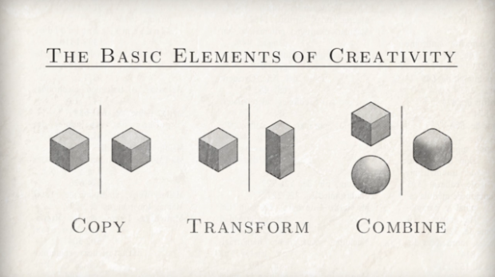

“Copiar, transformar e combinar”

Ciência, campo do cérebro humano, habilidade, talento ou dom divino?

Cientificamente ou filosoficamente, eu sinceramente não sei, mas, quanto mais experiência eu tenho trabalhando como criativo, mais eu questiono essa palavra.

Hoje em dia, até ando duvidando bastante do uso dessa palavra. A “criatividade” tem sido constantemente usada como muleta por pessoas despreparadas. Sempre que recebo um trabalho sem o famoso [briefing](http://pt.wikipedia.org/wiki/Briefing), mas com os dizeres “quero um trabalho criativo”, já prevejo sérios problemas.

A criatividade é construção, planejamento e muita, mas muita referência.

### A referência e o repertório

Exemplos sempre ajudam a fortalecer uma ideia. [Quentin Tarantino](http://www.imdb.com/name/nm0000233/), considerado por muitos um dos maiores nomes do cinema atual e um dos mais criativos. Provavelmente você conhece o cara e, como eu você, gosta do trabalho dele. Rato de locadoras e junkbox, **ele é um liquidificador de referências**.

Se, por algum motivo, você não sabia disso dá uma olhada no Everything is a Remix, que o jader Pires publicou aqui no PapodeHomem, no artigo “[Você não é criativo](http://papodehomem.com.br/voce-nao-e-criativo/)“.

> none

> Kirby Ferguson é um diretor, roteirista e montador americano que atualmente trabalha em uma série de quatro webvídeos com o intuito, não de desmistificar nomes atrelados a grandes feitos considerados inéditos ou únicos, mas sim de desmistificar o seu pensamento de que grandes coisas acontecem de lugar nenhum.
>
> Intitulado *[Everything is a Remix](http://www.everythingisaremix.info/)*, o documentário é dividido em quatro partes (três delas já disponibilizadas) e conta como todas as coisas que admiramos hoje em dia na chamada cultura pop (música, cinema, tecnologia) são nada mais que cópias de outras coisas que deixamos de admirar (ou não admiramos por não ter a mesma visibilidade).
>
> O mesmo ocorre com o mito das invenções e seus considerados inventores geniais. Não que todos os grandes nomes da ciência e tecnologia não são, de uma forma ou de outra, grandes mentes fazendo grandes coisas, mas considerar uma ideia inventiva, algo único, pontual e genuíno, é equivocar-se demais.

Se você é um cara experiente, já manja bem do que estou falando. Mas se você é um novato deve estar pensando “porra! como assim criatividade não existe e tudo não passa de cópia?”.

Calma, jovem! Vamos a mais um exemplo.

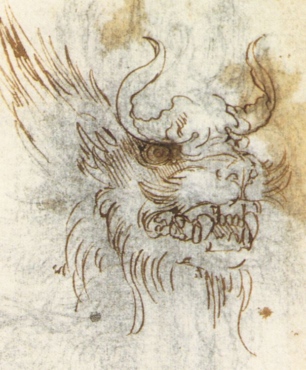

O dragão do Da Vinci

[Leonardo da Vinci](http://pt.wikipedia.org/wiki/Leonardo_da_Vinci), um dos maiores [artífices](http://pt.wikipedia.org/wiki/Art%C3%ADfice) da humanidade (e porque não dizer, um dos homens mais criativos que já andou nas quebradas deste mundão), tinha muitos projetos feitos e muita coisa inacabados. Um desses projetos é o livro *O Trattato della pittura*, ou *[Tratado da pintura](http://pt.wikipedia.org/wiki/Trattato_della_Pittura)*. Este livro possui escritos técnicos do Da Vinci sobre desenho, pintura e filosofia. Em um desses escritos, o pintor italiano fala sobre a criação de monstros, mais especificamente dragões.

> none

> “Sabes que não podes inventar animais sem membros, e cada um destes, por si só, de assemelhar-se aos de qualquer outro animal.
>
> Dai que, se quiseres fazer com que um animal, inventado por ti, pareça natural — digamos que um dragão –, toma a cabeça de um mastim ou sabujo para sua cabeça, com os olhos de um gato, as orelhas de um porco-espinho, o nariz de um perdigueiro, a testa de um leão, as têmporas de um galo velho, o pescoço de uma tartaruga-d’água.”

Como eu disse lá em cima, o assunto criatividade é estudados por vários fodões como [Vygotsky](http://pt.wikipedia.org/wiki/Lev_Vygotsky), [Dostoiévski](http://pt.wikipedia.org/wiki/Fi%C3%B3dor_Dostoi%C3%A9vski), [Damásio](http://pt.wikipedia.org/wiki/Ant%C3%B3nio_Dam%C3%A1sio), [Leó Szilárd](http://pt.wikipedia.org/wiki/Le%C3%B3_Szil%C3%A1rd), [Jonas Salk](http://pt.wikipedia.org/wiki/Jonas_Salk) etc. e quem sou eu para dizer se ela existe ou não?

Mas se um mestre como Leonardo Da Vinci acredita no poder da construção e da referência visual, eu é que não vou discordar.

### Pensando nisso tudo, como ser um criativo e inovador?

Cada um tem a sua forma ou método de trabalho e maneiras pessoais de como criar a uma linha de pensamento para chegar em um objetivo criativo. A minha é simples e bem parecida com a do Tarantino: **ser um rato de portfólio**.

Foda-se o Twitter, Facebook, Orkut. Se você quer trabalhar com criação — ou criação de imagens para ser mais especifico –, você tem que ser viciado em outras redes sociais, como [Flickr](http://www.flickr.com/), [Behance](http://www.behance.net/), [Tumblr](https://www.tumblr.com/), [Pinterest](https://www.pinterest.com/), [Instagram](http://instagram.com/) e não se limitar a isso. Sua maior ferramenta e o que você deve mais treinar **é o seu olhar**.

Como Leonardo Da Vinci mostrou, para se criar algo você tem que criar primeiro um Frankstein.

Precisa estar sempre se abastecendo de informações ou referências, só assim você vai saber o que está sendo feito e como se aproveitar disso. Só se cria algo novo com base no que já foi criado, até mesmo para destruir um conceito que você acha velho e ultrapassado, há que ser especialista neste conceito.

Ou você pode fazer igual ao [Banksy](http://pt.wikipedia.org/wiki/Banksy) e roubar mesmo:

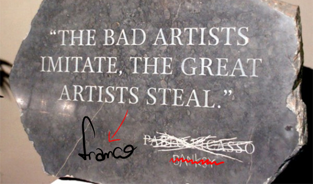

“O artista ruim imita. O grande artista rouba”. Essa frase já foi do Picasso um dia. E do Banksy. Hoje, ela é minha.

### [Pixel Show!](http://www.pixelshow.com.br/)

Essa semana, em São Paulo, vai rolar o [Pixel Show](http://www.pixelshow.com.br/), um dos maiores eventos no Brasil sobre as artes gráficas, animação, ilustração, fotografia, design e todas as variações disso tudo.

O evento vai contar com muita gente foda. Um momento bem interessante pra caçar boas referências. Aproveita e procurem mais os trampos de alguns dos participantes da edição deste ano e, se me verem por lá, me paguem uma breja.

***Obs:** o PapodeHomem é apoiador oficial do [Pixel Show](http://www.pixelshow.com.br/) e os leitores que quiserem ir, terão um desconto de 20% na entrada. Basta usar o promocode **papodehomem20%.***

### Tipocali (Brasil): Tipografia

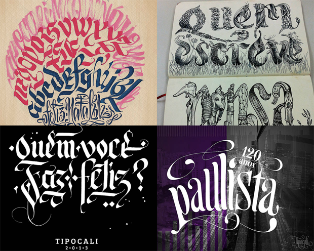

Thiago Reginato é sócio do estúdio Maquinário – Laboratório Criativo e fundador do TIPOCALI. No período de 2011 e 2012, em que trabalhava na agência A10, deu workshops em diversos lugares e participou como palestrante no Ndesign, na ESPM, no Estúdio Catarina Gushiken, Semana Tipográfica Bauru, entre outros.

Seu objetivo com o TIPOCALI é cada vez mais conectar diferentes áreas da criação com a tipografia e a caligrafia, explorando e experimento novos produtos e serviços que beneficiem o mercado e a sociedade.

### Techno Image (Brasil): Ilustração Publicitária

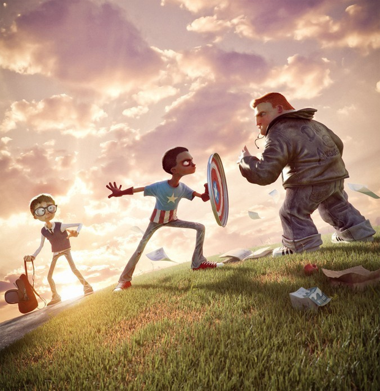

O estúdio Techno Image é um grupo de profissionais originários das mais diversas áreas ligadas às artes gráficas. Trabalham com peças em 3D, pinturas, concept arts, ilustração a traço, manipulação de imagens ou o produto da soma de tudo isso.

Em sua lista de clientes estão: Philips, Gol, Brastemp, Nike, Editora Abril, entre outros.

### Bárbara Veiga (Brasil): Fotografia

Cinegrafista e Fotojornalista brasileira que passou sete anos engajada em causas socioambientais internacionalmente, percorrendo mais de 50 países entre Ásia, África, Oriente Médio, Oceania e Europa. E por mar!

Seu trabalho reúne obras de arte cheias de simbolismo, combinando sua formação jornalística e a paixão pela arte visual. Barbara trabalhou em renomadas ONG’s, tais como: Amazon Watch, Avaaz, Greenpeace e Sea Shepherd. Também participou na série de TV Whale Wars, da Discovery Channel. A artista passou dois anos trabalhando em campanhas na Antártida junto ao canadense Paul Watson, documentando ações contra o ataque baleeiro no Pólo Sul, além de ter feito um audacioso trabalho de espionagem contra o massacre de baleias-piloto nas Ilhas Faroe.

Barbara Veiga palestrou no TED e fez exposições itinerantes pela França e Alemanha.

### Mcbess (Reino Unido): Ilustração

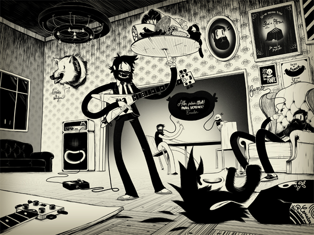

Mcbess, nascido Matthieu Bessudo, é um ilustrador francês que vive em Londres. Seu estilo mistura referências a desenhos animados antigos usando formas contemporâneas, símbolos e fontes, e seus desenhos frequentemente consistem de retratos dele mesmo cercado por um mundo surrealista cheio de comida e referências musicais como amplificadores, guitarras e letras de músicas.

Já apareceu em revistas famosas como Justapox e Illustrated Ape, e fez parte de exposições realizadas em Londres, Hamburgo, Tóquio, Los Angeles e Chicago.

### Mauricio de Souza (Brasil): Quadrinhos

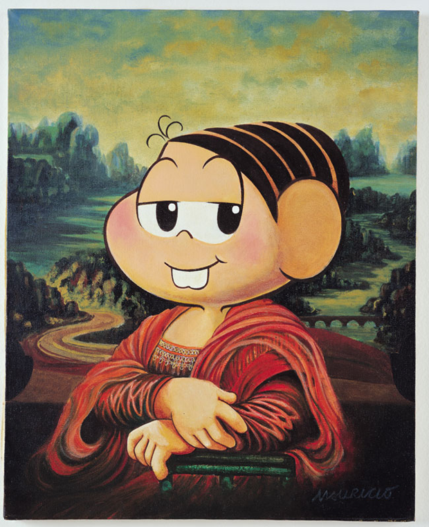

Mauricio de Sousa nasceu no interior São Paulo e já rabiscava coisas durante sua infância nos cadernos e livros escolares.

Aos 19 anos, mudou-se para a capital do estado e começou a trabalhar no Jornal Folha da Manhã (atual Folha de São Paulo). Depois de publicar tirinhas com diversos personagens já conhecidos – Bidu, Cebolinha, Franjinha… –, Mauricio lançou, em 1970, a revista Mônica, que atualmente é publicada pela Panini. Entre quadrinhos e tirinhas, suas criações alcançam 30 países e o autor já alcançou o número de 1 bilhão de revistas publicadas.

Mônica foi reconhecida como Embaixadora da UNICEF em 2007 e Embaixadora do Turismo Brasileiro em 2008.

### Eduardo Srur (Brasil): Intervenção urbana

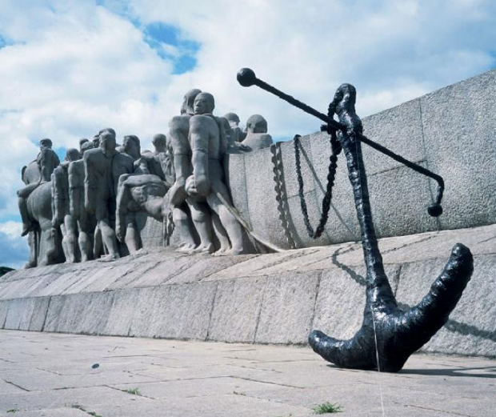

Eduardo Srur trabalha e mora em São Paulo e começou sua trajetória de artista visual com a pintura.

A partir de 2002, passou a investigar novas mídias como a fotografia, escultura, video, performance, instalação e a intervenção urbana. Atualmente, sua produção atual é voltada ao espaço público, onde ele realiza exposições temporárias que questionam o sistema social de forma crítica e bem-humorada, além de alterar a paisagem da cidade.

Já expôs em diversas instituições culturais no Brasil e em países como França, Espanha, Inglaterra e Cuba.

### Moment Factory (Canadá): Mapping e cenografia

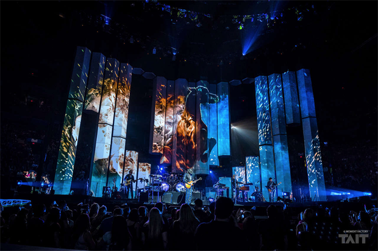

A Moment Factory é um estudio especializado na concepção e produção de ambientes multimedia combinando vídeo, luz, arquitetura, som e efeitos especiais para criar experiências marcantes.

Desde seu início em 2001, o estudio – que conta com mais de 110 colaboradores que ocupam o espaço de 20.000 metros quadrados em Montreal – já tem em sua bagagem mais de 300 eventos, shows e instalações ao redor do mundo para clientes como Cirque du Soleil, Disney, Nine Inch Nails, Céline Dion, Bon Jovi, Arcade Fire e Madonna.

### Nawer (Polônia): Grafitti Futurista

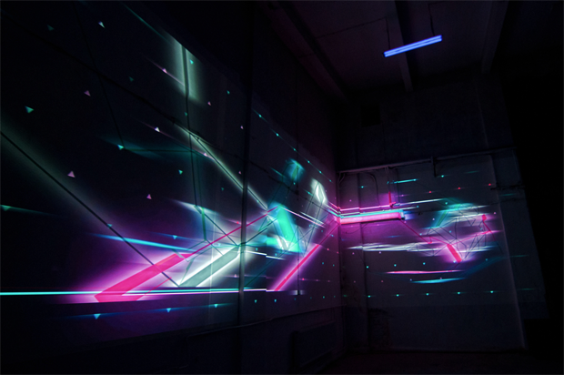

Nawer é arquiteto, designer e artista de rua, graduado no programa de Arquitetura e Urbanismo de Krakow.

Se envolveu com a arte de rua desde meados dos anos 90, e em 2003, começou a dedicar seu tempo entre para a pintura e a freelances de design de interiores. Seu estilo, que sempre busca conectar pintura e arquitetura, é geométrico e isométrico, usando objetos no espaço e o spray para fazer pinturas em perspectiva.

A combinação dessas duas abordagens dá frescor ao ramo de design de disposição e criatividade de um espaço interior.

### MK12 (Estados Unidos): Motion Graphics

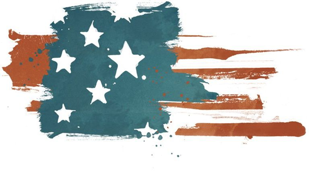

Com sede em Kansas City, Missouri, MK12 é um coletivo de design e cinema fundado em 2000 com propósito de produzir conteúdo original que evoluiu em um estúdio de serviço completo, adaptando sua marca única em filmagem para créditos iniciais de filmes, animações para games, vídeo clipes, material de anúncio, entre outros.

O trabalho do estúdio constantemente desafia os limites entre a estrutura narrativa e a maneira experimental de contar histórias justapondo live action, design gráfico, influência nostálgica e novas tecnologias. O estúdio já teve seus curtas exibidos em festivais mundiais como a Bienal de São Paulo e o Sundance; teve vídeo clipes nomeados a importantes prêmios como o MTV Video Music Awards e o Grammy e seu trabalho também pode ser visto na sequência inicial do Rock Band Green Day e Beatles.

### Sam Van Doorn (Holanda): Design Ggráfico

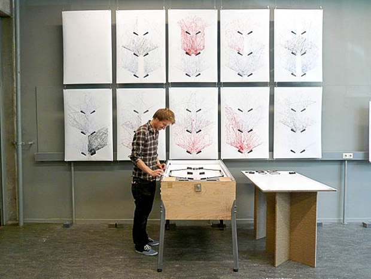

Sam van Doorn é um designer gráfico holandês famoso por elaborar projetos únicos, dinâmicos e interativos, que conversam com o usuário e o incentivam a encontrar a mensagem por trás de cada composição ou plataforma interativa.

### Sérgio Gordilho (Brasil: agência ÁFRICA): Design Gráfico

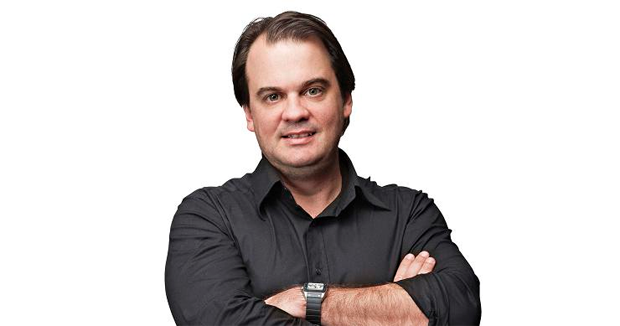

Um dos maiores diretores de arte do mercado de design gráfico, Sérgio Gordilho tem tem diploma em Arquitetura, pós-graduação em Design Gráfico na Royal College of Art, em Londres, e um MBA em Liderança Criativa na Berlin School.

Ele é sócio e co-presidente da Agência África e seus inúmeros cases bem sucedidos contribuíram para a forte reputação da agência e ajudou-a a tornar-se uma referência em criação original e eficiência.

### Sandro Di Segni (Brasil) Efeitos Especiais

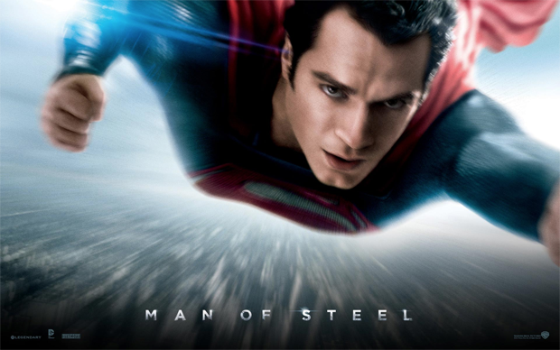

Diretor Técnico de Efeitos Especiais Sandro Di Segni viveu os últimos 15 anos entre os grandes estúdios de animação e efeitos 3D do Canadá, Ásia e Inglaterra.

Saiu do Brasil para estudar na melhor escola em computação gráfica, a Vancouver Film School (VFS), e aprendeu a criar no computador os ambientes mágicos e acontecimentos impossíveis de se filmar. Agora, em sua volta ao país, traz na bagagem a experiência de ter participado de superproduções internacionais, como “Homem de Aço”, “Thor – O Mundo Sombrio”, “Harry Potter e as Relíquias da Morte – Parte 2”, e de séries para TV, como “Star Wars: Guerra dos Clones”, “Max Steel”, “Hot Wheels” e “Spider Man”.
