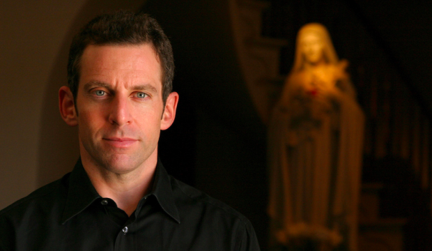
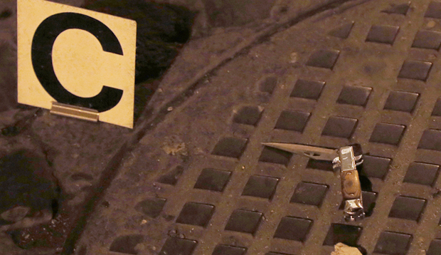

# **O** que as artes marciais tem a ver com a meditação e o ateísmo**?**

*Uma entrevista sobre autodefesa e o lado sedutor da fé**.***

*Sam Harris é melhor conhecido como um [expressivo oponente da fé religiosa, neurocientista, palestrante e autor de alguns best-sellers](http://www.samharris.org/) **.** Mas ele também é estudante de artes marciais e autodefesa armada, além de praticante diário de meditação silenciosa**.***

Sam Harris

Na edição de maio de *[The Atlantic](http://www.theatlantic.com/)* , [recontei a experiência](http://www.theatlantic.com/magazine/archive/2013/05/the-atheist-who-strangled-me/309292/)  de aprender meditação e jiu-jitsu brasileiro com ele**.**

Harris está terminando seu próximo livro, “Waking Up: Science, Skepticism, Spirituality”(Acordando: Ciência, Ceticismo, Espiritualidade), sobre auto-transcendência na ausência de religião**.** Durante esse encontro, discutimos sobre violência, fé e meditação**.**

Faca vista em uma rua no centro da cidade de Roma após uma briga em 2012**.** (Yara Nardi/Reuters)

**Graeme: Você preferiria ser atacado por uma pessoa com uma faca ou vários indivíduos desarmados, mas igualmente com a intenção de te matar**?****

**Sam:** Ambas as situações são convites a uma direção: você quer fugir**.**

Um de meus professores, [Mark Mikita](http://fightology.com/) , é especialista em luta com faca, principalmente a derivada das artes marciais filipinas**.** Um dos professores dele lhe disse: “Se você treinar comigo durante dez anos e alguém puxar uma faca pra você, e você apenas se virar e ir embora, então todo o seu treinamento vai ter tido êxito**.**” Os problemas com uma faca ou com vários agressores são semelhantes, eles raramente terminam bem para uma pessoa que está só e desarmada**.**

Até mesmo caso você saiba se defender contra uma pessoa, ao combater várias, ocorre uma situação imensamente diferente**.** Você pode ser um campeão Golden Gloves, contudo, enquanto você confronta seu primeiro atacante, você já terá uma ou mais pessoas partindo pra cima**.** Subestimar a gravidade deste problema é uma das ilusões mais perigosas que um praticante de artes marciais pode cometer**.**

É verdade que agressores menos preparados costumam partir pra cima em série, um após o outro e, se você for habilidoso, você pode prevalecer sob um de cada vez**.** Mas se você for atacado por várias pessoas ao mesmo tempo, isso se torna um problema para o qual nenhuma arte marcial tem uma solução**.** Só portando algum tipo de arma provavelmente o faria prevalecer em uma situação assim**.**

De forma semelhante, um ataque com faca é sempre um desastre para uma pessoa desarmada**.** Alguém que sai de 10 anos em uma prisão de segurança máxima se graduou em como improvisar uma faca e esfaquear o outro com ela**.** Uma pessoa que realmente está com a intenção de te matar com uma faca não irá te atacar da forma como você aprendeu nas aulas de artes marciais**.**

A maioria dos praticantes de artes marciais treina táticas de defesa onde seus parceiros atacam de uma forma muito estereotipada – lançando-se adiante com um único golpe e deixando o braço ao alcance de forma que você possa executar a técnica**.** Isto é apenas uma encenação de combate, com que podemos nos enganar perigosamente**.**

A realidade de um ataque com faca é que, mesmo que você interrompa 50% dos golpes e agressões, você estará se lesando ao fazer qualquer tipo de movimento**.** E ser cortado por uma faca de qualquer tamanho é fisiologicamente terrível de um jeito que poucas pessoas entendem**.** É bem pior do que ser baleado. Uma bala é uma bola minúscula de metal que pode ou não atingir algo vital**.** A menos que você atire em alguém no crânio ou coração, você basicamente espera até que a perda de sangue incapacite a pessoa**.**

Uma faca – especialmente nas mãos de alguém que sabe usá-la – dilacera tudo o que toca, e não falha ou fica sem balas**.** Também é muito mais difícil de lutar com uma pessoa que empunha uma faca porque você não pode agarrá-la sem cortar os dedos**.**

**Um livro chamado *Put ‘em down, Take ‘em out: Técnicas de Luta com Faca da Prisão Folson* foi uma das coisas mais assustadoras que já li, e que me fez ter medo das facas**.** Mas eu também não tinha certeza se gostaria de ser o tipo de pessoa que pensa muito sobre isso**.** Eu gostava de andar pelo mundo sem imaginar meu sangue arterial sendo projetado do meu corpo**.** Te incomoda pensar tanto assim em autodefesa?**

Você pode pensar nestes fatos às vezes e até mesmo ser motivado por eles, sem ser mórbido**.** Lidar com a violência de um patamar totalmente diferente**.** Uma pessoa pode ler *The Fate of the Earth*, de Jonathan Schell, que descreve a catástrofe global que seria se EUA e Rússia se atacassem com bombas nucleares, guardar o livro na estante, e se lembrar do conceito básico: que uma guerra nuclear nessas proporções seria inimaginavelmente tão terrível que se torna algo a ser evitado a todo custo**.** Ter visitado estes cantos do inferno, mesmo que brevemente, torna-se algo útil, para se ter uma compreensão inteligente das realidades envolvidas**.**

Uma obsessão com autodefesa pode parecer paranóia, especialmente se você vive em uma parte segura do mundo desenvolvido**.** A vasta maioria de nós nunca vai se confrontar com violência real, desde que, estupidamente, não procuremos por isso**.** Mas quando você considera as estatísticas relacionadas a crimes violentos, você pode ser pego de surpresa ao descobrir que isso não é como se preocupar com um acidente de avião**.** É mais como um acidente de carro.

Nunca estive em um acidente de carro sério, mas não acho irracional considerar dirigir como algo intrinsecamente perigoso**.** Quando você realmente analisa a fundo e admite que ter certas habilidades de autodefesa é algo válido, você descobre que pode ser imensamente divertido as adquirir**.** A realidade do que você começa a aprender é bem sombria quando você olha para sua possível aplicação no mundo real, e com certeza uma pessoa pode se tornar bitolada ao passar muito tempo pensando sobre violência**.** Mas não há nada de mórbido sobre praticar artes marciais – ou mesmo praticar com revólveres, facas e outras armas**.**

**Alguma vez você vivenciou uma situação de violência grave**?****

De forma significante, não.

Uma vez, quando calouro em Stanford, cruzei com três caras que abusavam de um cão amarrado a um parquímetro**.** Por azar, eu tinha passado o dia bebendo com amigos e tinha aproximadamente cinco watts de consciência da situação**.** Ou seja, não estava em condição de me defender, ou ao cão**.** Mas tentei discutir com eles. A próxima coisa que me lembro foi estar me levantando depois de ter batido a cabeça**.** Eu já estava fora da briga antes mesmo de haver percebido que havia começado**.** Claro que, considerando o que disse há pouco sobre vários agressores, não sei se a situação teria sido muito diferente se estivesse sóbrio**.**

**Você mencionou que ter uma família te deixou mais consciente quanto à segurança pessoal**.** Isso teve algum efeito sobre como você pensa sobre religião**?** Daniel C. Dennett, que quando muito criança perdeu o pai, afirmou que a habilidade dos pais em consolar suas crianças através da religião talvez seja suficiente em si mesma para explicar a sobrevivência da crença religiosa**.****

A religião oferece a única história que fundamentalmente servirá de consolo em face às piores possíveis experiências – a morte de um dos pais, por exemplo**.** Na realidade, muitas religiões removem por completo tais experiências, pois seus seguidores acreditam fervorosamente que irão se reunir com todas as pessoas que amam e que a morte é uma ilusão**.** Não há nenhum substituto racional para esse tipo de consolo e penso que nós, ateus, precisamos admitir isto**.**

Mas podemos pôr isso de lado, junto com tudo mais que abandonamos na infância, e não nos tornarmos mais carentes por causa disso**.** Existe uma sombra de falso conforto que impede as pessoas de lidarem honestamente com aflições e perdas**.** Se você realmente acredita que sua pessoa amada está à direita do trono de Jesus, não existe mais o motivo de seu sofrimento**.** Ouvi de outras pessoas que afirmaram que o apoio que frequentemente receberam dos amigos religiosos pareceu lhes ser um modo de evitar a realidade de seu sofrimento**.**

Dizer algo como, “Ela está em um lugar melhor” me soa como uma total falha de compaixão**.** É uma afirmação falsa motivada pelo próprio medo da morte – e pelo desconforto na presença da dor de outra pessoa**.** Há muito mais sabedoria e compaixão ao se aceitar a magnitude da perda que a outra pessoa sofre e as nossas próprias inevitáveis perdas, sem fingir sabermos coisas que não sabemos**.**

Como pai, é minha responsabilidade ensinar meu filho a fazer isto – sentir a dor quando o sofrimento for necessário e perceber que, ainda assim, a vida continua sendo algo profundamente bonito e válido, apesar do fato de que inevitavelmente vamos todos morrer e que não sabemos o que acontece após a morte**.**

**Yanagi Ryuken, um praticante de aikido no Japão, conseguiu convencer muitas pessoas – dentre elas, ele mesmo – de que tinha dominado o “no-touch knockout”: uma habilidade que derrota os oponentes sem sequer tocar neles**.** O primeiro destes dois vídeos que você discutiu em seu artigo sobre jiu-jitsu brasileiro, [“Os prazeres de se afogar”](http://www.samharris.org/blog/item/the-pleasures-of-drowning) , mostra Yanagi se livrando de vários de seus alunos, sem qualquer esforço, enquanto eles parecem tentar atacá-lo:**

**No segundo vídeo, ele confronta um praticante de artes marciais livre dessa delusão, e esse praticante golpeia Yanagi no rosto e na cabeça**.****

**Os alunos de Yanagi parecem estar sob algum tipo de feitiço**.** Por que eles estariam dispostos a sustentar a crença de Yanagi por tanto tempo**?** Estamos vendo um fenômeno do tipo religioso?**

Esses vídeos desafiam descrição**.** Eles são a manifestação física dos mesmos tipos de argumentações errôneas e auto-engano que vemos na religião – com a crucial diferença que, nas artes marciais, é possível expor as concepções errôneas de uma pessoa, em tempo real, para que todos vejam**.**

Mas o que é incrível – e isto deveria realmente preocupar as pessoas de fé – é que, mesmo nas artes marciais, uma pessoa pode persistir numa ilusão durante décadas, juntar discípulos e se tornar um famoso mestre de sua falsa disciplina sem saber que está completamente fora de contato com a realidade**.**

Este maluco não consegue nem começar a fazer o que ele acha que consegue – no que aparentemente tornou-se renomado – porque a habilidade que ele demonstra e que seus alunos se esforçam para imitar não existe**.** A coisa toda é uma ilusão coletiva**.** Se religião fosse um esporte, poderia ser vista como o primeiro vídeo**.** Já o segundo vídeo, claro, seria o que a ciência tem feito à religião, repetidamente, nos últimos séculos**.**

Não é tão simples entender como a ilusão de Yanagi se criou e se estabeleceu**.** Mas, a partir do momento em que todos os alunos começaram a cair por toda parte, fica fácil perceber como isso se manteve**.**

Imagine do ponto de vista dele: se você pensasse que poderia derrubar as pessoas a uma distância, e então seus alunos, sugestionados, concordassem, ano após ano, você poderia começar a acreditar que realmente teria estes poderes**.** Em menor grau, este é um problema em muitas artes marciais: já que, para treinar a maioria das técnicas sem se machucar, você tem que permitir pequenos elementos de fantasia**.** Cutucar alguém no olho realmente termina uma briga**?** As pessoas que fizeram isto em combate provavelmente sabem, mas milhões de praticantes de artes marciais fingem enfiar o dedo um do outro nos olhos durante o treino, sem jamais saberem o que aconteceria se realmente tentassem isto pra valer**.**

Você não pode treinar com facas verdadeiras porque poderia ser morto no primeiro dia**.** Então você treina com facas de plástico ou borracha, e você começa a perder a visão do quão distante está da realidade**.** Isto sempre acontece em certo grau, não importando quão bem embasada na técnica a instrução seja**.**

Claro que, no caso de Yanagi, é mais difícil ver como um novo estudante seria subjugado baseado na virtude de sua própria ilusão**.** Mas existe muita pressão social para se confirmar um dogma declarado**.** Não é que as pessoas precisem fingir estas coisas conscientemente**.** Elas podem ser levadas por um processo paralelo a fingir isto sem jamais confrontarem o fato de que estão fingindo**.**

É como a cura pela fé**.** Uma pessoa pode ser induzida a uma performance pela performance de outras**.**

**Você estudou com peritos em artes marciais, como [Ryron Gracie](http://www.gracieacademy.com/generations_ryron.asp)  no jiu-jitsu brasileiro, e com peritos em meditação, como [Tulku Urgyen Rinpoche](http://en.wikipedia.org/wiki/Tulku_Urgyen_Rinpoche) **.** Especialistas nestas duas áreas tem alguma coisa em comum**?****

Ryron me impacta como uma pessoa muito meditativa, embora eu não saiba se ele pratica meditação**.** Alguns instrutores de Jiu-Jitsu Brasileiro vivem altamente turbinados com níveis elevados de testosterona e muito musculosos**.** Mas Ryron é o sujeito mais agradável que você pode encontrar**.** Há algo no Jiu-Jitsu Brasileiro, como arte marcial, que tangencia um projeto mais contemplativo de auto-transcendência**.**

No Jiu-Jitsu Brasileiro as ilusões auto-centradas da pessoa são anuladas logo no início**.** Você não consegue fingir ser bom no Jiu-Jitsu Brasileiro nem por 30 segundos**.** Enquanto você treina, a existência de outra pessoa com habilidade superior à sua é uma sombra constante**.** Também há algo de meditativo sobre a experiência de rolar com um parceiro – como são chamados os *sparrings* – embora de modo algum isso seja um caminho direto para o insight meditativo**.**

Quando você está na presença de um verdadeiro mestre de meditação, as habilidades dele não são tão aparentes**.** E se todo mundo ao redor desta pessoa está se comportando como se ele fosse o messias, o auto-engano fica óbvio**.** A vida espiritual pode certamente seguir o mesmo padrão daquele visto nas falsas artes marciais, com a maioria dos professores fazendo afirmações mágicas e duvidosas que nunca são testadas, enquanto seus alunos se enganam com ideias estranhas, rituais vazios e outras afetações**.** **No entanto, a meditação é uma habilidade que pode ser ensinada**.** Auto-transcendência é um experimento que pode ser repetido**.****

Uma forma de descrever esse experimento: coloque uma atenção cuidadosa na natureza de sua própria mente – no fluxo de pensamentos, estados, sensações e percepções do presente – e você poderá notar que o sentimento de ser uma pessoa, um ego, um criador de pensamentos no meio da experiência, é uma ilusão**.**

Quer dizer que você pode realmente descobrir a ausência do sentimento que chama “eu”**.** Você ainda terá pensamentos, estados, sensações, percepções, mas estará claro que não existe nenhum ego andando por aí, na sua cabeça, como sendo o dono destas experiências**.** Esta é uma descoberta que pode ser feita e reproduzida, e ter cada parte dela verificada – igual é com as técnicas no Jiu-jitsu**.**

**Minha própria experiência com meditação me trouxe uma calma e serenidade inesperadas**.** Mas achei que isso me desarmou analiticamente e baniu muitos pensamentos que normalmente eu tomava como produtivos**.** A meditação entra em conflito com o pensamento produtivo**?****

Não**.** Sua mente estará ativa em qualquer caso, não importa quanto você medite**.** A meta não é permanecer sem pensamento, mas estar atento ao caráter de sua experiência em cada momento e não sofrer desnecessariamente**.** Quase todo nosso sofrimento é produto de nossos pensamentos**.** Nós passamos quase todo tempo de nossas vidas perdidos em pensamentos e reféns do caráter desses pensamentos**.**

Você pode quebrar este feitiço, mas é preciso treinamento, assim como é preciso treinamento para se defender contra uma agressão física**.** Você está pensando a todo momento e não está atento a isto, e a experiência inicial de qualquer um que tenta seriamente meditar é a descoberta do quão incessante é esta cascata de pensamentos**.**

É provavelmente verdade que determinadas realizações humanas dependem das vontades neuróticas que as pessoas tem por atingir metas ou de sua ganância por dinheiro ou poder**.** Um monte de arte é motivada a partir de ilusões autocentradas**.** E, se uma pessoa permanentemente dispersasse a ilusão de uma identidade, ela talvez não vá escrever grandes romances ou começar a próxima Apple**.** O estado de Buda poderia ser incompatível com o próximo Nabokov ou Steve Jobs**.** Felizmente, ninguém nunca teve que escolher entre ser um grande artista ou empresário ou o próximo Buda**.**

Para mim, a pergunta relevante é o quão neuróticos e infelizes e deludidos temos que estar para termos vidas produtivas**.** Penso que a resposta é “muito menos do que a maioria de nós é”**.**

**Sua carreira como um dos Novos Ateus envolve entrar no que a maioria descreveria como brigas que não se pode vencer, argumentando com adversários que simplesmente nunca concordarão com você**.** A maioria das pessoas, quando confrontada com adversários irritantemente teimosos, dá de ombros e segue em frente**.** Você considera que sua vontade de lutar é um sinal de uma mente fundamentalmente inquieta**?** Talvez você precise da meditação mais que a maioria de nós**.****

É fácil entender mal – intelectual, ética, e psicologicamente – a situação vendo de fora**.** Estas brigas não são de fato impossíveis de se ganhar**.** Eu constantemente redescubro o que significa ganhar**.**

É algo raramente visível para aqueles que estão assistindo o embate**.** Por exemplo, se eu fizer um debate público com um rabino ou um pastor ou algum outro representante fundamentalista, sei muito bem que ele não vai mudar sua crença enquanto debate comigo na frente de mil pessoas**.** No entanto, fico sabendo de pessoas que assistem estes debates e têm suas crenças modificadas por completo**.** E isto inclui pessoas que, em outro contexto, poderiam ter sido inflexíveis da mesma maneira que meu oponente no debate – rabinos, pastores, padres, fundamentalistas convictos, etc**.**

Mentes podem mudar. E até mesmo culturas inteiras podem mudar, depressa e radicalmente**.**

Quando entendermos sobre bem-estar humano melhor do que entendemos hoje e começarmos a conversar sobre toda a gama de experiências espirituais no contexto de uma visão de mundo mais racional, empírica e baseada em evidências, as pessoas vão ver que não existe jogo que valha a pena ser jogado e melhor o seja em uma igreja, sinagoga ou mesquita**.**

Ninguém nunca me acusou de ser um otimista, mas eu acho que a razão e a honestidade intelectual vão prevalecer**.** Elas são úteis demais.

***Nota do editor:** texto publicado originalmente na [The Atlantic](http://www.theatlantic.com/national/archive/2013/04/what-martial-arts-have-to-do-with-atheism/275273/) **.** Licenciado para republicação mediante acordo com o autor**.** E traduzido com maestria pela **[Myla Fonseca](https://www.facebook.com/myla.fonseca)** **.***
